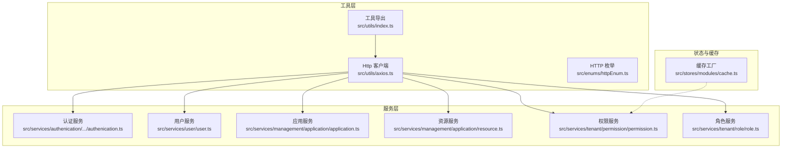
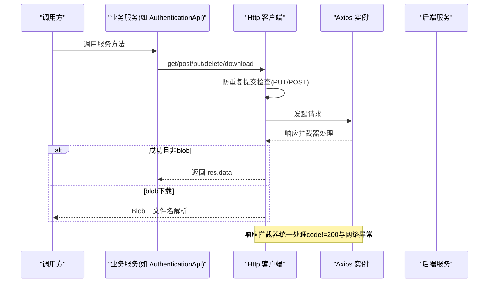
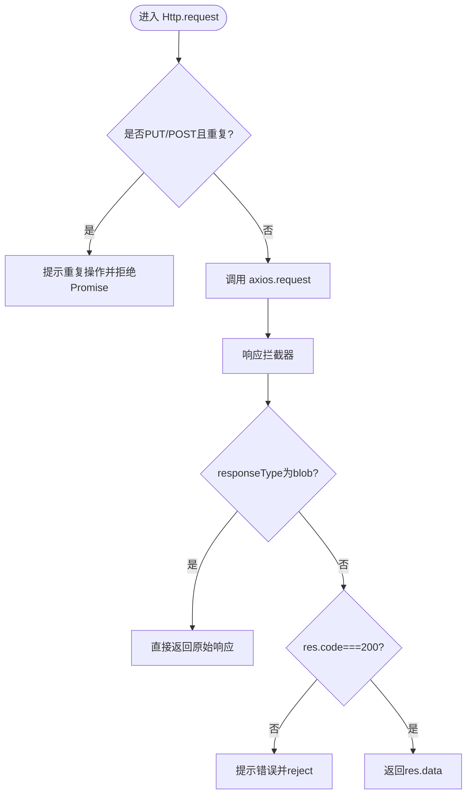
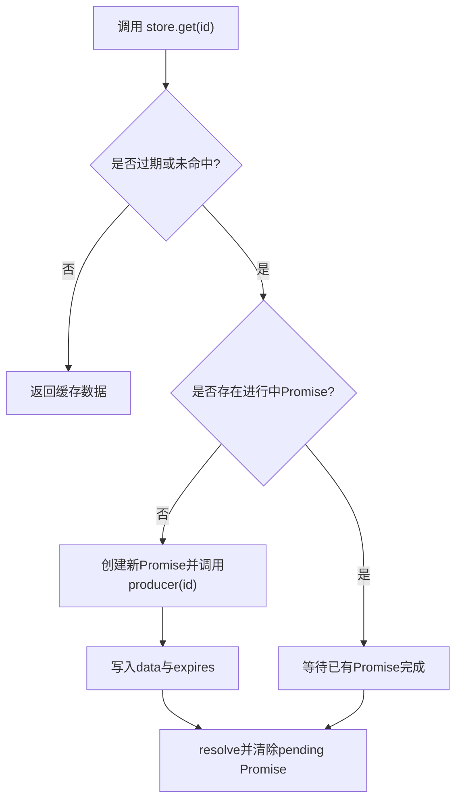
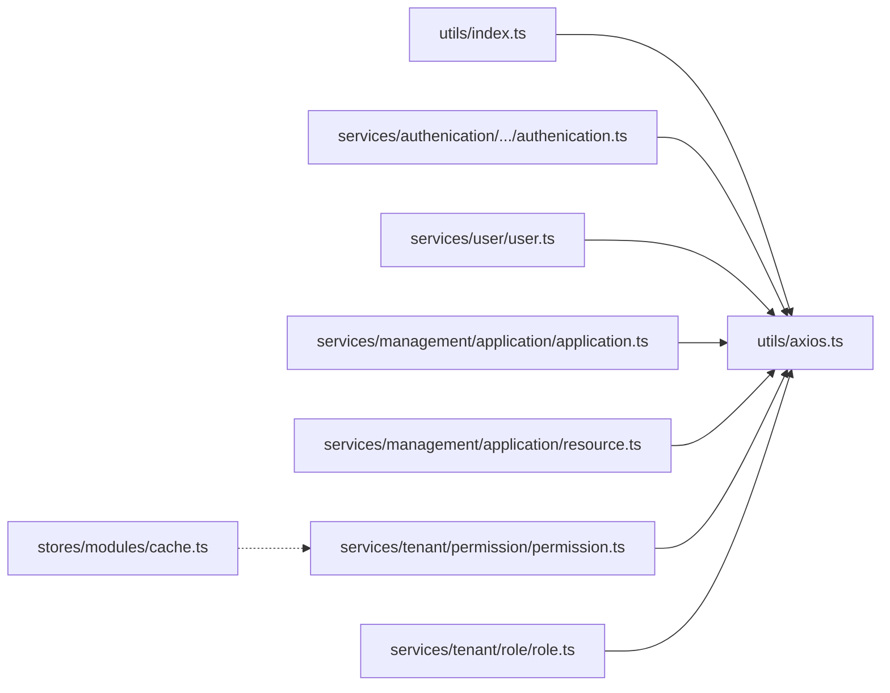

# API服务层

<cite>
**本文引用的文件**   
- [axios.ts](file://src/utils/axios.ts)
- [index.ts](file://src/utils/index.ts)
- [httpEnum.ts](file://src/enums/httpEnum.ts)
- [authenication.ts](file://src/services/authenication/authenication/authenication.ts)
- [user.ts](file://src/services/user/user.ts)
- [application.ts](file://src/services/management/application/application.ts)
- [resource.ts](file://src/services/management/application/resource.ts)
- [permission.ts](file://src/services/tenant/permission/permission.ts)
- [role.ts](file://src/services/tenant/role/role.ts)
- [cache.ts](file://src/stores/modules/cache.ts)
</cite>

## 目录
1. [简介](#简介)
2. [项目结构](#项目结构)
3. [核心组件](#核心组件)
4. [架构总览](#架构总览)
5. [详细组件分析](#详细组件分析)
6. [依赖关系分析](#依赖关系分析)
7. [性能与优化](#性能与优化)
8. [故障排除指南](#故障排除指南)
9. [结论](#结论)
10. [附录：API接口清单](#附录api接口清单)

## 简介
本文件面向前端工程中的“API服务层”，系统性说明HTTP客户端封装、请求拦截器配置、错误处理机制，以及各业务服务模块的职责、接口定义、参数校验与响应处理。同时涵盖认证与权限控制、缓存策略的实现细节，并提供最佳实践、性能优化建议与排障方法，帮助开发者快速理解并高效扩展该服务层。

## 项目结构
API服务层由以下关键部分组成：
- HTTP客户端封装：统一创建Axios实例、设置基础URL与超时、注册响应拦截器、提供常用方法与下载能力
- 枚举常量：统一的请求方法与Content-Type定义
- 业务服务模块：按领域划分的服务类（认证、用户、应用管理、资源管理、租户权限与角色等）
- 缓存工具：基于Pinia的轻量级数据缓存工厂，支持过期与并发去重

**图表来源**
- [axios.ts:5-126](file://src/utils/axios.ts#L5-L126)
- [httpEnum.ts:4-24](file://src/enums/httpEnum.ts#L4-L24)
- [index.ts:9-9](file://src/utils/index.ts#L9-L9)
- [authenication.ts:19-26](file://src/services/authenication/authenication/authenication.ts#L19-L26)
- [user.ts:18-35](file://src/services/user/user.ts#L18-L35)
- [application.ts:12-22](file://src/services/management/application/application.ts#L12-L22)
- [resource.ts:34-44](file://src/services/management/application/resource.ts#L34-L44)
- [permission.ts:117-166](file://src/services/tenant/permission/permission.ts#L117-L166)
- [role.ts:18-47](file://src/services/tenant/role/role.ts#L18-L47)
- [cache.ts:4-44](file://src/stores/modules/cache.ts#L4-L44)

**章节来源**
- [axios.ts:5-126](file://src/utils/axios.ts#L5-L126)
- [httpEnum.ts:4-24](file://src/enums/httpEnum.ts#L4-L24)
- [index.ts:9-9](file://src/utils/index.ts#L9-L9)

## 核心组件
- Http 客户端：封装Axios实例、拦截器、防重复提交、下载与通用方法
- 枚举常量：RequestEnum、ContentTypeEnum
- 业务服务：AuthenticationApi、UserApi、ApplicationApi、ResourceApi、PermissionApi、RoleApi
- 缓存工厂：useCacheStore，提供带过期时间的内存缓存与并发保护

**章节来源**
- [axios.ts:5-126](file://src/utils/axios.ts#L5-L126)
- [httpEnum.ts:4-24](file://src/enums/httpEnum.ts#L4-L24)
- [authenication.ts:19-26](file://src/services/authenication/authenication/authenication.ts#L19-L26)
- [user.ts:18-35](file://src/services/user/user.ts#L18-L35)
- [application.ts:12-22](file://src/services/management/application/application.ts#L12-L22)
- [resource.ts:34-44](file://src/services/management/application/resource.ts#L34-L44)
- [permission.ts:117-166](file://src/services/tenant/permission/permission.ts#L117-L166)
- [role.ts:18-47](file://src/services/tenant/role/role.ts#L18-L47)
- [cache.ts:4-44](file://src/stores/modules/cache.ts#L4-L44)

## 架构总览
下图展示从调用方到后端接口的完整链路，包括拦截器、错误处理与下载流程。

**图表来源**
- [axios.ts:36-66](file://src/utils/axios.ts#L36-L66)
- [axios.ts:68-103](file://src/utils/axios.ts#L68-L103)
- [axios.ts:104-125](file://src/utils/axios.ts#L104-L125)
- [authenication.ts:19-26](file://src/services/authenication/authenication/authenication.ts#L19-L26)

## 详细组件分析

### HTTP客户端封装（Http）
职责与特性：
- 初始化Axios实例：读取环境变量作为baseURL，设置全局超时
- 响应拦截器：
  - 对非blob响应进行统一code校验，失败时提示并reject
  - 对网络异常或特定状态码（如403）进行友好提示
  - 清理防重复标记
- 防重复提交：针对PUT/POST在短时间内的重复请求进行拦截并提示
- 通用方法：get/post/put/delete，以及download(blob下载与文件名解析)

**图表来源**
- [axios.ts:68-103](file://src/utils/axios.ts#L68-L103)
- [axios.ts:36-66](file://src/utils/axios.ts#L36-L66)

**章节来源**
- [axios.ts:5-126](file://src/utils/axios.ts#L5-L126)

### 枚举常量（HTTP）
- RequestEnum：GET、POST、PATCH、PUT、DELETE
- ContentTypeEnum：JSON、TEXT、FORM_URLENCODED、FORM_DATA

用途：统一HTTP方法与内容类型，避免硬编码。

**章节来源**
- [httpEnum.ts:4-24](file://src/enums/httpEnum.ts#L4-L24)

### 认证服务（AuthenticationApi）
职责：
- 获取当前员工信息
- 根据租户代码获取租户相关认证信息

接口概览：
- GET /authorization-sub/authentication
- GET /authorization-sub/authentication/{tenantId}

**章节来源**
- [authenication.ts:19-26](file://src/services/authenication/authenication/authenication.ts#L19-L26)

### 用户服务（UserApi）
职责：
- 分页查询用户列表
- 获取单个用户
- 新增用户
- 更新用户（含id校验）

接口概览：
- GET /demo/user?page=...
- GET /demo/user/{id}
- POST /demo/user
- PUT /demo/user/{id}

注意：update在未传入id时直接返回本地提示，未发起请求。

**章节来源**
- [user.ts:18-35](file://src/services/user/user.ts#L18-L35)

### 应用服务（ApplicationApi）
职责：
- 分页查询应用
- 获取单个应用
- 创建应用

接口概览：
- GET management/application?page=...
- GET management/application/{id}
- POST management/application

**章节来源**
- [application.ts:12-22](file://src/services/management/application/application.ts#L12-L22)

### 资源服务（ResourceApi）
职责：
- 为应用添加元素、API等资源
- 删除指定类型的资源

接口概览：
- POST .../{applicationCode}/element
- POST .../{applicationCode}/api
- DELETE .../application/{applicationCode}/type/{type}/code/{code}

**章节来源**
- [resource.ts:34-44](file://src/services/management/application/resource.ts#L34-L44)

### 权限服务（PermissionApi）
职责：
- 权限列表与详情
- 权限创建、删除
- 绑定资源
- 获取用户权限与资源树
- 获取角色已绑定的权限集合

接口概览：
- GET /tenant/permission
- GET /tenant/permission/{permissionCode}
- POST /tenant/permission
- DELETE /tenant/permission/{permissionCode}
- PUT /tenant/permission/{permissionCode}/resource
- GET /tenant/permission/user/{uid}
- GET /tenant/permission/resource
- GET /tenant/permission/{roleId}/permission

数据处理：
- one/getPermissionResource等方法对返回数据进行树形转换与应用过滤

**章节来源**
- [permission.ts:117-166](file://src/services/tenant/permission/permission.ts#L117-L166)

### 角色服务（RoleApi）
职责：
- 角色分页查询
- 角色创建、更新、删除
- 获取角色下员工列表

接口概览：
- GET /tenant/role
- POST /tenant/role
- PUT /tenant/role/{code}
- DELETE /tenant/role/{code}
- GET /tenant/role/{roleCode}/user

注意：update/delete在未传入code时返回本地提示，不发起请求。

**章节来源**
- [role.ts:18-47](file://src/services/tenant/role/role.ts#L18-L47)

### 缓存策略（useCacheStore）
职责：
- 基于Pinia的轻量级缓存工厂
- 支持按id缓存数据，默认过期时间10分钟
- 并发保护：同一id的多次请求合并为一个Promise
- 提供data与get(id)访问方式

典型用法：
- 将服务方法包装为producer，通过useCacheStore(name, producer)生成store
- 在组件中调用store.get(id)获取数据，自动处理过期与并发

**图表来源**
- [cache.ts:11-37](file://src/stores/modules/cache.ts#L11-L37)

**章节来源**
- [cache.ts:4-44](file://src/stores/modules/cache.ts#L4-L44)

## 依赖关系分析
- utils/index.ts 暴露 http 单例，供所有服务模块使用
- 各服务模块仅依赖 http 与必要类型定义，保持低耦合
- 缓存工厂独立于HTTP层，可被任意服务组合使用

**图表来源**
- [index.ts:9-9](file://src/utils/index.ts#L9-L9)
- [axios.ts:5-126](file://src/utils/axios.ts#L5-L126)
- [authenication.ts:19-26](file://src/services/authenication/authenication/authenication.ts#L19-L26)
- [user.ts:18-35](file://src/services/user/user.ts#L18-L35)
- [application.ts:12-22](file://src/services/management/application/application.ts#L12-L22)
- [resource.ts:34-44](file://src/services/management/application/resource.ts#L34-L44)
- [permission.ts:117-166](file://src/services/tenant/permission/permission.ts#L117-L166)
- [role.ts:18-47](file://src/services/tenant/role/role.ts#L18-L47)
- [cache.ts:4-44](file://src/stores/modules/cache.ts#L4-L44)

**章节来源**
- [index.ts:9-9](file://src/utils/index.ts#L9-L9)
- [axios.ts:5-126](file://src/utils/axios.ts#L5-L126)

## 性能与优化
- 防重复提交：对PUT/POST在短时间内的重复请求进行拦截，减少无效网络开销与副作用
- 统一超时与重试：建议结合业务场景增加重试策略（指数退避），并在拦截器中记录耗时用于监控
- 下载优化：blob下载路径已分离，建议在服务端配合合适的Content-Disposition与分块传输
- 缓存优先：对读多写少的数据（如权限树、菜单、字典）使用useCacheStore，降低后端压力
- 分页与懒加载：列表接口应支持分页；大对象按需拉取
- 类型安全：充分利用TS泛型与接口定义，减少运行时错误

[本节为通用建议，无需具体文件引用]

## 故障排除指南
常见问题与定位思路：
- 接口报错提示“系统错误”或“没有权限”
  - 检查响应拦截器中对error.response.status的处理逻辑
  - 确认后端返回的msg字段是否正确
- 下载失败
  - 检查responseType是否为blob
  - 检查服务端Content-Disposition是否包含filename
- 重复提交导致操作失败
  - 观察控制台提示“操作过快，请不要重复操作”
  - 检查是否在短时间内多次触发PUT/POST
- 缓存未生效或数据陈旧
  - 检查useCacheStore的过期时间与producer实现
  - 确认调用方是否正确使用get(id)

**章节来源**
- [axios.ts:36-66](file://src/utils/axios.ts#L36-L66)
- [axios.ts:104-125](file://src/utils/axios.ts#L104-L125)
- [cache.ts:11-37](file://src/stores/modules/cache.ts#L11-L37)

## 结论
本API服务层以Http客户端为核心，统一了请求生命周期、错误处理与下载能力；各业务服务模块职责清晰、接口明确；配合useCacheStore可实现高效的内存缓存与并发控制。在此基础上，建议逐步完善认证鉴权、请求重试、日志埋点与Mock测试，进一步提升稳定性与可维护性。

[本节为总结性内容，无需具体文件引用]

## 附录：API接口清单
- 认证服务
  - GET /authorization-sub/authentication
  - GET /authorization-sub/authentication/{tenantId}
- 用户服务
  - GET /demo/user
  - GET /demo/user/{id}
  - POST /demo/user
  - PUT /demo/user/{id}
- 应用服务
  - GET management/application
  - GET management/application/{id}
  - POST management/application
- 资源服务
  - POST .../{applicationCode}/element
  - POST .../{applicationCode}/api
  - DELETE .../application/{applicationCode}/type/{type}/code/{code}
- 权限服务
  - GET /tenant/permission
  - GET /tenant/permission/{permissionCode}
  - POST /tenant/permission
  - DELETE /tenant/permission/{permissionCode}
  - PUT /tenant/permission/{permissionCode}/resource
  - GET /tenant/permission/user/{uid}
  - GET /tenant/permission/resource
  - GET /tenant/permission/{roleId}/permission
- 角色服务
  - GET /tenant/role
  - POST /tenant/role
  - PUT /tenant/role/{code}
  - DELETE /tenant/role/{code}
  - GET /tenant/role/{roleCode}/user

**章节来源**
- [authenication.ts:19-26](file://src/services/authenication/authenication/authenication.ts#L19-L26)
- [user.ts:18-35](file://src/services/user/user.ts#L18-L35)
- [application.ts:12-22](file://src/services/management/application/application.ts#L12-L22)
- [resource.ts:34-44](file://src/services/management/application/resource.ts#L34-L44)
- [permission.ts:117-166](file://src/services/tenant/permission/permission.ts#L117-L166)
- [role.ts:18-47](file://src/services/tenant/role/role.ts#L18-L47)