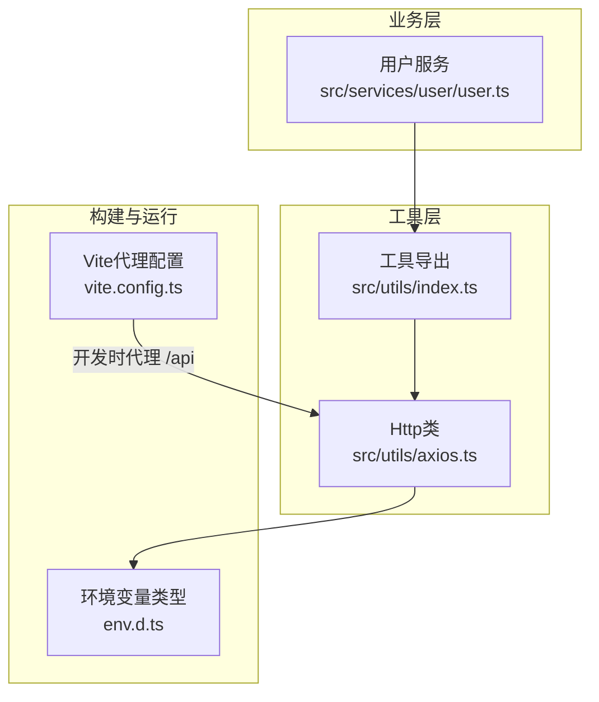
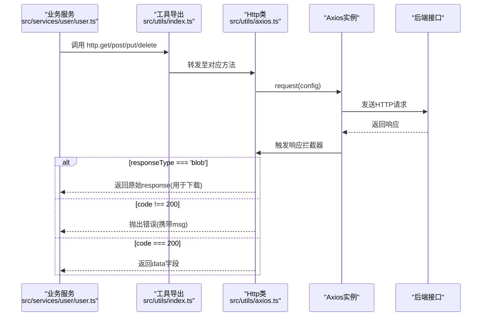
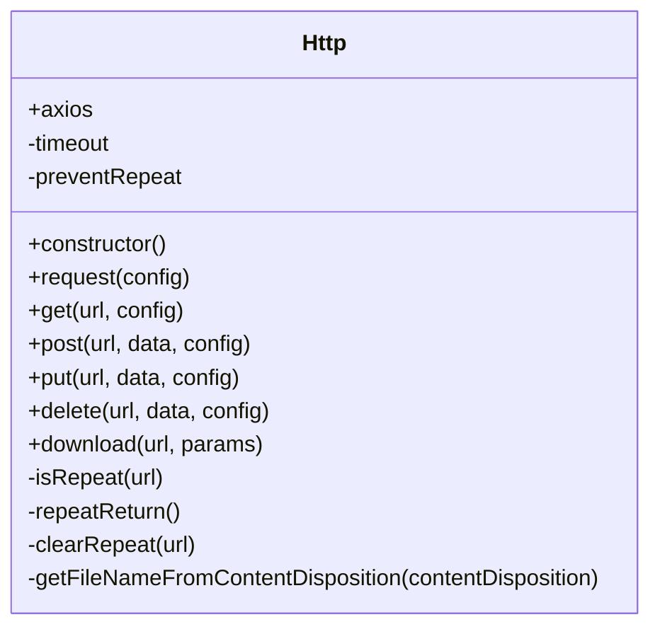
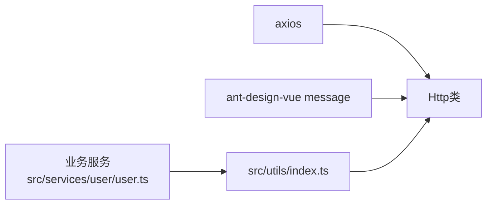

# HTTP客户端封装

<cite>
**本文引用的文件**   
- [src/utils/axios.ts](file://src/utils/axios.ts)
- [src/utils/index.ts](file://src/utils/index.ts)
- [src/services/user/user.ts](file://src/services/user/user.ts)
- [env.d.ts](file://env.d.ts)
- [vite.config.ts](file://vite.config.ts)
</cite>

## 目录
1. [简介](#简介)
2. [项目结构](#项目结构)
3. [核心组件](#核心组件)
4. [架构总览](#架构总览)
5. [详细组件分析](#详细组件分析)
6. [依赖关系分析](#依赖关系分析)
7. [性能与可靠性考虑](#性能与可靠性考虑)
8. [故障排查指南](#故障排查指南)
9. [结论](#结论)
10. [附录：使用示例与最佳实践](#附录使用示例与最佳实践)

## 简介
本文件面向前端工程中的HTTP客户端封装，围绕Axios实例的配置、请求拦截器、响应拦截器的实现机制展开，详细说明错误处理策略、重复提交防护、超时配置、下载能力等。同时给出认证令牌管理、请求头设置、响应数据转换的扩展建议与最佳实践，并包含常见网络问题的解决方案与性能优化建议。

## 项目结构
本项目采用模块化组织方式，HTTP客户端位于工具层，通过统一导出供业务服务调用。关键路径如下：
- HTTP客户端实现：src/utils/axios.ts
- 全局单例导出：src/utils/index.ts
- 业务服务示例：src/services/user/user.ts
- 环境变量类型定义：env.d.ts
- Vite代理与开发服务器配置：vite.config.ts

图表来源
- [src/utils/axios.ts:1-127](file://src/utils/axios.ts#L1-L127)
- [src/utils/index.ts:1-101](file://src/utils/index.ts#L1-L101)
- [src/services/user/user.ts:1-36](file://src/services/user/user.ts#L1-L36)
- [env.d.ts:1-8](file://env.d.ts#L1-L8)
- [vite.config.ts:81-99](file://vite.config.ts#L81-L99)

章节来源
- [src/utils/axios.ts:1-127](file://src/utils/axios.ts#L1-L127)
- [src/utils/index.ts:1-101](file://src/utils/index.ts#L1-L101)
- [src/services/user/user.ts:1-36](file://src/services/user/user.ts#L1-L36)
- [env.d.ts:1-8](file://env.d.ts#L1-L8)
- [vite.config.ts:81-99](file://vite.config.ts#L81-L99)

## 核心组件
- Http类：封装Axios实例、响应拦截器、重复提交防护、下载方法等。
- 全局http单例：在工具模块中创建并导出，供业务服务统一调用。
- 业务服务：以UserApi为例，展示如何调用get/post/put/delete等方法。

章节来源
- [src/utils/axios.ts:5-127](file://src/utils/axios.ts#L5-L127)
- [src/utils/index.ts:4-9](file://src/utils/index.ts#L4-L9)
- [src/services/user/user.ts:18-35](file://src/services/user/user.ts#L18-L35)

## 架构总览
下图展示了从业务服务到HTTP客户端再到Axios的请求流程，以及响应拦截器的处理分支。

图表来源
- [src/services/user/user.ts:18-35](file://src/services/user/user.ts#L18-L35)
- [src/utils/index.ts:4-9](file://src/utils/index.ts#L4-L9)
- [src/utils/axios.ts:28-67](file://src/utils/axios.ts#L28-L67)

## 详细组件分析

### Http类设计与实现
- 实例化与基础配置
  - baseURL：优先读取环境变量VITE_SERVER_PATH，否则回退为/api/。
  - timeout：Axios实例默认设置为90秒。
- 响应拦截器
  - 对blob类型响应直接透传，便于下载逻辑处理。
  - 对常规JSON响应，检查业务码code是否为200；非200则提示错误并reject。
  - 异常分支（无response或状态码）统一提示错误信息并reject。
- 重复提交防护
  - 针对POST/PUT方法，基于URL+时间窗口进行防抖式去重，避免短时间内重复提交。
  - 在响应成功或失败后清理该URL的去重标记。
- 便捷方法
  - get/post/put/delete：封装Axios对应方法，并在post/put中增加重复提交检查。
  - download：以GET + responseType=blob方式下载文件，自动解析文件名并触发浏览器下载。

图表来源
- [src/utils/axios.ts:5-127](file://src/utils/axios.ts#L5-L127)

章节来源
- [src/utils/axios.ts:28-67](file://src/utils/axios.ts#L28-L67)
- [src/utils/axios.ts:68-127](file://src/utils/axios.ts#L68-L127)

### 全局单例导出
- 在工具模块中导入Http类并创建单例http，对外暴露。
- 业务服务通过import { http } from '@/utils'获取并使用。

章节来源
- [src/utils/index.ts:4-9](file://src/utils/index.ts#L4-L9)

### 业务服务调用示例
- UserApi提供list/one/create/update等方法，统一通过http.get/post/put调用。
- 返回值类型为HttpResult<T>，由响应拦截器保证业务码校验与数据解包。

章节来源
- [src/services/user/user.ts:18-35](file://src/services/user/user.ts#L18-L35)

### 环境变量与代理
- 环境变量类型定义：VITE_SERVER_PATH用于指定API基础路径。
- Vite开发服务器代理：将/api前缀请求代理到目标后端地址，便于本地开发联调。

章节来源
- [env.d.ts:4-8](file://env.d.ts#L4-L8)
- [vite.config.ts:81-99](file://vite.config.ts#L81-L99)

## 依赖关系分析
- 外部依赖
  - axios：底层HTTP库。
  - ant-design-vue message：用于错误与警告提示。
- 内部依赖
  - src/utils/index.ts：导出全局http单例。
  - 业务服务：通过http调用后端接口。

图表来源
- [src/utils/axios.ts:1-3](file://src/utils/axios.ts#L1-L3)
- [src/utils/index.ts:4-9](file://src/utils/index.ts#L4-L9)
- [src/services/user/user.ts:1-2](file://src/services/user/user.ts#L1-L2)

章节来源
- [src/utils/axios.ts:1-3](file://src/utils/axios.ts#L1-L3)
- [src/utils/index.ts:4-9](file://src/utils/index.ts#L4-L9)
- [src/services/user/user.ts:1-2](file://src/services/user/user.ts#L1-L2)

## 性能与可靠性考虑

### 超时与重试
- 当前实现
  - Axios实例timeout设置为90秒。
  - 未内置重试机制。
- 建议
  - 根据接口SLA调整timeout，区分读多写少场景。
  - 引入指数退避重试策略，仅对幂等请求（如GET）或可安全重试的错误码进行重试。
  - 结合取消控制器AbortController，避免长时间挂起请求占用资源。

### 重复提交防护
- 当前实现
  - 对POST/PUT按URL+时间窗口进行去重，防止短时间重复提交。
  - 响应完成后清理去重标记。
- 建议
  - 对需要强一致性的操作，可在服务端增加幂等键（如idempotency-key）。
  - 对高频批量操作，建议在应用层做节流与队列控制。

### 下载与大文件
- 当前实现
  - 通过responseType=blob下载，自动解析Content-Disposition文件名。
- 建议
  - 大文件下载建议使用分片与断点续传。
  - 显示下载进度条与取消下载能力。

### 缓存与并发
- 当前实现
  - 未内置请求缓存与并发限制。
- 建议
  - 对热点数据增加内存缓存与失效策略。
  - 对高并发场景限制并发数，避免雪崩。

[本节为通用指导，不直接分析具体文件]

## 故障排查指南

### 常见问题与定位
- 接口报错提示
  - 当业务码code不为200时，会弹出错误消息并reject。请检查后端返回结构与业务码约定。
- 网络异常
  - 无response或网络不可达时，统一提示“请求失败”。检查代理配置与后端可达性。
- 权限问题
  - 若后端返回403，会提示“没有权限”。检查认证令牌与权限配置。
- 下载失败
  - 检查后端是否返回正确的Content-Type与Content-Disposition，确保文件名解析正确。

章节来源
- [src/utils/axios.ts:36-67](file://src/utils/axios.ts#L36-L67)
- [src/utils/axios.ts:104-125](file://src/utils/axios.ts#L104-L125)

### 调试建议
- 打开浏览器开发者工具的Network面板，查看请求URL、状态码、响应体。
- 在响应拦截器处添加日志输出，观察业务码与错误信息。
- 检查Vite代理配置是否正确转发到后端。

章节来源
- [vite.config.ts:81-99](file://vite.config.ts#L81-L99)

## 结论
当前HTTP客户端封装提供了基础的Axios实例配置、响应拦截器、重复提交防护与下载能力，满足大多数业务场景。后续可在此基础上扩展认证令牌注入、请求头标准化、重试与取消、缓存与并发控制等能力，以提升系统的健壮性与用户体验。

[本节为总结性内容，不直接分析具体文件]

## 附录：使用示例与最佳实践

### 基本用法
- 在业务服务中导入http并调用get/post/put/delete。
- 返回值遵循HttpResult<T>约定，code为200时data字段可用。

章节来源
- [src/services/user/user.ts:18-35](file://src/services/user/user.ts#L18-L35)

### 认证令牌管理与请求头设置（扩展建议）
- 在构造Axios实例后，添加请求拦截器，从存储中读取令牌并注入Authorization头。
- 在响应拦截器中处理401，刷新令牌或跳转登录页。
- 注意跨域与安全策略，必要时设置withCredentials。

[本节为概念性扩展建议，不直接分析具体文件]

### 请求头标准化（扩展建议）
- 统一Content-Type、Accept等头部。
- 针对不同环境（dev/test/prod）动态设置不同header或参数。

[本节为概念性扩展建议，不直接分析具体文件]

### 响应数据转换（扩展建议）
- 在响应拦截器中对日期、枚举、分页结构等进行统一转换。
- 对空值与边界情况进行规范化，减少业务层判断。

[本节为概念性扩展建议，不直接分析具体文件]

### 常见网络问题解决方案
- 代理不可用：检查Vite代理target与rewrite规则。
- 跨域问题：确认后端CORS配置与前端withCredentials设置。
- 大文件下载卡顿：改用流式下载与进度反馈。

章节来源
- [vite.config.ts:81-99](file://vite.config.ts#L81-L99)