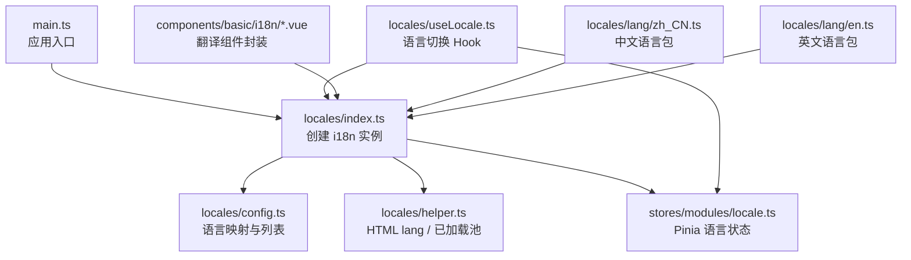
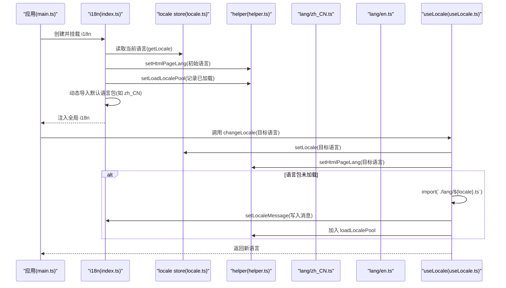
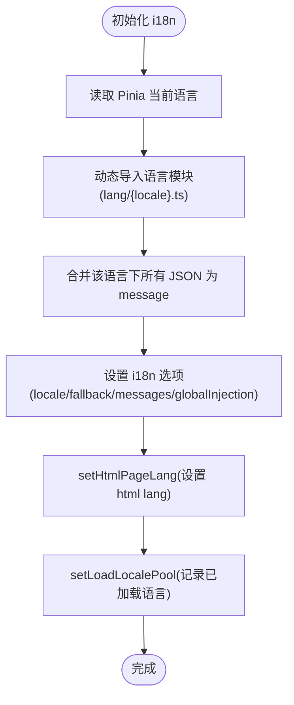
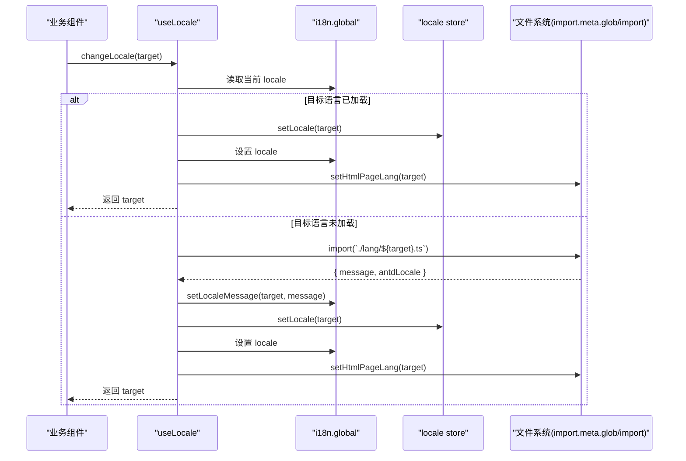
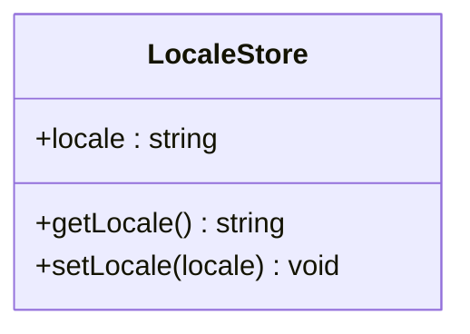
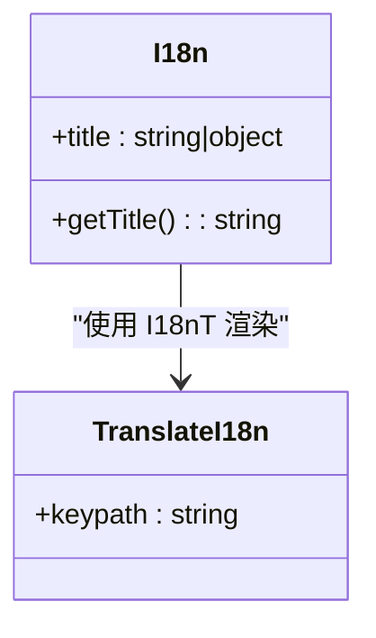
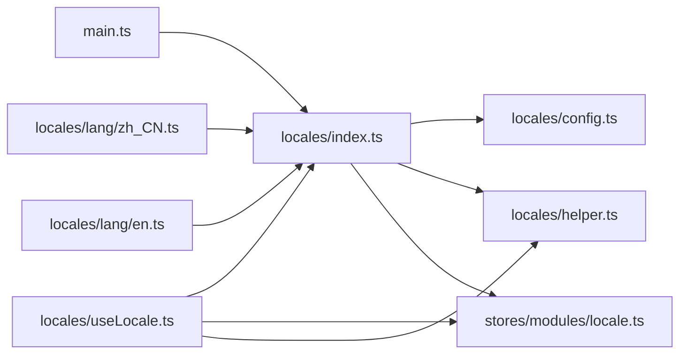

# 国际化系统

<cite>
**本文引用的文件**   
- [src/locales/index.ts](file://src/locales/index.ts)
- [src/locales/config.ts](file://src/locales/config.ts)
- [src/locales/helper.ts](file://src/locales/helper.ts)
- [src/locales/useLocale.ts](file://src/locales/useLocale.ts)
- [src/stores/modules/locale.ts](file://src/stores/modules/locale.ts)
- [src/components/basic/i18n/index.vue](file://src/components/basic/i18n/index.vue)
- [src/components/basic/i18n/TranslateI18n.vue](file://src/components/basic/i18n/TranslateI18n.vue)
- [src/locales/lang/en.ts](file://src/locales/lang/en.ts)
- [src/locales/lang/zh_CN.ts](file://src/locales/lang/zh_CN.ts)
- [src/main.ts](file://src/main.ts)
</cite>

## 目录
1. [简介](#简介)
2. [项目结构](#项目结构)
3. [核心组件](#核心组件)
4. [架构总览](#架构总览)
5. [详细组件分析](#详细组件分析)
6. [依赖关系分析](#依赖关系分析)
7. [性能与优化](#性能与优化)
8. [故障排查](#故障排查)
9. [结论](#结论)
10. [附录：新增语言与规范](#附录新增语言与规范)

## 简介
本仓库实现了一套基于 vue-i18n 的前端国际化方案，支持多语言动态加载、运行时切换、Ant Design Vue 组件库本地化以及 HTML lang 属性同步。系统通过 Pinia 持久化当前语言，结合 Vite 的 import.meta.glob 实现按语言包按需加载，并提供统一的翻译键值组织与使用方式。

## 项目结构
国际化相关代码集中在 src/locales 目录，配合 stores 中的 locale 模块与基础 i18n 组件，形成“配置 + 状态 + 运行时切换 + 组件封装”的完整闭环。

**图表来源**
- [src/main.ts:11-17](file://src/main.ts#L11-L17)
- [src/locales/index.ts:1-39](file://src/locales/index.ts#L1-L39)
- [src/locales/config.ts:1-22](file://src/locales/config.ts#L1-L22)
- [src/locales/helper.ts:1-12](file://src/locales/helper.ts#L1-L12)
- [src/stores/modules/locale.ts:1-35](file://src/stores/modules/locale.ts#L1-L35)
- [src/locales/useLocale.ts:1-69](file://src/locales/useLocale.ts#L1-L69)
- [src/components/basic/i18n/index.vue:1-32](file://src/components/basic/i18n/index.vue#L1-L32)
- [src/components/basic/i18n/TranslateI18n.vue:1-5](file://src/components/basic/i18n/TranslateI18n.vue#L1-L5)
- [src/locales/lang/zh_CN.ts:1-28](file://src/locales/lang/zh_CN.ts#L1-L28)
- [src/locales/lang/en.ts:1-28](file://src/locales/lang/en.ts#L1-L28)

**章节来源**
- [src/main.ts:1-22](file://src/main.ts#L1-L22)
- [src/locales/index.ts:1-39](file://src/locales/index.ts#L1-L39)

## 核心组件
- 语言配置与枚举：定义可用语言、显示名称与图标等元信息。
- i18n 初始化：根据当前语言动态导入对应语言包，注册到 vue-i18n。
- 语言切换 Hook：提供 changeLocale/getLocale/getAntdLocale，负责运行时切换与 Ant Design Vue 本地化。
- Pinia 状态管理：持久化当前语言，提供 getLocale/setLocale。
- 辅助工具：维护已加载语言池、设置 HTML lang。
- 翻译组件封装：在模板中便捷使用 keypath 进行文本渲染。

**章节来源**
- [src/locales/config.ts:1-22](file://src/locales/config.ts#L1-L22)
- [src/locales/index.ts:1-39](file://src/locales/index.ts#L1-L39)
- [src/locales/useLocale.ts:1-69](file://src/locales/useLocale.ts#L1-L69)
- [src/stores/modules/locale.ts:1-35](file://src/stores/modules/locale.ts#L1-L35)
- [src/locales/helper.ts:1-12](file://src/locales/helper.ts#L1-L12)
- [src/components/basic/i18n/index.vue:1-32](file://src/components/basic/i18n/index.vue#L1-L32)
- [src/components/basic/i18n/TranslateI18n.vue:1-5](file://src/components/basic/i18n/TranslateI18n.vue#L1-L5)

## 架构总览
下图展示了从应用启动到语言切换的关键流程，包括 i18n 实例创建、语言包动态加载、Pinia 状态更新与 DOM 属性同步。

**图表来源**
- [src/main.ts:11-17](file://src/main.ts#L11-L17)
- [src/locales/index.ts:9-39](file://src/locales/index.ts#L9-L39)
- [src/locales/helper.ts:3-11](file://src/locales/helper.ts#L3-L11)
- [src/locales/useLocale.ts:18-60](file://src/locales/useLocale.ts#L18-L60)
- [src/stores/modules/locale.ts:13-28](file://src/stores/modules/locale.ts#L13-L28)
- [src/locales/lang/zh_CN.ts:1-28](file://src/locales/lang/zh_CN.ts#L1-L28)
- [src/locales/lang/en.ts:1-28](file://src/locales/lang/en.ts#L1-L28)

## 详细组件分析

### i18n 初始化与语言包合并
- 初始化逻辑：根据 Pinia 中的当前语言，动态导入对应的语言模块，提取 message 字段，设置 fallbackLocale 为简体中文，关闭缺失警告。
- 语言包结构：每个语言目录下包含若干 JSON 文件，语言模块通过 import.meta.glob 将所有 JSON 合并为一个扁平化的 message 对象，并附带 antdLocale。
- HTML lang 同步：初始化时设置 document.documentElement.lang，便于无障碍与 SEO。

**图表来源**
- [src/locales/index.ts:9-39](file://src/locales/index.ts#L9-L39)
- [src/locales/lang/zh_CN.ts:1-28](file://src/locales/lang/zh_CN.ts#L1-L28)
- [src/locales/lang/en.ts:1-28](file://src/locales/lang/en.ts#L1-L28)
- [src/locales/helper.ts:5-11](file://src/locales/helper.ts#L5-L11)

**章节来源**
- [src/locales/index.ts:1-39](file://src/locales/index.ts#L1-L39)
- [src/locales/lang/zh_CN.ts:1-28](file://src/locales/lang/zh_CN.ts#L1-L28)
- [src/locales/lang/en.ts:1-28](file://src/locales/lang/en.ts#L1-L28)
- [src/locales/helper.ts:1-12](file://src/locales/helper.ts#L1-L12)

### 语言切换流程（useLocale）
- 获取当前语言与 Ant Design Vue 本地化：通过 computed 暴露 getLocale 与 getAntdLocale。
- 切换逻辑：若目标语言已在已加载池中，直接切换；否则动态 import 语言模块，将 message 注册到 i18n，再切换语言并记录到已加载池。
- 副作用：更新 Pinia 状态与 HTML lang。

**图表来源**
- [src/locales/useLocale.ts:18-60](file://src/locales/useLocale.ts#L18-L60)
- [src/stores/modules/locale.ts:23-28](file://src/stores/modules/locale.ts#L23-L28)
- [src/locales/helper.ts:5-11](file://src/locales/helper.ts#L5-L11)

**章节来源**
- [src/locales/useLocale.ts:1-69](file://src/locales/useLocale.ts#L1-L69)
- [src/stores/modules/locale.ts:1-35](file://src/stores/modules/locale.ts#L1-L35)
- [src/locales/helper.ts:1-12](file://src/locales/helper.ts#L1-L12)

### Pinia 语言状态管理
- 状态结构：locale 字段保存当前语言代码。
- 持久化：使用 StorageFactory 读写 LOCALE_KEY，保证刷新后语言不丢失。
- 对外接口：getLocale 获取当前语言，setLocale 设置语言并持久化。

**图表来源**
- [src/stores/modules/locale.ts:9-28](file://src/stores/modules/locale.ts#L9-L28)

**章节来源**
- [src/stores/modules/locale.ts:1-35](file://src/stores/modules/locale.ts#L1-L35)

### 翻译组件封装
- I18n 组件：接收 title 属性，支持字符串或对象形式；当为对象时按当前语言选择对应标题，并通过 I18nT 渲染。
- TranslateI18n 组件：作为占位符，使用 I18nT 渲染空 keypath，便于扩展。

**图表来源**
- [src/components/basic/i18n/index.vue:10-30](file://src/components/basic/i18n/index.vue#L10-L30)
- [src/components/basic/i18n/TranslateI18n.vue:1-5](file://src/components/basic/i18n/TranslateI18n.vue#L1-L5)

**章节来源**
- [src/components/basic/i18n/index.vue:1-32](file://src/components/basic/i18n/index.vue#L1-L32)
- [src/components/basic/i18n/TranslateI18n.vue:1-5](file://src/components/basic/i18n/TranslateI18n.vue#L1-L5)

## 依赖关系分析
- main.ts 挂载 i18n，使其成为全局依赖。
- locales/index.ts 依赖 config、helper、stores/modules/locale，并动态导入语言模块。
- useLocale.ts 依赖 i18n、helper、stores/modules/locale，并在运行时动态导入语言模块。
- 语言模块（zh_CN.ts、en.ts）依赖 ant-design-vue 的 locale 资源，并通过 import.meta.glob 聚合 JSON。

**图表来源**
- [src/main.ts:11-17](file://src/main.ts#L11-L17)
- [src/locales/index.ts:1-39](file://src/locales/index.ts#L1-L39)
- [src/locales/useLocale.ts:1-69](file://src/locales/useLocale.ts#L1-L69)
- [src/locales/lang/zh_CN.ts:1-28](file://src/locales/lang/zh_CN.ts#L1-L28)
- [src/locales/lang/en.ts:1-28](file://src/locales/lang/en.ts#L1-L28)

**章节来源**
- [src/main.ts:1-22](file://src/main.ts#L1-L22)
- [src/locales/index.ts:1-39](file://src/locales/index.ts#L1-L39)
- [src/locales/useLocale.ts:1-69](file://src/locales/useLocale.ts#L1-L69)

## 性能与优化
- 动态加载语言包：仅在首次切换到某语言时 import 对应模块，避免首屏冗余。
- 已加载池缓存：loadLocalePool 避免重复加载同一语言。
- 关闭多余警告：silentTranslationWarn、missingWarn、silentFallbackWarn 降低控制台噪音。
- 建议：
  - 保持语言包体积精简，避免大对象一次性加载。
  - 对频繁使用的文案可考虑预加载常用语言（例如用户上次选择的语言）。
  - 使用懒加载路由与组件，减少首屏压力。

[本节为通用指导，不涉及具体文件]

## 故障排查
- 切换语言无效：
  - 检查是否已将目标语言加入 localeMap 与 localeList。
  - 确认语言模块是否正确导出 message 字段。
  - 查看 Pinia 中 locale 是否成功更新。
- 文本未生效：
  - 确认 keypath 是否存在于对应语言的 message 中。
  - 检查是否在模板中正确使用 I18nT 或封装组件。
- Ant Design Vue 未本地化：
  - 确保语言模块导入了 antdLocale 并随 message 一起注册。
  - 使用 getAntdLocale 获取组件库本地化对象。

**章节来源**
- [src/locales/config.ts:1-22](file://src/locales/config.ts#L1-L22)
- [src/locales/lang/zh_CN.ts:1-28](file://src/locales/lang/zh_CN.ts#L1-L28)
- [src/locales/lang/en.ts:1-28](file://src/locales/lang/en.ts#L1-L28)
- [src/locales/useLocale.ts:30-60](file://src/locales/useLocale.ts#L30-L60)
- [src/components/basic/i18n/index.vue:18-30](file://src/components/basic/i18n/index.vue#L18-L30)

## 结论
本项目实现了稳定、可扩展的国际化体系：以 vue-i18n 为核心，结合 Pinia 持久化与 Vite 动态导入，提供运行时语言切换与组件库本地化。通过统一的语言配置、语言包结构与辅助工具，开发者可以高效地新增语言、管理翻译键值并进行格式化输出。

[本节为总结性内容，不涉及具体文件]

## 附录：新增语言与规范

### 新增语言步骤
- 在 locales/config.ts 中添加语言映射与显示项。
- 在 locales/lang 下新建语言模块文件（如 fr.ts），参照现有语言模块结构。
- 在该语言模块中使用 import.meta.glob 聚合 JSON 文件，并导出 message 与 antdLocale。
- 在 locales/lang/fr 下放置对应 JSON 文案文件。
- 在需要展示语言列表的地方（如设置面板）使用 localeList。

**章节来源**
- [src/locales/config.ts:1-22](file://src/locales/config.ts#L1-L22)
- [src/locales/lang/zh_CN.ts:1-28](file://src/locales/lang/zh_CN.ts#L1-L28)
- [src/locales/lang/en.ts:1-28](file://src/locales/lang/en.ts#L1-L28)

### 翻译键值管理规范
- 使用点号分隔的层级键名（如 serviceCategory），保持语义清晰。
- 按功能域拆分 JSON 文件，便于维护与增量构建。
- 避免在键名中包含可变数据，使用参数化占位符（由上层格式化）。

[本节为通用规范，不涉及具体文件]

### 格式化处理技巧
- 日期、数字等格式化建议在业务层处理，或使用第三方库（如 dayjs、numeral）。
- 对于复数、性别等复杂场景，可在 i18n 层使用插值与条件规则（需结合 vue-i18n 能力）。

[本节为通用实践，不涉及具体文件]

### 最佳实践
- 将语言切换操作封装为可复用方法，集中处理副作用（Pinia、HTML lang、AntD 本地化）。
- 对关键页面进行语言切换后的回归测试，确保所有文案与组件库样式正确。
- 定期清理未使用的翻译键，保持语言包整洁。

[本节为通用实践，不涉及具体文件]