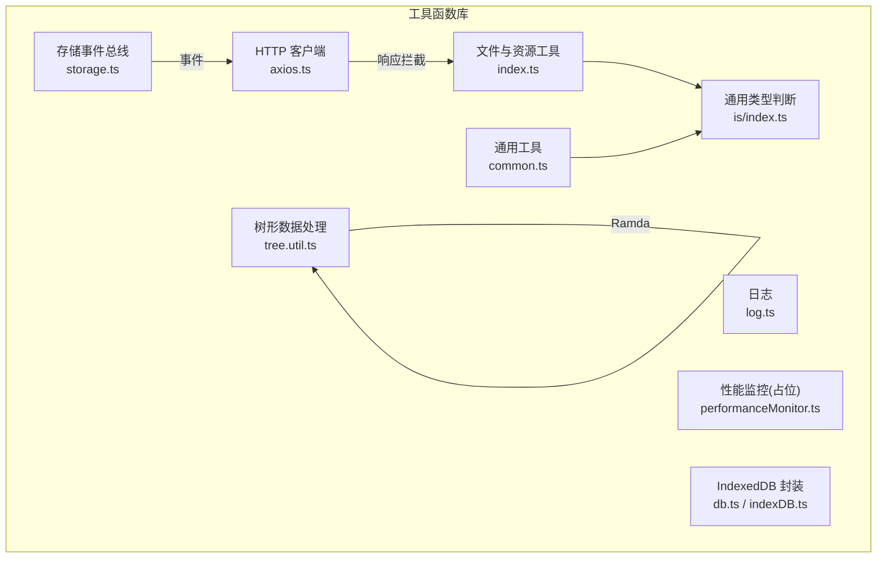
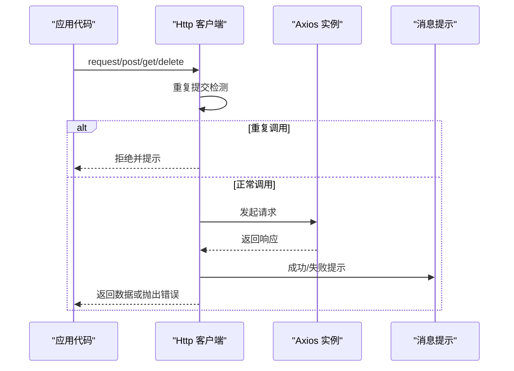
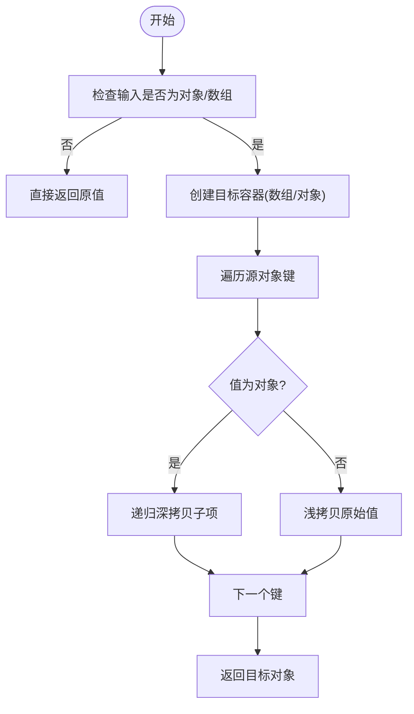
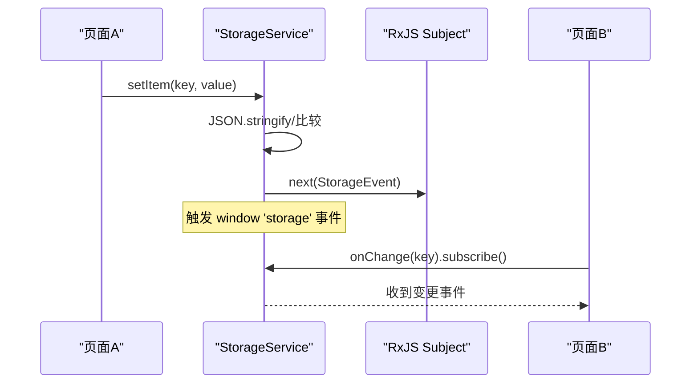
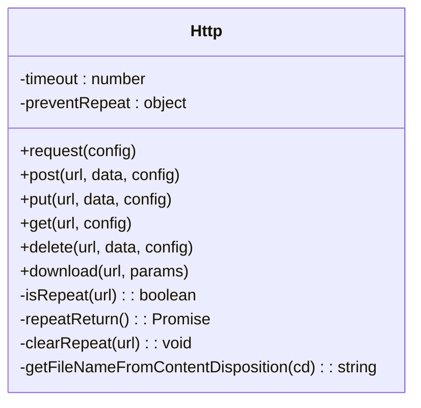
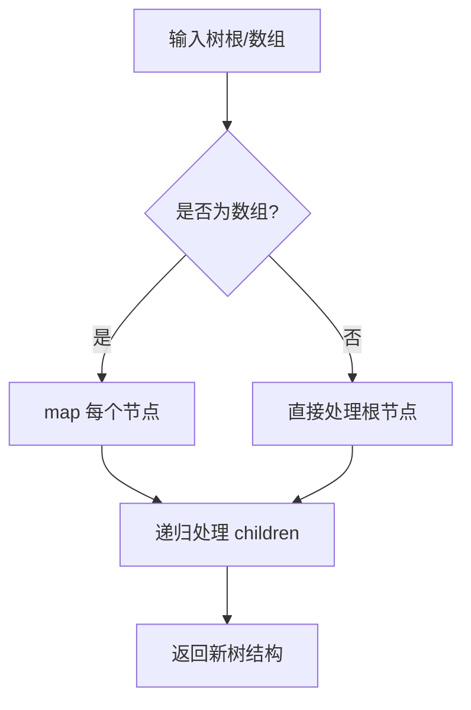
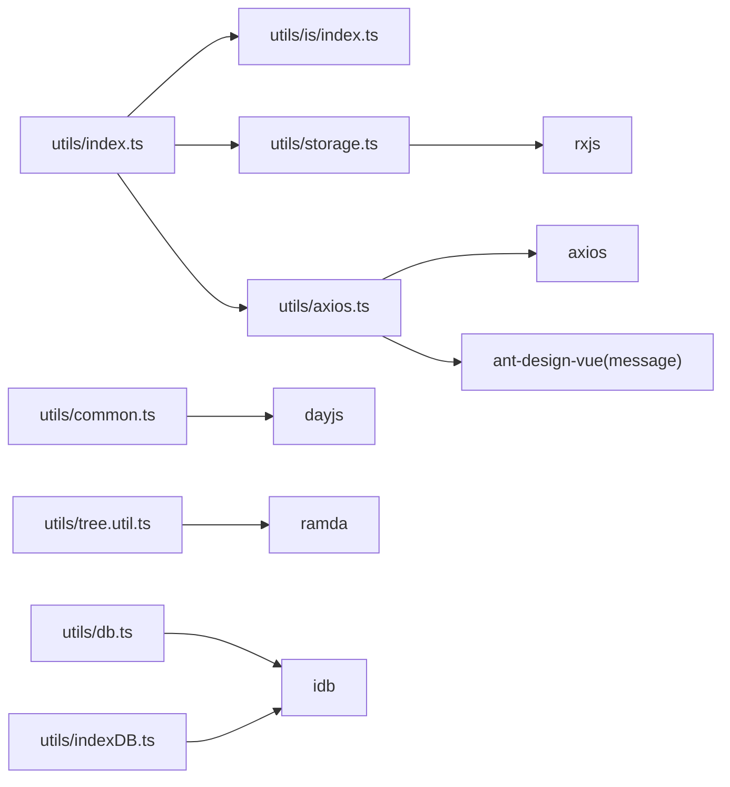

# 工具函数库

<cite>
**本文引用的文件**   
- [src/utils/index.ts](file://src/utils/index.ts)
- [src/utils/common.ts](file://src/utils/common.ts)
- [src/utils/is/index.ts](file://src/utils/is/index.ts)
- [src/utils/validate.ts](file://src/utils/validate.ts)
- [src/utils/storage.ts](file://src/utils/storage.ts)
- [src/utils/tree.util.ts](file://src/utils/tree.util.ts)
- [src/utils/axios.ts](file://src/utils/axios.ts)
- [src/utils/log.ts](file://src/utils/log.ts)
- [src/utils/performanceMonitor.ts](file://src/utils/performanceMonitor.ts)
- [src/utils/db.ts](file://src/utils/db.ts)
- [src/utils/indexDB.ts](file://src/utils/indexDB.ts)
</cite>

## 目录
1. [简介](#简介)
2. [项目结构](#项目结构)
3. [核心组件](#核心组件)
4. [架构总览](#架构总览)
5. [详细组件分析](#详细组件分析)
6. [依赖关系分析](#依赖关系分析)
7. [性能与优化](#性能与优化)
8. [故障排查指南](#故障排查指南)
9. [结论](#结论)
10. [附录：扩展与测试规范](#附录扩展与测试规范)

## 简介
本仓库的 utils 层提供了一套通用工具函数库，覆盖日期处理、字符串操作、数学计算、数据验证、树形数据处理、存储事件总线、HTTP 请求封装、日志与性能监控等。文档将按“通用工具”“业务工具”“数据处理”三大类进行说明，并给出实现原理、使用示例、扩展方法与最佳实践。

## 项目结构
utils 目录采用功能域划分：
- 通用类型判断与校验：is、validate
- 通用工具：common（防抖、复制、URL 参数拼接、格式化大小、深拷贝、环境常量）
- 文件与资源工具：index（文件后缀解析、MIME 图标映射、字节单位格式化、对象深合并、Vue 插件安装器）
- 存储与事件：storage（基于 localStorage 的事件化存储，支持链式订阅与去重）
- HTTP 客户端：axios（统一拦截、重复提交防护、下载封装）
- 树形数据处理：tree.util（属性重命名、节点查找、遍历、排序、勾选状态联动）
- 日志与性能：log、performanceMonitor（当前为占位/注释态）
- IndexedDB 封装：db、indexDB（基础 CRUD）

图表来源
- [src/utils/index.ts:1-101](file://src/utils/index.ts#L1-L101)
- [src/utils/common.ts:1-219](file://src/utils/common.ts#L1-L219)
- [src/utils/is/index.ts:1-110](file://src/utils/is/index.ts#L1-L110)
- [src/utils/storage.ts:1-203](file://src/utils/storage.ts#L1-L203)
- [src/utils/axios.ts:1-127](file://src/utils/axios.ts#L1-L127)
- [src/utils/tree.util.ts:1-221](file://src/utils/tree.util.ts#L1-L221)

章节来源
- [src/utils/index.ts:1-101](file://src/utils/index.ts#L1-L101)
- [src/utils/common.ts:1-219](file://src/utils/common.ts#L1-L219)
- [src/utils/is/index.ts:1-110](file://src/utils/is/index.ts#L1-L110)
- [src/utils/storage.ts:1-203](file://src/utils/storage.ts#L1-L203)
- [src/utils/axios.ts:1-127](file://src/utils/axios.ts#L1-L127)
- [src/utils/tree.util.ts:1-221](file://src/utils/tree.util.ts#L1-L221)

## 核心组件
- 通用类型判断与校验
  - is：统一的类型判断集合（数组、对象、字符串、数字、Promise、Window、Element、Map、URL 等），并提供 isServer/isClient 环境判断。
  - validate：外部链接判定。
- 通用工具
  - common：防抖、首字母大写、随机颜色、复制文本、Base64 判定、URL 参数拼接、环境常量、日期格式化、深拷贝。
  - index：文件后缀提取、MIME 到图标名映射、文件大小格式化、对象深合并、withInstall Vue 插件安装器。
- 存储与事件
  - storage：基于 localStorage 的事件化存储，支持 onChange 订阅、路径匹配、全匹配、多 key 合并去抖、跨标签页事件监听。
- HTTP 客户端
  - axios：统一 baseURL/超时、响应拦截错误提示、重复提交防护、Blob 下载封装。
- 树形数据处理
  - tree.util：基于 Ramda 的不可变风格工具，提供属性重命名、节点定位、遍历回调、叶子节点可选、排序、勾选状态联动。
- 日志与性能
  - log：带项目名的 warn/error 输出。
  - performanceMonitor：当前为注释占位，预留性能采集上报能力。
- IndexedDB 封装
  - db：创建数据库与对象仓库。
  - indexDB：CRUD 方法封装（保存、查询、更新、删除）。

章节来源
- [src/utils/is/index.ts:1-110](file://src/utils/is/index.ts#L1-L110)
- [src/utils/validate.ts:1-8](file://src/utils/validate.ts#L1-L8)
- [src/utils/common.ts:1-219](file://src/utils/common.ts#L1-L219)
- [src/utils/index.ts:1-101](file://src/utils/index.ts#L1-L101)
- [src/utils/storage.ts:1-203](file://src/utils/storage.ts#L1-L203)
- [src/utils/axios.ts:1-127](file://src/utils/axios.ts#L1-L127)
- [src/utils/tree.util.ts:1-221](file://src/utils/tree.util.ts#L1-L221)
- [src/utils/log.ts:1-10](file://src/utils/log.ts#L1-L10)
- [src/utils/performanceMonitor.ts:1-192](file://src/utils/performanceMonitor.ts#L1-L192)
- [src/utils/db.ts:1-16](file://src/utils/db.ts#L1-L16)
- [src/utils/indexDB.ts:1-54](file://src/utils/indexDB.ts#L1-L54)

## 架构总览
工具库以“纯函数 + 轻量封装”为主，避免全局副作用；通过 RxJS Subject 对存储变更进行事件化；HTTP 层集中处理错误与重复提交；树形工具基于 Ramda 保持函数式风格。

图表来源
- [src/utils/axios.ts:28-78](file://src/utils/axios.ts#L28-L78)
- [src/utils/axios.ts:86-125](file://src/utils/axios.ts#L86-L125)

## 详细组件分析

### 通用类型判断与校验（is、validate）
- 设计要点
  - 统一使用 Object.prototype.toString 做精确类型判断，避免 instanceof 在跨 iframe 场景的失效问题。
  - 提供 isEmpty 针对 Array/String/Map/Set/Object 的统一空值语义。
  - isUrl 使用正则校验 URL 格式，便于路由与外链判断。
- 复杂度
  - 各判断函数均为 O(1)。
- 使用建议
  - 优先使用 isObject/isArray/isString 等类型守卫，减少 typeof 分支。
  - 对外部输入先做 isNullOrUnDef 判空，再进入业务逻辑。

章节来源
- [src/utils/is/index.ts:1-110](file://src/utils/is/index.ts#L1-L110)
- [src/utils/validate.ts:1-8](file://src/utils/validate.ts#L1-L8)

### 通用工具（common）
- 防抖 debounce
  - 原理：闭包持有定时器，延迟执行原函数，适用于高频输入场景。
  - 复杂度：O(1)，时间由 delay 决定。
- 首字母大写 changeStr
  - 简单字符串处理，注意非字符串输入需前置校验。
- 随机颜色 randomColor
  - 支持 rgb/hex/hsl 三种模式，hex 模式存在 padStart 填充逻辑可优化。
- 复制文本 copyText
  - 通过临时 input 与 execCommand('copy') 实现，兼容旧浏览器。
- Base64 判定 isBase64
  - 利用 atob/btoa 往返编码校验，异常捕获返回 false。
- URL 参数拼接 setObjToUrlParams
  - 自动处理 baseUrl 是否已带 ?，并对参数值进行 encodeURIComponent。
- 环境常量 IS_PROD/IS_DEV
  - 基于 Vite 环境变量。
- 日期格式化 formatDate
  - 基于 dayjs 统一格式化 YYYY-MM-DD HH:mm:ss。
- 深拷贝 deepClone
  - 递归拷贝对象与数组，未处理循环引用与特殊对象（Date/RegExp/Function）。

图表来源
- [src/utils/common.ts:205-218](file://src/utils/common.ts#L205-L218)

章节来源
- [src/utils/common.ts:1-219](file://src/utils/common.ts#L1-L219)

### 文件与资源工具（index）
- 文件后缀 getFileExtension
  - 使用正则提取最后一个点后的内容。
- MIME 转图标 parseMimeTypeToIconName
  - 根据扩展名映射到统一图标名称，便于列表展示。
- 文件大小 formatSizeUnits
  - 基于 1024 进制换算，支持自定义小数位数。
- 对象深合并 deepMerge
  - 递归合并，仅当 src[key] 为对象时深度合并，否则覆盖。
- withInstall
  - Vue 插件安装器，支持别名挂载到全局属性。

章节来源
- [src/utils/index.ts:1-101](file://src/utils/index.ts#L1-L101)

### 存储与事件（storage）
- 核心能力
  - 基于 localStorage 的 set/get/remove。
  - 通过 window 'storage' 事件与 RxJS Subject 实现跨标签页/同源页面变更通知。
  - onChange(target, fullmatch) 支持单 key、多 key 合并去抖、路径前缀匹配与全匹配。
  - StorageFactory 支持多实例链式连接，适合微前端或多模块场景。
- 关键流程
  - setItem 写入后触发 triggerEvent，内部 listener 与 uplinkSubject 分发。
  - onChange 返回 Observable，多 key 时使用 merge + debounceTime 合并多次变更。
- 复杂度
  - 事件分发 O(k)（k 为匹配到的监听器数量），去抖时间固定。
- 使用建议
  - 及时取消订阅，避免内存泄漏。
  - 大对象序列化开销较大，建议按需拆分 key。

图表来源
- [src/utils/storage.ts:21-143](file://src/utils/storage.ts#L21-L143)
- [src/utils/storage.ts:145-203](file://src/utils/storage.ts#L145-L203)

章节来源
- [src/utils/storage.ts:1-203](file://src/utils/storage.ts#L1-L203)

### HTTP 客户端（axios）
- 设计要点
  - 统一 baseURL、超时配置。
  - 响应拦截：统一错误提示、blob 下载透传、业务码校验。
  - 重复提交防护：PUT/POST 在 timeout 内重复调用直接拒绝。
  - 下载封装：从 Content-Disposition 解析文件名，Blob 下载。
- 复杂度
  - 重复检测 O(1)，下载流程受网络 IO 影响。
- 使用建议
  - 对敏感接口开启防重复提交。
  - 下载接口务必设置 responseType: 'blob'。

图表来源
- [src/utils/axios.ts:5-127](file://src/utils/axios.ts#L5-L127)

章节来源
- [src/utils/axios.ts:1-127](file://src/utils/axios.ts#L1-L127)

### 树形数据处理（tree.util）
- 设计要点
  - 基于 Ramda 的不可变风格组合函数，提供 curry 化 API。
  - renamePropertiesCurry：递归重命名树节点属性。
  - locateNodeCurry：按多字段匹配定位首个节点，并可回调命中节点及其祖先。
  - loopTreeCurry：统一遍历，支持 before/after 钩子。
  - selectableLeaf：标记叶子节点可选。
  - sortTree：按 order 字段排序 children。
  - changeIndeterminateTree/checkIndeterminate：复选框半选状态联动。
- 复杂度
  - 遍历/定位 O(n)，n 为节点数。
- 使用建议
  - 大数据量树建议分页渲染或虚拟滚动。
  - 频繁更新建议使用不可变更新策略，配合 React/Vue diff 提升性能。

图表来源
- [src/utils/tree.util.ts:18-55](file://src/utils/tree.util.ts#L18-L55)
- [src/utils/tree.util.ts:119-152](file://src/utils/tree.util.ts#L119-L152)

章节来源
- [src/utils/tree.util.ts:1-221](file://src/utils/tree.util.ts#L1-L221)

### 日志与性能（log、performanceMonitor）
- log
  - 输出带项目名的 warn/error，error 会抛错便于快速暴露问题。
- performanceMonitor
  - 当前为注释占位，预留了 Performance API 采集与上报方案，可按需启用。

章节来源
- [src/utils/log.ts:1-10](file://src/utils/log.ts#L1-L10)
- [src/utils/performanceMonitor.ts:1-192](file://src/utils/performanceMonitor.ts#L1-L192)

### IndexedDB 封装（db、indexDB）
- db
  - 使用 idb 创建数据库与对象仓库。
- indexDB
  - 封装 saveData/getData/updateData/deleteData 等常用操作。
- 使用建议
  - 升级版本号时需保证向后兼容。
  - 事务读写分离，避免并发冲突。

章节来源
- [src/utils/db.ts:1-16](file://src/utils/db.ts#L1-L16)
- [src/utils/indexDB.ts:1-54](file://src/utils/indexDB.ts#L1-L54)

## 依赖关系分析
- 内部依赖
  - index.ts 依赖 is/index.ts、storage.ts、axios.ts。
  - common.ts 依赖 dayjs。
  - tree.util.ts 依赖 ramda。
  - storage.ts 依赖 rxjs。
- 外部依赖
  - axios、dayjs、ramda、rxjs、idb、ant-design-vue（message）。

图表来源
- [src/utils/index.ts:1-10](file://src/utils/index.ts#L1-L10)
- [src/utils/common.ts:1-1](file://src/utils/common.ts#L1-L1)
- [src/utils/tree.util.ts:1-14](file://src/utils/tree.util.ts#L1-L14)
- [src/utils/storage.ts:1-2](file://src/utils/storage.ts#L1-L2)
- [src/utils/axios.ts:1-3](file://src/utils/axios.ts#L1-L3)
- [src/utils/db.ts:1-2](file://src/utils/db.ts#L1-L2)
- [src/utils/indexDB.ts:1-2](file://src/utils/indexDB.ts#L1-L2)

章节来源
- [src/utils/index.ts:1-10](file://src/utils/index.ts#L1-L10)
- [src/utils/common.ts:1-1](file://src/utils/common.ts#L1-L1)
- [src/utils/tree.util.ts:1-14](file://src/utils/tree.util.ts#L1-L14)
- [src/utils/storage.ts:1-2](file://src/utils/storage.ts#L1-L2)
- [src/utils/axios.ts:1-3](file://src/utils/axios.ts#L1-L3)
- [src/utils/db.ts:1-2](file://src/utils/db.ts#L1-L2)
- [src/utils/indexDB.ts:1-2](file://src/utils/indexDB.ts#L1-L2)

## 性能与优化
- 防抖与节流
  - 高频输入（搜索、滚动）使用 debounce/throttle 降低渲染压力。
- 深拷贝优化
  - 避免无必要深拷贝，必要时考虑结构化克隆或不可变数据结构。
- 树形数据
  - 大数据量树使用虚拟滚动、懒加载与增量更新。
- 存储事件
  - 多 key 变更使用 debounceTime 合并，避免频繁触发。
- HTTP
  - 合理设置超时与重试策略；下载接口使用 Blob 流式处理。
- 类型判断
  - 使用 is 系列函数替代冗长的 typeof 分支，提高可读性与一致性。

[本节为通用指导，不直接分析具体文件]

## 故障排查指南
- HTTP 错误
  - 检查响应拦截中的业务码判断与错误提示逻辑，确认后端返回结构与前端预期一致。
  - 重复提交被拒：确认是否在短时间内重复 POST/PUT。
- 存储事件未触发
  - 确认 onChange 订阅是否正确，是否及时取消订阅。
  - 跨标签页需确保同源且使用 localStorage。
- 树形数据异常
  - 检查 children 字段是否存在与层级结构是否符合预期。
  - 排序/勾选联动前确保数据包含必要字段（order、selected、indeterminate）。
- IndexedDB
  - 版本升级导致对象仓库不存在：检查 upgrade 逻辑与 store 名称。
  - 事务读写冲突：确保同一时刻只有一个写事务。

章节来源
- [src/utils/axios.ts:36-66](file://src/utils/axios.ts#L36-L66)
- [src/utils/storage.ts:116-143](file://src/utils/storage.ts#L116-L143)
- [src/utils/tree.util.ts:153-210](file://src/utils/tree.util.ts#L153-L210)
- [src/utils/indexDB.ts:1-54](file://src/utils/indexDB.ts#L1-L54)

## 结论
该工具函数库以“小而精”为原则，提供了前端开发中常用的通用能力，并通过事件化存储与统一 HTTP 客户端提升了工程的可维护性与一致性。建议在业务中优先复用这些工具，避免重复造轮子，同时遵循函数式与不可变更新的思路，以获得更好的性能与可预测性。

[本节为总结，不直接分析具体文件]

## 附录：扩展与测试规范

### 扩展规范
- 新增工具函数
  - 单一职责：一个文件只承载一类工具（如字符串、日期、树、存储）。
  - 纯函数优先：避免隐式全局状态，必要时通过参数传入上下文。
  - 类型安全：为公共函数添加 TS 类型定义，尽量使用泛型。
- 命名约定
  - 动词开头：formatXxx、parseXxx、validateXxx。
  - 布尔判断：isXxx、hasXxx。
- 兼容性
  - 对浏览器 API 的使用需做环境判断与降级处理。

### 测试方法
- 单元测试
  - 使用 Vitest 对纯函数编写用例，覆盖边界条件（空值、非法输入、极端数值）。
  - 对异步逻辑（HTTP、IndexedDB）使用 mock 与 fake timers。
- 集成测试
  - 对存储事件链路进行端到端验证，确保 onChange 能正确触发。
- 回归测试
  - 对树形数据处理增加快照测试，防止结构变化引发意外。

[本节为通用指导，不直接分析具体文件]