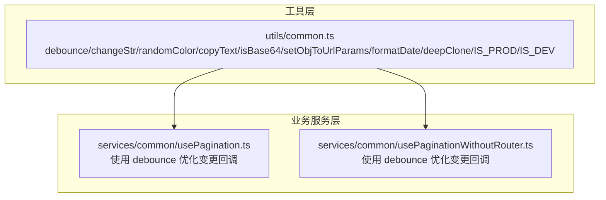
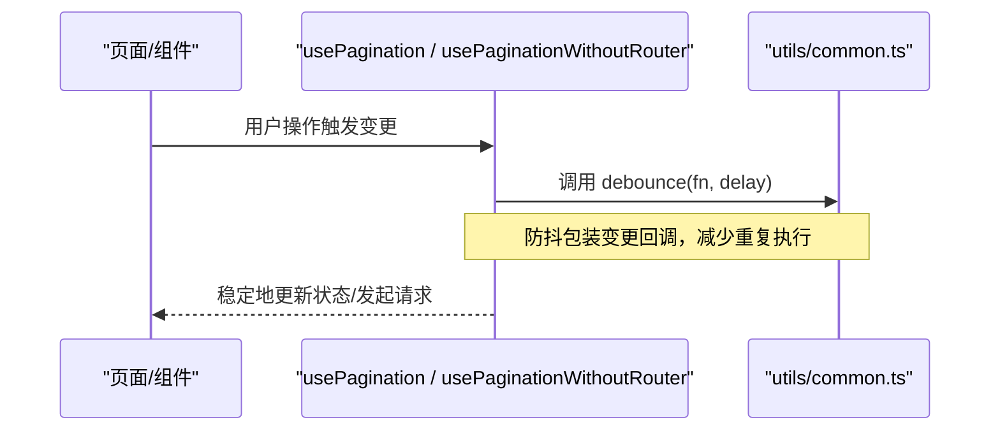
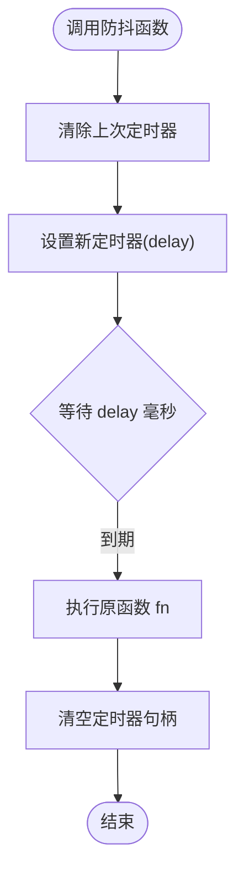
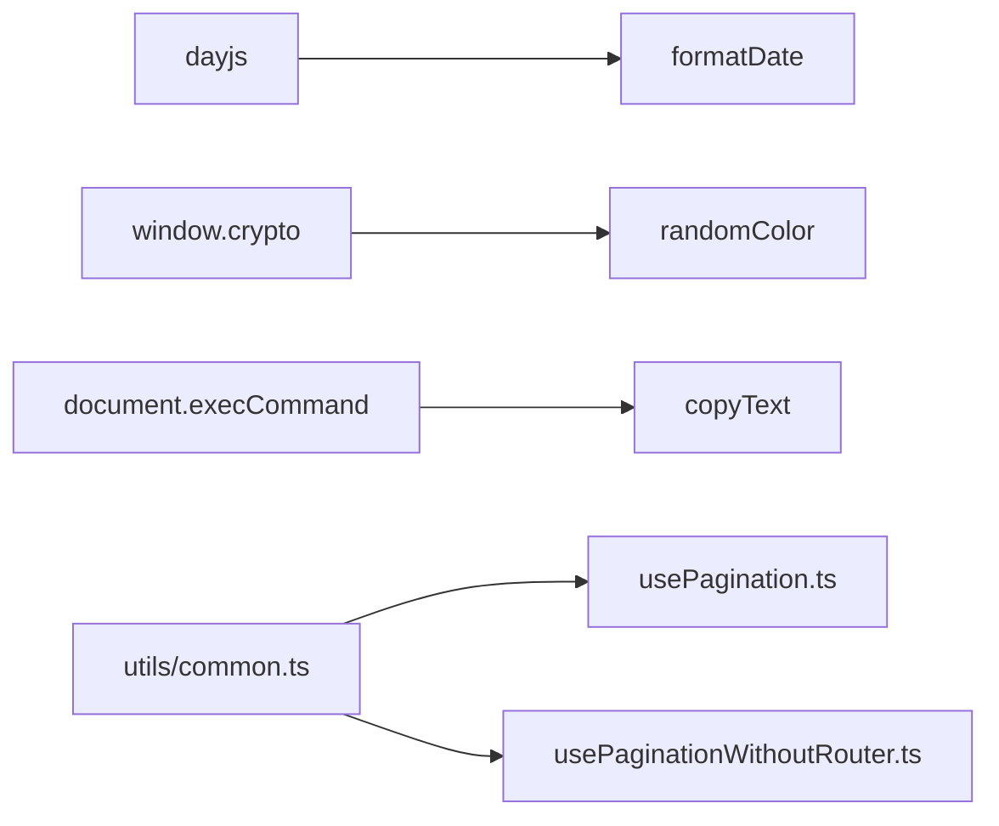

# 通用工具函数

<cite>
**本文引用的文件**   
- [src/utils/common.ts](file://src/utils/common.ts)
- [src/services/common/usePagination.ts](file://src/services/common/usePagination.ts)
- [src/services/common/usePaginationWithoutRouter.ts](file://src/services/common/usePaginationWithoutRouter.ts)
</cite>

## 目录
1. [简介](#简介)
2. [项目结构](#项目结构)
3. [核心组件](#核心组件)
4. [架构总览](#架构总览)
5. [详细组件分析](#详细组件分析)
6. [依赖分析](#依赖分析)
7. [性能考虑](#性能考虑)
8. [故障排查指南](#故障排查指南)
9. [结论](#结论)
10. [附录](#附录)

## 简介
本文件系统化梳理医疗评估系统中的通用工具函数，包括防抖、字符串首字母大写、随机颜色生成、文本复制、Base64 检测、URL 参数拼接、日期格式化与深拷贝等。同时说明环境判断常量 IS_PROD 与 IS_DEV 的用法，并结合分页场景给出在医疗评估系统中的最佳实践建议。

## 项目结构
这些工具函数集中在 utils/common.ts 中统一导出，供业务模块按需引入使用；其中 debounce 已在分页相关服务中被实际调用，体现其在高频交互中的价值。

**图表来源**
- [src/utils/common.ts:3-13](file://src/utils/common.ts#L3-L13)
- [src/services/common/usePagination.ts:1-62](file://src/services/common/usePagination.ts#L1-L62)
- [src/services/common/usePaginationWithoutRouter.ts:1-53](file://src/services/common/usePaginationWithoutRouter.ts#L1-L53)

**章节来源**
- [src/utils/common.ts:1-219](file://src/utils/common.ts#L1-L219)
- [src/services/common/usePagination.ts:1-62](file://src/services/common/usePagination.ts#L1-L62)
- [src/services/common/usePaginationWithoutRouter.ts:1-53](file://src/services/common/usePaginationWithoutRouter.ts#L1-L53)

## 核心组件
本节对每个工具函数的实现原理、参数说明、返回值与典型使用场景进行说明。

- debounce（防抖）
  - 作用：将频繁触发的回调合并为一次执行，避免重复计算或请求。
  - 参数：fn（要包装的函数），delay（延迟时间，默认 300ms）。
  - 返回：一个可被多次调用的新函数。
  - 行为要点：每次调用会清除上一次定时器并重新计时；首次触发不会立即执行，需等待 delay 毫秒后执行。
  - 适用场景：搜索输入、窗口尺寸变化、滚动事件、表单字段变更等高频事件。
  - 示例路径：[usePagination.ts:62](file://src/services/common/usePagination.ts#L62)、[usePaginationWithoutRouter.ts:53](file://src/services/common/usePaginationWithoutRouter.ts#L53)。

- changeStr（字符串首字母大写）
  - 作用：将字符串的首字符转为大写，其余保持不变。
  - 参数：str（原始字符串）。
  - 返回：处理后的字符串。
  - 适用场景：标题规范化、枚举值展示前缀统一等。

- randomColor（随机颜色生成）
  - 作用：根据类型生成随机颜色字符串。
  - 参数：type（'rgb' | 'hex' | 'hsl'）。
  - 返回：对应格式的颜色字符串。
  - 注意：不同浏览器对 crypto API 的支持可能不同，建议在需要高安全性的场景下做兼容处理。
  - 适用场景：图表数据点着色、占位图背景色、标签随机化等。

- copyText（文本复制）
  - 作用：将指定文本复制到系统剪贴板。
  - 参数：text（要复制的文本）。
  - 行为要点：通过创建临时 input 元素并调用 execCommand('copy') 完成复制。
  - 适用场景：分享链接、复制诊断编码、复制报告编号等。

- isBase64（Base64 检测）
  - 作用：判断给定字符串是否为合法的 Base64 内容。
  - 参数：str（待检测字符串）。
  - 返回：布尔值。
  - 行为要点：空串或非字符串将被判定为 false；内部通过 atob/btoa 校验。
  - 适用场景：图片预览前的格式校验、上传前预处理等。

- setObjToUrlParams（URL 参数拼接）
  - 作用：将对象键值对序列化为 URL 查询参数并拼接到基础 URL。
  - 参数：baseUrl（基础 URL），obj（键值对象，值为字符串）。
  - 返回：拼接后的完整 URL。
  - 行为要点：自动处理 baseUrl 是否已带 '?'；对参数值进行 encodeURIComponent 编码；去除末尾多余的 '&'。
  - 适用场景：路由跳转传参、导出接口拼接筛选条件等。

- formatDate（日期格式化）
  - 作用：将任意时间值格式化为“YYYY-MM-DD HH:mm:ss”。
  - 参数：time（任意可被 dayjs 解析的时间值）。
  - 返回：格式化后的字符串。
  - 适用场景：报告时间显示、日志打印、审计记录等。

- deepClone（深拷贝）
  - 作用：递归拷贝对象或数组，避免引用共享导致的状态污染。
  - 参数：source（源对象或数组）。
  - 返回：新的对象或数组。
  - 行为要点：区分数组与对象；仅对子项为对象的属性进行递归拷贝；非对象属性直接赋值。
  - 适用场景：表单初始值克隆、提交前备份、复杂配置对象隔离等。

- IS_PROD / IS_DEV（环境判断常量）
  - 作用：标识当前运行环境是生产还是开发。
  - 来源：import.meta.env.PROD / import.meta.env.DEV。
  - 适用场景：开关调试日志、埋点上报策略、功能灰度等。

**章节来源**
- [src/utils/common.ts:3-13](file://src/utils/common.ts#L3-L13)
- [src/utils/common.ts:19-21](file://src/utils/common.ts#L19-L21)
- [src/utils/common.ts:28-40](file://src/utils/common.ts#L28-L40)
- [src/utils/common.ts:46-53](file://src/utils/common.ts#L46-L53)
- [src/utils/common.ts:59-68](file://src/utils/common.ts#L59-L68)
- [src/utils/common.ts:79-92](file://src/utils/common.ts#L79-L92)
- [src/utils/common.ts:114-115](file://src/utils/common.ts#L114-L115)
- [src/utils/common.ts:121-121](file://src/utils/common.ts#L121-L121)
- [src/utils/common.ts:205-218](file://src/utils/common.ts#L205-L218)

## 架构总览
工具函数作为横切能力，被上层服务复用。下图展示了工具层与服务层的依赖关系以及关键调用链。

**图表来源**
- [src/services/common/usePagination.ts:1-62](file://src/services/common/usePagination.ts#L1-L62)
- [src/services/common/usePaginationWithoutRouter.ts:1-53](file://src/services/common/usePaginationWithoutRouter.ts#L1-L53)
- [src/utils/common.ts:3-13](file://src/utils/common.ts#L3-L13)

## 详细组件分析

### 防抖 debounce
- 实现要点
  - 使用闭包保存定时器句柄，确保每次调用都能正确清理旧定时器。
  - 通过 apply 保持原函数 this 指向与参数透传。
  - 默认延迟 300ms，可根据场景调整。
- 复杂度
  - 时间复杂度 O(1)，空间复杂度 O(1)。
- 优化建议
  - 若需要支持取消与立即执行，可在封装基础上扩展 cancel/flush 方法。
  - 在高并发场景下，结合节流（throttle）控制更细粒度的频率。
- 使用示例路径
  - [usePagination.ts:62](file://src/services/common/usePagination.ts#L62)
  - [usePaginationWithoutRouter.ts:53](file://src/services/common/usePaginationWithoutRouter.ts#L53)

**图表来源**
- [src/utils/common.ts:3-13](file://src/utils/common.ts#L3-L13)

**章节来源**
- [src/utils/common.ts:3-13](file://src/utils/common.ts#L3-L13)
- [src/services/common/usePagination.ts:1-62](file://src/services/common/usePagination.ts#L1-L62)
- [src/services/common/usePaginationWithoutRouter.ts:1-53](file://src/services/common/usePaginationWithoutRouter.ts#L1-L53)

### 字符串首字母大写 changeStr
- 行为说明
  - 取首字符转大写，剩余部分原样保留。
- 边界情况
  - 空字符串返回空字符串。
  - 非英文字符按 Unicode 规则转换。
- 使用示例路径
  - [src/utils/common.ts:19-21](file://src/utils/common.ts#L19-L21)

**章节来源**
- [src/utils/common.ts:19-21](file://src/utils/common.ts#L19-L21)

### 随机颜色 randomColor
- 行为说明
  - rgb：基于加密安全的随机数生成三个 0-255 的值。
  - hex：生成 6 位十六进制颜色码。
  - hsl：随机生成色相、饱和度、亮度。
- 兼容性提示
  - 某些环境可能不支持 window.crypto.getRandomValues，建议降级到 Math.random。
- 使用示例路径
  - [src/utils/common.ts:28-40](file://src/utils/common.ts#L28-L40)

**章节来源**
- [src/utils/common.ts:28-40](file://src/utils/common.ts#L28-L40)

### 文本复制 copyText
- 行为说明
  - 创建隐藏 input，填入目标文本，选中并调用 execCommand('copy') 完成复制。
- 兼容性提示
  - 现代浏览器推荐使用 navigator.clipboard.writeText，execCommand 属于遗留 API。
- 使用示例路径
  - [src/utils/common.ts:46-53](file://src/utils/common.ts#L46-L53)

**章节来源**
- [src/utils/common.ts:46-53](file://src/utils/common.ts#L46-L53)

### Base64 检测 isBase64
- 行为说明
  - 空串或非字符串返回 false；否则尝试 atob 解码再 btoa 编码与原串比较。
- 边界情况
  - 包含非法 Base64 字符或长度不符合要求时捕获异常返回 false。
- 使用示例路径
  - [src/utils/common.ts:59-68](file://src/utils/common.ts#L59-L68)

**章节来源**
- [src/utils/common.ts:59-68](file://src/utils/common.ts#L59-L68)

### URL 参数拼接 setObjToUrlParams
- 行为说明
  - 遍历对象键值对，对值进行 URL 编码并以 key=value& 形式拼接。
  - 自动处理 baseUrl 是否已有 '?'，并在末尾去除多余 '&'。
- 使用示例路径
  - [src/utils/common.ts:79-92](file://src/utils/common.ts#L79-L92)

**章节来源**
- [src/utils/common.ts:79-92](file://src/utils/common.ts#L79-L92)

### 日期格式化 formatDate
- 行为说明
  - 使用 dayjs 将任意时间值格式化为“YYYY-MM-DD HH:mm:ss”。
- 使用示例路径
  - [src/utils/common.ts:121-121](file://src/utils/common.ts#L121-L121)

**章节来源**
- [src/utils/common.ts:121-121](file://src/utils/common.ts#L121-L121)

### 深拷贝 deepClone
- 行为说明
  - 区分数组与对象，递归拷贝嵌套对象；非对象属性直接赋值。
- 注意事项
  - 不处理循环引用、Symbol、正则、函数、Date、Map、Set 等特殊类型。
- 使用示例路径
  - [src/utils/common.ts:205-218](file://src/utils/common.ts#L205-L218)

**章节来源**
- [src/utils/common.ts:205-218](file://src/utils/common.ts#L205-L218)

### 环境判断常量 IS_PROD / IS_DEV
- 行为说明
  - 直接从构建环境变量读取，用于分支逻辑控制。
- 使用示例路径
  - [src/utils/common.ts:114-115](file://src/utils/common.ts#L114-L115)

**章节来源**
- [src/utils/common.ts:114-115](file://src/utils/common.ts#L114-L115)

## 依赖分析
- 内部依赖
  - formatDate 依赖 dayjs。
  - randomColor 依赖 window.crypto（可选）。
  - copyText 依赖 document.execCommand（遗留 API）。
- 外部依赖
  - 分页服务依赖 debounce 以优化高频变更。
- 耦合性
  - 工具函数之间低耦合，便于独立测试与维护。
  - 分页服务对 debounce 的依赖清晰且单一。

**图表来源**
- [src/utils/common.ts:121-121](file://src/utils/common.ts#L121-L121)
- [src/utils/common.ts:28-40](file://src/utils/common.ts#L28-L40)
- [src/utils/common.ts:46-53](file://src/utils/common.ts#L46-L53)
- [src/services/common/usePagination.ts:1-62](file://src/services/common/usePagination.ts#L1-L62)
- [src/services/common/usePaginationWithoutRouter.ts:1-53](file://src/services/common/usePaginationWithoutRouter.ts#L1-L53)

**章节来源**
- [src/utils/common.ts:28-40](file://src/utils/common.ts#L28-L40)
- [src/utils/common.ts:46-53](file://src/utils/common.ts#L46-L53)
- [src/utils/common.ts:121-121](file://src/utils/common.ts#L121-L121)
- [src/services/common/usePagination.ts:1-62](file://src/services/common/usePagination.ts#L1-L62)
- [src/services/common/usePaginationWithoutRouter.ts:1-53](file://src/services/common/usePaginationWithoutRouter.ts#L1-L53)

## 性能考虑
- debounce
  - 合理设置 delay，避免过短导致无效防抖或过长影响交互体验。
  - 对于网络请求，建议配合去重与超时取消机制。
- randomColor
  - 在大量渲染场景中，优先缓存生成的颜色集合，避免重复计算。
- copyText
  - 频繁复制建议使用 Clipboard API 替代 execCommand，提升性能与兼容性。
- isBase64
  - 大字符串解码开销较大，应在必要处使用，并可结合长度阈值快速拒绝。
- setObjToUrlParams
  - 参数较多时可考虑分片拼接或使用 URLSearchParams 以提升可读性与性能。
- formatDate
  - 批量格式化时尽量复用 dayjs 实例或预编译模板。
- deepClone
  - 大数据对象深拷贝成本较高，必要时采用不可变数据结构或增量更新策略。

## 故障排查指南
- 复制失败
  - 现象：copyText 无法复制。
  - 排查：检查是否在非安全上下文（如 http）或浏览器不支持 execCommand。
  - 建议：改用 navigator.clipboard.writeText，并处理权限与错误。
- Base64 校验误判
  - 现象：isBase64 返回 false。
  - 排查：确认输入是否为纯 Base64 字符串，是否存在换行符或空格。
  - 建议：先 trim 并移除可能的 data URI 前缀。
- URL 参数乱码
  - 现象：setObjToUrlParams 拼接后中文乱码。
  - 排查：确认传入值为字符串且已正确编码。
  - 建议：服务端解码一致，前端统一使用 encodeURIComponent。
- 日期格式异常
  - 现象：formatDate 输出不正确。
  - 排查：传入 time 是否可被 dayjs 解析。
  - 建议：在调用前做时间有效性校验。
- 深拷贝丢失特殊类型
  - 现象：deepClone 后 Date/RegExp/Function 等丢失。
  - 排查：确认是否需要处理这些类型。
  - 建议：扩展 deepClone 以支持常见特殊类型，或改用成熟的库。

**章节来源**
- [src/utils/common.ts:46-53](file://src/utils/common.ts#L46-L53)
- [src/utils/common.ts:59-68](file://src/utils/common.ts#L59-L68)
- [src/utils/common.ts:79-92](file://src/utils/common.ts#L79-L92)
- [src/utils/common.ts:121-121](file://src/utils/common.ts#L121-L121)
- [src/utils/common.ts:205-218](file://src/utils/common.ts#L205-L218)

## 结论
通用工具函数为医疗评估系统提供了稳定、可复用的基础能力。debounce 在分页等高频交互中显著降低冗余调用；其他工具函数覆盖字符串、颜色、剪贴板、Base64、URL、日期与对象拷贝等常见需求。建议在生产环境中结合 IS_PROD/IS_DEV 进行差异化行为控制，并根据实际场景持续优化工具函数的兼容性与性能。

## 附录
- 在医疗评估系统中的典型应用
  - 表单字段变更：使用 debounce 聚合输入，减少不必要的校验或请求。
  - 报告编号复制：使用 copyText 一键复制，提升医生工作流效率。
  - 图片预览校验：使用 isBase64 在前端快速过滤非法图片。
  - 导出链接生成：使用 setObjToUrlParams 拼接筛选条件，便于分享与存档。
  - 时间显示：使用 formatDate 统一报告时间与日志时间格式。
  - 配置对象隔离：使用 deepClone 避免表单编辑时的状态污染。
  - 环境差异：使用 IS_PROD/IS_DEV 控制调试日志、埋点上报与功能开关。