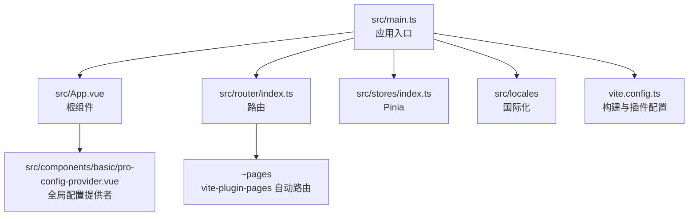
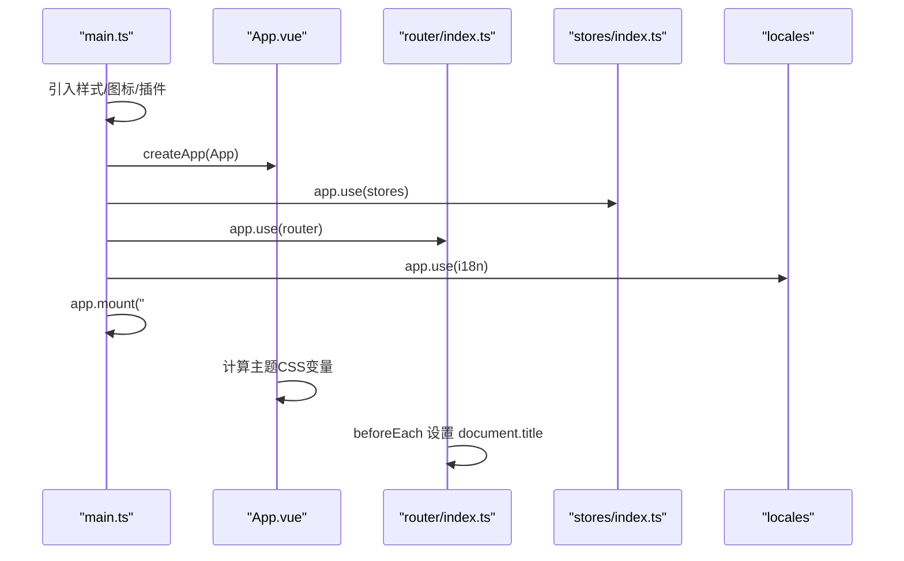
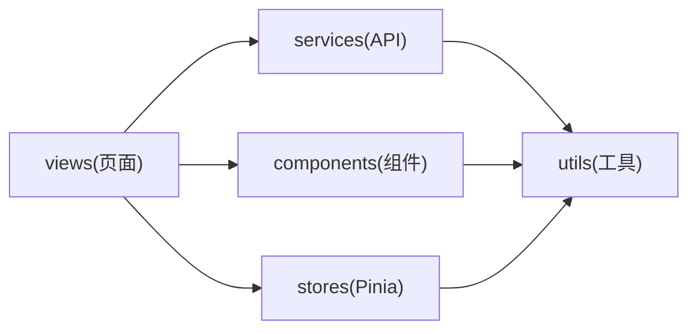
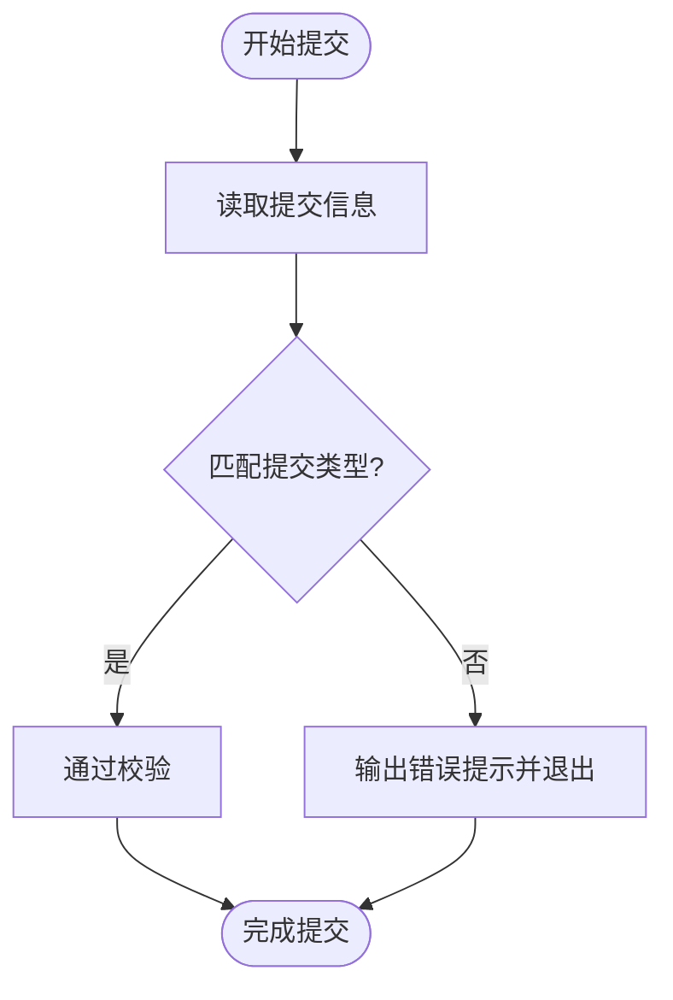
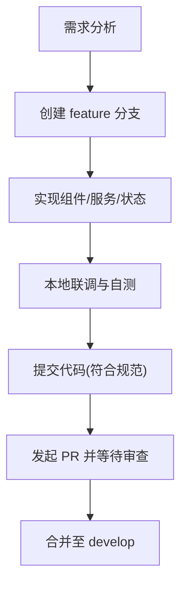
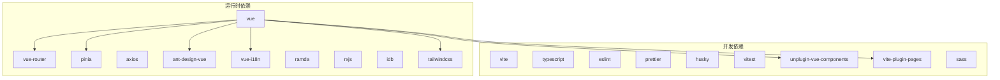

# 开发指南

<cite>
**本文引用的文件**   
- [README.md](file://README.md)
- [package.json](file://package.json)
- [.eslintrc.cjs](file://.eslintrc.cjs)
- [.prettierrc.json](file://.prettierrc.json)
- [vite.config.ts](file://vite.config.ts)
- [src/main.ts](file://src/main.ts)
- [src/App.vue](file://src/App.vue)
- [src/router/index.ts](file://src/router/index.ts)
- [src/stores/index.ts](file://src/stores/index.ts)
- [scripts/verifyCommit.js](file://scripts/verifyCommit.js)
- [.gitignore](file://.gitignore)
</cite>

## 目录
1. [引言](#引言)
2. [项目结构](#项目结构)
3. [核心组件](#核心组件)
4. [架构总览](#架构总览)
5. [详细组件分析](#详细组件分析)
6. [依赖分析](#依赖分析)
7. [性能考虑](#性能考虑)
8. [故障排查指南](#故障排查指南)
9. [结论](#结论)
10. [附录](#附录)

## 引言
本指南面向前端团队，统一代码规范、命名约定与文件组织方式；明确 Git 工作流、提交信息规范与 Code Review 流程；提供开发环境配置、IDE 推荐设置与快捷键建议；并给出新功能开发流程、重构指导、性能优化建议与常见问题解决方案。目标是提升团队协作效率与代码质量，降低维护成本。

## 项目结构
本项目基于 Vue 3 + Vite + TypeScript，采用模块化目录组织：
- src/components：基础与业务组件
- src/configs：应用配置
- src/enums：枚举定义
- src/locales：国际化资源与工具
- src/router：路由配置
- src/services：接口服务封装
- src/stores：Pinia 状态管理
- src/styles：样式与主题变量
- src/utils：通用工具函数
- src/views：页面视图（由 vite-plugin-pages 自动注册）

**图表来源**
- [src/main.ts:1-22](file://src/main.ts#L1-L22)
- [src/App.vue:1-43](file://src/App.vue#L1-L43)
- [src/router/index.ts:1-20](file://src/router/index.ts#L1-L20)
- [src/stores/index.ts:1-6](file://src/stores/index.ts#L1-L6)
- [vite.config.ts:1-100](file://vite.config.ts#L1-L100)

**章节来源**
- [README.md:1-53](file://README.md#L1-L53)
- [package.json:1-76](file://package.json#L1-L76)
- [vite.config.ts:1-100](file://vite.config.ts#L1-L100)

## 核心组件
- 应用入口与装配：在入口中引入样式、Ant Design Vue 重置样式、SVG 图标注册、App 根组件、路由、Pinia 与 i18n，并完成挂载。
- 根组件：通过全局配置提供者包裹路由视图，动态注入主题 CSS 变量，支持浅色/深色主题切换。
- 路由：使用 vue-router 与 vite-plugin-pages 自动生成路由，并在 beforeEach 中根据 meta.title 设置文档标题。
- 状态管理：使用 Pinia 创建 store 实例，供各模块复用。

**图表来源**
- [src/main.ts:1-22](file://src/main.ts#L1-L22)
- [src/App.vue:1-43](file://src/App.vue#L1-L43)
- [src/router/index.ts:1-20](file://src/router/index.ts#L1-L20)
- [src/stores/index.ts:1-6](file://src/stores/index.ts#L1-L6)

**章节来源**
- [src/main.ts:1-22](file://src/main.ts#L1-L22)
- [src/App.vue:1-43](file://src/App.vue#L1-L43)
- [src/router/index.ts:1-20](file://src/router/index.ts#L1-L20)
- [src/stores/index.ts:1-6](file://src/stores/index.ts#L1-L6)

## 架构总览
整体架构遵循“视图层 + 组件层 + 状态层 + 服务层 + 工具层”的分层模式：
- 视图层：views 下的页面组件，按功能域划分
- 组件层：components 下基础与业务组件，保持高内聚低耦合
- 状态层：stores 使用 Pinia 进行跨组件状态共享
- 服务层：services 封装 API 调用，统一错误处理与数据转换
- 工具层：utils 提供通用方法，如 axios 封装、日志、存储等

[此图为概念性架构图，不直接映射具体源码文件]

## 详细组件分析

### 代码规范与命名约定
- 语言与类型
  - 统一使用 TypeScript，组件使用 <script setup lang="ts">
  - 常量使用 UPPER_SNAKE_CASE，变量使用 camelCase，类名使用 PascalCase
- 文件与目录
  - 组件文件以 .vue 结尾，文件名使用 PascalCase
  - 工具函数以 .ts 结尾，文件名使用 camelCase
  - 枚举文件以 Enum 结尾，如 roleEnum.ts
  - 样式文件使用 SCSS，变量集中放在 styles/variables.scss
- 组件设计
  - 单一职责：每个组件只做一件事
  - Props 显式声明类型，避免 any
  - 事件命名使用动词短语，如 onOpen、onClose
- 样式
  - 优先使用 Tailwind 原子类，复杂样式放入 SCSS 模块
  - 主题变量通过 CSS 变量注入，便于运行时切换

**章节来源**
- [.eslintrc.cjs:1-20](file://.eslintrc.cjs#L1-L20)
- [.prettierrc.json:1-8](file://.prettierrc.json#L1-L8)
- [vite.config.ts:43-61](file://vite.config.ts#L43-L61)

### Git 工作流与提交信息规范
- 分支策略
  - main：生产分支
  - develop：开发分支
  - feature/*：功能分支
  - fix/*：修复分支
  - hotfix/*：紧急修复分支
- 提交信息规范
  - 使用 conventional commits 格式：type(scope): description
  - type 包括 feat、fix、docs、refactor、perf、test、build、ci、chore、types、wip、release、deps
  - 提交信息长度不超过 50 字符
- 钩子校验
  - 使用 scripts/verifyCommit.js 校验提交信息格式
  - 配合 husky 在 commit-msg 阶段执行校验脚本

**图表来源**
- [scripts/verifyCommit.js:1-25](file://scripts/verifyCommit.js#L1-L25)

**章节来源**
- [scripts/verifyCommit.js:1-25](file://scripts/verifyCommit.js#L1-L25)

### Code Review 流程
- 提交流程
  - 从 feature/* 或 fix/* 分支发起 Pull Request 到 develop
  - PR 描述需包含变更背景、影响范围、测试说明
- 审查要点
  - 代码可读性与可维护性
  - 是否遵循 ESLint/Prettier 规则
  - 是否存在潜在性能问题
  - 是否补充必要注释与文档
- 合并要求
  - 至少一名团队成员通过审查
  - CI 检查全部通过（lint、type-check、test）

[本节为流程性内容，不直接分析具体文件]

### 开发环境配置与 IDE 推荐
- Node 版本
  - 建议使用 Node 20+（参考 tsconfig.node 与依赖）
- 包管理器
  - 推荐使用 npm（项目 scripts 与 lock 文件基于 npm）
- IDE 与插件
  - VSCode + Volar（禁用 Vetur）
  - TypeScript Vue Plugin (Volar)
  - ESLint、Prettier、Tailwind CSS IntelliSense
- 快捷键建议
  - 保存时自动格式化（Prettier）
  - 打开命令面板快速查找与跳转
  - 使用多光标编辑与重构工具

**章节来源**
- [README.md:5-18](file://README.md#L5-L18)
- [package.json:35-68](file://package.json#L35-L68)

### 新功能开发流程
- 需求分析与设计
  - 明确用户故事、验收标准与边界条件
- 分支与实现
  - 创建 feature/* 分支，编写组件与服务
  - 使用 Pinia 管理状态，services 封装接口
- 自测与联调
  - 本地运行 dev 服务，验证交互与数据
  - 使用 mock 或代理调试后端接口
- 提交与评审
  - 遵循提交信息规范，发起 PR 并等待审查

[此图为概念性流程图，不直接映射具体源码文件]

### 代码重构指导
- 拆分大组件
  - 将复杂页面拆分为多个小组件，提高复用性
- 抽取公共逻辑
  - 将重复逻辑抽离为 utils 或 composables
- 类型完善
  - 消除 any，完善接口与类型定义
- 样式治理
  - 将内联样式迁移到 SCSS 模块，统一变量与主题

[本节为方法论内容，不直接分析具体文件]

### 性能优化建议
- 构建优化
  - 使用 unplugin-vue-components 按需引入 Ant Design Vue 组件
  - 使用 vite-plugin-top-level-await 优化异步加载
  - 对 locales/lang 单独分包，减少首屏体积
- 运行时优化
  - 合理使用 keep-alive 缓存页面
  - 列表渲染使用虚拟滚动（vue-virtual-scroller）
  - 图片与图标使用 SVG 与懒加载
- 网络优化
  - 接口请求使用 axios 封装，统一拦截器处理错误与重试
  - 合理设置缓存策略与分页

**章节来源**
- [vite.config.ts:17-41](file://vite.config.ts#L17-L41)
- [vite.config.ts:69-79](file://vite.config.ts#L69-L79)
- [package.json:17-34](file://package.json#L17-L34)

## 依赖分析
项目依赖主要分为运行时依赖与开发依赖：
- 运行时依赖
  - Vue 3、Vue Router、Pinia、Axios、Ant Design Vue、i18n、Ramda、RxJS、IDB、Tailwind 等
- 开发依赖
  - Vite、TypeScript、ESLint、Prettier、Husky、Vitest、unplugin-vue-components、vite-plugin-pages、tailwindcss、sass 等

**图表来源**
- [package.json:17-68](file://package.json#L17-L68)

**章节来源**
- [package.json:17-68](file://package.json#L17-L68)

## 性能考虑
- 构建阶段
  - 启用 topLevelAwait 提升异步模块加载体验
  - 对语言包进行独立分包，按需加载
  - 使用 PostCSS 与 Tailwind 优化 CSS 体积
- 运行阶段
  - 使用 CSS 变量动态注入主题，避免重绘
  - 合理使用 Pinia 状态，避免过度订阅
  - 接口请求去抖与防抖，减少无效请求
- 监控与度量
  - 使用浏览器 Performance API 与自定义埋点收集关键指标
  - 定期分析打包产物，定位大包与慢加载模块

[本节为通用性能建议，不直接分析具体文件]

## 故障排查指南
- 启动失败
  - 检查 Node 版本与依赖安装是否完整
  - 清理 node_modules 后重新安装
- 类型检查失败
  - 使用 vue-tsc 进行类型检查，定位类型错误
  - 确保 .d.ts 声明文件正确
- 样式异常
  - 检查 SCSS 变量导入路径是否正确
  - 确认 Tailwind 配置与 postcss 插件顺序
- 路由标题未更新
  - 检查 beforeEach 中 meta.title 是否存在
- 提交被拒绝
  - 检查提交信息是否符合 conventional commits 规范
  - 确认 husky 钩子已正确安装

**章节来源**
- [src/router/index.ts:10-18](file://src/router/index.ts#L10-L18)
- [scripts/verifyCommit.js:12-24](file://scripts/verifyCommit.js#L12-L24)
- [vite.config.ts:43-61](file://vite.config.ts#L43-L61)

## 结论
本指南明确了项目的代码规范、Git 工作流、Code Review 流程与环境配置，提供了新功能开发与重构的指导原则，以及性能优化与故障排查的实用建议。遵循本指南有助于提升团队协作效率与代码质量，保障项目长期可维护性。

## 附录
- 常用脚本
  - 开发：npm run dev
  - 构建：npm run build
  - 预览：npm run preview
  - 单元测试：npm run test:unit
  - 代码检查：npm run lint
  - 代码格式化：npm run format
  - 准备钩子：npm run prepare

**章节来源**
- [package.json:6-15](file://package.json#L6-L15)