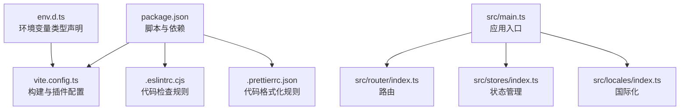
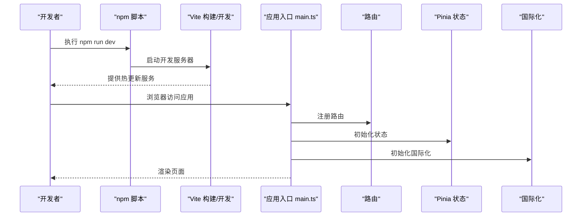

# 快速开始

<cite>
**本文引用的文件**   
- [package.json](file://package.json)
- [README.md](file://README.md)
- [vite.config.ts](file://vite.config.ts)
- [.eslintrc.cjs](file://.eslintrc.cjs)
- [.prettierrc.json](file://.prettierrc.json)
- [env.d.ts](file://env.d.ts)
- [src/main.ts](file://src/main.ts)
</cite>

## 目录
1. [简介](#简介)
2. [项目结构](#项目结构)
3. [环境要求](#环境要求)
4. [安装与运行](#安装与运行)
5. [开发工作流](#开发工作流)
6. [构建与预览](#构建与预览)
7. [常见问题排查](#常见问题排查)
8. [IDE 配置建议](#ide-配置建议)
9. [架构总览](#架构总览)
10. [结论](#结论)

## 简介
本指南面向首次接触该项目的开发者，帮助你在最短时间内完成环境准备、依赖安装、启动开发服务器、执行代码检查与格式化、运行单元测试以及构建生产版本。项目基于 Vue 3 + Vite + TypeScript，使用 Ant Design Vue 作为 UI 组件库，采用 Pinia 进行状态管理，Vitest 进行单元测试，ESLint + Prettier 保证代码质量。

## 项目结构
- 源码位于 src 目录，包含视图、组件、路由、国际化、服务层、状态管理等模块。
- 构建工具为 Vite，配置文件在根目录 vite.config.ts。
- 代码规范与格式化由 ESLint 和 Prettier 提供，脚本命令集中在 package.json。
- 环境变量类型定义在 env.d.ts，Vite 的 envDir 指向 env 目录（若存在 .env 文件可在此目录下创建）。

图表来源
- [package.json:6-15](file://package.json#L6-L15)
- [vite.config.ts:16-42](file://vite.config.ts#L16-L42)
- [.eslintrc.cjs:4-18](file://.eslintrc.cjs#L4-L18)
- [.prettierrc.json:1-8](file://.prettierrc.json#L1-L8)
- [env.d.ts:4-8](file://env.d.ts#L4-L8)
- [src/main.ts:1-21](file://src/main.ts#L1-L21)

章节来源
- [package.json:1-76](file://package.json#L1-L76)
- [vite.config.ts:1-100](file://vite.config.ts#L1-L100)
- [src/main.ts:1-22](file://src/main.ts#L1-L22)

## 环境要求
- Node.js：建议使用 v18 或更高版本（推荐 LTS）。
- 包管理器：npm（也可使用 pnpm/yarn，但请确保与仓库锁文件一致）。
- 操作系统：Windows/macOS/Linux 均可。

说明
- 项目 scripts 中使用了 npm-run-all2 等现代脚本工具，Node 版本过低可能导致解析失败。
- 项目类型为 module，需较新的 Node 支持。

章节来源
- [package.json:1-16](file://package.json#L1-L16)

## 安装与运行
- 安装依赖
  - 在项目根目录执行：npm install
- 启动开发服务器
  - 执行：npm run dev
  - 默认监听本地端口，浏览器访问提示地址即可。
- 代理配置
  - 开发时通过 Vite server.proxy 将 /api 请求转发至后端目标地址，便于联调。

章节来源
- [README.md:24-34](file://README.md#L24-L34)
- [vite.config.ts:81-98](file://vite.config.ts#L81-L98)

## 开发工作流
- 代码检查（ESLint）
  - 执行：npm run lint
  - 自动修复部分问题；未修复的问题会在控制台输出。
- 代码格式化（Prettier）
  - 执行：npm run format
  - 对 src 目录下的文件进行统一格式化。
- 单元测试（Vitest）
  - 执行：npm run test:unit
  - 以交互模式运行测试用例，支持 watch 模式。
- Git 钩子（Husky + lint-staged）
  - 提交前会对暂存区的 JS/TS/Vue 文件执行 Prettier 格式化，保证提交质量。

章节来源
- [package.json:6-15](file://package.json#L6-L15)
- [.eslintrc.cjs:4-18](file://.eslintrc.cjs#L4-L18)
- [.prettierrc.json:1-8](file://.prettierrc.json#L1-L8)

## 构建与预览
- 类型检查与构建
  - 执行：npm run build
  - 会先执行 vue-tsc 类型检查，再并行执行 Vite 构建，生成生产优化产物。
- 仅构建（跳过类型检查）
  - 执行：npm run build-only
- 预览生产构建结果
  - 执行：npm run preview
  - 用于本地验证构建产物的行为与性能。

章节来源
- [package.json:6-15](file://package.json#L6-L15)

## 常见问题排查
- 无法找到环境变量类型
  - 现象：ImportMetaEnv 报错或缺少属性提示。
  - 处理：确认 env.d.ts 已引入并正确声明了环境变量类型；如需新增变量，请在 ImportMetaEnv 接口中添加对应字段。
- 开发时 API 请求跨域
  - 现象：前端调用 /api 接口报跨域错误。
  - 处理：确认 vite.config.ts 中的 server.proxy 配置是否生效；必要时调整 target 与 rewrite 规则。
- 构建时报错或类型检查失败
  - 现象：npm run build 失败。
  - 处理：先执行 npm run type-check 查看具体类型错误；修复后重试构建。
- 样式变量未生效
  - 现象：SCSS 变量未识别。
  - 处理：确认 vite.config.ts 中 SCSS preprocessorOptions.additionalData 已导入全局变量文件。
- 图标资源未加载
  - 现象：SVG 图标不显示。
  - 处理：确认 vite.config.ts 中 createSvgIconsPlugin 配置的 iconDirs 路径正确，并在入口文件中注册 virtual:svg-icons-register。

章节来源
- [env.d.ts:4-8](file://env.d.ts#L4-L8)
- [vite.config.ts:29-41](file://vite.config.ts#L29-L41)
- [vite.config.ts:43-61](file://vite.config.ts#L43-L61)
- [vite.config.ts:81-98](file://vite.config.ts#L81-L98)

## IDE 配置建议
- VSCode 扩展
  - 安装 Volar（Vue Language Features）并禁用 Vetur。
  - 安装 TypeScript Vue Plugin (Volar) 以获得 .vue 文件的 TS 类型支持。
- 编辑器设置
  - 启用保存时自动格式化（Prettier）。
  - 开启 ESLint 集成，保存时自动修复可修复问题。
- 语言服务
  - 如感觉内置 TS 语言服务较慢，可在 VSCode 中启用 Volar 的 Take Over Mode。

章节来源
- [README.md:5-18](file://README.md#L5-L18)

## 架构总览
下图展示了应用入口如何挂载核心功能模块（路由、状态管理、国际化），以及构建与开发时的关键配置点。

图表来源
- [package.json:6-15](file://package.json#L6-L15)
- [src/main.ts:1-21](file://src/main.ts#L1-L21)

## 结论
按照本指南完成环境准备与依赖安装后，你可以通过 npm run dev 快速启动开发服务器，配合 ESLint 与 Prettier 保持代码质量，使用 Vitest 保障功能正确性，并通过 npm run build 产出生产版本。建议在 IDE 中启用 Volar 与 ESLint/Prettier 集成，以获得最佳开发体验。