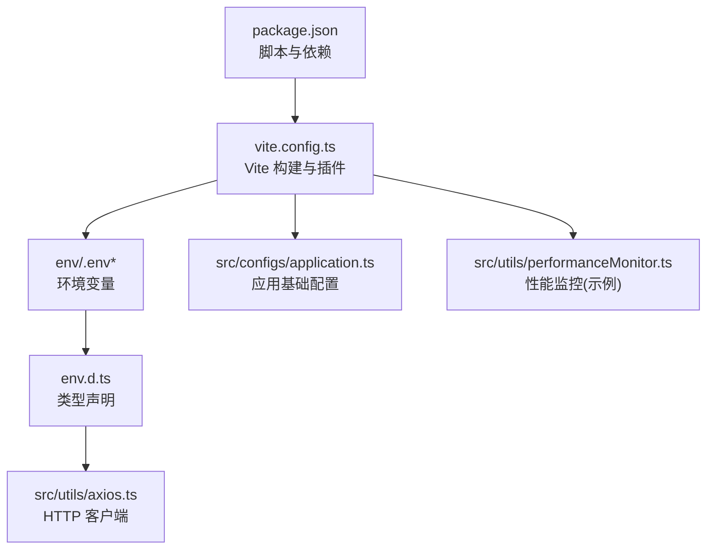
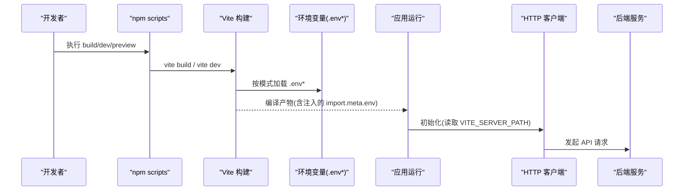
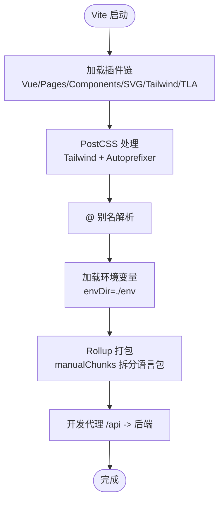
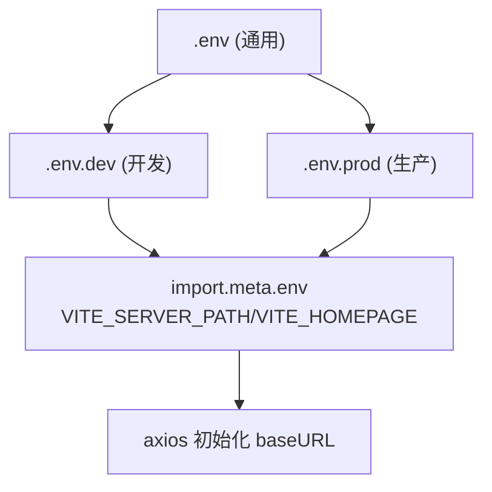
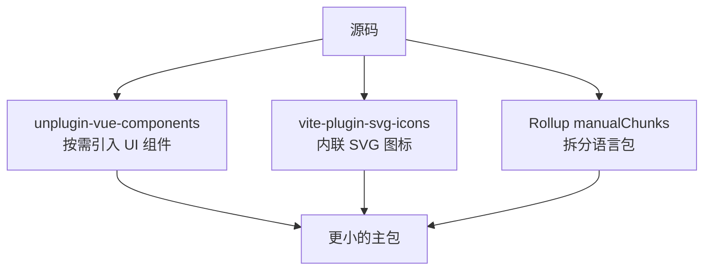
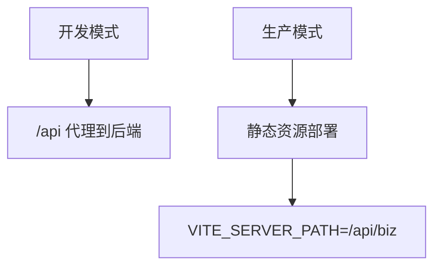
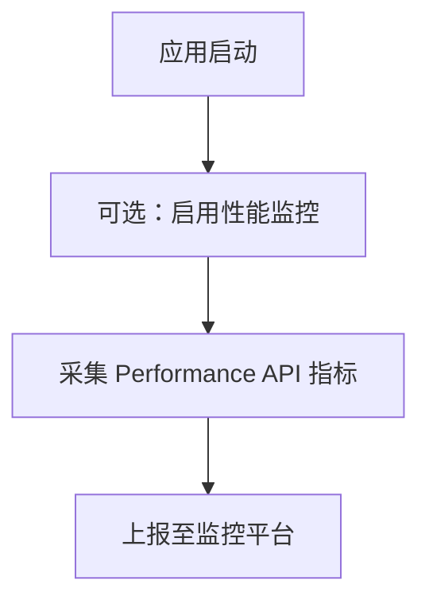
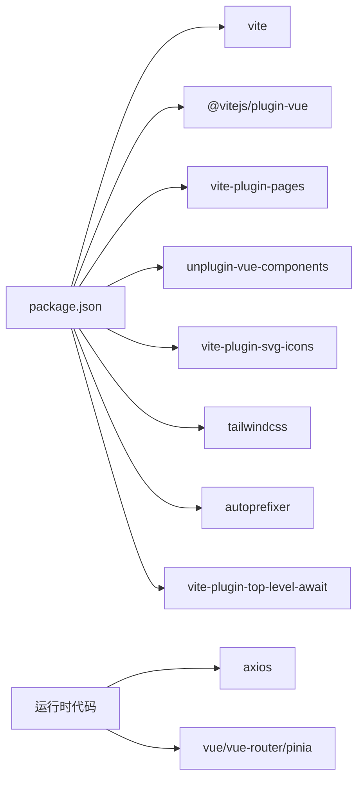

# 构建与部署

<cite>
**本文引用的文件**   
- [vite.config.ts](file://vite.config.ts)
- [package.json](file://package.json)
- [.env](file://env/.env)
- [.env.dev](file://env/.env.dev)
- [.env.prod](file://env/.env.prod)
- [env.d.ts](file://env.d.ts)
- [application.ts](file://src/configs/application.ts)
- [axios.ts](file://src/utils/axios.ts)
- [performanceMonitor.ts](file://src/utils/performanceMonitor.ts)
</cite>

## 目录
1. [简介](#简介)
2. [项目结构](#项目结构)
3. [核心组件](#核心组件)
4. [架构总览](#架构总览)
5. [详细组件分析](#详细组件分析)
6. [依赖关系分析](#依赖关系分析)
7. [性能考量](#性能考量)
8. [故障排查指南](#故障排查指南)
9. [结论](#结论)
10. [附录](#附录)

## 简介
本指南面向前端工程化与交付，围绕 Vite 构建配置、环境变量管理、代码分割优化展开，并补充开发/生产环境差异、构建产物分析与性能监控集成。同时提供 CI/CD 流水线建议、Docker 容器化与云服务部署方案，以及构建性能优化、资源压缩与缓存策略的最佳实践。

## 项目结构
本项目采用 Vite + Vue 3 + TypeScript 技术栈，关键构建与环境相关文件如下：
- 构建入口与插件：vite.config.ts
- 脚本命令与依赖：package.json
- 环境变量：env/.env、env/.env.dev、env/.env.prod
- 类型声明：env.d.ts
- 应用基础配置：src/configs/application.ts
- HTTP 客户端（使用环境变量）：src/utils/axios.ts
- 性能监控（示例模板，已注释）：src/utils/performanceMonitor.ts

**图表来源**
- [package.json:6-15](file://package.json#L6-L15)
- [vite.config.ts:16-42](file://vite.config.ts#L16-L42)
- [.env:1-2](file://env/.env#L1-L2)
- [.env.dev:1-2](file://env/.env.dev#L1-L2)
- [.env.prod:1-2](file://env/.env.prod#L1-L2)
- [env.d.ts:5-8](file://env.d.ts#L5-L8)
- [axios.ts:28-34](file://src/utils/axios.ts#L28-L34)
- [application.ts:1-6](file://src/configs/application.ts#L1-L6)
- [performanceMonitor.ts:1-192](file://src/utils/performanceMonitor.ts#L1-L192)

**章节来源**
- [package.json:6-15](file://package.json#L6-L15)
- [vite.config.ts:16-42](file://vite.config.ts#L16-L42)
- [.env:1-2](file://env/.env#L1-L2)
- [.env.dev:1-2](file://env/.env.dev#L1-L2)
- [.env.prod:1-2](file://env/.env.prod#L1-L2)
- [env.d.ts:5-8](file://env.d.ts#L5-L8)
- [axios.ts:28-34](file://src/utils/axios.ts#L28-L34)
- [application.ts:1-6](file://src/configs/application.ts#L1-L6)
- [performanceMonitor.ts:1-192](file://src/utils/performanceMonitor.ts#L1-L192)

## 核心组件
- 构建系统与插件链
  - Vite 核心与 Vue 插件、页面路由插件、组件自动导入、SVG 图标插件、TailwindCSS/Autoprefixer、Top-Level Await 支持等。
- 环境变量系统
  - 通过 envDir 指定 env 目录；不同模式加载对应 .env.* 文件；类型在 env.d.ts 中声明；运行时由 import.meta.env 读取。
- HTTP 客户端
  - 基于 axios 封装，从环境变量读取 API 基地址，统一拦截器处理错误与重复请求防护。
- 应用基础配置
  - 应用标识与名称集中管理。

**章节来源**
- [vite.config.ts:16-42](file://vite.config.ts#L16-L42)
- [vite.config.ts:63-69](file://vite.config.ts#L63-L69)
- [env.d.ts:5-8](file://env.d.ts#L5-L8)
- [axios.ts:28-34](file://src/utils/axios.ts#L28-L34)
- [application.ts:1-6](file://src/configs/application.ts#L1-L6)

## 架构总览
下图展示构建期与运行期的关键路径：脚本触发 Vite 构建，Vite 根据模式加载环境变量，注入到运行时；HTTP 客户端在启动时读取环境变量设置 baseURL；可选的性能监控模块用于采集与上报指标。

**图表来源**
- [package.json:6-15](file://package.json#L6-L15)
- [vite.config.ts:68-69](file://vite.config.ts#L68-L69)
- [.env:1-2](file://env/.env#L1-L2)
- [.env.dev:1-2](file://env/.env.dev#L1-L2)
- [.env.prod:1-2](file://env/.env.prod#L1-L2)
- [axios.ts:28-34](file://src/utils/axios.ts#L28-L34)

## 详细组件分析

### Vite 构建配置
- 插件体系
  - Vue 单文件组件支持、页面路由自动生成、Ant Design Vue 组件按需引入、SVG 图标内联、TailwindCSS 与 Autoprefixer、Top-Level Await 支持。
- CSS 预处理
  - PostCSS 管线集成 TailwindCSS 与 Autoprefixer；SCSS 全局变量注入。
- 路径别名
  - @ 指向 src 目录。
- 环境变量目录
  - envDir 指向 ./env，按模式加载 .env.*。
- 构建输出与代码分割
  - 通过 Rollup manualChunks 将语言包独立分包，利于浏览器缓存与懒加载。
- 开发服务器代理
  - 本地开发时将 /api 转发至目标后端地址，便于跨域调试。

**图表来源**
- [vite.config.ts:16-42](file://vite.config.ts#L16-L42)
- [vite.config.ts:43-62](file://vite.config.ts#L43-L62)
- [vite.config.ts:63-69](file://vite.config.ts#L63-L69)
- [vite.config.ts:69-80](file://vite.config.ts#L69-L80)
- [vite.config.ts:81-98](file://vite.config.ts#L81-L98)

**章节来源**
- [vite.config.ts:16-42](file://vite.config.ts#L16-L42)
- [vite.config.ts:43-62](file://vite.config.ts#L43-L62)
- [vite.config.ts:63-69](file://vite.config.ts#L63-L69)
- [vite.config.ts:69-80](file://vite.config.ts#L69-L80)
- [vite.config.ts:81-98](file://vite.config.ts#L81-L98)

### 环境变量管理
- 文件组织
  - 根级 .env：通用变量
  - .env.dev：开发环境覆盖
  - .env.prod：生产环境覆盖
- 类型安全
  - env.d.ts 声明 ImportMetaEnv，确保 TS 对 VITE_* 变量的类型提示。
- 运行时使用
  - axios 在构造时读取 VITE_SERVER_PATH 作为 baseURL，实现多环境 API 前缀切换。

**图表来源**
- [.env:1-2](file://env/.env#L1-L2)
- [.env.dev:1-2](file://env/.env.dev#L1-L2)
- [.env.prod:1-2](file://env/.env.prod#L1-L2)
- [env.d.ts:5-8](file://env.d.ts#L5-L8)
- [axios.ts:28-34](file://src/utils/axios.ts#L28-L34)

**章节来源**
- [.env:1-2](file://env/.env#L1-L2)
- [.env.dev:1-2](file://env/.env.dev#L1-L2)
- [.env.prod:1-2](file://env/.env.prod#L1-L2)
- [env.d.ts:5-8](file://env.d.ts#L5-L8)
- [axios.ts:28-34](file://src/utils/axios.ts#L28-L34)

### 代码分割与优化
- 语言包分包
  - 将 src/locales/lang 下的国际化资源抽离为独立 chunk，提升缓存命中与首屏加载效率。
- 组件按需引入
  - 通过 unplugin-vue-components 与 AntDesignVueResolver 实现 UI 库按需引入，减少体积。
- SVG 图标内联
  - 使用 vite-plugin-svg-icons 将图标转为内联 Symbol，减少网络请求。
- Top-Level Await
  - 启用 TLA 支持，简化异步初始化逻辑。

**图表来源**
- [vite.config.ts:16-42](file://vite.config.ts#L16-L42)
- [vite.config.ts:69-80](file://vite.config.ts#L69-L80)

**章节来源**
- [vite.config.ts:16-42](file://vite.config.ts#L16-L42)
- [vite.config.ts:69-80](file://vite.config.ts#L69-L80)

### 开发环境与生产环境差异
- 开发环境
  - 使用 vite dev 启动 HMR 热更新；dev server 代理 /api 到后端，便于本地联调。
- 生产环境
  - 使用 vite build 生成静态资源；API 基地址通过 .env.prod 中的 VITE_SERVER_PATH 控制；预览使用 vite preview。

**图表来源**
- [vite.config.ts:81-98](file://vite.config.ts#L81-L98)
- [.env.prod:1-2](file://env/.env.prod#L1-L2)
- [package.json:6-15](file://package.json#L6-L15)

**章节来源**
- [vite.config.ts:81-98](file://vite.config.ts#L81-L98)
- [.env.prod:1-2](file://env/.env.prod#L1-L2)
- [package.json:6-15](file://package.json#L6-L15)

### 构建产物分析与性能监控集成
- 构建产物分析
  - 可结合第三方工具（如 rollup-plugin-visualizer）或 Vite 生态插件进行可视化分析，定位大体积依赖与冗余代码。
- 性能监控
  - 项目包含性能监控示例模板（已注释），可按需启用，采集白屏时间、DOMReady、onload 等指标并通过 sendBeacon 或图片上报。

**图表来源**
- [performanceMonitor.ts:1-192](file://src/utils/performanceMonitor.ts#L1-L192)

**章节来源**
- [performanceMonitor.ts:1-192](file://src/utils/performanceMonitor.ts#L1-L192)

## 依赖关系分析
- 构建期依赖
  - Vite、@vitejs/plugin-vue、vite-plugin-pages、unplugin-vue-components、vite-plugin-svg-icons、tailwindcss、autoprefixer、vite-plugin-top-level-await。
- 运行期依赖
  - vue、vue-router、pinia、ant-design-vue、axios、vue-i18n 等。

**图表来源**
- [package.json:17-68](file://package.json#L17-L68)

**章节来源**
- [package.json:17-68](file://package.json#L17-L68)

## 性能考量
- 构建性能优化
  - 使用并行任务（如 npm-run-all）组合 type-check 与 build-only，缩短整体构建时间。
  - 合理配置 SCSS 全局变量注入，避免重复计算。
- 资源体积优化
  - 组件按需引入、SVG 内联、语言包独立分包，降低主包体积。
- 缓存策略
  - 利用浏览器缓存与 CDN 缓存，结合版本化文件名（Vite 默认行为）提升命中率。
- 网络优化
  - 开发阶段使用代理减少跨域问题；生产环境通过反向代理或网关统一接入后端接口。

[本节为通用指导，不直接分析具体文件]

## 故障排查指南
- 环境变量未生效
  - 确认 envDir 指向正确；检查 .env.* 文件命名与键名是否匹配 env.d.ts 声明；确认构建模式是否正确（dev/prod）。
- API 请求失败
  - 检查 axios 初始化的 baseURL 是否来自正确的环境变量；核对后端路径与代理配置；查看拦截器错误提示。
- 重复提交导致报错
  - 封装层内置防抖去重逻辑，若频繁出现“操作过快”提示，请检查业务调用频率与用户交互设计。
- 下载文件异常
  - 确认响应头 Content-Disposition 存在且格式正确；检查 responseType 是否为 blob。

**章节来源**
- [vite.config.ts:68-69](file://vite.config.ts#L68-L69)
- [env.d.ts:5-8](file://env.d.ts#L5-L8)
- [axios.ts:28-34](file://src/utils/axios.ts#L28-L34)
- [axios.ts:36-66](file://src/utils/axios.ts#L36-L66)
- [axios.ts:104-125](file://src/utils/axios.ts#L104-L125)

## 结论
本项目以 Vite 为核心，配合完善的插件链与清晰的环境变量管理，实现了高效的开发与构建体验。通过按需引入、SVG 内联与语言包分包等手段，有效控制了资源体积。建议在后续迭代中持续引入构建产物分析与性能监控能力，并结合 CI/CD 与容器化部署，形成稳定可靠的交付流程。

[本节为总结性内容，不直接分析具体文件]

## 附录

### 构建与预览命令
- 开发：npm run dev
- 构建：npm run build（包含类型检查与仅构建）
- 预览：npm run preview

**章节来源**
- [package.json:6-15](file://package.json#L6-L15)

### CI/CD 流水线建议
- 步骤建议
  - 安装依赖 -> 类型检查 -> 构建 -> 产物校验 -> 推送镜像/上传 CDN
- 缓存策略
  - 缓存 node_modules 与 Vite 缓存目录，加速二次构建
- 质量门禁
  - 集成 ESLint/Prettier 校验，失败即阻断流水线

[本节为通用指导，不直接分析具体文件]

### Docker 容器化部署
- 多阶段构建
  - 构建阶段：Node 镜像安装依赖并执行构建
  - 运行阶段：Nginx 镜像托管静态资源
- 环境变量注入
  - 通过 Nginx 配置或运行时注入 VITE_SERVER_PATH 等变量
- 健康检查与端口映射
  - 暴露 80 端口，配置健康检查探针

[本节为通用指导，不直接分析具体文件]

### 云服务部署方案
- 静态站点托管
  - 将构建产物上传至对象存储/CDN，配置域名与缓存策略
- 反向代理
  - 通过网关或负载均衡统一处理 /api 转发至后端服务
- 灰度与回滚
  - 借助云平台的发布能力实现灰度发布与快速回滚

[本节为通用指导，不直接分析具体文件]