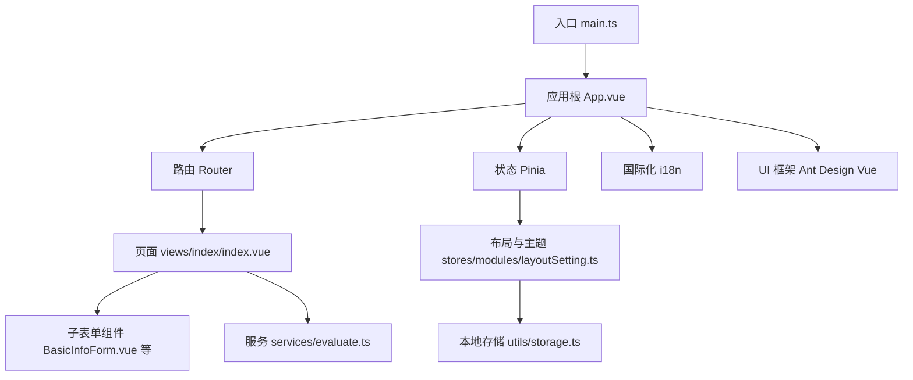
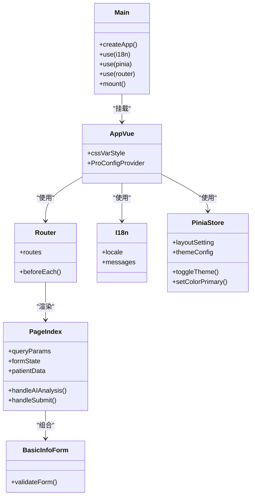
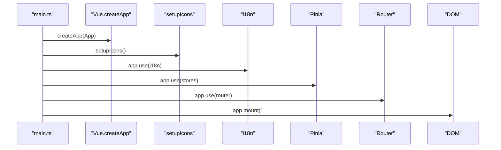
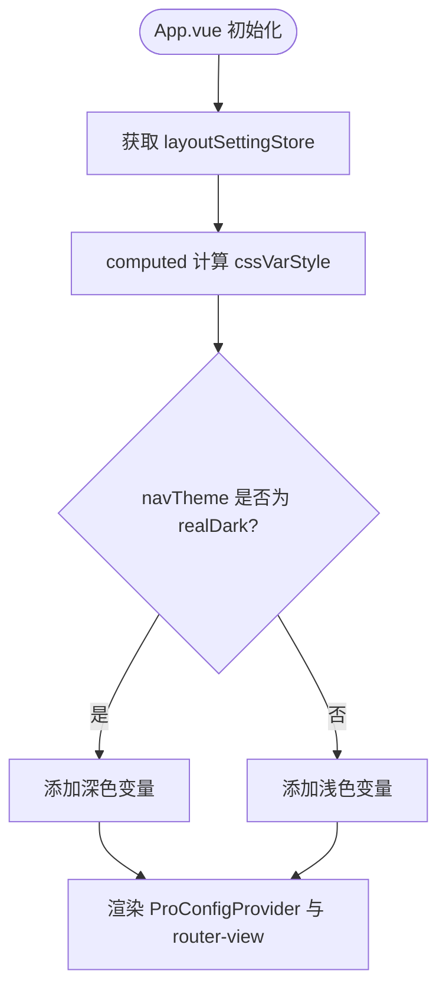
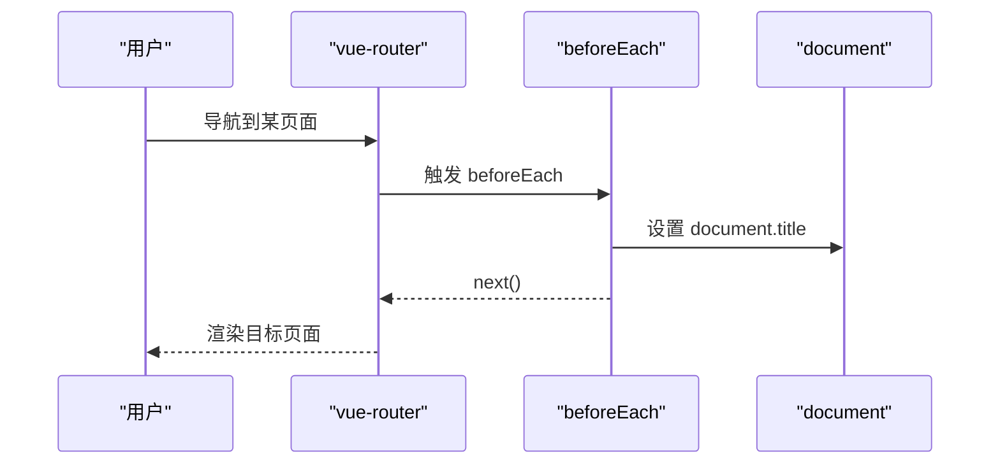
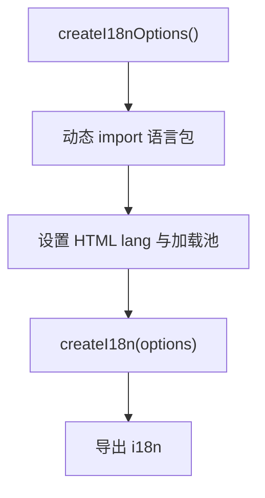
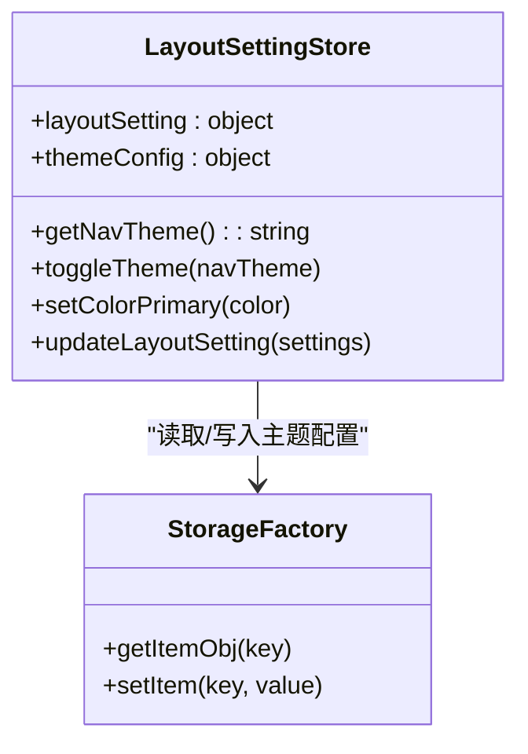
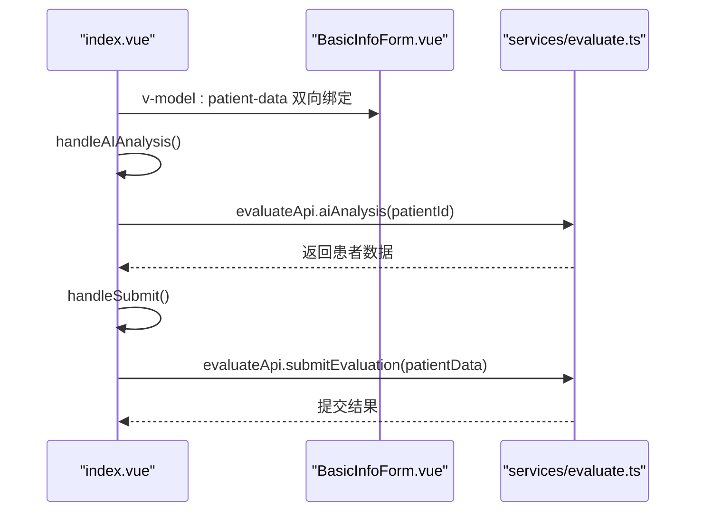
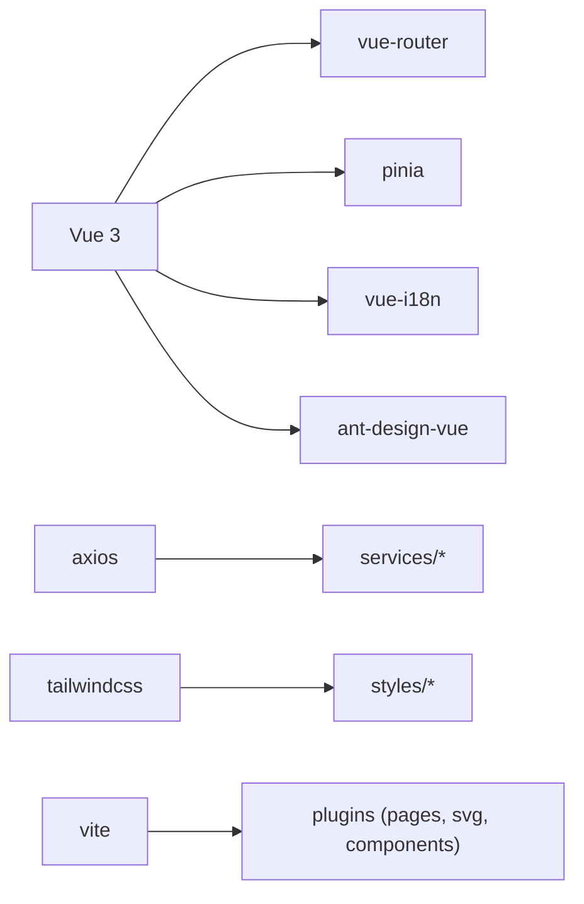

# 整体架构

<cite>
**本文引用的文件**   
- [package.json](file://package.json)
- [vite.config.ts](file://vite.config.ts)
- [src/main.ts](file://src/main.ts)
- [src/App.vue](file://src/App.vue)
- [src/router/index.ts](file://src/router/index.ts)
- [src/locales/index.ts](file://src/locales/index.ts)
- [src/stores/index.ts](file://src/stores/index.ts)
- [src/stores/modules/layoutSetting.ts](file://src/stores/modules/layoutSetting.ts)
- [src/components/basic/pro-config-provider.vue](file://src/components/basic/pro-config-provider.vue)
- [src/views/index/index.vue](file://src/views/index/index.vue)
- [src/views/index/components/BasicInfoForm.vue](file://src/views/index/components/BasicInfoForm.vue)
- [src/utils/storage.ts](file://src/utils/storage.ts)
</cite>

## 目录
1. [引言](#引言)
2. [项目结构](#项目结构)
3. [核心组件](#核心组件)
4. [架构总览](#架构总览)
5. [详细组件分析](#详细组件分析)
6. [依赖关系分析](#依赖关系分析)
7. [性能与构建优化](#性能与构建优化)
8. [开发环境与生产环境配置](#开发环境与生产环境配置)
9. [故障排查指南](#故障排查指南)
10. [结论](#结论)

## 引言
本文件为“协和麻醉科智能评估系统”的前端整体架构文档，聚焦于 MVVM 架构模式在 Vue 3 + TypeScript + Ant Design Vue 技术栈中的落地方式。文档从系统边界、外部依赖、核心模块交互入手，详细说明 Model（数据模型）、View（视图组件）、ViewModel（状态管理）的职责划分；阐述应用启动流程与插件注册机制；并给出构建配置、开发环境与生产环境的优化策略。

## 项目结构
项目采用基于功能域与层次混合的组织方式：
- src/views：页面级视图（如评估主页面）
- src/components：基础与业务组件
- src/stores：Pinia 状态管理
- src/services：API 服务封装
- src/locales：国际化资源与工具
- src/router：路由配置
- src/styles：样式与主题变量
- src/utils：通用工具（存储、日志、校验等）
- vite.config.ts：Vite 构建与插件配置
- package.json：依赖与脚本

图表来源
- [src/main.ts:1-22](file://src/main.ts#L1-L22)
- [src/App.vue:1-43](file://src/App.vue#L1-L43)
- [src/router/index.ts:1-20](file://src/router/index.ts#L1-L20)
- [src/locales/index.ts:1-39](file://src/locales/index.ts#L1-L39)
- [src/stores/index.ts:1-6](file://src/stores/index.ts#L1-L6)
- [src/stores/modules/layoutSetting.ts:1-126](file://src/stores/modules/layoutSetting.ts#L1-L126)
- [src/views/index/index.vue:1-800](file://src/views/index/index.vue#L1-L800)
- [src/views/index/components/BasicInfoForm.vue:108-169](file://src/views/index/components/BasicInfoForm.vue#L108-L169)
- [src/utils/storage.ts:1-38](file://src/utils/storage.ts#L1-L38)

章节来源
- [package.json:1-76](file://package.json#L1-L76)
- [vite.config.ts:1-100](file://vite.config.ts#L1-L100)

## 核心组件
- 应用入口与插件挂载：main.ts 负责创建 Vue 应用实例，安装国际化、状态管理、路由，并挂载到 DOM。
- 根组件与主题注入：App.vue 通过 ProConfigProvider 包裹全局 UI 配置，动态计算 CSS 变量以适配主题。
- 路由与页面：router/index.ts 使用 vite-plugin-pages 自动生成路由，并在 beforeEach 中设置页面标题。
- 国际化：locales/index.ts 异步加载当前语言包，初始化 vue-i18n。
- 状态管理：stores/index.ts 创建 Pinia 实例；layoutSetting.ts 提供布局与主题状态，联动 Ant Design Vue 的 ConfigProvider。
- 视图层：views/index/index.vue 聚合多个评估子表单，组织查询参数、表单状态与提交逻辑。
- 基础组件：components/basic/pro-config-provider.vue 统一注入 Ant Design Vue 的主题与语言。

章节来源
- [src/main.ts:1-22](file://src/main.ts#L1-L22)
- [src/App.vue:1-43](file://src/App.vue#L1-L43)
- [src/router/index.ts:1-20](file://src/router/index.ts#L1-L20)
- [src/locales/index.ts:1-39](file://src/locales/index.ts#L1-L39)
- [src/stores/index.ts:1-6](file://src/stores/index.ts#L1-L6)
- [src/stores/modules/layoutSetting.ts:1-126](file://src/stores/modules/layoutSetting.ts#L1-L126)
- [src/components/basic/pro-config-provider.vue:1-39](file://src/components/basic/pro-config-provider.vue#L1-L39)
- [src/views/index/index.vue:1-800](file://src/views/index/index.vue#L1-L800)

## 架构总览
本项目遵循 MVVM 模式：
- Model（数据模型）
  - 类型定义与数据结构位于各组件与服务文件中，例如评估表单的数据结构与接口类型在页面与服务中声明。
  - 持久化数据通过 Pinia store 与本地存储（utils/storage.ts）进行读写。
- View（视图组件）
  - 页面与组件使用 Vue 3 Composition API（script setup），通过模板渲染用户界面，绑定响应式数据与方法。
- ViewModel（状态管理）
  - 使用 Pinia 管理跨组件共享状态（如布局与主题），并通过 computed/watchPostEffect 驱动 UI 更新。
  - 组件内部的状态与逻辑通过 ref/reactive/computed 组织，保持高内聚低耦合。

图表来源
- [src/main.ts:1-22](file://src/main.ts#L1-L22)
- [src/App.vue:1-43](file://src/App.vue#L1-L43)
- [src/router/index.ts:1-20](file://src/router/index.ts#L1-L20)
- [src/locales/index.ts:1-39](file://src/locales/index.ts#L1-L39)
- [src/stores/modules/layoutSetting.ts:1-126](file://src/stores/modules/layoutSetting.ts#L1-L126)
- [src/views/index/index.vue:1-800](file://src/views/index/index.vue#L1-L800)
- [src/views/index/components/BasicInfoForm.vue:108-169](file://src/views/index/components/BasicInfoForm.vue#L108-L169)

## 详细组件分析

### 应用启动与插件注册
- 入口 main.ts 依次引入样式、Ant Design Vue 重置样式、SVG 图标虚拟模块、根组件、路由、Pinia、i18n 与图标初始化。
- 创建应用实例后，调用 setupIcons 初始化图标，然后按顺序 use(i18n)、use(stores)、use(router)，最后 mount 到 #qsd。

图表来源
- [src/main.ts:1-22](file://src/main.ts#L1-L22)

章节来源
- [src/main.ts:1-22](file://src/main.ts#L1-L22)

### 根组件与主题注入
- App.vue 通过 ProConfigProvider 包裹 router-view，动态将 Ant Design Vue 的 token 映射为 CSS 变量，并根据 layoutSetting 的 navTheme 调整浅色/深色变量。
- 使用 storeToRefs 解构布局设置，结合 ramda keys 遍历 token 生成样式对象。

图表来源
- [src/App.vue:1-43](file://src/App.vue#L1-L43)
- [src/stores/modules/layoutSetting.ts:1-126](file://src/stores/modules/layoutSetting.ts#L1-L126)

章节来源
- [src/App.vue:1-43](file://src/App.vue#L1-L43)
- [src/components/basic/pro-config-provider.vue:1-39](file://src/components/basic/pro-config-provider.vue#L1-L39)

### 路由与页面标题
- router/index.ts 使用 vite-plugin-pages 自动导入 routes，并在 beforeEach 中根据 to.meta.title 设置 document.title。

图表来源
- [src/router/index.ts:1-20](file://src/router/index.ts#L1-L20)

章节来源
- [src/router/index.ts:1-20](file://src/router/index.ts#L1-L20)

### 国际化初始化
- locales/index.ts 通过 createI18nOptions 异步加载当前语言包，设置 locale、fallbackLocale、messages 等选项，并导出 i18n 实例供应用使用。

图表来源
- [src/locales/index.ts:1-39](file://src/locales/index.ts#L1-L39)

章节来源
- [src/locales/index.ts:1-39](file://src/locales/index.ts#L1-L39)

### 状态管理与主题切换
- stores/modules/layoutSetting.ts 使用 defineStore 定义布局与主题状态，包含默认配置、主题算法、主色、监听变化并同步到 localStorage。
- toggleTheme 控制 html.dark 类名，setColorPrimary 更新主题 token，updateLayoutSetting 合并新配置。

图表来源
- [src/stores/modules/layoutSetting.ts:1-126](file://src/stores/modules/layoutSetting.ts#L1-L126)
- [src/utils/storage.ts:1-38](file://src/utils/storage.ts#L1-L38)

章节来源
- [src/stores/modules/layoutSetting.ts:1-126](file://src/stores/modules/layoutSetting.ts#L1-L126)
- [src/utils/storage.ts:1-38](file://src/utils/storage.ts#L1-L38)

### 评估页面与表单组合
- views/index/index.vue 作为评估主页面，聚合多个子表单组件（基本信息、一般情况、个人史、气道评估、辅助检查、器官系统评估、专病评估）。
- 页面维护 queryParams、formState、patientData 等响应式数据，并提供 AI 分析与提交方法。
- BasicInfoForm.vue 暴露 validateForm 方法供父组件校验。

图表来源
- [src/views/index/index.vue:1-800](file://src/views/index/index.vue#L1-L800)
- [src/views/index/components/BasicInfoForm.vue:108-169](file://src/views/index/components/BasicInfoForm.vue#L108-L169)

章节来源
- [src/views/index/index.vue:1-800](file://src/views/index/index.vue#L1-L800)
- [src/views/index/components/BasicInfoForm.vue:108-169](file://src/views/index/components/BasicInfoForm.vue#L108-L169)

## 依赖关系分析
- 运行时依赖
  - Vue 3、Vue Router、Pinia、Ant Design Vue、Axios、Vue I18n、RxJS、Ramda、TailwindCSS、Vite 生态插件等。
- 构建与开发依赖
  - Vite、TypeScript、ESLint、Prettier、Husky、vitest、unplugin-vue-components、vite-plugin-pages、vite-plugin-svg-icons、tailwindcss、autoprefixer 等。

图表来源
- [package.json:17-68](file://package.json#L17-L68)

章节来源
- [package.json:1-76](file://package.json#L1-L76)

## 性能与构建优化
- 代码分割与按需加载
  - unplugin-vue-components 配合 AntDesignVueResolver 实现 Ant Design Vue 组件按需引入，减少打包体积。
  - vite-plugin-pages 自动生成路由，避免手动维护路由表带来的冗余。
- 静态资源优化
  - vite-plugin-svg-icons 缓存 SVG 图标，提升图标渲染性能。
- 构建产物优化
  - manualChunks 将语言包独立拆分，利于浏览器缓存与懒加载。
- CSS 处理
  - PostCSS 集成 autoprefixer 与 tailwindcss，SCSS additionalData 注入全局变量，减少重复样式。
- 开发体验
  - envDir 指定环境变量目录，便于多环境配置管理。
  - server.proxy 配置后端代理，简化开发联调。

章节来源
- [vite.config.ts:1-100](file://vite.config.ts#L1-L100)

## 开发环境与生产环境配置
- 开发环境
  - 运行脚本：dev 使用 vite 启动开发服务器。
  - 代理：/api 请求转发至 http://10.125.48.192:8082，支持 changeOrigin 与 rewrite。
  - 热更新与调试：Vite 原生 HMR，配合 @vitejs/plugin-vue。
- 生产环境
  - 构建脚本：build 执行 type-check 与 build-only，确保类型安全与产物输出。
  - 预览：preview 使用 vite preview 验证构建产物。
  - 代码质量：lint 与 format 分别使用 ESLint 与 Prettier，husky 与 lint-staged 保证提交前规范。

章节来源
- [package.json:6-15](file://package.json#L6-L15)
- [vite.config.ts:81-98](file://vite.config.ts#L81-L98)

## 故障排查指南
- 主题不生效
  - 检查 layoutSetting 是否成功写入 localStorage，以及 html.dark 类名是否正确切换。
  - 确认 ProConfigProvider 的 theme 与 token 是否被正确计算与传递。
- 国际化缺失
  - 确认 locales/index.ts 动态加载的语言包是否存在，且 message 字段完整。
- 路由标题未更新
  - 检查 router/index.ts 的 beforeEach 是否执行，to.meta.title 是否存在。
- 表单校验失败
  - 检查子组件是否暴露 validateForm，父组件是否正确调用并处理返回值。
- 网络请求异常
  - 检查 services 层的错误处理与消息提示逻辑，确认代理配置与后端地址可达。

章节来源
- [src/stores/modules/layoutSetting.ts:87-115](file://src/stores/modules/layoutSetting.ts#L87-L115)
- [src/locales/index.ts:9-38](file://src/locales/index.ts#L9-L38)
- [src/router/index.ts:10-18](file://src/router/index.ts#L10-L18)
- [src/views/index/components/BasicInfoForm.vue:110-128](file://src/views/index/components/BasicInfoForm.vue#L110-L128)

## 结论
本项目以 Vue 3 + TypeScript + Ant Design Vue 为核心技术栈，采用 MVVM 架构模式，清晰划分 Model、View、ViewModel 职责。通过 Pinia 管理全局状态，结合 ProConfigProvider 实现主题与语言的统一配置；Vite 生态插件提升开发与构建效率。评估页面以 Composition API 组织逻辑，聚合多子表单完成复杂业务场景。整体架构具备良好的可维护性与扩展性，适合医疗专业场景下的复杂表单与交互需求。