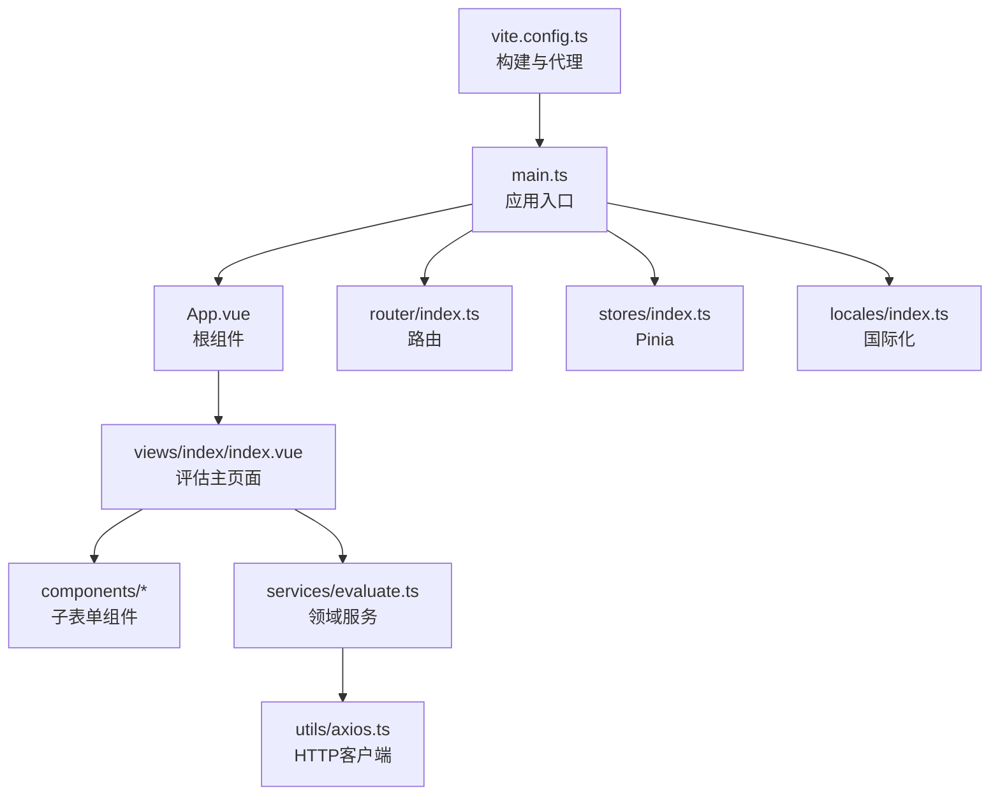
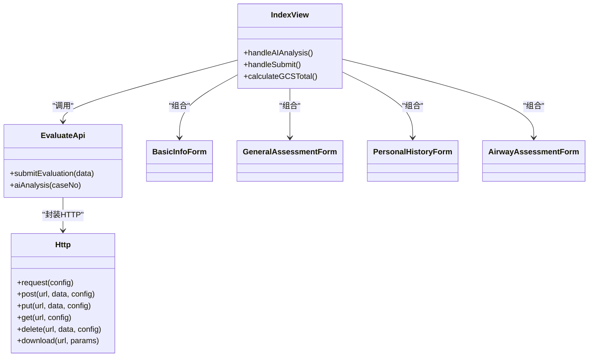
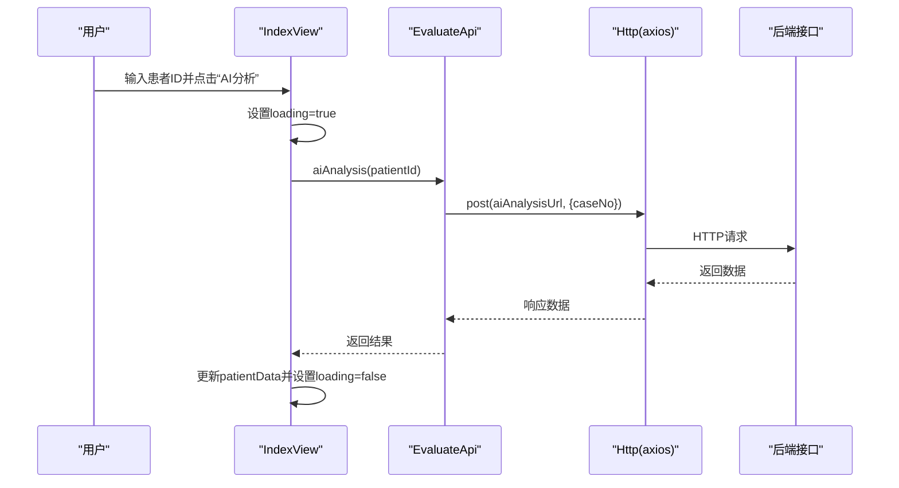
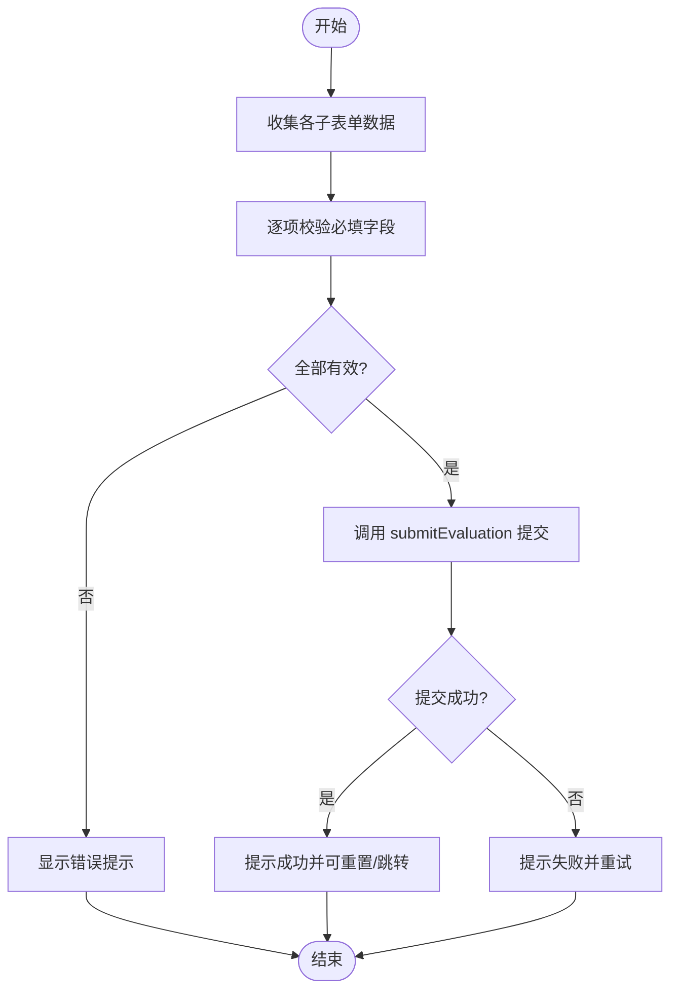
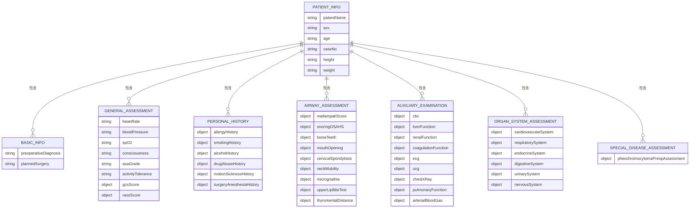
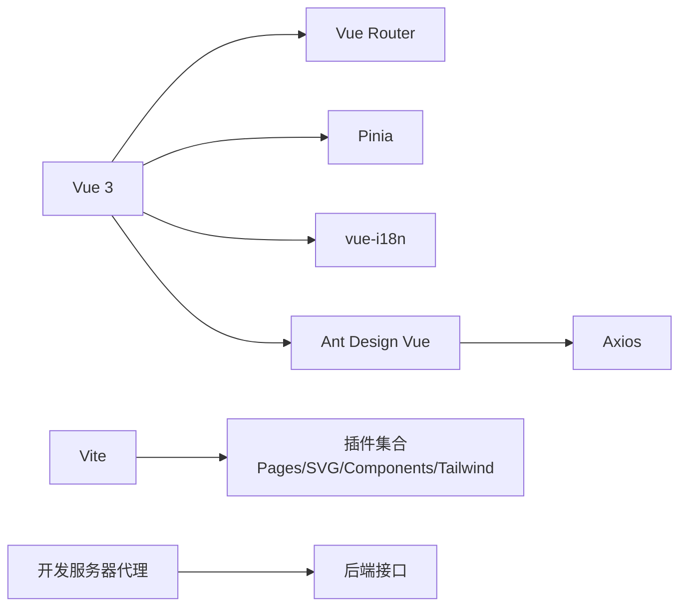

# 架构设计

<cite>
**本文引用的文件**   
- [main.ts](file://src/main.ts)
- [App.vue](file://src/App.vue)
- [router/index.ts](file://src/router/index.ts)
- [stores/index.ts](file://src/stores/index.ts)
- [locales/index.ts](file://src/locales/index.ts)
- [vite.config.ts](file://vite.config.ts)
- [utils/axios.ts](file://src/utils/axios.ts)
- [services/evaluate.ts](file://src/services/evaluate.ts)
- [views/index/index.vue](file://src/views/index/index.vue)
- [views/index/components/BasicInfoForm.vue](file://src/views/index/components/BasicInfoForm.vue)
- [views/index/components/GeneralAssessmentForm.vue](file://src/views/index/components/GeneralAssessmentForm.vue)
- [views/index/components/PersonalHistoryForm.vue](file://src/views/index/components/PersonalHistoryForm.vue)
- [views/index/components/AirwayAssessmentForm.vue](file://src/views/index/components/AirwayAssessmentForm.vue)
</cite>

## 目录
1. [引言](#引言)
2. [项目结构](#项目结构)
3. [核心组件](#核心组件)
4. [架构总览](#架构总览)
5. [详细组件分析](#详细组件分析)
6. [依赖关系分析](#依赖关系分析)
7. [性能考虑](#性能考虑)
8. [故障排查指南](#故障排查指南)
9. [结论](#结论)
10. [附录](#附录)

## 引言
本文件为“协和麻醉科智能评估系统”前端的前端架构设计文档。系统采用 Vue 3 + Vite 技术栈，遵循 MVVM 模式组织代码，通过 Pinia 进行状态管理、Vue Router 进行路由管理、i18n 实现国际化，使用 Ant Design Vue 作为 UI 组件库，并通过 Axios 封装统一 HTTP 客户端。业务聚焦于患者术前评估表单的采集、AI 辅助分析与提交，整体以模块化与可维护性为核心目标。

## 项目结构
仓库采用按功能域与层次划分的目录组织：
- src/main.ts：应用入口，挂载插件（i18n、Pinia、Router）、初始化图标与样式
- src/App.vue：根组件，提供全局主题变量注入与路由视图渲染
- src/router/index.ts：基于 vite-plugin-pages 自动路由注册，统一设置页面标题
- src/stores/index.ts：Pinia 实例创建与导出
- src/locales/index.ts：动态加载语言包并配置 i18n
- src/utils/axios.ts：HTTP 客户端封装（拦截器、重复请求防护、下载）
- src/services/evaluate.ts：领域服务层（类型定义、API 方法、常量与工具函数）
- src/views/index/index.vue：评估主页面（聚合子表单、调用服务层）
- src/views/index/components/*：各评估模块的子表单组件
- vite.config.ts：构建与开发服务器配置（插件、别名、代理、分包）

**图表来源** 
- [main.ts:1-22](file://src/main.ts#L1-L22)
- [App.vue:1-43](file://src/App.vue#L1-L43)
- [router/index.ts:1-20](file://src/router/index.ts#L1-L20)
- [stores/index.ts:1-6](file://src/stores/index.ts#L1-L6)
- [locales/index.ts:1-39](file://src/locales/index.ts#L1-L39)
- [vite.config.ts:1-100](file://vite.config.ts#L1-L100)
- [services/evaluate.ts:459-506](file://src/services/evaluate.ts#L459-L506)
- [utils/axios.ts:1-127](file://src/utils/axios.ts#L1-L127)
- [views/index/index.vue:1-800](file://src/views/index/index.vue#L1-L800)

**章节来源**
- [main.ts:1-22](file://src/main.ts#L1-L22)
- [App.vue:1-43](file://src/App.vue#L1-L43)
- [router/index.ts:1-20](file://src/router/index.ts#L1-L20)
- [stores/index.ts:1-6](file://src/stores/index.ts#L1-L6)
- [locales/index.ts:1-39](file://src/locales/index.ts#L1-L39)
- [vite.config.ts:1-100](file://vite.config.ts#L1-L100)

## 核心组件
- 应用入口与装配：main.ts 负责创建 Vue 应用、安装 i18n/Pinia/Router、初始化图标与样式，完成全局能力装配。
- 根组件：App.vue 将 Ant Design 主题 token 映射为 CSS 变量，结合布局设置 store 计算主题色，并通过 router-view 渲染页面。
- 路由：router/index.ts 使用 ~pages 自动生成路由表，并在 beforeEach 中根据 meta.title 设置浏览器标题。
- 状态管理：stores/index.ts 创建并导出 Pinia 实例；业务状态可按需扩展至 modules 下。
- 国际化：locales/index.ts 动态按需加载当前语言包，配置 fallbackLocale 与全局注入。
- HTTP 客户端：utils/axios.ts 封装 axios，提供超时、拦截器（成功/失败处理、错误提示）、重复请求防护、下载等能力。
- 领域服务：services/evaluate.ts 定义评估数据模型、API 方法与常量，供视图层调用。
- 视图层：views/index/index.vue 聚合多个子表单组件，负责用户交互、数据校验与调用 evaluateApi 进行 AI 分析与提交。

**章节来源**
- [main.ts:1-22](file://src/main.ts#L1-L22)
- [App.vue:1-43](file://src/App.vue#L1-L43)
- [router/index.ts:1-20](file://src/router/index.ts#L1-L20)
- [stores/index.ts:1-6](file://src/stores/index.ts#L1-L6)
- [locales/index.ts:1-39](file://src/locales/index.ts#L1-L39)
- [utils/axios.ts:1-127](file://src/utils/axios.ts#L1-L127)
- [services/evaluate.ts:1-757](file://src/services/evaluate.ts#L1-L757)
- [views/index/index.vue:1-800](file://src/views/index/index.vue#L1-L800)

## 架构总览
系统采用 MVVM 分层：
- Model：services/evaluate.ts 中的 TypeScript 接口与数据结构（PatientAssessmentData 等），以及常量与工具函数。
- View：views/index/index.vue 与各子表单组件，负责展示与用户交互。
- ViewModel：视图逻辑集中在 index.vue，组合子组件、维护表单状态、触发服务层调用。

**图表来源** 
- [utils/axios.ts:1-127](file://src/utils/axios.ts#L1-L127)
- [services/evaluate.ts:459-506](file://src/services/evaluate.ts#L459-L506)
- [views/index/index.vue:408-539](file://src/views/index/index.vue#L408-L539)
- [views/index/components/BasicInfoForm.vue:1-194](file://src/views/index/components/BasicInfoForm.vue#L1-L194)
- [views/index/components/GeneralAssessmentForm.vue:1-336](file://src/views/index/components/GeneralAssessmentForm.vue#L1-L336)
- [views/index/components/PersonalHistoryForm.vue:1-339](file://src/views/index/components/PersonalHistoryForm.vue#L1-L339)
- [views/index/components/AirwayAssessmentForm.vue:1-349](file://src/views/index/components/AirwayAssessmentForm.vue#L1-L349)

## 详细组件分析

### 视图层与数据流（MVVM）
- 视图层（View）：index.vue 聚合多个子表单组件，绑定 v-model 到共享数据对象 patientData，实现双向数据绑定。
- 视图模型（ViewModel）：index.vue 内 handleAIAnalysis 与 handleSubmit 协调表单状态 loading/submitting，调用 evaluateApi 完成数据获取与提交。
- 模型（Model）：services/evaluate.ts 定义 PatientAssessmentData 等类型，约束数据结构，保证前后端契约一致。

**图表来源** 
- [views/index/index.vue:408-437](file://src/views/index/index.vue#L408-L437)
- [services/evaluate.ts:464-505](file://src/services/evaluate.ts#L464-L505)
- [utils/axios.ts:31-67](file://src/utils/axios.ts#L31-L67)

**章节来源**
- [views/index/index.vue:408-539](file://src/views/index/index.vue#L408-L539)
- [services/evaluate.ts:406-506](file://src/services/evaluate.ts#L406-L506)
- [utils/axios.ts:1-127](file://src/utils/axios.ts#L1-L127)

### 子表单组件职责与验证
- BasicInfoForm：负责基本信息（姓名、性别、年龄、病案号、身高、体重、术前诊断、拟行手术）。
- GeneralAssessmentForm：一般情况评估（心率、血压、血氧、意识状态、ASA分级、活动耐量、GCS/RASS评分），包含 GCS 总分计算。
- PersonalHistoryForm：个人史（过敏、吸烟、饮酒、药物滥用、晕动病、手术麻醉史及 PONV）。
- AirwayAssessmentForm：气道评估（Mallampati、鼾症/OSAHS、松动牙、张口度、颈椎、下颌相关指标）。

每个子组件均暴露 validateForm 方法，便于父组件在提交前进行局部校验。

**图表来源** 
- [views/index/index.vue:440-521](file://src/views/index/index.vue#L440-L521)
- [views/index/components/BasicInfoForm.vue:104-129](file://src/views/index/components/BasicInfoForm.vue#L104-L129)
- [views/index/components/GeneralAssessmentForm.vue:176-214](file://src/views/index/components/GeneralAssessmentForm.vue#L176-L214)
- [views/index/components/PersonalHistoryForm.vue:177-237](file://src/views/index/components/PersonalHistoryForm.vue#L177-L237)
- [views/index/components/AirwayAssessmentForm.vue:142-208](file://src/views/index/components/AirwayAssessmentForm.vue#L142-L208)

**章节来源**
- [views/index/components/BasicInfoForm.vue:1-194](file://src/views/index/components/BasicInfoForm.vue#L1-L194)
- [views/index/components/GeneralAssessmentForm.vue:1-336](file://src/views/index/components/GeneralAssessmentForm.vue#L1-L336)
- [views/index/components/PersonalHistoryForm.vue:1-339](file://src/views/index/components/PersonalHistoryForm.vue#L1-L339)
- [views/index/components/AirwayAssessmentForm.vue:1-349](file://src/views/index/components/AirwayAssessmentForm.vue#L1-L349)

### 服务层设计与数据模型
- 数据模型：services/evaluate.ts 定义了 PatientInfo、BasicInfo、GeneralAssessment、PersonalHistory、AirwayAssessment、AuxiliaryExamination、OrganSystemAssessment、SpecialDiseaseAssessment 等接口，形成完整的评估数据树。
- API 方法：evaluateApi.submitEvaluation 与 evaluateApi.aiAnalysis 分别对应提交与 AI 分析。
- 常量与工具：ASSESSMENT_CONSTANTS 集中管理下拉选项与枚举值；evaluateUtils 提供基础校验与摘要生成。

**图表来源** 
- [services/evaluate.ts:1-420](file://src/services/evaluate.ts#L1-L420)

**章节来源**
- [services/evaluate.ts:1-757](file://src/services/evaluate.ts#L1-L757)

## 依赖关系分析
- 运行时依赖：Vue 3、Ant Design Vue、Axios、Pinia、Vue Router、vue-i18n、TailwindCSS、Vite 生态插件。
- 构建期依赖：unplugin-vue-components（按需引入 Ant Design Vue）、vite-plugin-pages（自动路由）、vite-plugin-svg-icons（SVG 图标）、tailwindcss/autoprefixer（样式处理）。
- 外部集成：开发服务器代理 /api 转发至后端网关或业务服务。

**图表来源** 
- [package.json:17-68](file://package.json#L17-L68)
- [vite.config.ts:17-42](file://vite.config.ts#L17-L42)
- [vite.config.ts:81-98](file://vite.config.ts#L81-L98)

**章节来源**
- [package.json:1-76](file://package.json#L1-L76)
- [vite.config.ts:1-100](file://vite.config.ts#L1-L100)

## 性能考虑
- 构建优化
  - 使用 unplugin-vue-components 按需引入 Ant Design Vue，减少打包体积。
  - 使用 vite-plugin-pages 自动路由，避免手动维护路由表带来的冗余。
  - 对 locales/lang 进行独立分包，降低首屏资源体积。
- 运行期优化
  - 表单数据采用响应式对象与 v-model 双向绑定，减少不必要的重渲染。
  - 大表单分块渲染（各模块卡片化），提升可维护性与可读性。
  - 下载接口使用 Blob 与 URL.createObjectURL，避免内存泄漏。
- 网络优化
  - Axios 拦截器统一错误处理与消息提示，减少重复代码。
  - 重复请求防护（PUT/POST）防止误操作导致的并发问题。

[本节为通用指导，不直接分析具体文件]

## 故障排查指南
- 接口报错与权限问题
  - utils/axios.ts 在响应拦截器中对非 200 码与 403 状态进行错误提示，便于快速定位权限或业务异常。
- 重复提交防护
  - 对 PUT/POST 请求进行时间窗口去重，避免短时间内重复提交导致的数据不一致。
- 下载失败
  - download 方法捕获异常并提示“下载失败”，同时清理临时 URL，避免内存占用。
- 路由标题未生效
  - 检查 router/index.ts 中 beforeEach 是否根据 to.meta.title 设置 document.title。

**章节来源**
- [utils/axios.ts:36-67](file://src/utils/axios.ts#L36-L67)
- [utils/axios.ts:68-78](file://src/utils/axios.ts#L68-L78)
- [utils/axios.ts:104-125](file://src/utils/axios.ts#L104-L125)
- [router/index.ts:10-18](file://src/router/index.ts#L10-L18)

## 结论
本系统以 Vue 3 + Vite 为基础，采用 MVVM 分层与模块化组织，清晰划分视图、服务与模型。通过 Pinia 与 i18n 提供可扩展的状态管理与国际化能力；Axios 封装统一网络访问与错误处理；服务层以强类型接口约束数据契约，保障前后端一致性。整体架构具备良好的可维护性与扩展性，适合在医疗场景下持续演进。

[本节为总结性内容，不直接分析具体文件]

## 附录
- 安全设计要点
  - 统一错误处理与敏感信息不打印（仅提示用户可见的错误消息）。
  - 代理配置仅在开发环境启用，生产环境应通过网关或反向代理统一管理。
- 扩展点设计
  - 新增评估模块：在 services/evaluate.ts 扩展数据模型与常量，在 views/index/index.vue 增加子表单组合与校验。
  - 新增路由：在 src/views 下新增 .vue 文件，由 vite-plugin-pages 自动注册。
  - 新增主题变量：在 App.vue 中继续将 token 映射为 CSS 变量，配合 Tailwind 使用。

[本节为补充说明，不直接分析具体文件]