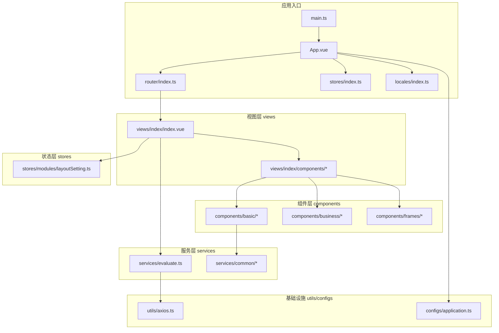
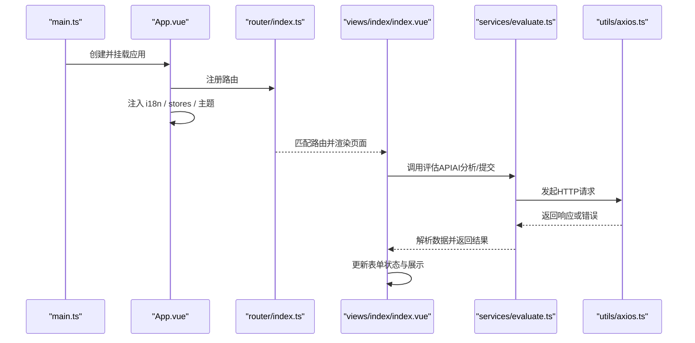
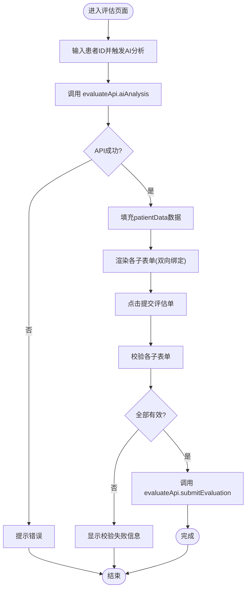
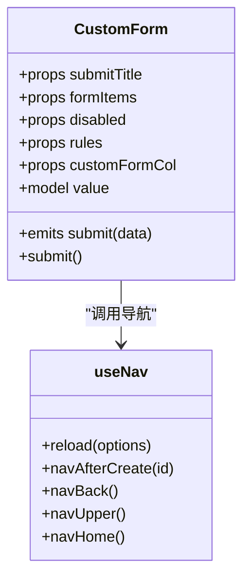
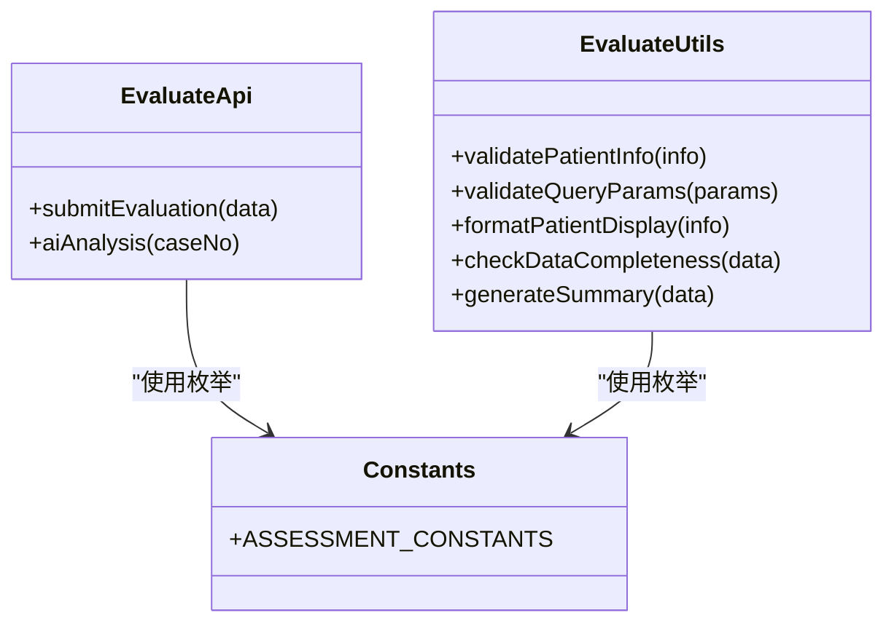
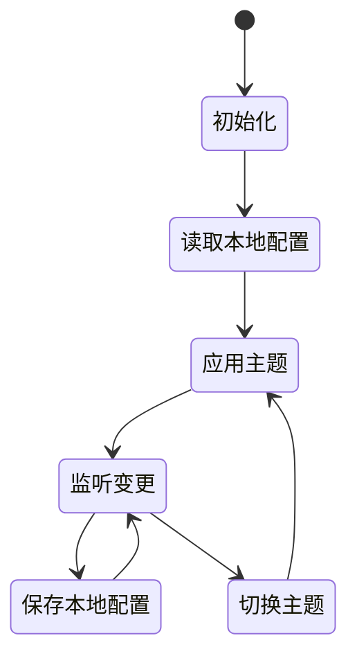
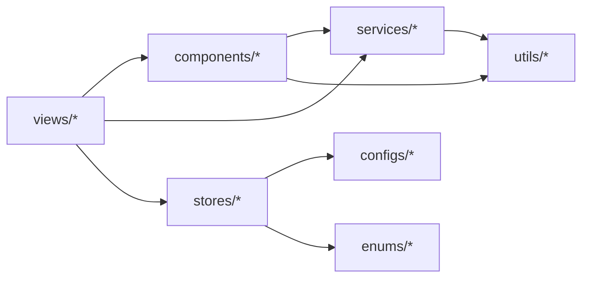

# 模块组织

<cite>
**本文引用的文件**   
- [main.ts](file://src/main.ts)
- [App.vue](file://src/App.vue)
- [router/index.ts](file://src/router/index.ts)
- [stores/index.ts](file://src/stores/index.ts)
- [stores/modules/layoutSetting.ts](file://src/stores/modules/layoutSetting.ts)
- [locales/index.ts](file://src/locales/index.ts)
- [components/basic/custom-form/CustomForm.vue](file://src/components/basic/custom-form/CustomForm.vue)
- [services/common/useNav.ts](file://src/services/common/useNav.ts)
- [services/evaluate.ts](file://src/services/evaluate.ts)
- [utils/axios.ts](file://src/utils/axios.ts)
- [views/index/index.vue](file://src/views/index/index.vue)
- [views/index/components/BasicInfoForm.vue](file://src/views/index/components/BasicInfoForm.vue)
- [configs/application.ts](file://src/configs/application.ts)
</cite>

## 目录
1. [引言](#引言)
2. [项目结构与设计原则](#项目结构与设计原则)
3. [核心模块与职责划分](#核心模块与职责划分)
4. [架构总览](#架构总览)
5. [详细组件分析](#详细组件分析)
6. [依赖关系与导入导出规范](#依赖关系与导入导出规范)
7. [性能与可维护性考量](#性能与可维护性考量)
8. [故障排查指南](#故障排查指南)
9. [结论](#结论)
10. [附录：命名约定与扩展实践](#附录：命名约定与扩展实践)

## 引言
本文件面向协和麻醉科智能评估系统的前端工程，聚焦“模块组织”这一主题。文档从目录结构、设计原则出发，系统性说明 components（基础组件、业务组件、框架组件）、services（服务层）、stores（状态管理）、views（页面视图）的职责边界与协作方式；给出组件层次结构与复用策略、服务层抽象设计、状态管理的模块化组织；并提供模块间依赖图、导入导出规范以及扩展最佳实践与命名约定，帮助团队在复杂医疗业务场景下保持代码清晰、稳定与可扩展。

## 项目结构与设计原则
本项目采用基于领域与职责的目录划分，遵循以下设计原则：
- 分层清晰：UI 层（views/components）、服务层（services）、状态层（stores）、工具与配置（utils/configs/enums/locales）解耦。
- 高内聚低耦合：每个模块仅暴露必要接口，内部实现细节不向外泄露。
- 可测试与可替换：通过服务层封装 HTTP 调用，便于 Mock 与替换。
- 可演进：新增业务以“视图 + 表单组件 + 服务 + 类型定义”的方式扩展，不影响既有模块。

图表来源
- [main.ts:1-22](file://src/main.ts#L1-L22)
- [App.vue:1-43](file://src/App.vue#L1-L43)
- [router/index.ts:1-20](file://src/router/index.ts#L1-L20)
- [stores/index.ts:1-6](file://src/stores/index.ts#L1-L6)
- [locales/index.ts:1-39](file://src/locales/index.ts#L1-L39)
- [views/index/index.vue:1-800](file://src/views/index/index.vue#L1-L800)
- [services/evaluate.ts:1-757](file://src/services/evaluate.ts#L1-L757)
- [utils/axios.ts:1-127](file://src/utils/axios.ts#L1-L127)
- [stores/modules/layoutSetting.ts:1-126](file://src/stores/modules/layoutSetting.ts#L1-L126)
- [configs/application.ts:1-6](file://src/configs/application.ts#L1-L6)

章节来源
- [main.ts:1-22](file://src/main.ts#L1-L22)
- [App.vue:1-43](file://src/App.vue#L1-L43)
- [router/index.ts:1-20](file://src/router/index.ts#L1-L20)
- [stores/index.ts:1-6](file://src/stores/index.ts#L1-L6)
- [locales/index.ts:1-39](file://src/locales/index.ts#L1-L39)
- [configs/application.ts:1-6](file://src/configs/application.ts#L1-L6)

## 核心模块与职责划分
- components（组件层）
  - basic：通用基础组件（如自定义表单、图标、上传、表格等），强调无业务语义、高复用。
  - business：业务相关组件（如部门选择器等），承载特定业务规则但尽量保持 UI 与数据分离。
  - frames：框架级布局与容器组件（菜单、头部、内容块等），负责整体布局与导航。
- services（服务层）
  - 按领域或功能组织（如 evaluate.ts 对应评估域），统一封装 API 调用、类型定义、常量与工具函数。
  - 提供纯函数或类方法，避免直接耦合 UI 与网络细节。
- stores（状态管理）
  - 使用 Pinia 进行全局状态管理，按功能拆分 modules（如 layoutSetting）。
  - 关注跨组件共享状态（主题、布局、用户信息等），不包含具体业务逻辑。
- views（页面视图）
  - 组合业务组件与基础组件，编排用户交互流程，协调服务层调用与状态更新。
  - 尽量薄，不包含复杂计算与持久化逻辑。

章节来源
- [components/basic/custom-form/CustomForm.vue:1-76](file://src/components/basic/custom-form/CustomForm.vue#L1-L76)
- [services/evaluate.ts:1-757](file://src/services/evaluate.ts#L1-L757)
- [stores/modules/layoutSetting.ts:1-126](file://src/stores/modules/layoutSetting.ts#L1-L126)
- [views/index/index.vue:1-800](file://src/views/index/index.vue#L1-L800)

## 架构总览
下图展示从应用启动到页面渲染、再到服务调用的关键路径与模块交互。

图表来源
- [main.ts:1-22](file://src/main.ts#L1-L22)
- [App.vue:1-43](file://src/App.vue#L1-L43)
- [router/index.ts:1-20](file://src/router/index.ts#L1-L20)
- [views/index/index.vue:1-800](file://src/views/index/index.vue#L1-L800)
- [services/evaluate.ts:1-757](file://src/services/evaluate.ts#L1-L757)
- [utils/axios.ts:1-127](file://src/utils/axios.ts#L1-L127)

## 详细组件分析

### 视图层：评估主页面与子表单
- 主页面 views/index/index.vue
  - 职责：编排患者信息查询、多段评估表单、AI 分析与提交流程；聚合各子表单 ref 进行校验与提交。
  - 数据流：从 services/evaluate.ts 获取数据，填充至本地 patientData 对象，再传递给各子表单双向绑定。
  - 交互：包含 AI 分析按钮与提交按钮，处理 loading/submitting 状态与消息提示。
- 子表单 views/index/components/BasicInfoForm.vue
  - 职责：展示与编辑基本信息（姓名、性别、年龄、病案号、身高体重、术前诊断、拟行手术）。
  - 交互：通过 defineModel 与父组件双向绑定 patientData.patientInfo 与 result.basicInfo 字段；暴露 validateForm 供父组件校验。

图表来源
- [views/index/index.vue:1-800](file://src/views/index/index.vue#L1-L800)
- [services/evaluate.ts:471-506](file://src/services/evaluate.ts#L471-L506)
- [views/index/components/BasicInfoForm.vue:1-194](file://src/views/index/components/BasicInfoForm.vue#L1-L194)

章节来源
- [views/index/index.vue:1-800](file://src/views/index/index.vue#L1-L800)
- [views/index/components/BasicInfoForm.vue:1-194](file://src/views/index/components/BasicInfoForm.vue#L1-L194)

### 组件层：基础表单组件 CustomForm
- 职责：封装 Ant Design Vue 表单能力，支持动态 formItems、校验规则、列宽配置、国际化提交标题、返回导航等。
- 复用策略：通过 props 与 slots 扩展不同业务表单；结合 services/common/useNav 提供统一的导航行为。
- 关键点：使用 defineModel 实现 v-model 双向绑定；在 submit 时执行校验并触发事件。

图表来源
- [components/basic/custom-form/CustomForm.vue:1-76](file://src/components/basic/custom-form/CustomForm.vue#L1-L76)
- [services/common/useNav.ts:1-67](file://src/services/common/useNav.ts#L1-L67)

章节来源
- [components/basic/custom-form/CustomForm.vue:1-76](file://src/components/basic/custom-form/CustomForm.vue#L1-L76)
- [services/common/useNav.ts:1-67](file://src/services/common/useNav.ts#L1-L67)

### 服务层：评估域服务 evaluate.ts
- 职责：集中定义评估相关的 TypeScript 接口、API 方法、常量与工具函数。
- 抽象设计：
  - 接口层：PatientInfo、BasicInfo、GeneralAssessment、PersonalHistory、AirwayAssessment、AuxiliaryExamination、OrganSystemAssessment、SpecialDiseaseAssessment、PatientAssessmentData、QueryParams、FormState、ApiResponse 等。
  - API 层：evaluateApi 提供 submitEvaluation、aiAnalysis 等方法，屏蔽底层 HTTP 细节。
  - 工具层：evaluateUtils 提供数据校验、格式化、完整性检查、摘要生成等。
  - 常量层：ASSESSMENT_CONSTANTS 集中枚举选项（ASA分级、GCS评分、RASS评分等）。
- 依赖：通过 utils/axios.ts 的 http 实例发起请求。

图表来源
- [services/evaluate.ts:1-757](file://src/services/evaluate.ts#L1-L757)

章节来源
- [services/evaluate.ts:1-757](file://src/services/evaluate.ts#L1-L757)

### 状态管理：布局设置 store
- 职责：管理主题色、导航主题、布局模式、内容宽度、固定 Header/Siderbar、语言、Tab 视图开关等全局设置。
- 特性：
  - 使用 Pinia defineStore 定义 store，reactive 存储状态。
  - 监听变化自动同步到 localStorage，并联动 antd 主题算法与 token。
  - 提供 toggleTheme、setColorPrimary、updateLayoutSetting 等方法。

图表来源
- [stores/modules/layoutSetting.ts:1-126](file://src/stores/modules/layoutSetting.ts#L1-L126)

章节来源
- [stores/modules/layoutSetting.ts:1-126](file://src/stores/modules/layoutSetting.ts#L1-L126)

### 国际化与主题
- 国际化 locales/index.ts
  - 根据 locale store 动态加载语言包，设置 fallbackLocale 与全局注入。
- 主题 App.vue
  - 将 antd theme token 映射为 CSS 变量，并根据 navTheme 调整浅色/深色变量。

章节来源
- [locales/index.ts:1-39](file://src/locales/index.ts#L1-L39)
- [App.vue:1-43](file://src/App.vue#L1-L43)

## 依赖关系与导入导出规范
- 导入方向
  - views 依赖 components、services、stores。
  - components 依赖 services（如 useNav）、utils（如 i18n）。
  - services 依赖 utils（如 axios）。
  - stores 依赖 configs、enums、utils。
- 导出规范
  - 服务层优先导出具名接口与常量，API 方法以对象形式导出（如 evaluateApi）。
  - 组件使用 defineProps/defineEmits/defineModel 明确契约。
  - Store 使用 defineStore 并以具名函数导出。
- 别名与路径
  - 使用 @ 作为 src 根路径别名，提升可读性与可维护性。

图表来源
- [views/index/index.vue:1-800](file://src/views/index/index.vue#L1-L800)
- [components/basic/custom-form/CustomForm.vue:1-76](file://src/components/basic/custom-form/CustomForm.vue#L1-L76)
- [services/evaluate.ts:1-757](file://src/services/evaluate.ts#L1-L757)
- [stores/modules/layoutSetting.ts:1-126](file://src/stores/modules/layoutSetting.ts#L1-L126)
- [utils/axios.ts:1-127](file://src/utils/axios.ts#L1-L127)

章节来源
- [views/index/index.vue:1-800](file://src/views/index/index.vue#L1-L800)
- [components/basic/custom-form/CustomForm.vue:1-76](file://src/components/basic/custom-form/CustomForm.vue#L1-L76)
- [services/evaluate.ts:1-757](file://src/services/evaluate.ts#L1-L757)
- [stores/modules/layoutSetting.ts:1-126](file://src/stores/modules/layoutSetting.ts#L1-L126)
- [utils/axios.ts:1-127](file://src/utils/axios.ts#L1-L127)

## 性能与可维护性考量
- 组件粒度
  - 将大表单拆分为多个子表单组件，降低单文件复杂度，提高可测试性。
- 服务层缓存与重试
  - 可在 services 层增加请求缓存与重试机制，减少重复请求与抖动。
- 状态最小化
  - 仅在 stores 中存放真正需要跨组件共享的状态，局部状态下沉到组件内部。
- 类型安全
  - 通过 TypeScript 接口约束数据流转，减少运行时错误。
- 主题与样式
  - 使用 CSS 变量与 antd token 统一管理主题，避免硬编码颜色值。

[本节为通用指导，不涉及具体文件分析]

## 故障排查指南
- 网络请求失败
  - 检查 utils/axios.ts 拦截器中的错误处理与 message 提示。
  - 确认 baseURL 与后端接口地址一致。
- 重复提交防护
  - utils/axios.ts 内置防抖逻辑，若出现“操作过快”提示，请适当延长间隔或优化交互。
- 权限与鉴权
  - 403 错误会弹出“没有权限”，需检查路由守卫与后端权限控制。
- 主题不生效
  - 检查 stores/modules/layoutSetting.ts 中 themeConfig 与 document.documentElement 的 dark 类名切换逻辑。
- 国际化缺失
  - 检查 locales/index.ts 的动态加载是否成功，确保语言包存在且 key 正确。

章节来源
- [utils/axios.ts:1-127](file://src/utils/axios.ts#L1-L127)
- [stores/modules/layoutSetting.ts:1-126](file://src/stores/modules/layoutSetting.ts#L1-L126)
- [locales/index.ts:1-39](file://src/locales/index.ts#L1-L39)

## 结论
本项目通过清晰的目录划分与职责边界，实现了视图、组件、服务、状态的解耦与协作。评估域以 services/evaluate.ts 为核心，配合 views 与 components 形成稳定的数据流与交互链；stores 管理全局主题与布局；utils 与 configs 提供基础设施支撑。该组织方式具备良好的可扩展性与可维护性，适合在复杂的医疗业务场景中持续演进。

[本节为总结性内容，不涉及具体文件分析]

## 附录：命名约定与扩展实践
- 命名约定
  - 组件：PascalCase，文件名与组件名一致（如 BasicInfoForm.vue）。
  - 服务：小写+驼峰（如 evaluate.ts），导出具名方法与常量。
  - Store：useXxxStore 命名，模块文件以小写下划线或驼峰命名。
  - 常量：全大写+下划线（如 ASSESSMENT_CONSTANTS）。
- 扩展实践
  - 新增业务域：在 services 下新建领域文件，定义接口与 API；在 views 下新增页面；在 components 下新增业务组件；如需全局状态，新增 stores/modules 下的 store。
  - 复用策略：将通用 UI 能力沉淀到 components/basic；将领域通用逻辑沉淀到 services；将跨页面状态放入 stores。
  - 类型先行：先定义 TypeScript 接口，再实现组件与服务，保证类型安全。
  - 配置外置：将应用级配置放入 configs，环境变量通过 import.meta.env 访问。

章节来源
- [services/evaluate.ts:1-757](file://src/services/evaluate.ts#L1-L757)
- [configs/application.ts:1-6](file://src/configs/application.ts#L1-L6)