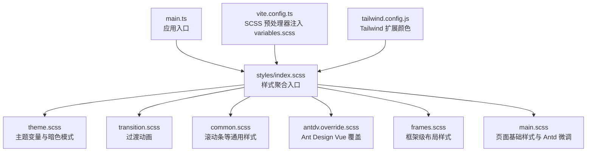
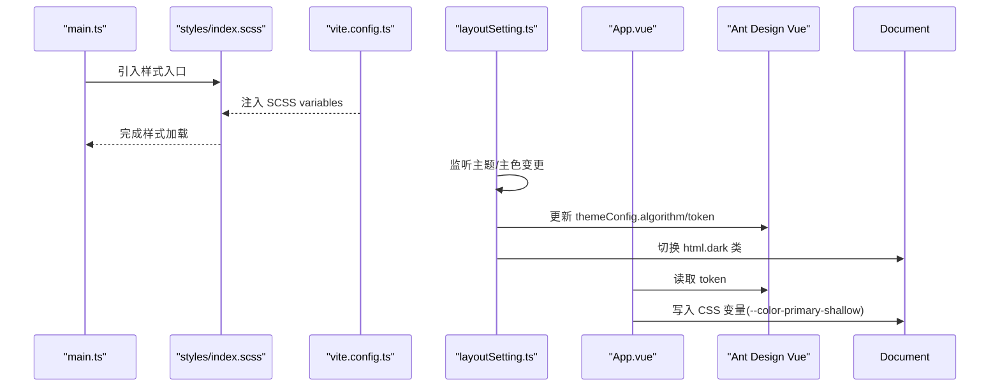
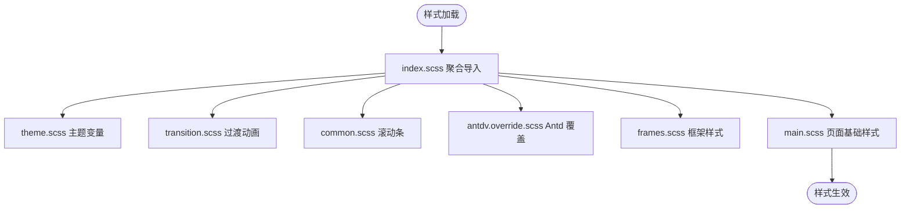
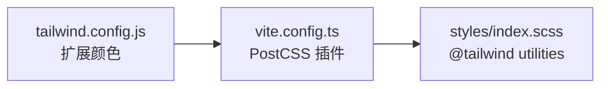
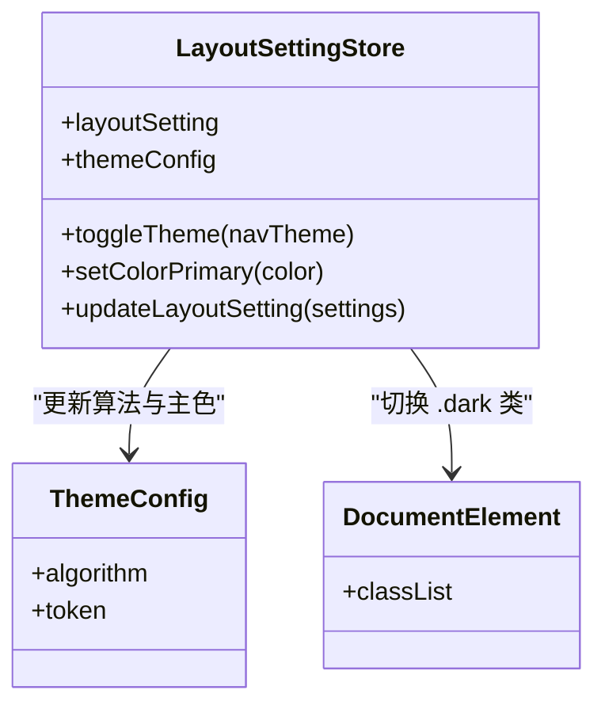
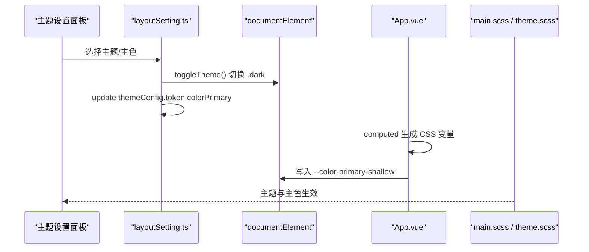
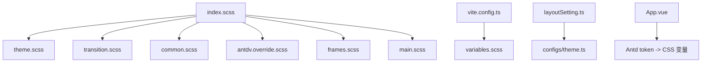

# 样式与主题

<cite>
**本文引用的文件**   
- [src/styles/index.scss](file://src/styles/index.scss)
- [src/styles/main.scss](file://src/styles/main.scss)
- [src/styles/variables.scss](file://src/styles/variables.scss)
- [src/styles/theme.scss](file://src/styles/theme.scss)
- [src/styles/common.scss](file://src/styles/common.scss)
- [src/styles/transition.scss](file://src/styles/transition.scss)
- [src/styles/frames.scss](file://src/styles/frames.scss)
- [src/styles/antdv.override.scss](file://src/styles/antdv.override.scss)
- [tailwind.config.js](file://tailwind.config.js)
- [vite.config.ts](file://vite.config.ts)
- [src/configs/theme.ts](file://src/configs/theme.ts)
- [src/stores/modules/layoutSetting.ts](file://src/stores/modules/layoutSetting.ts)
- [src/App.vue](file://src/App.vue)
- [src/main.ts](file://src/main.ts)
</cite>

## 目录
1. [简介](#简介)
2. [项目结构](#项目结构)
3. [核心组件](#核心组件)
4. [架构总览](#架构总览)
5. [详细组件分析](#详细组件分析)
6. [依赖关系分析](#依赖关系分析)
7. [性能考虑](#性能考虑)
8. [故障排查指南](#故障排查指南)
9. [结论](#结论)
10. [附录](#附录)

## 简介
本文件系统化梳理前端项目的样式与主题体系，覆盖 SCSS 组织结构、Tailwind CSS 配置、全局样式规范；阐述主题系统的设计原理、动态切换机制与品牌色定制方法；说明响应式策略、组件样式覆盖、动画过渡实现；并提供样式性能优化、浏览器兼容性处理与主题扩展指南。目标是帮助开发者快速理解并安全地扩展样式与主题能力。

## 项目结构
样式相关资源集中在 src/styles 目录，通过统一的入口文件引入，确保加载顺序与优先级可控。构建层通过 Vite 的 SCSS preprocessorOptions 自动注入变量，并通过 PostCSS 集成 Tailwind CSS。

图表来源
- [src/main.ts:1-22](file://src/main.ts#L1-L22)
- [src/styles/index.scss:1-11](file://src/styles/index.scss#L1-L11)
- [vite.config.ts:43-62](file://vite.config.ts#L43-L62)
- [tailwind.config.js:1-16](file://tailwind.config.js#L1-L16)

章节来源
- [src/main.ts:1-22](file://src/main.ts#L1-L22)
- [src/styles/index.scss:1-11](file://src/styles/index.scss#L1-L11)
- [vite.config.ts:43-62](file://vite.config.ts#L43-L62)
- [tailwind.config.js:1-16](file://tailwind.config.js#L1-L16)

## 核心组件
- 样式聚合入口：统一导入主题、过渡、通用、Antd 覆盖、框架与主样式，并启用 Tailwind utilities。
- 变量与主题：SCSS 变量集中定义，主题算法与颜色由 Ant Design Vue 提供，运行时通过 Pinia store 切换。
- 运行时主题变量：App 组件将 Antd token 映射为 CSS 自定义属性，供全局样式使用。
- Tailwind 配置：在 tailwind.config.js 中扩展颜色，配合 PostCSS 编译。

章节来源
- [src/styles/index.scss:1-11](file://src/styles/index.scss#L1-L11)
- [src/styles/variables.scss:1-9](file://src/styles/variables.scss#L1-L9)
- [src/configs/theme.ts:1-83](file://src/configs/theme.ts#L1-L83)
- [src/stores/modules/layoutSetting.ts:1-125](file://src/stores/modules/layoutSetting.ts#L1-L125)
- [src/App.vue:1-43](file://src/App.vue#L1-L43)
- [tailwind.config.js:1-16](file://tailwind.config.js#L1-L16)

## 架构总览
样式与主题的运行时流程如下：
- 应用启动时，main.ts 引入 styles/index.scss，触发所有样式模块加载。
- vite.config.ts 通过 SCSS additionalData 自动注入 variables.scss，使全局 SCSS 可直接使用变量。
- layoutSetting store 维护当前主题与主色，并在变化时更新 Antd themeConfig 与 documentElement 的 dark 类。
- App.vue 将 Antd token 转换为 CSS 变量（如 --color-primary-shallow），供 main.scss 等样式引用。
- Tailwind 通过 PostCSS 编译，仅 utilities 被引入以减小体积。

图表来源
- [src/main.ts:1-22](file://src/main.ts#L1-L22)
- [src/styles/index.scss:1-11](file://src/styles/index.scss#L1-L11)
- [vite.config.ts:43-62](file://vite.config.ts#L43-L62)
- [src/stores/modules/layoutSetting.ts:87-111](file://src/stores/modules/layoutSetting.ts#L87-L111)
- [src/App.vue:16-30](file://src/App.vue#L16-L30)

## 详细组件分析

### SCSS 组织与全局样式规范
- 入口聚合：index.scss 按主题、过渡、通用、Antd 覆盖、框架、主样式顺序引入，最后启用 Tailwind utilities。
- 变量与主题：
  - variables.scss 定义全局 SCSS 变量（如主色、尺寸）。
  - theme.scss 基于 html.dark 类设置 CSS 变量，用于区分明/暗背景。
- 通用样式：
  - common.scss 统一滚动条样式。
  - frames.scss 重置部分元素 outline，并提供搜索表单按钮容器工具类。
- 主样式：
  - main.scss 设置根背景、文本省略、页头左侧装饰线、表格表头背景、分页对齐等。
- Antd 覆盖：
  - antdv.override.scss 调整消息提示层级与图片预览显示行为。

图表来源
- [src/styles/index.scss:1-11](file://src/styles/index.scss#L1-L11)
- [src/styles/theme.scss:5-11](file://src/styles/theme.scss#L5-L11)
- [src/styles/common.scss:1-24](file://src/styles/common.scss#L1-L24)
- [src/styles/frames.scss:1-15](file://src/styles/frames.scss#L1-L15)
- [src/styles/main.scss:1-51](file://src/styles/main.scss#L1-L51)
- [src/styles/antdv.override.scss:1-10](file://src/styles/antdv.override.scss#L1-L10)

章节来源
- [src/styles/index.scss:1-11](file://src/styles/index.scss#L1-L11)
- [src/styles/variables.scss:1-9](file://src/styles/variables.scss#L1-L9)
- [src/styles/theme.scss:5-11](file://src/styles/theme.scss#L5-L11)
- [src/styles/common.scss:1-24](file://src/styles/common.scss#L1-L24)
- [src/styles/frames.scss:1-15](file://src/styles/frames.scss#L1-L15)
- [src/styles/main.scss:1-51](file://src/styles/main.scss#L1-L51)
- [src/styles/antdv.override.scss:1-10](file://src/styles/antdv.override.scss#L1-L10)

### Tailwind CSS 配置与使用
- 配置文件：tailwind.config.js 扩展了 gray、picker、hover 等颜色。
- 构建集成：vite.config.ts 通过 PostCSS 启用 tailwindcss 与 autoprefixer。
- 引入方式：styles/index.scss 仅引入 @tailwind utilities，避免生成 base/components 导致体积膨胀。

图表来源
- [tailwind.config.js:1-16](file://tailwind.config.js#L1-L16)
- [vite.config.ts:43-46](file://vite.config.ts#L43-L46)
- [src/styles/index.scss:9-11](file://src/styles/index.scss#L9-L11)

章节来源
- [tailwind.config.js:1-16](file://tailwind.config.js#L1-L16)
- [vite.config.ts:43-46](file://vite.config.ts#L43-L46)
- [src/styles/index.scss:9-11](file://src/styles/index.scss#L9-L11)

### 主题系统设计原理
- 主题类型：支持 light、dark、realDark 三种导航主题风格，分别对应不同的 Antd 算法。
- 主题色：内置多组预设品牌色，支持自定义颜色选择器。
- 运行时状态：Pinia store 维护 layoutSetting 与 themeConfig，并在变更时同步到 localStorage。
- DOM 标记：realDark 模式下给 documentElement 添加 dark 类，驱动 theme.scss 中的 CSS 变量切换。

图表来源
- [src/stores/modules/layoutSetting.ts:71-125](file://src/stores/modules/layoutSetting.ts#L71-L125)
- [src/configs/theme.ts:5-25](file://src/configs/theme.ts#L5-L25)
- [src/styles/theme.scss:5-11](file://src/styles/theme.scss#L5-L11)

章节来源
- [src/configs/theme.ts:1-83](file://src/configs/theme.ts#L1-L83)
- [src/stores/modules/layoutSetting.ts:1-125](file://src/stores/modules/layoutSetting.ts#L1-L125)
- [src/styles/theme.scss:5-11](file://src/styles/theme.scss#L5-L11)

### 动态主题切换机制
- 用户操作：通过主题设置面板（如 ThemeSetting）选择主题或主色。
- 状态更新：调用 store.toggleTheme 与 setColorPrimary，更新 themeConfig 与 DOM 类名。
- 变量注入：App.vue 计算 token 并写入 CSS 变量（如 --color-primary-shallow），供 main.scss 等样式使用。
- 持久化：store 变更自动写入 localStorage，刷新后恢复。

图表来源
- [src/stores/modules/layoutSetting.ts:98-111](file://src/stores/modules/layoutSetting.ts#L98-L111)
- [src/App.vue:16-30](file://src/App.vue#L16-L30)
- [src/styles/main.scss:34-45](file://src/styles/main.scss#L34-L45)
- [src/styles/theme.scss:5-11](file://src/styles/theme.scss#L5-L11)

章节来源
- [src/stores/modules/layoutSetting.ts:98-111](file://src/stores/modules/layoutSetting.ts#L98-L111)
- [src/App.vue:16-30](file://src/App.vue#L16-L30)
- [src/styles/main.scss:34-45](file://src/styles/main.scss#L34-L45)
- [src/styles/theme.scss:5-11](file://src/styles/theme.scss#L5-L11)

### 品牌色定制方法
- 预设主题色：configs/theme.ts 提供多组预设值，可在主题设置面板中选择。
- 自定义颜色：通过颜色选择器输入任意十六进制值，调用 setColorPrimary 更新 token。
- 影响范围：主色会应用到 Antd 组件及通过 CSS 变量引用的样式（如表格表头背景、页头装饰线）。

章节来源
- [src/configs/theme.ts:29-70](file://src/configs/theme.ts#L29-L70)
- [src/stores/modules/layoutSetting.ts:108-111](file://src/stores/modules/layoutSetting.ts#L108-L111)
- [src/styles/main.scss:43-45](file://src/styles/main.scss#L43-L45)

### 响应式设计策略
- 断点枚举：项目包含 breakpointEnum.ts，可用于组件内判断屏幕尺寸（具体使用见业务组件）。
- 布局适配：通过 Antd 栅格与 Tailwind 响应式类组合实现不同断点的布局调整。
- 建议：优先使用 Antd 栅格与 Tailwind 响应式前缀（sm/md/lg/xl）进行适配，减少手写媒体查询。

章节来源
- [src/enums/breakpointEnum.ts](file://src/enums/breakpointEnum.ts)

### 组件样式覆盖
- Antd 覆盖：antdv.override.scss 针对 message 层级与图片预览进行覆盖。
- 页面级覆盖：main.scss 对 page-header 装饰线、table thead 背景、pagination 对齐等进行微调。
- 建议：尽量通过 CSS 变量与主题 token 控制外观，减少对 Antd 内部类的直接覆盖，提升可维护性。

章节来源
- [src/styles/antdv.override.scss:1-10](file://src/styles/antdv.override.scss#L1-L10)
- [src/styles/main.scss:34-50](file://src/styles/main.scss#L34-L50)

### 动画与过渡效果
- 过渡类：transition.scss 定义了 breadcrumb、fade、fade-transform、zoom-fade 等过渡类，适用于路由视图与面包屑动画。
- 使用建议：在 <Transition> 组件中按需使用上述类名，保持动画一致性与性能。

章节来源
- [src/styles/transition.scss:1-61](file://src/styles/transition.scss#L1-L61)

## 依赖关系分析
- 样式入口依赖：index.scss 依赖 theme、transition、common、antdv.override、frames、main。
- 构建依赖：vite.config.ts 通过 SCSS additionalData 注入 variables.scss；PostCSS 启用 tailwindcss 与 autoprefixer。
- 主题依赖：layoutSetting store 依赖 configs/theme.ts 提供的主题算法与颜色集合；App.vue 依赖 Antd token 生成 CSS 变量。

图表来源
- [src/styles/index.scss:1-11](file://src/styles/index.scss#L1-L11)
- [vite.config.ts:47-61](file://vite.config.ts#L47-L61)
- [src/stores/modules/layoutSetting.ts:71-125](file://src/stores/modules/layoutSetting.ts#L71-L125)
- [src/configs/theme.ts:1-83](file://src/configs/theme.ts#L1-L83)
- [src/App.vue:16-30](file://src/App.vue#L16-L30)

章节来源
- [src/styles/index.scss:1-11](file://src/styles/index.scss#L1-L11)
- [vite.config.ts:47-61](file://vite.config.ts#L47-L61)
- [src/stores/modules/layoutSetting.ts:71-125](file://src/stores/modules/layoutSetting.ts#L71-L125)
- [src/configs/theme.ts:1-83](file://src/configs/theme.ts#L1-L83)
- [src/App.vue:16-30](file://src/App.vue#L16-L30)

## 性能考虑
- Tailwind 体积控制：仅引入 utilities，避免生成 base/components，减少 CSS 体积。
- SCSS 变量注入：通过 additionalData 注入 variables.scss，避免重复 import，提升编译效率。
- 动画性能：过渡动画使用 transform 与 opacity，避免触发布局重排，保证流畅度。
- 浏览器兼容：autoprefixer 自动补齐前缀；滚动条样式使用 -webkit- 前缀，注意在非 WebKit 内核下的降级表现。

[本节为通用指导，不直接分析具体文件]

## 故障排查指南
- 主题切换无效：
  - 检查 layoutSetting.store 是否正确调用 toggleTheme 与 setColorPrimary。
  - 确认 documentElement 是否已添加/移除 .dark 类。
  - 验证 App.vue 是否正确写入 CSS 变量（如 --color-primary-shallow）。
- 主色未生效：
  - 确认 Antd token 的 colorPrimary 已更新。
  - 检查样式中是否通过 CSS 变量或 Antd 类引用主色。
- 样式冲突：
  - 检查 index.scss 的导入顺序，确保覆盖样式在 Antd 默认样式之后。
  - 避免过度使用 !important，优先通过 CSS 变量与主题 token 控制。
- 滚动条样式异常：
  - 仅在 WebKit 内核生效，其他浏览器需接受默认滚动条样式。

章节来源
- [src/stores/modules/layoutSetting.ts:98-111](file://src/stores/modules/layoutSetting.ts#L98-L111)
- [src/App.vue:16-30](file://src/App.vue#L16-L30)
- [src/styles/common.scss:1-24](file://src/styles/common.scss#L1-L24)

## 结论
本项目采用“SCSS 聚合 + Tailwind utilities + Antd 主题”的混合方案，结合 Pinia store 与 CSS 变量实现动态主题与品牌色定制。通过清晰的样式分层与构建配置，既保证了可维护性，又兼顾了性能与可扩展性。建议在后续开发中继续遵循现有约定，优先使用 CSS 变量与主题 token，减少直接覆盖 Antd 内部类，以提升长期可维护性。

[本节为总结性内容，不直接分析具体文件]

## 附录
- 主题扩展指南：
  - 新增主题算法：在 configs/theme.ts 中添加新的算法映射。
  - 新增品牌色：在 configs/theme.ts 的 themeColors 数组中添加新条目。
  - 新增 CSS 变量：在 App.vue 的计算逻辑中扩展变量映射，并在样式中使用 var(--xxx)。
- 样式扩展指南：
  - 新增全局样式：在 styles 目录下新建 SCSS 文件，并在 index.scss 中按顺序引入。
  - 新增 Tailwind 颜色：在 tailwind.config.js 的 colors 中扩展，并在组件中使用对应类名。

[本节为通用指导，不直接分析具体文件]