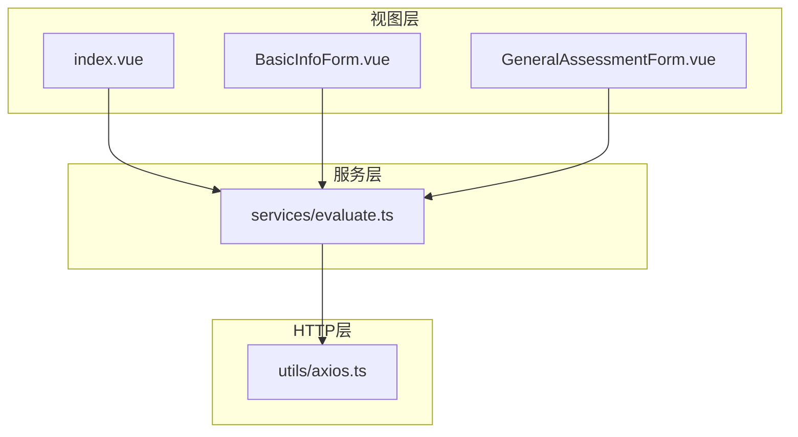
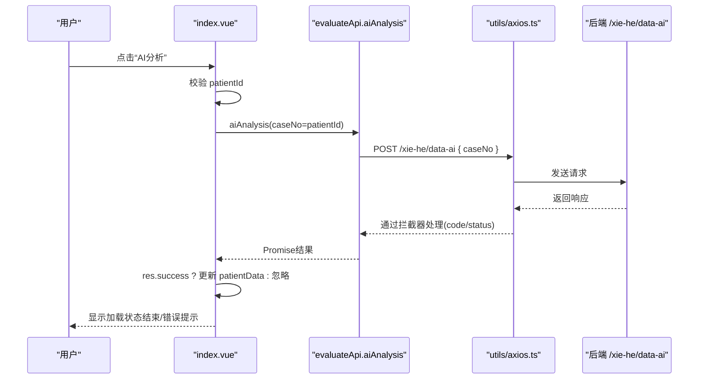
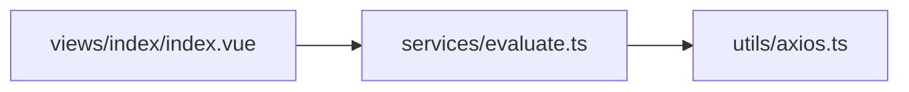

# AI智能评估系统

<cite>
**本文引用的文件**   
- [src/services/evaluate.ts](file://src/services/evaluate.ts)
- [src/views/index/index.vue](file://src/views/index/index.vue)
- [src/utils/axios.ts](file://src/utils/axios.ts)
- [src/views/index/components/BasicInfoForm.vue](file://src/views/index/components/BasicInfoForm.vue)
- [src/views/index/components/GeneralAssessmentForm.vue](file://src/views/index/components/GeneralAssessmentForm.vue)
</cite>

## 目录
1. [简介](#简介)
2. [项目结构](#项目结构)
3. [核心组件](#核心组件)
4. [架构总览](#架构总览)
5. [详细组件分析](#详细组件分析)
6. [依赖关系分析](#依赖关系分析)
7. [性能与最佳实践](#性能与最佳实践)
8. [故障排查指南](#故障排查指南)
9. [结论](#结论)

## 简介
本文件面向AI智能评估系统的前端实现，聚焦以下目标：
- 详细说明AI分析接口的调用机制，包括 evaluateApi.aiAnalysis 的参数传递、响应处理与错误处理。
- 解释后端返回数据如何映射到前端数据结构（PatientAssessmentData）。
- 说明评估数据的完整性验证机制，确保必填字段正确性。
- 提供API调用的最佳实践与性能优化建议。

## 项目结构
本项目采用Vue 3 + TypeScript的前端工程，围绕“患者评估”业务组织代码：
- 服务层：src/services/evaluate.ts 定义类型、API封装与工具函数。
- 视图层：src/views/index/index.vue 作为主页面，集成多个表单子组件。
- HTTP层：src/utils/axios.ts 统一封装请求、拦截器与错误提示。
- 表单组件：BasicInfoForm.vue、GeneralAssessmentForm.vue 等负责具体字段编辑与校验。

图表来源
- [src/views/index/index.vue:10-32](file://src/views/index/index.vue#L10-L32)
- [src/services/evaluate.ts:471-506](file://src/services/evaluate.ts#L471-L506)
- [src/utils/axios.ts:28-67](file://src/utils/axios.ts#L28-L67)

章节来源
- [src/views/index/index.vue:10-32](file://src/views/index/index.vue#L10-L32)
- [src/services/evaluate.ts:471-506](file://src/services/evaluate.ts#L471-L506)
- [src/utils/axios.ts:28-67](file://src/utils/axios.ts#L28-L67)

## 核心组件
- evaluateApi.aiAnalysis：发起AI分析请求，参数为caseNo（病案号），返回Promise。
- index.vue：承载用户交互，触发aiAnalysis并更新patientData。
- axios.ts：封装Axios实例、拦截器、重复提交防护与错误提示。
- BasicInfoForm.vue / GeneralAssessmentForm.vue：绑定到patientData的相应字段，完成数据收集与展示。

章节来源
- [src/services/evaluate.ts:498-506](file://src/services/evaluate.ts#L498-L506)
- [src/views/index/index.vue:407-437](file://src/views/index/index.vue#L407-L437)
- [src/utils/axios.ts:28-67](file://src/utils/axios.ts#L28-L67)
- [src/views/index/components/BasicInfoForm.vue:104-129](file://src/views/index/components/BasicInfoForm.vue#L104-L129)
- [src/views/index/components/GeneralAssessmentForm.vue:176-214](file://src/views/index/components/GeneralAssessmentForm.vue#L176-L214)

## 架构总览
下图展示了从用户点击“AI分析”到数据落盘至前端state的完整流程，以及HTTP层的拦截与错误处理。

图表来源
- [src/views/index/index.vue:407-437](file://src/views/index/index.vue#L407-L437)
- [src/services/evaluate.ts:498-506](file://src/services/evaluate.ts#L498-L506)
- [src/utils/axios.ts:36-67](file://src/utils/axios.ts#L36-L67)

## 详细组件分析

### AI分析接口调用机制（evaluateApi.aiAnalysis）
- 入口位置：src/services/evaluate.ts 中 evaluateApi.aiAnalysis。
- 参数：caseNo（字符串），由视图层传入 queryParams.patientId。
- 请求体：{ caseNo }。
- 返回：Promise，由axios拦截器处理后返回标准响应结构。
- URL常量：aiAnalysisUrl = '/xie-he/data-ai'。

注意事项
- 当前类型声明为 http.post<PageList<Manage[]>>(...)，但视图层将返回数据直接赋给 patientData（类型为 PatientAssessmentData）。这存在类型不一致风险，建议在后续版本中修正泛型或增加适配层。

章节来源
- [src/services/evaluate.ts:464-506](file://src/services/evaluate.ts#L464-L506)
- [src/views/index/index.vue:407-437](file://src/views/index/index.vue#L407-L437)

### 响应数据处理与前端数据映射
- 视图层在成功回调中将 res.data 赋值给 patientData.value。
- 前端数据结构定义：PatientAssessmentData，包含 patientInfo 与 result（basicInfo、generalAssessment、personalHistory、airwayAssessment、auxiliaryExamination、organSystemAssessment、specialDiseaseAssessment）。
- 各表单组件通过 v-model 双向绑定到 patientData 对应路径，如 patientData.patientInfo.* 与 patientData.result.generalAssessment.*。

映射要点
- 若后端返回结构与 PatientAssessmentData 不完全一致，需在视图层或服务层做字段映射与默认值填充，避免空引用。
- 对可能缺失的嵌套对象（如 gcsScore、asaGrade.content）应提供安全访问与默认值。

章节来源
- [src/services/evaluate.ts:409-420](file://src/services/evaluate.ts#L409-L420)
- [src/views/index/components/BasicInfoForm.vue:104-129](file://src/views/index/components/BasicInfoForm.vue#L104-L129)
- [src/views/index/components/GeneralAssessmentForm.vue:176-214](file://src/views/index/components/GeneralAssessmentForm.vue#L176-L214)

### 评估数据完整性验证机制
- 工具函数 evaluateUtils.checkDataCompleteness 检查关键必填字段：
  - patientInfo.patientName
  - result.basicInfo.preoperativeDiagnosis
  - result.generalAssessment.asaGrade
- 返回值包含 isComplete 与 missingFields，便于在提交前进行阻断与提示。

补充建议
- 可在提交前调用该函数，结合 message.warning 提示缺失字段，提升用户体验。
- 对于复杂嵌套字段，可进一步细化校验规则（如数值范围、枚举值匹配）。

章节来源
- [src/services/evaluate.ts:546-561](file://src/services/evaluate.ts#L546-L561)

### AI分析的错误处理策略
- HTTP层拦截器：
  - 当 response.data.code !== 200 时，弹出错误消息并 reject。
  - 网络异常或无 response 时，统一提示“请求失败”。
  - 403 权限错误单独提示。
- 视图层：
  - handleAIAnalysis 使用 try/catch 捕获异常，并在 finally 中重置 loading。
  - 成功分支仅当 res.success 为真时才更新 patientData。

建议增强
- 对超时、服务端5xx错误进行分类提示。
- 对重复点击进行防抖/节流，避免并发请求导致状态混乱。

章节来源
- [src/utils/axios.ts:36-67](file://src/utils/axios.ts#L36-L67)
- [src/views/index/index.vue:407-437](file://src/views/index/index.vue#L407-L437)

### 表单组件的数据绑定与校验
- BasicInfoForm.vue：
  - 绑定 patientData.patientInfo 下的姓名、性别、年龄、病案号、身高、体重等字段。
  - 暴露 validateForm 方法，校验必填项。
- GeneralAssessmentForm.vue：
  - 绑定 patientData.result.generalAssessment 下的心率、血压、血氧、意识状态、ASA分级、活动耐量等。
  - 计算GCS总分，暴露 calculateGCSTotal。

章节来源
- [src/views/index/components/BasicInfoForm.vue:104-129](file://src/views/index/components/BasicInfoForm.vue#L104-L129)
- [src/views/index/components/GeneralAssessmentForm.vue:176-214](file://src/views/index/components/GeneralAssessmentForm.vue#L176-L214)

## 依赖关系分析
- 视图层依赖服务层：index.vue 导入 evaluateApi 并调用 aiAnalysis。
- 服务层依赖HTTP层：evaluate.ts 通过 http.post 发起请求。
- HTTP层提供拦截器与错误处理：axios.ts 统一处理code、status与网络异常。

图表来源
- [src/views/index/index.vue:10-32](file://src/views/index/index.vue#L10-L32)
- [src/services/evaluate.ts:471-506](file://src/services/evaluate.ts#L471-L506)
- [src/utils/axios.ts:28-67](file://src/utils/axios.ts#L28-L67)

章节来源
- [src/views/index/index.vue:10-32](file://src/views/index/index.vue#L10-L32)
- [src/services/evaluate.ts:471-506](file://src/services/evaluate.ts#L471-L506)
- [src/utils/axios.ts:28-67](file://src/utils/axios.ts#L28-L67)

## 性能与最佳实践
- 防重复提交：
  - axios.ts 已内置基于URL的重复请求检测，短时间内的重复POST/PUT会被拒绝并提示。
- 超时与重试：
  - axios.ts 设置较长超时（90秒），适合耗时较长的AI分析任务；必要时可增加重试逻辑（指数退避）。
- 数据映射与健壮性：
  - 在服务层或视图层增加数据适配器，将后端返回结构转换为 PatientAssessmentData，并提供默认值与类型守卫。
- 局部加载与取消：
  - 对长耗时请求支持 AbortController 取消，避免组件卸载后仍更新状态。
- 缓存与预取：
  - 对相同 caseNo 的请求可做短期内存缓存，减少重复网络开销。
- 类型一致性：
  - 修正 aiAnalysis 的泛型类型，使其与返回的实际数据结构一致，避免运行时类型错误。

[本节为通用指导，不直接分析具体文件]

## 故障排查指南
常见问题与定位步骤：
- 未输入患者ID即点击AI分析：
  - 现象：提示“请输入患者ID”，不发起请求。
  - 定位：index.vue 中的参数校验逻辑。
- 网络异常或后端报错：
  - 现象：全局提示“请求失败”或后端返回 msg。
  - 定位：axios.ts 拦截器的错误分支。
- 返回数据为空或结构不符：
  - 现象：patientData 未更新或表单字段为空。
  - 定位：index.vue 的成功回调中对 res.success 的判断与 res.data 的赋值；必要时在服务层增加数据适配。
- 必填字段缺失导致提交失败：
  - 现象：提交时报错或缺失字段提示。
  - 定位：evaluateUtils.checkDataCompleteness 与表单组件的 validateForm。

章节来源
- [src/views/index/index.vue:407-437](file://src/views/index/index.vue#L407-L437)
- [src/utils/axios.ts:36-67](file://src/utils/axios.ts#L36-L67)
- [src/services/evaluate.ts:546-561](file://src/services/evaluate.ts#L546-L561)

## 结论
本系统通过清晰的分层架构实现了AI智能评估的前端能力：
- 服务层集中管理类型与API封装，视图层专注交互与状态管理，HTTP层统一处理请求与错误。
- 通过 evaluateUtils.checkDataCompleteness 保障数据完整性，结合表单组件的本地校验，提升数据质量。
- 建议在后续迭代中完善类型一致性、数据适配与错误分类提示，进一步提升稳定性与可维护性。

[本节为总结性内容，不直接分析具体文件]