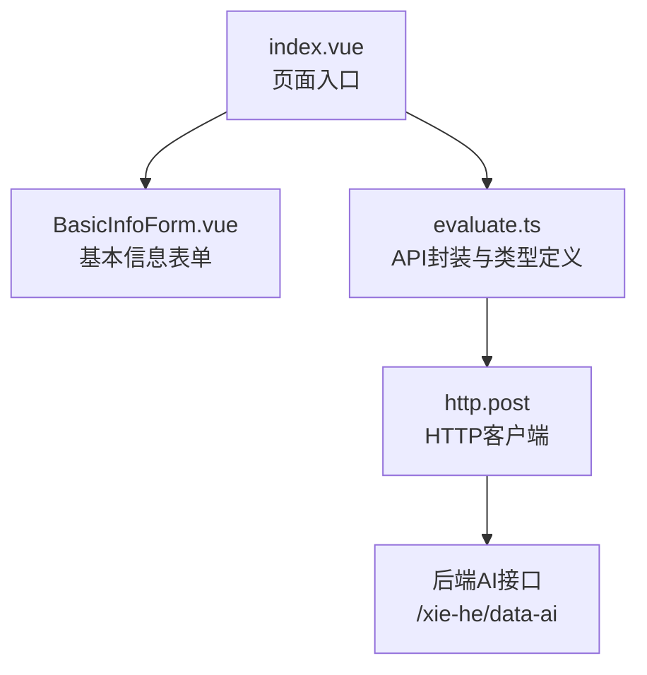
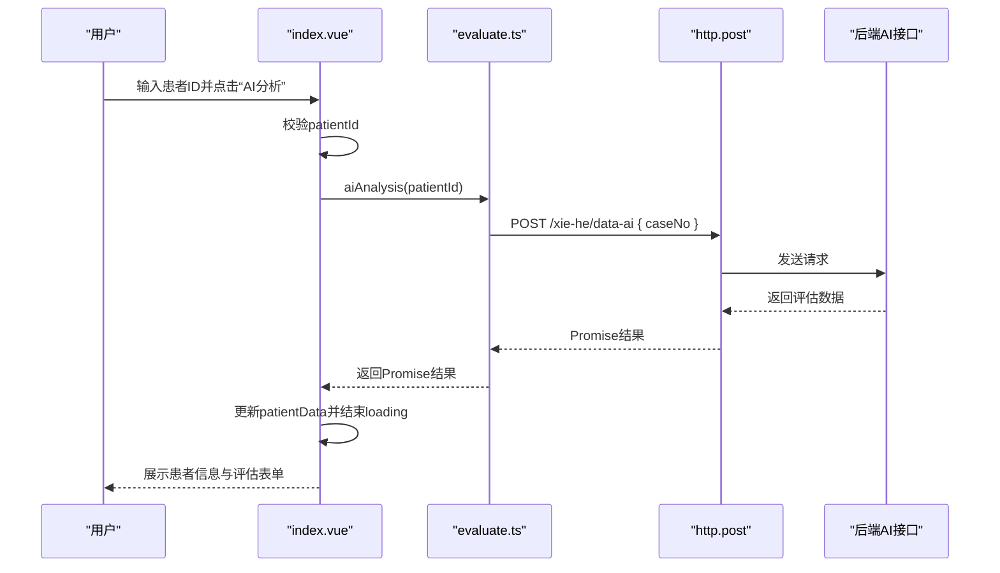
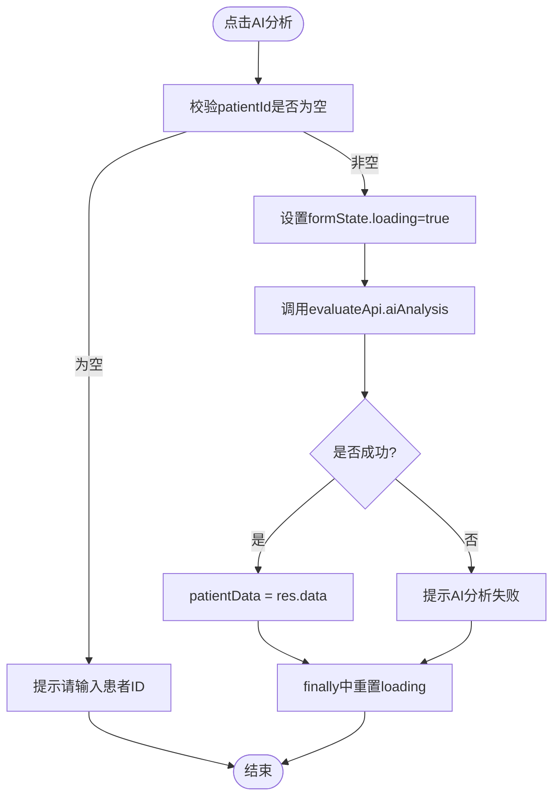
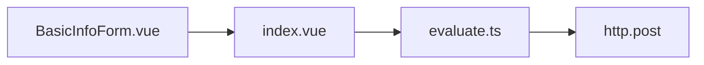
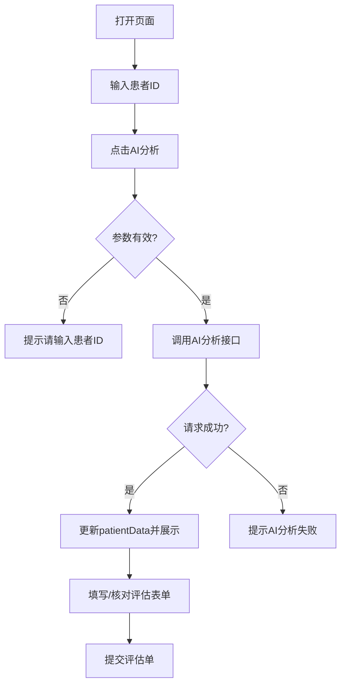
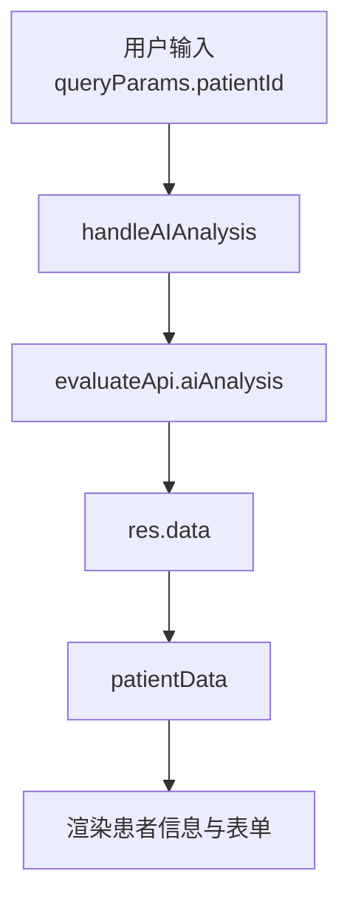

# 患者信息管理

<cite>
**本文引用的文件**   
- [index.vue](file://src/views/index/index.vue)
- [BasicInfoForm.vue](file://src/views/index/components/BasicInfoForm.vue)
- [evaluate.ts](file://src/services/evaluate.ts)
</cite>

## 目录
1. [简介](#简介)
2. [项目结构](#项目结构)
3. [核心组件](#核心组件)
4. [架构总览](#架构总览)
5. [详细组件分析](#详细组件分析)
6. [依赖关系分析](#依赖关系分析)
7. [性能与可用性建议](#性能与可用性建议)
8. [故障排查指南](#故障排查指南)
9. [结论](#结论)
10. [附录：集成示例与流程图](#附录集成示例与流程图)

## 简介
本模块为“智能评估”页面中的患者信息管理功能，提供基于患者ID的AI分析查询、患者基本信息展示、以及完整的术前评估表单。核心流程包括：
- 用户输入患者ID并触发AI分析
- 调用后端AI接口获取结构化评估数据
- 将返回数据映射到前端数据模型并渲染
- 支持后续编辑与提交评估单

该文档聚焦以下目标：
- 说明患者信息查询（含患者ID输入校验、参数处理、信息展示）
- 解释患者数据模型（patientInfo等字段定义与类型）
- 解析AI分析实现原理（handleAIAnalysis调用链、错误处理、状态管理）
- 提供可操作的集成步骤与交互/数据流图

## 项目结构
围绕患者信息管理的相关代码主要分布在视图层与服务层：
- 视图层
  - index.vue：页面入口，负责查询区、患者信息展示、表单组合与提交逻辑
  - BasicInfoForm.vue：基本信息子表单，绑定 patientData.patientInfo 字段
- 服务层
  - evaluate.ts：定义数据类型、API封装、工具函数与常量



图示来源
- [index.vue:408-437](file://src/views/index/index.vue#L408-L437)
- [BasicInfoForm.vue:104-128](file://src/views/index/components/BasicInfoForm.vue#L104-L128)
- [evaluate.ts:471-505](file://src/services/evaluate.ts#L471-L505)

章节来源
- [index.vue:1-100](file://src/views/index/index.vue#L1-L100)
- [BasicInfoForm.vue:1-102](file://src/views/index/components/BasicInfoForm.vue#L1-L102)
- [evaluate.ts:1-50](file://src/services/evaluate.ts#L1-L50)

## 核心组件
- 患者信息查询与AI分析入口
  - 通过表单输入 patientId，点击“AI分析”按钮触发 handleAIAnalysis
  - 进行参数校验、设置加载状态、调用 evaluateApi.aiAnalysis
  - 成功后将响应数据赋值给 patientData，用于后续展示与编辑
- 患者基本信息展示
  - 当 patientData.patientInfo 存在时，展示病案号、姓名、性别、年龄等信息
- 基本信息表单
  - 双向绑定 patientData.patientInfo 下的各字段（姓名、性别、年龄、病案号、身高、体重）
  - 提供基础校验方法 validateForm

章节来源
- [index.vue:408-437](file://src/views/index/index.vue#L408-L437)
- [index.vue:542-636](file://src/views/index/index.vue#L542-L636)
- [BasicInfoForm.vue:1-102](file://src/views/index/components/BasicInfoForm.vue#L1-L102)
- [BasicInfoForm.vue:110-128](file://src/views/index/components/BasicInfoForm.vue#L110-L128)

## 架构总览
从用户交互到数据展示的端到端流程如下：



图示来源
- [index.vue:408-437](file://src/views/index/index.vue#L408-L437)
- [evaluate.ts:471-505](file://src/services/evaluate.ts#L471-L505)

## 详细组件分析

### 患者信息查询与AI分析（index.vue）
- 输入验证
  - 若未输入 patientId，提示“请输入患者ID”并中止
- 状态管理
  - formState.loading 控制按钮与输入框禁用状态
  - finally 中确保 loading 重置
- API调用
  - 调用 evaluateApi.aiAnalysis(queryParams.patientId)
  - 成功时将 res.data 赋给 patientData.value
- 错误处理
  - catch 捕获异常并提示失败消息



图示来源
- [index.vue:408-437](file://src/views/index/index.vue#L408-L437)

章节来源
- [index.vue:408-437](file://src/views/index/index.vue#L408-L437)

### 患者数据模型（evaluate.ts）
- PatientInfo（患者基本信息）
  - patientName: string（患者姓名）
  - sex: string（性别）
  - age: string（年龄）
  - caseNo: string（病案号）
  - height: string（身高）
  - weight: string（体重）
- PatientAssessmentData（完整评估数据结构）
  - patientInfo: PatientInfo
  - result: { basicInfo, generalAssessment, personalHistory, airwayAssessment, auxiliaryExamination, organSystemAssessment, specialDiseaseAssessment }

```mermaid
classDiagram
class PatientInfo {
+string patientName
+string sex
+string age
+string caseNo
+string height
+string weight
}
class BasicInfo {
+preoperativeDiagnosis
+plannedSurgery
}
class GeneralAssessment {
+heartRate
+bloodPressure
+spO2
+consciousness
+gcsScore
+rassScore
+asaGrade
+activityTolerance
}
class PersonalHistory
class AirwayAssessment
class AuxiliaryExamination
class OrganSystemAssessment
class SpecialDiseaseAssessment
class PatientAssessmentData {
+patientInfo : PatientInfo
+result : {
basicInfo : BasicInfo
generalAssessment : GeneralAssessment
personalHistory : PersonalHistory
airwayAssessment : AirwayAssessment
auxiliaryExamination : AuxiliaryExamination
organSystemAssessment : OrganSystemAssessment
specialDiseaseAssessment : SpecialDiseaseAssessment
}
}
PatientAssessmentData --> PatientInfo : "包含"
PatientAssessmentData --> BasicInfo : "包含"
PatientAssessmentData --> GeneralAssessment : "包含"
PatientAssessmentData --> PersonalHistory : "包含"
PatientAssessmentData --> AirwayAssessment : "包含"
PatientAssessmentData --> AuxiliaryExamination : "包含"
PatientAssessmentData --> OrganSystemAssessment : "包含"
PatientAssessmentData --> SpecialDiseaseAssessment : "包含"
```

图示来源
- [evaluate.ts:8-15](file://src/services/evaluate.ts#L8-L15)
- [evaluate.ts:20-71](file://src/services/evaluate.ts#L20-L71)
- [evaluate.ts:76-119](file://src/services/evaluate.ts#L76-L119)
- [evaluate.ts:124-163](file://src/services/evaluate.ts#L124-L163)
- [evaluate.ts:169-216](file://src/services/evaluate.ts#L169-L216)
- [evaluate.ts:221-372](file://src/services/evaluate.ts#L221-L372)
- [evaluate.ts:377-404](file://src/services/evaluate.ts#L377-L404)
- [evaluate.ts:409-420](file://src/services/evaluate.ts#L409-L420)

章节来源
- [evaluate.ts:8-15](file://src/services/evaluate.ts#L8-L15)
- [evaluate.ts:409-420](file://src/services/evaluate.ts#L409-L420)

### 基本信息表单（BasicInfoForm.vue）
- 字段绑定
  - patientData.patientInfo.patientName
  - patientData.patientInfo.sex
  - patientData.patientInfo.age
  - patientData.patientInfo.caseNo
  - patientData.patientInfo.height
  - patientData.patientInfo.weight
- 校验方法
  - validateForm 检查姓名、性别、年龄必填项，返回 valid 与 message

章节来源
- [BasicInfoForm.vue:1-102](file://src/views/index/components/BasicInfoForm.vue#L1-L102)
- [BasicInfoForm.vue:110-128](file://src/views/index/components/BasicInfoForm.vue#L110-L128)

### AI分析API封装（evaluate.ts）
- evaluateApi.aiAnalysis(caseNo)
  - 使用 http.post 向 /xie-he/data-ai 发起POST请求
  - 请求体为 { caseNo }
- 注意
  - 当前类型声明返回 PageList<Manage[]>，但页面侧按 ApiResponse<any> 使用；实际对接时需统一类型

章节来源
- [evaluate.ts:471-505](file://src/services/evaluate.ts#L471-L505)

## 依赖关系分析
- index.vue 依赖 evaluate.ts 提供的 evaluateApi 与类型定义
- BasicInfoForm.vue 依赖父组件传递的 patientData 模型
- evaluate.ts 依赖 http 客户端发起网络请求



图示来源
- [index.vue:20-32](file://src/views/index/index.vue#L20-L32)
- [evaluate.ts:471-505](file://src/services/evaluate.ts#L471-L505)

章节来源
- [index.vue:20-32](file://src/views/index/index.vue#L20-L32)
- [evaluate.ts:471-505](file://src/services/evaluate.ts#L471-L505)

## 性能与可用性建议
- 防抖与节流
  - 对AI分析按钮增加防抖，避免重复提交
- 乐观更新与重试
  - 在弱网环境下可考虑本地缓存最近一次成功结果，并提供重试机制
- 数据完整性校验
  - 在提交前使用 evaluateUtils.checkDataCompleteness 提示缺失字段，提升用户体验
- 加载态优化
  - 区分“查询中”和“提交中”两种状态，分别控制不同区域UI

[本节为通用建议，不直接分析具体文件]

## 故障排查指南
- 常见问题
  - 未输入患者ID即点击AI分析：会提示“请输入患者ID”，请补充后重试
  - AI分析失败：catch分支会提示失败，检查网络与后端接口
  - 提交失败：handleSubmit 的 catch 分支会提示失败，检查表单数据与后端接口
- 定位要点
  - 确认 evaluateApi.aiAnalysis 的请求路径与参数是否正确
  - 确认返回数据结构是否与页面预期一致（patientData.patientInfo 是否存在）

章节来源
- [index.vue:408-437](file://src/views/index/index.vue#L408-L437)
- [index.vue:440-521](file://src/views/index/index.vue#L440-L521)
- [evaluate.ts:513-575](file://src/services/evaluate.ts#L513-L575)

## 结论
本模块以 index.vue 为入口，结合 evaluate.ts 的类型与API封装，实现了从患者ID输入到AI分析结果展示的全链路流程。数据模型清晰、职责分离明确，便于扩展更多评估维度与校验规则。建议在后续迭代中完善类型一致性、增强错误提示与网络容错能力。

[本节为总结性内容，不直接分析具体文件]

## 附录：集成示例与流程图

### 用户交互流程图


[此图为概念流程，不直接对应具体源码文件]

### 数据流转图


图示来源
- [index.vue:408-437](file://src/views/index/index.vue#L408-L437)
- [evaluate.ts:471-505](file://src/services/evaluate.ts#L471-L505)