# 核心功能模块

<cite>
**本文引用的文件**   
- [index.vue](file://src/views/index/index.vue)
- [BasicInfoForm.vue](file://src/views/index/components/BasicInfoForm.vue)
- [GeneralAssessmentForm.vue](file://src/views/index/components/GeneralAssessmentForm.vue)
- [PersonalHistoryForm.vue](file://src/views/index/components/PersonalHistoryForm.vue)
- [AirwayAssessmentForm.vue](file://src/views/index/components/AirwayAssessmentForm.vue)
- [AuxiliaryExaminationForm.vue](file://src/views/index/components/AuxiliaryExaminationForm.vue)
- [OrganSystemAssessmentForm.vue](file://src/views/index/components/OrganSystemAssessmentForm.vue)
- [SpecialDiseaseAssessmentForm.vue](file://src/views/index/components/SpecialDiseaseAssessmentForm.vue)
- [evaluate.ts](file://src/services/evaluate.ts)
</cite>

## 目录
1. [简介](#简介)
2. [项目结构](#项目结构)
3. [核心组件](#核心组件)
4. [架构总览](#架构总览)
5. [详细组件分析](#详细组件分析)
6. [依赖关系分析](#依赖关系分析)
7. [性能与一致性](#性能与一致性)
8. [故障排查指南](#故障排查指南)
9. [结论](#结论)

## 简介
本文件面向协和麻醉科智能评估系统的前端实现，聚焦以下核心能力：
- 患者信息管理：统一维护患者基本信息、拟行手术、术前诊断等。
- AI智能评估：根据患者ID调用AI接口，自动回填或辅助生成评估数据。
- 多模块评估表单：覆盖一般情况、个人史、气道、辅助检查、器官系统、专病等评估维度。
文档将说明各模块的业务逻辑、数据模型、用户交互流程，并给出架构图、数据流转图与API序列图，同时解释模块间依赖与协作机制，提供使用场景示例与错误处理策略。

## 项目结构
该页面采用“父容器 + 子表单”的组件化组织方式：
- 父容器 index.vue 负责路由元信息、查询参数、全局状态、AI分析与提交、GCS总分计算以及聚合展示。
- 子表单组件各自维护对应业务域的数据字段，并通过 v-model 双向绑定到父容器的 patientData 对象。
- 服务层 evaluate.ts 定义完整的数据类型、常量字典与API封装（AI分析与提交）。

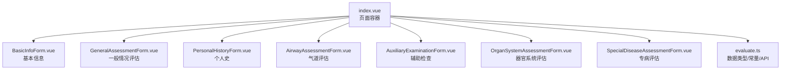

图表来源
- [index.vue:10-32](file://src/views/index/index.vue#L10-L32)
- [evaluate.ts:459-506](file://src/services/evaluate.ts#L459-L506)

章节来源
- [index.vue:1-32](file://src/views/index/index.vue#L1-L32)
- [evaluate.ts:459-506](file://src/services/evaluate.ts#L459-L506)

## 核心组件
- 页面容器 index.vue
  - 职责：管理查询参数、加载/提交状态、患者数据、触发AI分析、汇总校验与提交、计算GCS总分。
  - 关键方法：handleAIAnalysis、handleSubmit、calculateGCSTotal。
- 子表单组件
  - BasicInfoForm：姓名、性别、年龄、病案号、身高体重、术前诊断、拟行手术。
  - GeneralAssessmentForm：心率、血压、血氧、意识状态、ASA分级、活动耐量、GCS/RASS评分。
  - PersonalHistoryForm：过敏史、吸烟/饮酒/药物滥用史、晕动病史、手术麻醉史及PONV。
  - AirwayAssessmentForm：Mallampati分级、鼾症/OSAHS、松动牙齿、张口度、颈椎相关、下颌相关。
  - AuxiliaryExaminationForm：血液检查、影像学检查等。
  - OrganSystemAssessmentForm：心血管、呼吸、内分泌、消化、泌尿、神经系统疾病评估。
  - SpecialDiseaseAssessmentForm：嗜铬细胞瘤术前评估（肿瘤指标、症状、用药）。
- 服务层 evaluate.ts
  - 定义所有数据结构接口、常量字典、API封装（aiAnalysis、submitEvaluation）与工具函数。

章节来源
- [index.vue:40-539](file://src/views/index/index.vue#L40-L539)
- [BasicInfoForm.vue:104-129](file://src/views/index/components/BasicInfoForm.vue#L104-L129)
- [GeneralAssessmentForm.vue:176-214](file://src/views/index/components/GeneralAssessmentForm.vue#L176-L214)
- [PersonalHistoryForm.vue:177-237](file://src/views/index/components/PersonalHistoryForm.vue#L177-L237)
- [AirwayAssessmentForm.vue:142-208](file://src/views/index/components/AirwayAssessmentForm.vue#L142-L208)
- [AuxiliaryExaminationForm.vue:118-143](file://src/views/index/components/AuxiliaryExaminationForm.vue#L118-L143)
- [OrganSystemAssessmentForm.vue:1-800](file://src/views/index/components/OrganSystemAssessmentForm.vue#L1-L800)
- [SpecialDiseaseAssessmentForm.vue:188-214](file://src/views/index/components/SpecialDiseaseAssessmentForm.vue#L188-L214)
- [evaluate.ts:459-506](file://src/services/evaluate.ts#L459-L506)

## 架构总览
整体采用“视图层（Vue组件）— 服务层（API封装）— 后端AI/业务接口”的分层架构。视图层通过 v-model 双向绑定共享数据对象；服务层集中管理类型、常量与HTTP请求；后端提供AI分析与评估单提交能力。

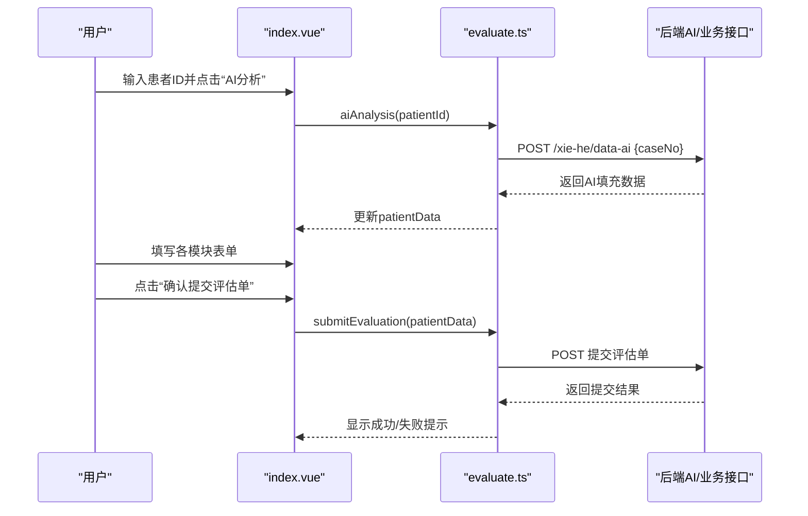

图表来源
- [index.vue:407-520](file://src/views/index/index.vue#L407-L520)
- [evaluate.ts:471-506](file://src/services/evaluate.ts#L471-L506)

## 详细组件分析

### 患者信息管理（BasicInfoForm）
- 业务逻辑
  - 收集患者基础信息与拟行手术、术前诊断。
  - 提供基础校验（姓名、性别、年龄必填）。
- 数据模型
  - 绑定至 patientData.patientInfo 与 result.basicInfo。
- 用户交互
  - 文本输入、数字输入、下拉选择。
- 验证规则
  - 组件内 validateForm 检查必填项。

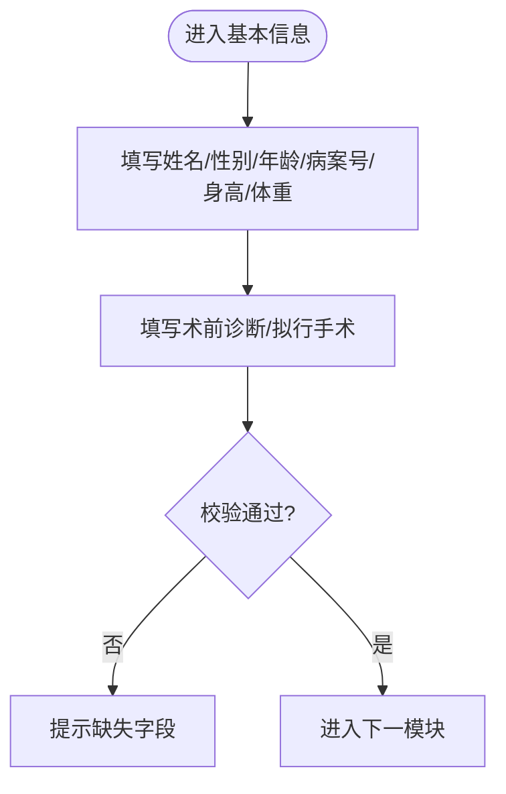

图表来源
- [BasicInfoForm.vue:1-102](file://src/views/index/components/BasicInfoForm.vue#L1-L102)
- [BasicInfoForm.vue:110-128](file://src/views/index/components/BasicInfoForm.vue#L110-L128)

章节来源
- [BasicInfoForm.vue:1-129](file://src/views/index/components/BasicInfoForm.vue#L1-L129)

### AI智能评估（index.vue + evaluate.ts）
- 业务逻辑
  - 输入患者ID后调用AI接口，成功后用返回数据替换/合并 patientData。
  - 若未输入患者ID则提示警告。
- 数据流
  - 前端 -> evaluateApi.aiAnalysis -> 后端 -> 返回数据 -> 更新 state。
- 错误处理
  - 捕获异常并提示失败，确保 loading 状态复位。

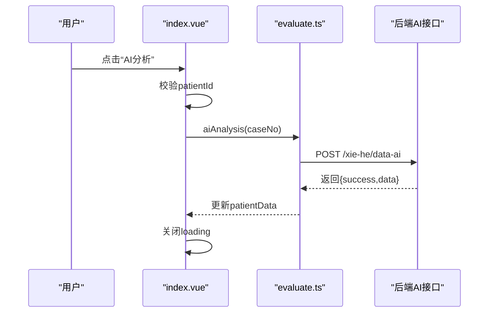

图表来源
- [index.vue:407-437](file://src/views/index/index.vue#L407-L437)
- [evaluate.ts:498-506](file://src/services/evaluate.ts#L498-L506)

章节来源
- [index.vue:407-437](file://src/views/index/index.vue#L407-L437)
- [evaluate.ts:498-506](file://src/services/evaluate.ts#L498-L506)

### 一般情况评估（GeneralAssessmentForm）
- 业务逻辑
  - 采集生命体征、意识状态、ASA分级、活动耐量。
  - 支持GCS三分项评分与RASS评分，实时计算总分。
- 数据模型
  - 绑定至 patientData.result.generalAssessment。
- 用户交互
  - 数值输入、下拉选择、分组展示（GCS/RASS）。
- 验证规则
  - 组件内 validateForm 检查心率、血压、血氧等必填项。

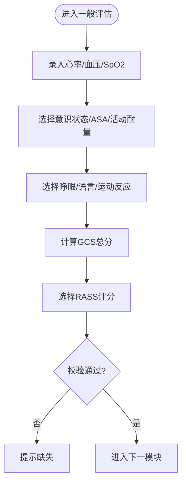

图表来源
- [GeneralAssessmentForm.vue:1-174](file://src/views/index/components/GeneralAssessmentForm.vue#L1-L174)
- [GeneralAssessmentForm.vue:183-214](file://src/views/index/components/GeneralAssessmentForm.vue#L183-L214)

章节来源
- [GeneralAssessmentForm.vue:1-214](file://src/views/index/components/GeneralAssessmentForm.vue#L1-L214)

### 个人史（PersonalHistoryForm）
- 业务逻辑
  - 记录过敏史、吸烟/饮酒/药物滥用史、晕动病史、手术麻醉史与PONV。
  - 条件显示手术麻醉详情（开关控制）。
- 数据模型
  - 绑定至 patientData.result.personalHistory。
- 用户交互
  - 文本域、下拉选择、日期选择器、开关。
- 验证规则
  - 条件必填校验（如存在过敏/吸烟/饮酒/药物滥用/手术史时的描述必填）。

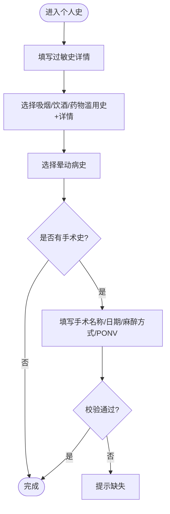

图表来源
- [PersonalHistoryForm.vue:1-175](file://src/views/index/components/PersonalHistoryForm.vue#L1-L175)
- [PersonalHistoryForm.vue:182-237](file://src/views/index/components/PersonalHistoryForm.vue#L182-L237)

章节来源
- [PersonalHistoryForm.vue:1-237](file://src/views/index/components/PersonalHistoryForm.vue#L1-L237)

### 气道评估（AirwayAssessmentForm）
- 业务逻辑
  - 采集口咽、颈椎、下颌相关指标，用于插管风险评估。
- 数据模型
  - 绑定至 patientData.result.airwayAssessment。
- 用户交互
  - 下拉选择与数值输入组合。
- 验证规则
  - 组件内 validateForm 对关键字段进行必填校验。

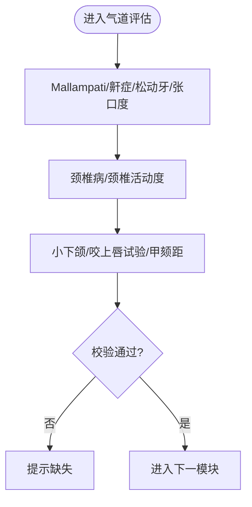

图表来源
- [AirwayAssessmentForm.vue:1-140](file://src/views/index/components/AirwayAssessmentForm.vue#L1-L140)
- [AirwayAssessmentForm.vue:152-208](file://src/views/index/components/AirwayAssessmentForm.vue#L152-L208)

章节来源
- [AirwayAssessmentForm.vue:1-208](file://src/views/index/components/AirwayAssessmentForm.vue#L1-L208)

### 辅助检查（AuxiliaryExaminationForm）
- 业务逻辑
  - 采集血液检查与影像学检查结果，便于后续评估参考。
- 数据模型
  - 绑定至 patientData.result.auxiliaryExamination。
- 用户交互
  - 文本输入为主，按类别分组展示。
- 验证规则
  - 组件内 validateForm 基于表单实例校验。

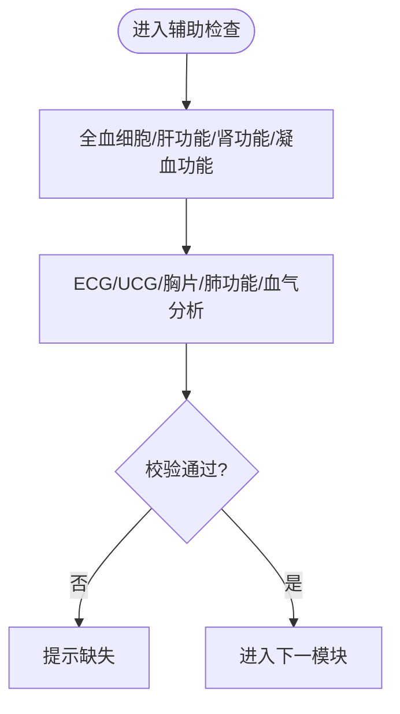

图表来源
- [AuxiliaryExaminationForm.vue:1-116](file://src/views/index/components/AuxiliaryExaminationForm.vue#L1-L116)
- [AuxiliaryExaminationForm.vue:127-143](file://src/views/index/components/AuxiliaryExaminationForm.vue#L127-L143)

章节来源
- [AuxiliaryExaminationForm.vue:1-143](file://src/views/index/components/AuxiliaryExaminationForm.vue#L1-L143)

### 器官系统评估（OrganSystemAssessmentForm）
- 业务逻辑
  - 覆盖心血管、呼吸、内分泌、消化、泌尿、神经系统常见疾病的患病时长、严重程度、近期症状与用药等。
- 数据模型
  - 绑定至 patientData.result.organSystemAssessment。
- 用户交互
  - 大量文本输入与部分下拉选择，按系统分块展示。
- 验证规则
  - 当前组件未暴露统一校验方法，可在父级统一校验。

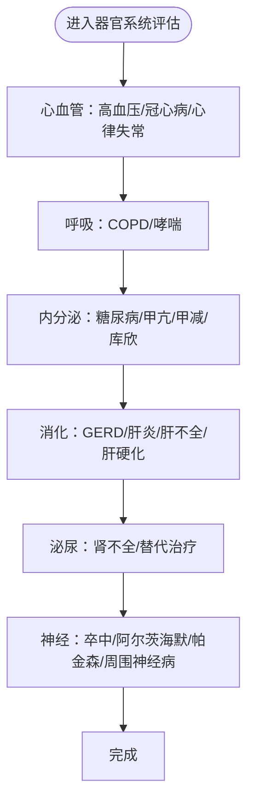

图表来源
- [OrganSystemAssessmentForm.vue:1-800](file://src/views/index/components/OrganSystemAssessmentForm.vue#L1-L800)

章节来源
- [OrganSystemAssessmentForm.vue:1-800](file://src/views/index/components/OrganSystemAssessmentForm.vue#L1-L800)

### 专病评估（SpecialDiseaseAssessmentForm）
- 业务逻辑
  - 针对嗜铬细胞瘤术前评估，采集肿瘤位置/大小、内分泌激素指标、临床症状与术前用药情况。
- 数据模型
  - 绑定至 patientData.result.specialDiseaseAssessment。
- 用户交互
  - 文本输入为主，按子模块分组。
- 验证规则
  - 组件内 validateForm 基于表单实例校验。

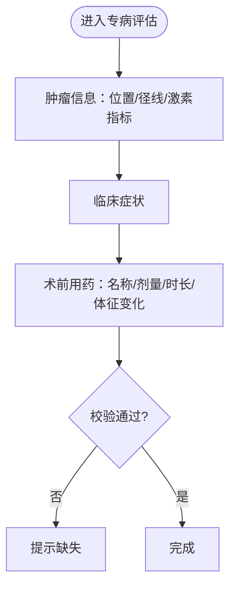

图表来源
- [SpecialDiseaseAssessmentForm.vue:1-186](file://src/views/index/components/SpecialDiseaseAssessmentForm.vue#L1-L186)
- [SpecialDiseaseAssessmentForm.vue:198-214](file://src/views/index/components/SpecialDiseaseAssessmentForm.vue#L198-L214)

章节来源
- [SpecialDiseaseAssessmentForm.vue:1-214](file://src/views/index/components/SpecialDiseaseAssessmentForm.vue#L1-L214)

## 依赖关系分析
- 组件耦合
  - 所有子表单通过 v-model 与父容器共享 patientData，形成松耦合但高内聚的数据中心模式。
- 服务依赖
  - 页面容器依赖 evaluate.ts 提供的 API 与常量字典。
- 外部依赖
  - Ant Design Vue 组件库用于表单与交互。
- 潜在循环依赖
  - 未发现循环引用；组件单向依赖父容器与服务层。

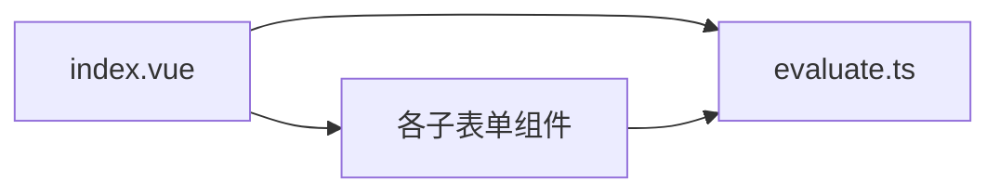

图表来源
- [index.vue:10-32](file://src/views/index/index.vue#L10-L32)
- [evaluate.ts:459-506](file://src/services/evaluate.ts#L459-L506)

章节来源
- [index.vue:10-32](file://src/views/index/index.vue#L10-L32)
- [evaluate.ts:459-506](file://src/services/evaluate.ts#L459-L506)

## 性能与一致性
- 性能考虑
  - AI分析为异步操作，使用 loading 状态避免重复请求。
  - 表单校验在组件内部执行，减少父级复杂度。
- 数据一致性
  - 所有数据集中在 patientData 中，保证提交时的一致性。
  - GCS总分由父容器统一计算，避免重复计算与不一致。
- 可扩展性
  - 新增评估维度可通过新增子表单并在父容器挂载，无需改动现有逻辑。

[本节为通用指导，不直接分析具体文件]

## 故障排查指南
- AI分析失败
  - 现象：提示“AI分析失败，请重试”。
  - 排查：检查患者ID是否为空；查看网络请求是否成功；确认后端接口路径与参数。
  - 定位：index.vue handleAIAnalysis 与 evaluate.ts aiAnalysis。
- 提交失败
  - 现象：提示“提交失败，请重试”。
  - 排查：检查各子表单是否已填写必要字段；查看 submitEvaluation 返回值。
  - 定位：index.vue handleSubmit 与 evaluate.ts submitEvaluation。
- 表单校验问题
  - 现象：某些字段未填却可继续。
  - 排查：检查各子表单 validateForm 的实现与父级调用逻辑。
  - 定位：各子表单组件的 validateForm 方法。

章节来源
- [index.vue:407-520](file://src/views/index/index.vue#L407-L520)
- [BasicInfoForm.vue:110-128](file://src/views/index/components/BasicInfoForm.vue#L110-L128)
- [GeneralAssessmentForm.vue:195-214](file://src/views/index/components/GeneralAssessmentForm.vue#L195-L214)
- [PersonalHistoryForm.vue:182-237](file://src/views/index/components/PersonalHistoryForm.vue#L182-L237)
- [AirwayAssessmentForm.vue:152-208](file://src/views/index/components/AirwayAssessmentForm.vue#L152-L208)
- [AuxiliaryExaminationForm.vue:127-143](file://src/views/index/components/AuxiliaryExaminationForm.vue#L127-L143)
- [SpecialDiseaseAssessmentForm.vue:198-214](file://src/views/index/components/SpecialDiseaseAssessmentForm.vue#L198-L214)
- [evaluate.ts:471-506](file://src/services/evaluate.ts#L471-L506)

## 结论
本系统以统一的 patientData 为中心，结合模块化表单与集中式服务层，实现了从患者信息采集、AI智能辅助到多维度评估与提交的完整闭环。通过清晰的职责划分与数据流向，系统在可维护性与扩展性方面具备良好基础。建议在后续迭代中完善各子表单的统一校验入口，增强错误提示的可操作性，并接入真实后端接口以替代模拟返回。

[本节为总结性内容，不直接分析具体文件]