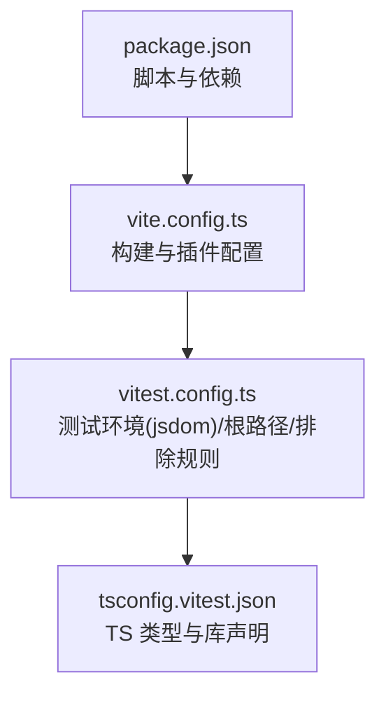
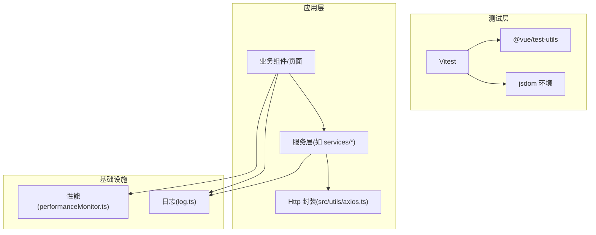
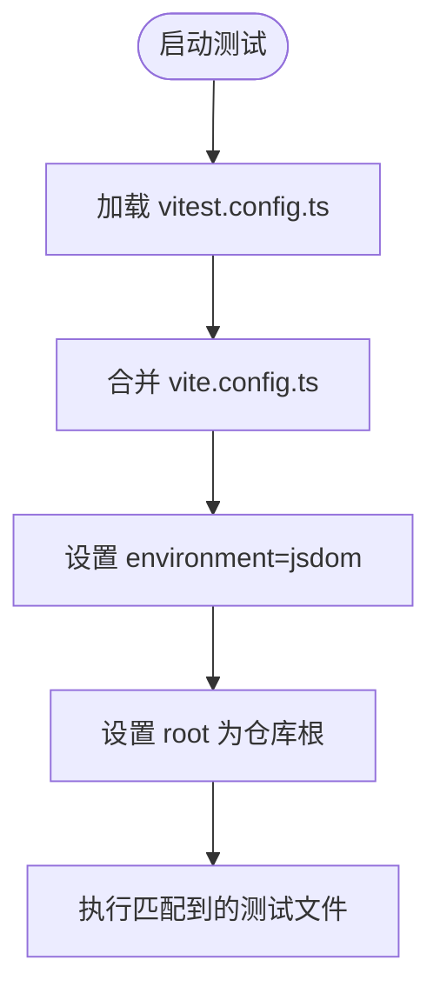
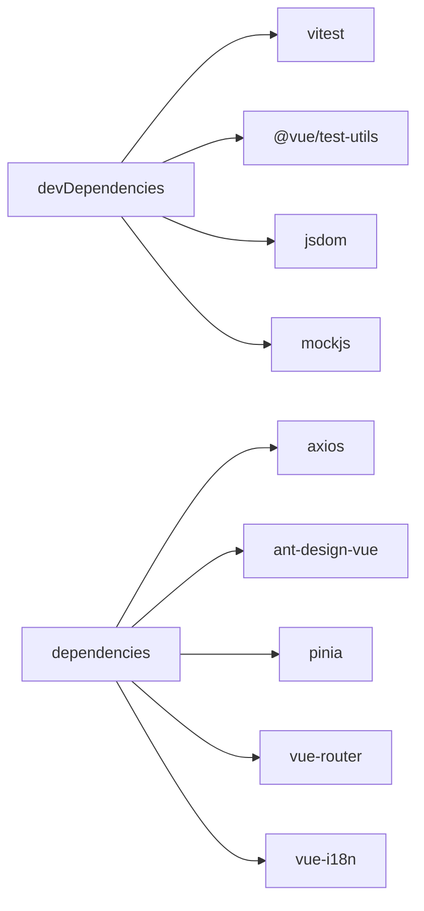

# 测试与调试

<cite>
**本文引用的文件**   
- [package.json](file://package.json)
- [vite.config.ts](file://vite.config.ts)
- [vitest.config.ts](file://vitest.config.ts)
- [tsconfig.vitest.json](file://tsconfig.vitest.json)
- [src/utils/axios.ts](file://src/utils/axios.ts)
- [src/utils/log.ts](file://src/utils/log.ts)
- [src/utils/performanceMonitor.ts](file://src/utils/performanceMonitor.ts)
</cite>

## 目录
1. [简介](#简介)
2. [项目结构](#项目结构)
3. [核心组件](#核心组件)
4. [架构总览](#架构总览)
5. [详细组件分析](#详细组件分析)
6. [依赖关系分析](#依赖关系分析)
7. [性能考虑](#性能考虑)
8. [故障排查指南](#故障排查指南)
9. [结论](#结论)
10. [附录](#附录)

## 简介
本指南面向前端工程（Vue 3 + Vite + Vitest）的测试与调试实践，覆盖单元测试框架配置、测试用例编写规范、Mock 数据策略、组件/服务层/端到端测试实施方法，以及调试工具、性能分析、错误追踪与日志记录。同时给出测试覆盖率建议、持续集成配置思路与质量保证流程，帮助团队建立稳定、可维护、可观测的前端质量保障体系。

## 项目结构
本项目采用 Vite 作为构建与开发服务器，使用 Vitest 进行单元测试，jsdom 作为浏览器环境模拟。测试相关的关键配置集中在以下文件：
- package.json：定义脚本命令与依赖（包含 vitest、@vue/test-utils、jsdom、mockjs）。
- vite.config.ts：Vite 主配置，提供别名、插件、代理等。
- vitest.config.ts：基于 Vite 配置合并 Vitest 测试配置，指定 jsdom 环境与排除 e2e 目录。
- tsconfig.vitest.json：为 Vitest 提供 TypeScript 编译选项与环境类型。

图表来源
- [package.json:6-15](file://package.json#L6-L15)
- [vite.config.ts:1-100](file://vite.config.ts#L1-L100)
- [vitest.config.ts:1-15](file://vitest.config.ts#L1-L15)
- [tsconfig.vitest.json:1-11](file://tsconfig.vitest.json#L1-L11)

章节来源
- [package.json:6-15](file://package.json#L6-L15)
- [vite.config.ts:1-100](file://vite.config.ts#L1-L100)
- [vitest.config.ts:1-15](file://vitest.config.ts#L1-L15)
- [tsconfig.vitest.json:1-11](file://tsconfig.vitest.json#L1-L11)

## 核心组件
- 测试运行器与断言：Vitest（含内置 expect、spy、mock 能力）。
- Vue 组件测试：@vue/test-utils 用于挂载、交互与断言。
- 浏览器环境模拟：jsdom（在 vitest.config.ts 中启用）。
- Mock 数据：mockjs（可用于生成随机数据或拦截请求）。
- HTTP 客户端封装：src/utils/axios.ts（统一拦截、重复提交防护、错误提示、下载处理）。
- 日志与错误：src/utils/log.ts（warn/error 包装），src/utils/performanceMonitor.ts（性能监控骨架，当前已注释）。

章节来源
- [vitest.config.ts:8-12](file://vitest.config.ts#L8-L12)
- [package.json:47-67](file://package.json#L47-L67)
- [src/utils/axios.ts:1-127](file://src/utils/axios.ts#L1-L127)
- [src/utils/log.ts:1-10](file://src/utils/log.ts#L1-L10)
- [src/utils/performanceMonitor.ts:1-192](file://src/utils/performanceMonitor.ts#L1-L192)

## 架构总览
下图展示测试与运行时关键模块的关系：测试通过 Vitest 启动，复用 Vite 配置；业务代码通过 Http 类发起网络请求；日志与性能监控辅助调试与观测。

图表来源
- [vitest.config.ts:8-12](file://vitest.config.ts#L8-L12)
- [src/utils/axios.ts:1-127](file://src/utils/axios.ts#L1-L127)
- [src/utils/log.ts:1-10](file://src/utils/log.ts#L1-L10)
- [src/utils/performanceMonitor.ts:1-192](file://src/utils/performanceMonitor.ts#L1-L192)

## 详细组件分析

### 单元测试框架配置（Vitest + jsdom）
- 测试环境：jsdom，适合 DOM 操作与 Vue 组件渲染测试。
- 根目录：指向仓库根，便于解析相对路径与别名。
- 排除规则：默认排除 e2e 目录，避免与单元/集成测试混跑。
- TS 支持：通过 tsconfig.vitest.json 扩展 app 配置并引入 jsdom 类型。

图表来源
- [vitest.config.ts:1-15](file://vitest.config.ts#L1-L15)
- [tsconfig.vitest.json:1-11](file://tsconfig.vitest.json#L1-L11)

章节来源
- [vitest.config.ts:1-15](file://vitest.config.ts#L1-L15)
- [tsconfig.vitest.json:1-11](file://tsconfig.vitest.json#L1-L11)

### 测试用例编写规范
- 命名约定：建议将测试文件与源文件同目录或置于 __tests__ 子目录，后缀 .test.ts/.spec.ts。
- 用例组织：使用 describe 分组业务场景，it/test 描述具体行为，expect 断言结果。
- 组件测试：
  - 使用 @vue/test-utils mount/shallowMount 挂载组件。
  - 通过 trigger('click')、setValue、find/getByRole 等进行交互与查询。
  - 对异步更新使用 nextTick 或 await flushPromises。
- 服务层测试：
  - 隔离外部依赖（HTTP、Pinia、路由等），使用 Vitest mock/spy。
  - 针对边界条件（空数据、异常、超时）编写用例。
- 端到端测试：
  - 当前 vitest.config.ts 排除 e2e 目录，建议单独使用 Playwright/Cypress 管理 e2e 用例与报告。

章节来源
- [vitest.config.ts:8-12](file://vitest.config.ts#L8-L12)

### Mock 数据策略
- 接口 Mock：
  - 使用 Vitest 的 vi.fn()/vi.mock() 对 axios 或自定义 Http 类进行替换，返回期望数据结构。
  - 或使用 mockjs 生成随机数据，配合本地 JSON 固定样例。
- 组件 Mock：
  - 对第三方 UI 组件或图标按需 stub，减少渲染开销。
- 状态与副作用：
  - 对 Pinia store、路由、定时器、localStorage 等使用 spy/mock 控制。
- 最佳实践：
  - 保持 Mock 数据与真实 API 契约一致（字段、类型、错误码）。
  - 将公共 Mock 抽取到 fixtures 目录，便于复用与维护。

章节来源
- [package.json:47-67](file://package.json#L47-L67)

### 组件测试实施要点
- 挂载策略：简单组件用 shallowMount，复杂交互用 mount。
- 事件断言：触发用户交互后断言 props/emits 变化与 DOM 状态。
- 异步渲染：等待 Promise 或微任务完成后再断言。
- 国际化与主题：必要时 mock i18n 与样式资源，避免无关失败。

章节来源
- [package.json:47-47](file://package.json#L47-L47)

### 服务层测试实施要点
- 隔离网络：对 src/utils/axios.ts 的 Http 类进行 mock，验证参数、URL、重试逻辑与错误分支。
- 校验拦截器：断言成功/失败响应处理、消息提示触发、重复提交保护。
- 下载流程：mock Blob 与 URL.createObjectURL，断言下载触发与文件名解析。

章节来源
- [src/utils/axios.ts:1-127](file://src/utils/axios.ts#L1-L127)

### 端到端测试实施要点
- 当前仓库未包含 e2e 实现，vitest.config.ts 已排除 e2e 目录。
- 建议引入 Playwright 或 Cypress，按功能域划分用例，结合 CI 自动化执行。
- 用例应覆盖关键用户旅程（登录、表单提交、权限校验、异常恢复）。

章节来源
- [vitest.config.ts:10-10](file://vitest.config.ts#L10-L10)

### 调试工具与技巧
- Vitest 调试：
  - 使用 --inspect 或 IDE 断点调试。
  - 使用 vi.spyOn 观察函数调用次数与参数。
- 浏览器 DevTools：
  - 利用 Network 面板检查请求与响应，Console 查看日志。
- 日志与错误：
  - 使用 src/utils/log.ts 的 warn/error 包装输出，便于过滤与定位。
  - 在 Http 拦截器中捕获错误并提示用户，便于复现问题。

章节来源
- [src/utils/log.ts:1-10](file://src/utils/log.ts#L1-L10)
- [src/utils/axios.ts:36-66](file://src/utils/axios.ts#L36-L66)

### 性能分析与优化
- 性能监控骨架：src/utils/performanceMonitor.ts 提供了性能采集与上报的完整思路（当前已注释），可按需启用。
- 指标建议：白屏时间、首字节时间、DOM 解析耗时、onload 完成时间。
- 优化方向：
  - 分包与懒加载（已在 vite.config.ts 中对语言包进行 manualChunks）。
  - 图片与静态资源优化、CDN 缓存。
  - 减少不必要的重渲染与计算。

章节来源
- [src/utils/performanceMonitor.ts:1-192](file://src/utils/performanceMonitor.ts#L1-L192)
- [vite.config.ts:69-79](file://vite.config.ts#L69-L79)

## 依赖关系分析
- 测试依赖：vitest、@vue/test-utils、jsdom、mockjs。
- 构建依赖：vite、unplugin-vue-components、vite-plugin-pages 等。
- 运行时依赖：axios、ant-design-vue、pinia、vue-router、vue-i18n 等。

图表来源
- [package.json:17-67](file://package.json#L17-L67)

章节来源
- [package.json:17-67](file://package.json#L17-L67)

## 性能考虑
- 测试性能：
  - 使用 shallowMount 减少深层渲染。
  - 合理拆分测试套件，避免单用例过重。
  - 使用 vi.useFakeTimers 控制时间与异步。
- 构建性能：
  - 继续细化 manualChunks，分离大体积依赖（如 ant-design-vue 按需引入）。
  - 开启 Gzip/Brotli 压缩，合理使用 CDN。
- 运行时性能：
  - 关注长列表虚拟滚动、图片懒加载、防抖节流。
  - 使用 performanceMonitor.ts 的思路采集关键指标并上报。

[本节为通用指导，不直接分析具体文件]

## 故障排查指南
- 常见问题与定位：
  - 组件渲染失败：检查是否缺少必要的依赖注入（如 i18n、router、store），必要时 mock。
  - 网络请求失败：确认 baseURL、代理配置与后端可达性；检查 Http 拦截器的错误分支。
  - 重复提交告警：Http 类对 PUT/POST 做了短时间内的重复请求拦截，注意测试时调整时间窗口或禁用该逻辑。
  - 下载失败：检查 responseType=blob 与 Content-Disposition 解析逻辑。
- 日志与错误：
  - 使用 log.ts 的 warn/error 输出关键信息。
  - 在 Http 拦截器中统一捕获并提示错误，便于复现。
- 性能问题：
  - 启用 performanceMonitor.ts 的采集逻辑，观察关键指标。
  - 借助浏览器 Performance 面板分析主线程阻塞与重绘。

章节来源
- [src/utils/axios.ts:36-66](file://src/utils/axios.ts#L36-L66)
- [src/utils/axios.ts:104-125](file://src/utils/axios.ts#L104-L125)
- [src/utils/log.ts:1-10](file://src/utils/log.ts#L1-L10)
- [src/utils/performanceMonitor.ts:1-192](file://src/utils/performanceMonitor.ts#L1-L192)

## 结论
通过 Vitest + jsdom 的组合，本项目具备完善的单元测试基础；配合 @vue/test-utils 与 mockjs，可高效覆盖组件与服务层。建议在现有基础上：
- 完善测试用例与覆盖率目标（建议核心模块行覆盖率≥80%，分支覆盖率≥70%）。
- 引入端到端测试（Playwright/Cypress）覆盖关键业务流程。
- 启用性能监控与错误上报，形成闭环的质量保障体系。
- 在 CI 中集成 lint、type-check、unit test 与覆盖率门禁，确保代码质量持续提升。

[本节为总结性内容，不直接分析具体文件]

## 附录

### 测试覆盖率要求（建议）
- 行覆盖率：≥80%
- 分支覆盖率：≥70%
- 函数覆盖率：≥80%
- 语句覆盖率：≥80%
- 关键业务模块（认证、权限、表单、表格）优先达到更高阈值

[本节为通用建议，不直接分析具体文件]

### 持续集成配置（建议）
- 触发条件：push/PR 到 main/develop 分支。
- 步骤：
  - 安装依赖
  - 类型检查（vue-tsc）
  - Lint 与格式化检查
  - 运行单元测试（vitest run）
  - 生成覆盖率报告（vitest run --coverage）
  - 上传覆盖率与产物（可选）
- 门禁：覆盖率低于阈值则失败；lint/type-check 失败则阻断合并。

[本节为通用建议，不直接分析具体文件]

### 质量保证流程（建议）
- 代码审查：强制 PR 评审，关注可测性与可维护性。
- 测试先行：新功能与修复优先补充用例。
- 回归测试：定期运行 E2E 用例，覆盖核心路径。
- 发布前检查：CI 全量通过，覆盖率达标，无高危告警。

[本节为通用建议，不直接分析具体文件]