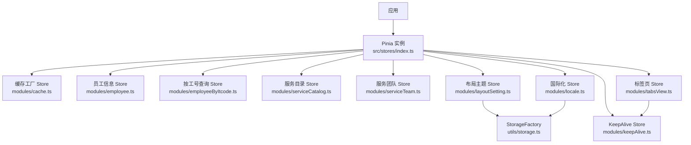
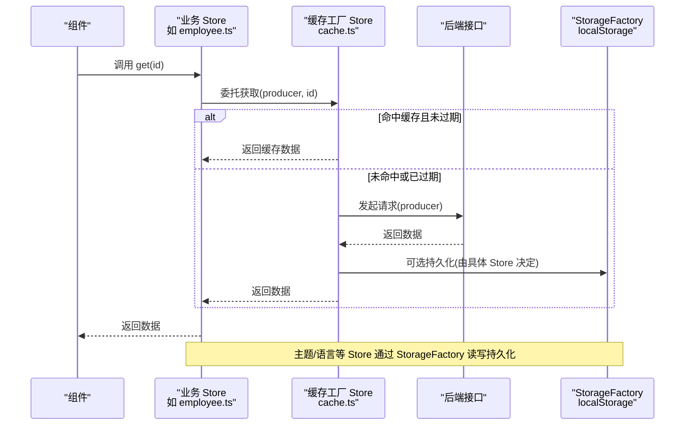
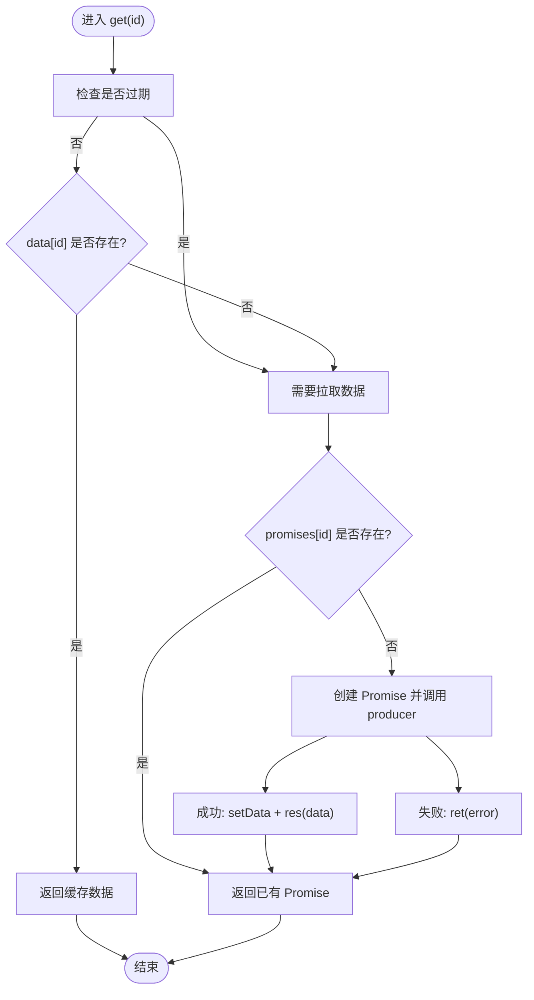
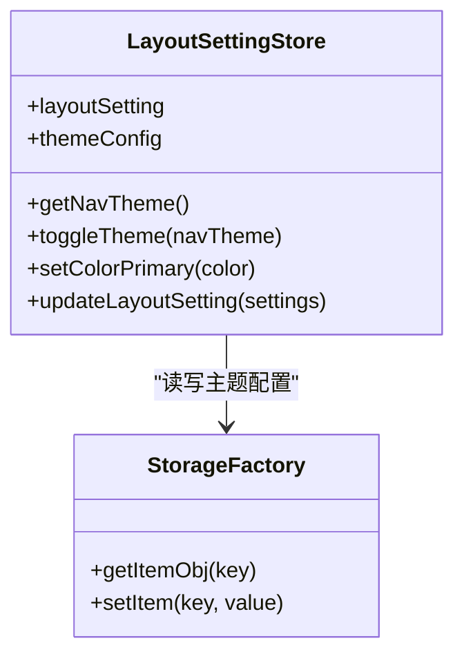
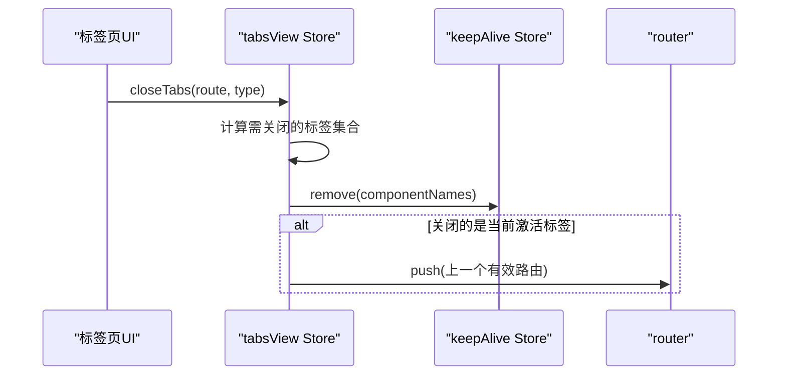
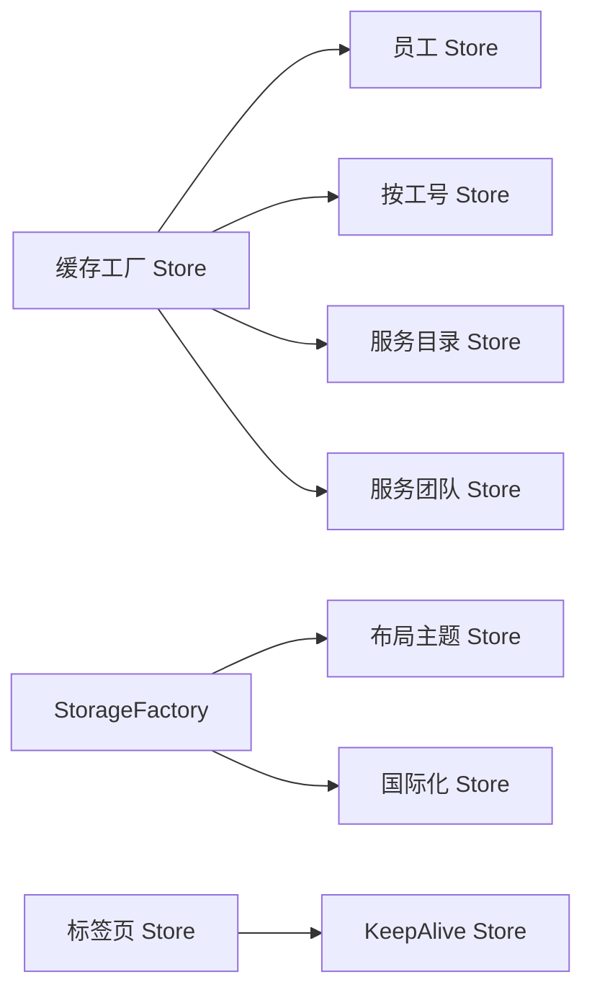

# 状态管理

<cite>
**本文引用的文件**   
- [src/stores/index.ts](file://src/stores/index.ts)
- [src/stores/modules/cache.ts](file://src/stores/modules/cache.ts)
- [src/stores/modules/employee.ts](file://src/stores/modules/employee.ts)
- [src/stores/modules/employeeByItcode.ts](file://src/stores/modules/employeeByItcode.ts)
- [src/stores/modules/serviceCatalog.ts](file://src/stores/modules/serviceCatalog.ts)
- [src/stores/modules/serviceTeam.ts](file://src/stores/modules/serviceTeam.ts)
- [src/stores/modules/layoutSetting.ts](file://src/stores/modules/layoutSetting.ts)
- [src/stores/modules/locale.ts](file://src/stores/modules/locale.ts)
- [src/stores/modules/tabsView.ts](file://src/stores/modules/tabsView.ts)
- [src/stores/modules/keepAlive.ts](file://src/stores/modules/keepAlive.ts)
- [src/utils/storage.ts](file://src/utils/storage.ts)
- [src/enums/cacheEnum.ts](file://src/enums/cacheEnum.ts)
</cite>

## 目录
1. [简介](#简介)
2. [项目结构](#项目结构)
3. [核心组件](#核心组件)
4. [架构总览](#架构总览)
5. [详细组件分析](#详细组件分析)
6. [依赖关系分析](#依赖关系分析)
7. [性能与优化](#性能与优化)
8. [调试与排错](#调试与排错)
9. [最佳实践与设计模式](#最佳实践与设计模式)
10. [结论](#结论)

## 简介
本仓库采用 Pinia 作为前端状态管理方案，围绕“按领域拆分 Store”的组织方式，结合可复用的缓存工厂、主题与语言设置持久化、标签页路由状态管理等模块，构建统一的状态中心。整体设计强调：
- 职责单一：每个 Store 聚焦一个业务域或横切关注点
- 数据流清晰：组件通过 actions/getters 访问 state，避免直接修改
- 可复用能力：通过 useCacheStore 抽象通用缓存与并发控制
- 持久化策略：基于 StorageFactory 的 localStorage 封装，配合 key 常量统一管理
- 可扩展性：新增 Store 只需遵循定义规范并导出组合式函数

## 项目结构
Pinia 相关代码集中在 src/stores 目录：
- 根入口：创建并导出 Pinia 实例
- modules：按功能拆分的 Store 实现
- 辅助工具：StorageFactory 提供带事件通知的本地存储能力
- 枚举常量：集中管理持久化键名

**图表来源**
- [src/stores/index.ts:1-6](file://src/stores/index.ts#L1-L6)
- [src/stores/modules/cache.ts:1-45](file://src/stores/modules/cache.ts#L1-L45)
- [src/stores/modules/employee.ts:1-27](file://src/stores/modules/employee.ts#L1-L27)
- [src/stores/modules/employeeByItcode.ts:1-19](file://src/stores/modules/employeeByItcode.ts#L1-L19)
- [src/stores/modules/serviceCatalog.ts:1-22](file://src/stores/modules/serviceCatalog.ts#L1-L22)
- [src/stores/modules/serviceTeam.ts:1-19](file://src/stores/modules/serviceTeam.ts#L1-L19)
- [src/stores/modules/layoutSetting.ts:1-126](file://src/stores/modules/layoutSetting.ts#L1-L126)
- [src/stores/modules/locale.ts:1-35](file://src/stores/modules/locale.ts#L1-L35)
- [src/stores/modules/tabsView.ts:1-145](file://src/stores/modules/tabsView.ts#L1-L145)
- [src/stores/modules/keepAlive.ts:1-44](file://src/stores/modules/keepAlive.ts#L1-L44)
- [src/utils/storage.ts:1-203](file://src/utils/storage.ts#L1-L203)

**章节来源**
- [src/stores/index.ts:1-6](file://src/stores/index.ts#L1-L6)

## 核心组件
- Pinia 实例：在应用启动时创建并导出，供各模块注入使用
- 缓存工厂 Store（useCacheStore）：提供通用的异步数据缓存、过期控制与并发请求去重
- 业务 Store：员工、服务目录、服务团队等，均基于缓存工厂封装
- 界面与系统 Store：布局主题、国际化、标签页、KeepAlive 等
- 存储层：StorageFactory 封装 localStorage，并提供跨标签页事件监听与合并订阅

**章节来源**
- [src/stores/index.ts:1-6](file://src/stores/index.ts#L1-L6)
- [src/stores/modules/cache.ts:1-45](file://src/stores/modules/cache.ts#L1-L45)
- [src/utils/storage.ts:1-203](file://src/utils/storage.ts#L1-L203)

## 架构总览
下图展示从组件到 Store 再到后端 API 的数据流向，以及持久化与事件同步机制。

**图表来源**
- [src/stores/modules/cache.ts:1-45](file://src/stores/modules/cache.ts#L1-L45)
- [src/stores/modules/employee.ts:1-27](file://src/stores/modules/employee.ts#L1-L27)
- [src/utils/storage.ts:1-203](file://src/utils/storage.ts#L1-L203)

## 详细组件分析

### 缓存工厂 Store（useCacheStore）
职责
- 提供统一的缓存容器 data、过期时间 expires、并发请求 promises
- 对外暴露 get(id) 方法，自动处理缓存命中、过期刷新与并发去重
- 支持自定义 producer 以接入不同后端接口

关键流程
- 首次调用：若缓存不存在或已过期，则执行 producer 拉取数据，写入 data 与 expires
- 并发保护：同一 id 的多次调用共享同一个 Promise，避免重复请求
- 返回值：返回 Promise<T>，便于组件 await 或 .then 消费

复杂度
- 时间复杂度：get 为 O(1)，producer 取决于网络 IO
- 空间复杂度：O(n) 缓存条目数

**图表来源**
- [src/stores/modules/cache.ts:11-37](file://src/stores/modules/cache.ts#L11-L37)

**章节来源**
- [src/stores/modules/cache.ts:1-45](file://src/stores/modules/cache.ts#L1-L45)

### 员工信息 Store（useEmployeeStore）
职责
- 基于 useCacheStore 封装员工详情数据的获取与缓存
- 将 EmployeeApi.one 的结果转换为标准数据结构

数据流
- 组件调用 useEmployeeStore.get(id)
- 内部调用 producer -> EmployeeApi.one(id)
- 成功后写入缓存，后续相同 id 直接命中

**章节来源**
- [src/stores/modules/employee.ts:1-27](file://src/stores/modules/employee.ts#L1-L27)

### 按工号查询 Store（useEmployeeByItcodeStore）
职责
- 基于 useCacheStore 封装按 itcode 查询员工详情的逻辑
- 对接 EmployeeApi.getEmployeeDetaillByCode

**章节来源**
- [src/stores/modules/employeeByItcode.ts:1-19](file://src/stores/modules/employeeByItcode.ts#L1-L19)

### 服务目录 Store（useServiceCatalogStore）
职责
- 基于 useCacheStore 封装服务目录单条数据获取

**章节来源**
- [src/stores/modules/serviceCatalog.ts:1-22](file://src/stores/modules/serviceCatalog.ts#L1-L22)

### 服务团队 Store（useServiceTeamStore）
职责
- 基于 useCacheStore 封装服务团队详情获取

**章节来源**
- [src/stores/modules/serviceTeam.ts:1-19](file://src/stores/modules/serviceTeam.ts#L1-L19)

### 布局主题 Store（useLayoutSettingStore）
职责
- 维护全局布局与主题配置（navTheme、colorPrimary、layout 等）
- 计算属性 getNavTheme 暴露当前导航主题
- watchPostEffect 监听 layoutSetting 变化，自动：
  - 切换文档级 dark 类名
  - 更新 antd themeConfig
  - 持久化至 localStorage

持久化
- 读取：初始化时从 StorageFactory 读取 THEME_KEY 对应对象
- 写入：watchPostEffect 中自动保存

**图表来源**
- [src/stores/modules/layoutSetting.ts:59-125](file://src/stores/modules/layoutSetting.ts#L59-L125)
- [src/utils/storage.ts:145-203](file://src/utils/storage.ts#L145-L203)

**章节来源**
- [src/stores/modules/layoutSetting.ts:1-126](file://src/stores/modules/layoutSetting.ts#L1-L126)
- [src/utils/storage.ts:1-203](file://src/utils/storage.ts#L1-L203)
- [src/enums/cacheEnum.ts:1-16](file://src/enums/cacheEnum.ts#L1-L16)

### 国际化 Store（useLocaleStore）
职责
- 维护当前语言 locale，并提供 setLocale 动作
- 初始化时从 StorageFactory 读取 LOCALE_KEY，变更时同步持久化

**章节来源**
- [src/stores/modules/locale.ts:1-35](file://src/stores/modules/locale.ts#L1-L35)
- [src/utils/storage.ts:1-203](file://src/utils/storage.ts#L1-L203)
- [src/enums/cacheEnum.ts:1-16](file://src/enums/cacheEnum.ts#L1-L16)

### 标签页 Store（useTabsViewStore）
职责
- 管理多标签页列表 tabsList，提供添加、关闭（左/右/其他/当前/全部）、更新标题等方法
- 与 KeepAlive Store 联动，关闭标签时移除对应组件缓存
- 计算属性：
  - getTabsList：过滤 hideInTabs 且存在的路由
  - getCurrentTab：根据当前路由匹配激活标签

交互流程
- 关闭标签前，收集被关路由对应的组件名称，调用 keepAliveStore.remove 清理缓存
- 关闭当前标签后，若该标签为激活项，则跳转到上一个有效标签

**图表来源**
- [src/stores/modules/tabsView.ts:30-89](file://src/stores/modules/tabsView.ts#L30-L89)
- [src/stores/modules/keepAlive.ts:13-36](file://src/stores/modules/keepAlive.ts#L13-L36)

**章节来源**
- [src/stores/modules/tabsView.ts:1-145](file://src/stores/modules/tabsView.ts#L1-L145)
- [src/stores/modules/keepAlive.ts:1-44](file://src/stores/modules/keepAlive.ts#L1-L44)

### KeepAlive Store（useKeepAliveStore）
职责
- 维护需要缓存的组件名列表 list
- 提供 add/remove/clear 动作，用于与标签页协同管理组件缓存

**章节来源**
- [src/stores/modules/keepAlive.ts:1-44](file://src/stores/modules/keepAlive.ts#L1-L44)

## 依赖关系分析
- 所有业务 Store（employee、employeeByItcode、serviceCatalog、serviceTeam）都依赖缓存工厂 Store
- 布局主题 Store 与国际化 Store 依赖 StorageFactory 进行持久化
- 标签页 Store 依赖 KeepAlive Store 进行组件缓存清理
- 所有持久化 key 集中在 cacheEnum.ts 中管理，避免硬编码

**图表来源**
- [src/stores/modules/cache.ts:1-45](file://src/stores/modules/cache.ts#L1-L45)
- [src/stores/modules/employee.ts:1-27](file://src/stores/modules/employee.ts#L1-L27)
- [src/stores/modules/employeeByItcode.ts:1-19](file://src/stores/modules/employeeByItcode.ts#L1-L19)
- [src/stores/modules/serviceCatalog.ts:1-22](file://src/stores/modules/serviceCatalog.ts#L1-L22)
- [src/stores/modules/serviceTeam.ts:1-19](file://src/stores/modules/serviceTeam.ts#L1-L19)
- [src/stores/modules/layoutSetting.ts:1-126](file://src/stores/modules/layoutSetting.ts#L1-L126)
- [src/stores/modules/locale.ts:1-35](file://src/stores/modules/locale.ts#L1-L35)
- [src/stores/modules/tabsView.ts:1-145](file://src/stores/modules/tabsView.ts#L1-L145)
- [src/stores/modules/keepAlive.ts:1-44](file://src/stores/modules/keepAlive.ts#L1-L44)
- [src/utils/storage.ts:1-203](file://src/utils/storage.ts#L1-L203)

**章节来源**
- [src/enums/cacheEnum.ts:1-16](file://src/enums/cacheEnum.ts#L1-L16)

## 性能与优化
- 并发请求去重：useCacheStore 对同一 id 的请求仅发起一次，减少网络压力
- 缓存过期控制：默认 10 分钟过期，可按需调整 expire 策略
- 响应式最小化：仅在必要时更新 reactive 数据，避免不必要的重渲染
- 主题/语言持久化：通过 watchPostEffect 自动落盘，避免重复 IO
- 标签页与 KeepAlive 联动：关闭标签即清理组件缓存，降低内存占用

[本节为通用指导，不直接分析具体文件]

## 调试与排错
常见问题与建议
- 缓存未生效或重复请求
  - 检查 producer 是否正确返回 Promise 且 resolve 数据
  - 确认 get(id) 的 id 一致性与大小写敏感
  - 查看并发请求是否被正确去重（promises 表）
- 主题/语言未持久化
  - 确认 StorageFactory 可用且 localStorage 未被禁用
  - 检查 THEME_KEY / LOCALE_KEY 是否与枚举一致
- 标签页关闭后页面跳转异常
  - 确认关闭当前标签后是否有上一个有效路由
  - 核对 keepAliveStore.remove 是否传入正确的组件名
- 跨标签页状态不同步
  - 利用 StorageFactory 的事件机制（onChange/uplinkEvent）监听 storage 变更
  - 确保多个标签页共享同一 StorageFactory 实例

**章节来源**
- [src/stores/modules/cache.ts:11-37](file://src/stores/modules/cache.ts#L11-L37)
- [src/stores/modules/layoutSetting.ts:87-96](file://src/stores/modules/layoutSetting.ts#L87-L96)
- [src/stores/modules/locale.ts:23-27](file://src/stores/modules/locale.ts#L23-L27)
- [src/stores/modules/tabsView.ts:30-89](file://src/stores/modules/tabsView.ts#L30-L89)
- [src/utils/storage.ts:44-70](file://src/utils/storage.ts#L44-L70)

## 最佳实践与设计模式
- 领域驱动拆分 Store：每个 Store 负责一个业务域或横切关注点，保持高内聚低耦合
- 组合式 Store 工厂：通过 useCacheStore 抽象通用能力，提升复用性
- 明确数据边界：state 只读，变更通过 actions；计算属性 getters 派生状态
- 持久化键集中管理：使用 cacheEnum.ts 统一管理 key，避免散落的字符串常量
- 副作用与视图解耦：主题切换、语言切换等副作用在 Store 内完成，组件仅触发 actions
- 错误处理前置：在 producer 中对接口返回做统一校验与抛错，保证上层一致性

[本节为通用指导，不直接分析具体文件]

## 结论
本项目基于 Pinia 构建了清晰、可扩展的状态管理体系：通过缓存工厂统一数据获取与缓存策略，结合主题、语言、标签页等 Store 覆盖常见场景，并以 StorageFactory 提供稳定的持久化与事件同步能力。遵循上述最佳实践，可在保证性能的同时提升可维护性与可测试性。