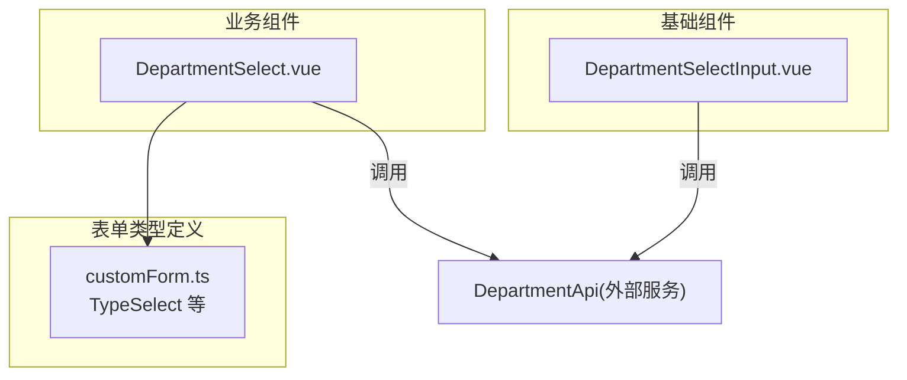
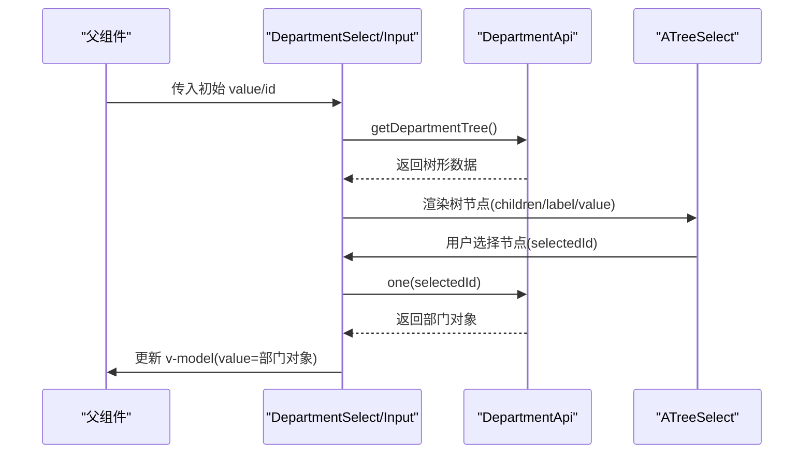
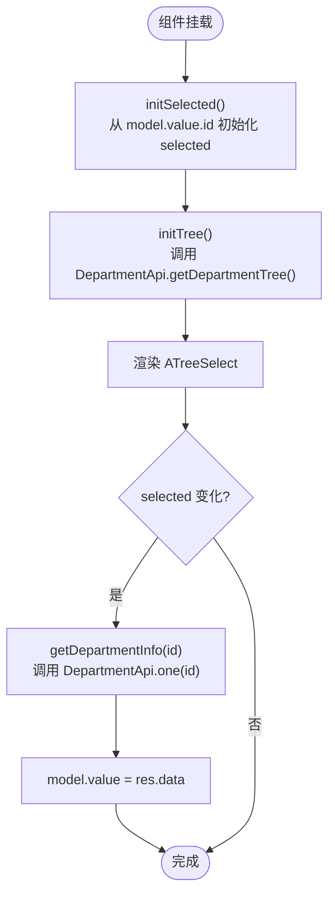
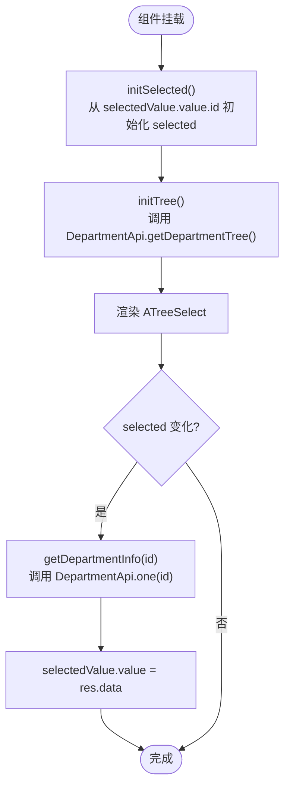
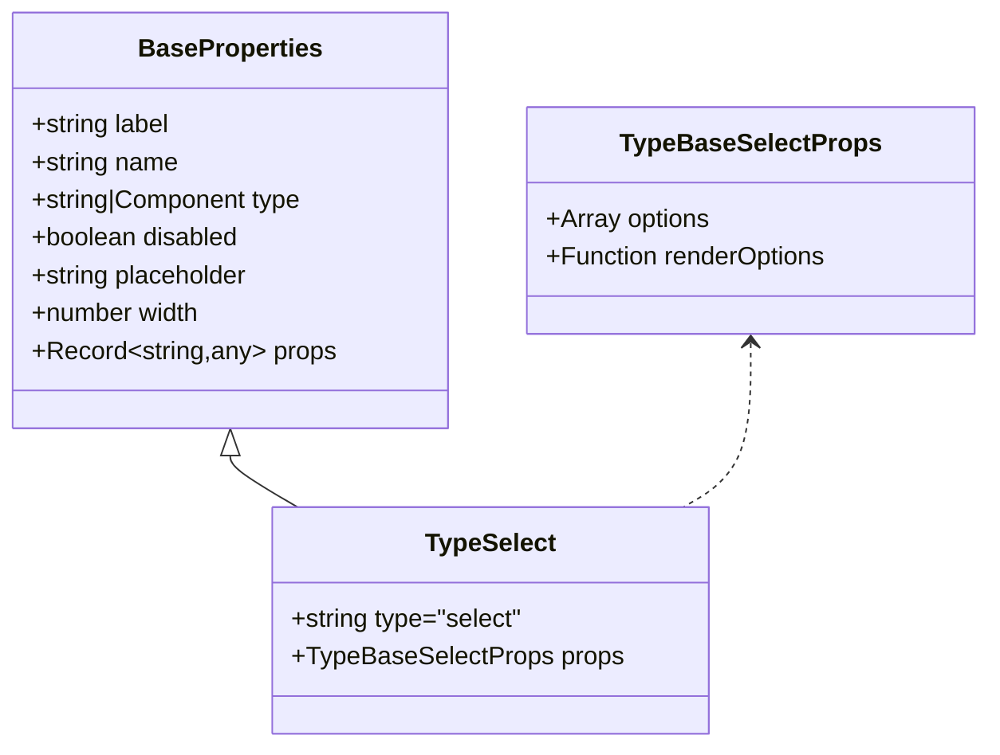
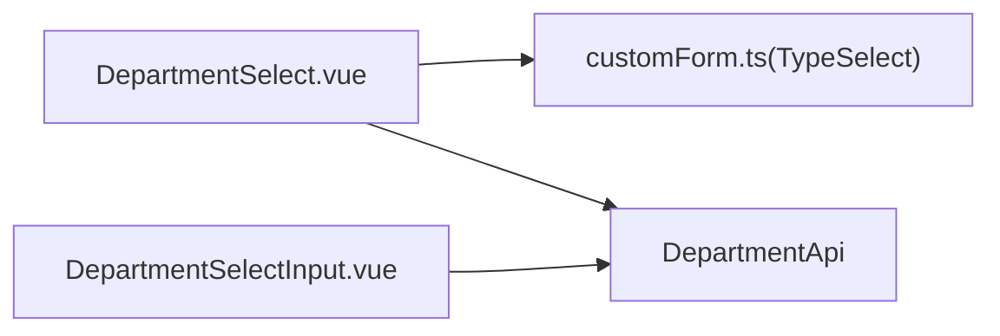

# 业务组件

<cite>
**本文引用的文件**   
- [DepartmentSelect.vue](file://src/components/business/custom-form/DepartmentSelect.vue)
- [DepartmentSelectInput.vue](file://src/components/basic/select/DepartmentSelectInput.vue)
- [customForm.ts](file://src/components/basic/custom-form/customForm.ts)
</cite>

## 目录
1. [简介](#简介)
2. [项目结构](#项目结构)
3. [核心组件](#核心组件)
4. [架构总览](#架构总览)
5. [详细组件分析](#详细组件分析)
6. [依赖关系分析](#依赖关系分析)
7. [性能与可维护性](#性能与可维护性)
8. [故障排查指南](#故障排查指南)
9. [结论](#结论)
10. [附录：使用示例与扩展方法](#附录使用示例与扩展方法)

## 简介
本章节聚焦医疗业务领域的部门选择类业务组件，重点说明 DepartmentSelect 部门选择器（面向自定义表单）与 DepartmentSelectInput 基础选择器的功能特性、数据绑定方式、业务逻辑封装、与后端服务的集成方式、数据验证规则与错误处理机制。同时提供组合模式、扩展方法与典型业务场景的应用示例，帮助读者快速在医疗业务中复用并扩展部门选择能力。

## 项目结构
围绕部门选择相关代码，主要涉及以下位置：
- 业务层组件：src/components/business/custom-form/DepartmentSelect.vue
- 基础层组件：src/components/basic/select/DepartmentSelectInput.vue
- 自定义表单类型定义：src/components/basic/custom-form/customForm.ts

图表来源
- [DepartmentSelect.vue:1-64](file://src/components/business/custom-form/DepartmentSelect.vue#L1-L64)
- [DepartmentSelectInput.vue:1-66](file://src/components/basic/select/DepartmentSelectInput.vue#L1-L66)
- [customForm.ts:71-90](file://src/components/basic/custom-form/customForm.ts#L71-L90)

章节来源
- [DepartmentSelect.vue:1-64](file://src/components/business/custom-form/DepartmentSelect.vue#L1-L64)
- [DepartmentSelectInput.vue:1-66](file://src/components/basic/select/DepartmentSelectInput.vue#L1-L66)
- [customForm.ts:71-90](file://src/components/basic/custom-form/customForm.ts#L71-L90)

## 核心组件
- DepartmentSelect：面向自定义表单的部门选择器，基于 TypeSelect 配置驱动渲染，支持搜索、清空、下拉宽度匹配、后缀图标、列表高度等属性透传；内部加载部门树并双向绑定选中项对象。
- DepartmentSelectInput：通用基础部门选择器，固定展示样式，支持搜索与清空，通过 v-model 双向绑定选中项对象。

两者均：
- 初始化时从父级或模型读取已选 id 并同步到内部状态
- 监听内部选中值变化，调用后端接口获取完整部门对象并回写模型
- 组件挂载时请求部门树数据，映射为 Ant Design Vue TreeSelect 所需格式

章节来源
- [DepartmentSelect.vue:1-64](file://src/components/business/custom-form/DepartmentSelect.vue#L1-L64)
- [DepartmentSelectInput.vue:1-66](file://src/components/basic/select/DepartmentSelectInput.vue#L1-L66)

## 架构总览
部门选择组件采用“视图层 + 数据层”解耦设计：
- 视图层：Ant Design Vue 的 ATreeSelect 作为 UI 控件
- 数据层：通过 DepartmentApi 提供的 getDepartmentTree 与 one 方法分别获取部门树与单个部门详情
- 双向绑定：组件内部维护 selected 键值，并通过 defineModel 将完整部门对象暴露给父组件

图表来源
- [DepartmentSelect.vue:16-40](file://src/components/business/custom-form/DepartmentSelect.vue#L16-L40)
- [DepartmentSelectInput.vue:17-41](file://src/components/basic/select/DepartmentSelectInput.vue#L17-L41)

## 详细组件分析

### DepartmentSelect（业务表单专用）
- 数据绑定
  - 通过 defineModel('value', { type: Object }) 与父组件双向绑定完整部门对象
  - 内部 selected 仅保存 key(id)，用于 ATreeSelect 的值绑定
- 初始化流程
  - initSelected：从 model.value.id 初始化 selected
  - initTree：调用 DepartmentApi.getDepartmentTree 获取树数据并赋值给 treeData
- 交互与更新
  - watch selected 变化：当选中不为空时调用 DepartmentApi.one(id) 拉取完整部门信息并写回 model.value
- 属性透传
  - 基于 formItem.props 透传给 ATreeSelect：showSearch、allowClear、placement、dropdownMatchSelectWidth、suffixIcon、listHeight 等
- 错误处理
  - 对接口调用进行 catch 捕获，当前实现为空处理，未向上抛出错误

图表来源
- [DepartmentSelect.vue:11-40](file://src/components/business/custom-form/DepartmentSelect.vue#L11-L40)

章节来源
- [DepartmentSelect.vue:1-64](file://src/components/business/custom-form/DepartmentSelect.vue#L1-L64)

### DepartmentSelectInput（基础通用）
- 数据绑定
  - 通过 defineModel({ type: Object }) 双向绑定完整部门对象
  - 内部 selected 保存 key(id)
- 初始化与交互
  - initSelected：从 selectedValue.value.id 初始化 selected
  - initTree：调用 DepartmentApi.getDepartmentTree 获取树数据
  - watch selected：非空时调用 DepartmentApi.one(id) 并将结果写回 selectedValue.value
- 展示控制
  - 固定 allow-clear、showSearch=true
  - 通过 props.dropdownMatchSelectWidth 控制下拉宽度（默认 300）

图表来源
- [DepartmentSelectInput.vue:12-41](file://src/components/basic/select/DepartmentSelectInput.vue#L12-L41)

章节来源
- [DepartmentSelectInput.vue:1-66](file://src/components/basic/select/DepartmentSelectInput.vue#L1-L66)

### 自定义表单类型定义（TypeSelect）
- TypeSelect 定义了 select 类型表单的配置结构，包含 label、name、type、disabled、placeholder、width、props 等基础属性
- props 中包含 showSearch、placement、allowClear、dropdownMatchSelectWidth、suffixIcon、listHeight、mode、maxTagCount 等，供 DepartmentSelect 透传给 ATreeSelect

图表来源
- [customForm.ts:3-11](file://src/components/basic/custom-form/customForm.ts#L3-L11)
- [customForm.ts:66-90](file://src/components/basic/custom-form/customForm.ts#L66-L90)

章节来源
- [customForm.ts:3-11](file://src/components/basic/custom-form/customForm.ts#L3-L11)
- [customForm.ts:66-90](file://src/components/basic/custom-form/customForm.ts#L66-L90)

## 依赖关系分析
- 组件对外依赖
  - Ant Design Vue 的 ATreeSelect 组件
  - DepartmentApi（来自 services/tenant/department/department），提供 getDepartmentTree 与 one 两个关键方法
- 组件间关系
  - DepartmentSelect 依赖 customForm.ts 中的 TypeSelect 类型以接收表单配置
  - 两个组件均独立封装了树数据加载与详情拉取逻辑，耦合度低，便于复用

图表来源
- [DepartmentSelect.vue:1-64](file://src/components/business/custom-form/DepartmentSelect.vue#L1-L64)
- [DepartmentSelectInput.vue:1-66](file://src/components/basic/select/DepartmentSelectInput.vue#L1-L66)
- [customForm.ts:71-90](file://src/components/basic/custom-form/customForm.ts#L71-L90)

章节来源
- [DepartmentSelect.vue:1-64](file://src/components/business/custom-form/DepartmentSelect.vue#L1-L64)
- [DepartmentSelectInput.vue:1-66](file://src/components/basic/select/DepartmentSelectInput.vue#L1-L66)
- [customForm.ts:71-90](file://src/components/basic/custom-form/customForm.ts#L71-L90)

## 性能与可维护性
- 性能
  - 树数据仅在组件挂载时请求一次，避免重复网络开销
  - 选中变更时按需拉取单条详情，减少不必要的数据传输
  - 建议：若部门树规模较大，可在上层缓存树数据，或在组件内增加防抖与本地缓存策略
- 可维护性
  - 通过 TypeSelect 统一表单配置，降低 UI 差异带来的维护成本
  - 两个组件职责清晰：基础组件负责通用交互，业务组件负责表单适配与属性透传
- 可扩展性
  - 可通过扩展 formItem.props 新增更多 ATreeSelect 属性，如过滤函数、禁用节点等
  - 建议在 DepartmentApi 层统一错误码与异常处理，组件层只做最小化展示

[本节为通用指导，不直接分析具体文件]

## 故障排查指南
- 常见问题
  - 部门树为空：检查 DepartmentApi.getDepartmentTree 是否成功返回数据，确认字段映射 children/label/value 是否与后端一致
  - 选中后无详情：确认 DepartmentApi.one(id) 能正确返回部门对象，且 model.value 被正确更新
  - 下拉宽度异常：检查 dropdownMatchSelectWidth 配置是否正确传入
- 错误处理现状
  - 组件中对接口失败进行了 catch 捕获，但当前未做进一步提示或重试，建议在业务层增加错误提示与重试机制
- 调试建议
  - 在 watch selected 与 initTree 处添加日志，观察数据流
  - 校验 model.value 与 selected 的一致性，确保 id 与对象同步

章节来源
- [DepartmentSelect.vue:16-40](file://src/components/business/custom-form/DepartmentSelect.vue#L16-L40)
- [DepartmentSelectInput.vue:17-41](file://src/components/basic/select/DepartmentSelectInput.vue#L17-L41)

## 结论
DepartmentSelect 与 DepartmentSelectInput 提供了稳定、易用的部门选择能力，适用于医疗业务中的科室/部门选择场景。通过 TypeSelect 配置驱动与 DepartmentApi 服务解耦，组件具备良好的可复用性与扩展性。建议在现有基础上完善错误处理与缓存策略，进一步提升用户体验与系统稳定性。

[本节为总结性内容，不直接分析具体文件]

## 附录：使用示例与扩展方法

### 在自定义表单中使用 DepartmentSelect
- 配置 formItem.type 为 'select'，并在 props 中按需设置 showSearch、allowClear、placement、dropdownMatchSelectWidth、suffixIcon、listHeight 等
- 通过 v-model:value 绑定一个对象，组件会在选中后自动填充完整部门信息

参考路径
- [DepartmentSelect.vue:43-60](file://src/components/business/custom-form/DepartmentSelect.vue#L43-L60)
- [customForm.ts:71-90](file://src/components/basic/custom-form/customForm.ts#L71-L90)

### 直接使用 DepartmentSelectInput
- 通过 v-model 绑定对象，组件会自动加载树并支持搜索与清空
- 可通过 props.dropdownMatchSelectWidth 调整下拉宽度

参考路径
- [DepartmentSelectInput.vue:44-60](file://src/components/basic/select/DepartmentSelectInput.vue#L44-L60)

### 组合模式与扩展方法
- 组合模式
  - 在表单页面中组合多个业务组件（如员工选择、部门选择），统一通过 store 或响应式变量管理状态
- 扩展方法
  - 扩展 formItem.props 以支持更多 ATreeSelect 特性（如禁用某些节点、自定义过滤）
  - 在 DepartmentApi 层增加缓存与重试逻辑，组件层保持简洁

[本节为概念性指导，不直接分析具体文件]