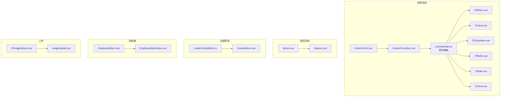
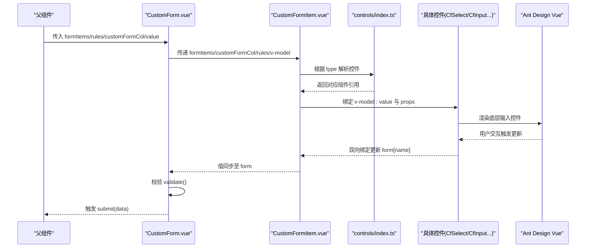
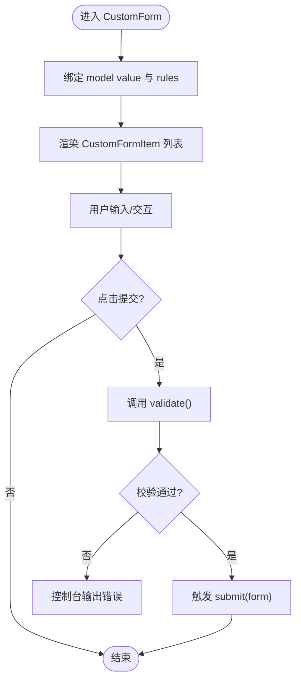
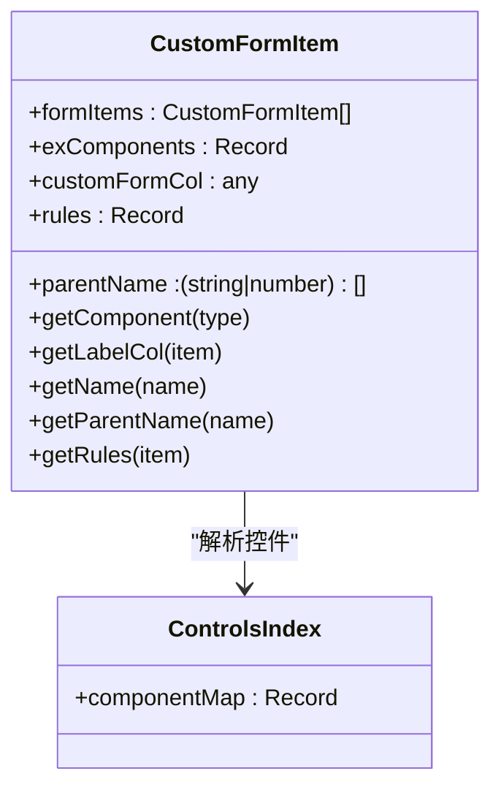
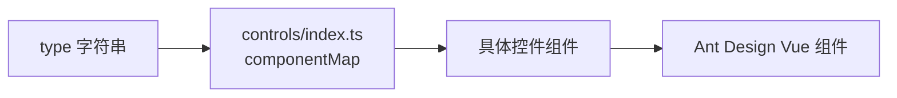
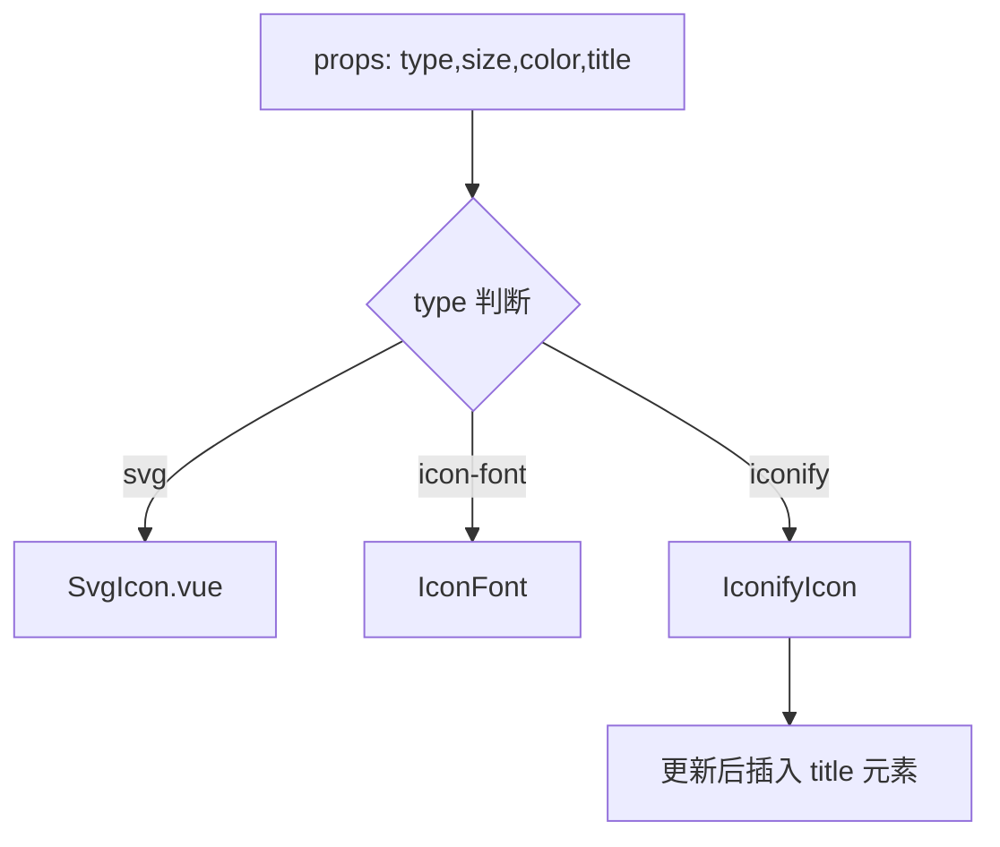
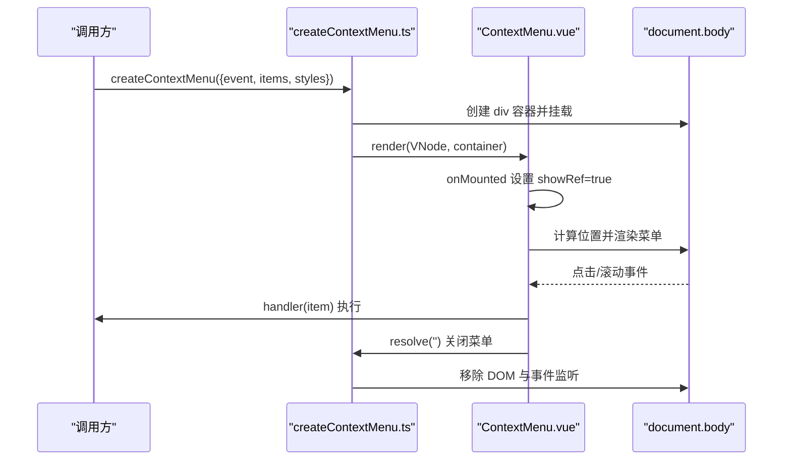
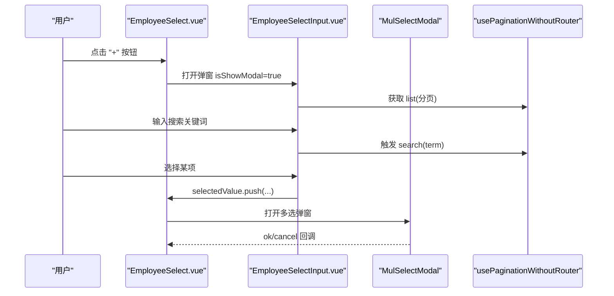
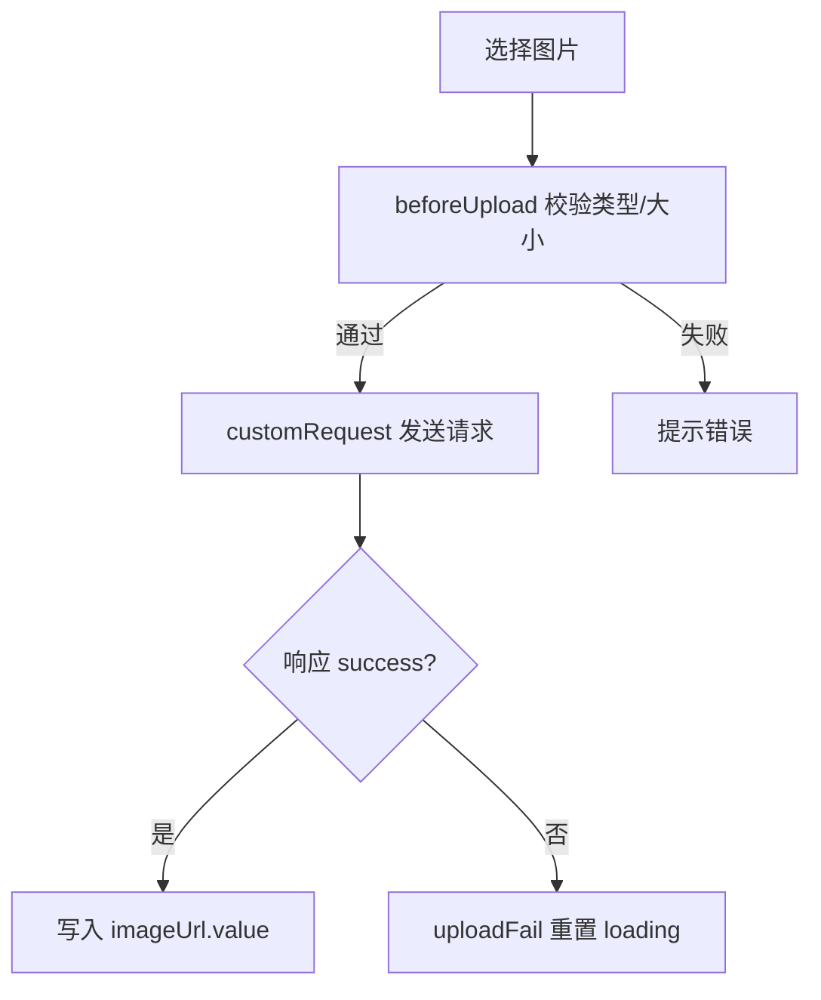
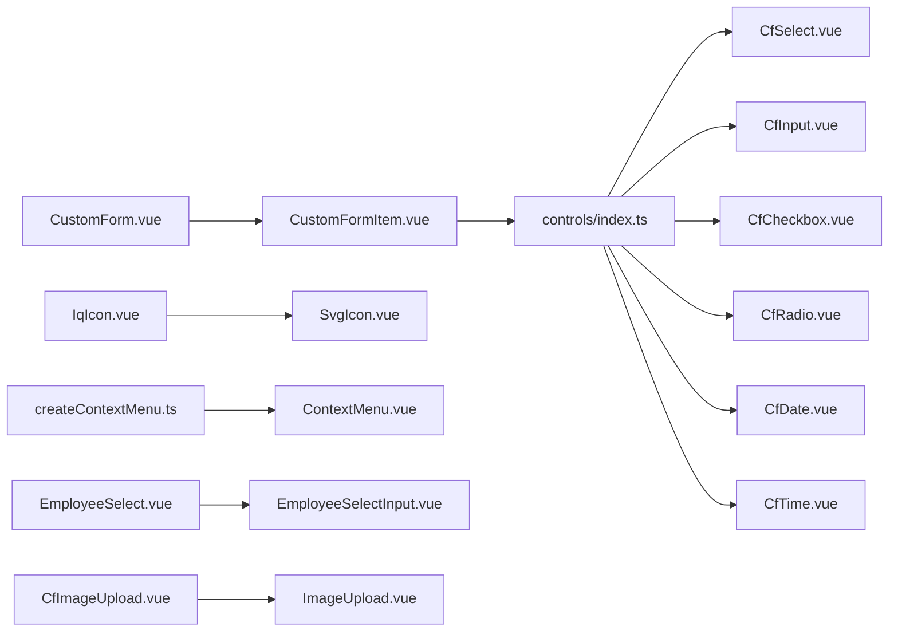

# 基础组件

<cite>
**本文引用的文件**   
- [CustomForm.vue](file://src/components/basic/custom-form/CustomForm.vue)
- [CustomFormItem.vue](file://src/components/basic/custom-form/CustomFormItem.vue)
- [customForm.ts](file://src/components/basic/custom-form/customForm.ts)
- [controls/index.ts](file://src/components/basic/custom-form/controls/index.ts)
- [CfSelect.vue](file://src/components/basic/custom-form/controls/CfSelect.vue)
- [CfInput.vue](file://src/components/basic/custom-form/controls/CfInput.vue)
- [CfCheckbox.vue](file://src/components/basic/custom-form/controls/CfCheckbox.vue)
- [CfRadio.vue](file://src/components/basic/custom-form/controls/CfRadio.vue)
- [CfDate.vue](file://src/components/basic/custom-form/controls/CfDate.vue)
- [CfTime.vue](file://src/components/basic/custom-form/controls/CfTime.vue)
- [IqIcon.vue](file://src/components/basic/icon/IqIcon.vue)
- [SvgIcon.vue](file://src/components/basic/icon/src/SvgIcon.vue)
- [ContextMenu.vue](file://src/components/basic/context-menu/src/ContextMenu.vue)
- [createContextMenu.ts](file://src/components/basic/context-menu/src/createContextMenu.ts)
- [EmployeeSelect.vue](file://src/components/basic/select/EmployeeSelect.vue)
- [EmployeeSelectInput.vue](file://src/components/basic/select/EmployeeSelectInput.vue)
- [CfImageUpload.vue](file://src/components/basic/upload/CfImageUpload.vue)
- [ImageUpload.vue](file://src/components/basic/upload/ImageUpload.vue)
</cite>

## 目录
1. [简介](#简介)
2. [项目结构](#项目结构)
3. [核心组件](#核心组件)
4. [架构总览](#架构总览)
5. [详细组件分析](#详细组件分析)
6. [依赖关系分析](#依赖关系分析)
7. [性能与可访问性](#性能与可访问性)
8. [故障排查指南](#故障排查指南)
9. [结论](#结论)

## 简介
本文件系统化梳理并文档化基础 UI 组件，包括：
- CustomForm 表单体系（表单容器、动态表单项、控件映射）
- IqIcon 图标组件（统一图标入口）
- ContextMenu 右键菜单组件（程序化创建与渲染）
- 选择器组件（员工多选/搜索）
- 上传组件（图片上传封装）

内容涵盖 API、属性配置、事件处理、插槽使用、样式定制、响应式适配、可访问性支持、组合使用场景与性能优化建议。

## 项目结构
基础组件按功能域组织在 src/components/basic 下：
- custom-form：表单容器与动态表单项、控件映射
- icon：图标统一入口与 SVG 图标实现
- context-menu：右键菜单组件与程序化创建工具
- select：业务选择器（以员工为例）
- upload：图片上传封装

图表来源
- [CustomForm.vue:1-76](file://src/components/basic/custom-form/CustomForm.vue#L1-L76)
- [CustomFormItem.vue:1-112](file://src/components/basic/custom-form/CustomFormItem.vue#L1-L112)
- [controls/index.ts:1-45](file://src/components/basic/custom-form/controls/index.ts#L1-L45)
- [CfSelect.vue:1-58](file://src/components/basic/custom-form/controls/CfSelect.vue#L1-L58)
- [CfInput.vue:1-23](file://src/components/basic/custom-form/controls/CfInput.vue#L1-L23)
- [CfCheckbox.vue:1-42](file://src/components/basic/custom-form/controls/CfCheckbox.vue#L1-L42)
- [CfRadio.vue:1-45](file://src/components/basic/custom-form/controls/CfRadio.vue#L1-L45)
- [CfDate.vue:1-26](file://src/components/basic/custom-form/controls/CfDate.vue#L1-L26)
- [CfTime.vue:1-36](file://src/components/basic/custom-form/controls/CfTime.vue#L1-L36)
- [IqIcon.vue:1-59](file://src/components/basic/icon/IqIcon.vue#L1-L59)
- [SvgIcon.vue:1-34](file://src/components/basic/icon/src/SvgIcon.vue#L1-L34)
- [ContextMenu.vue:1-210](file://src/components/basic/context-menu/src/ContextMenu.vue#L1-L210)
- [createContextMenu.ts:1-78](file://src/components/basic/context-menu/src/createContextMenu.ts#L1-L78)
- [EmployeeSelect.vue:1-78](file://src/components/basic/select/EmployeeSelect.vue#L1-L78)
- [EmployeeSelectInput.vue:1-176](file://src/components/basic/select/EmployeeSelectInput.vue#L1-L176)
- [CfImageUpload.vue:1-14](file://src/components/basic/upload/CfImageUpload.vue#L1-L14)
- [ImageUpload.vue:1-95](file://src/components/basic/upload/ImageUpload.vue#L1-L95)

章节来源
- [CustomForm.vue:1-76](file://src/components/basic/custom-form/CustomForm.vue#L1-L76)
- [CustomFormItem.vue:1-112](file://src/components/basic/custom-form/CustomFormItem.vue#L1-L112)
- [controls/index.ts:1-45](file://src/components/basic/custom-form/controls/index.ts#L1-L45)

## 核心组件
- CustomForm：表单容器，负责校验、提交、布局列宽、按钮插槽等
- CustomFormItem：根据 formItems 动态渲染具体控件，支持分组、数组、标题、分割线等
- IqIcon：统一图标入口，支持 Iconify、SVG、IconFont 三种模式
- ContextMenu：右键菜单，支持层级、分隔符、禁用、自定义样式与定位
- EmployeeSelect / EmployeeSelectInput：人员多选与搜索，支持弹窗选择与下拉选择
- CfImageUpload / ImageUpload：图片上传封装，含类型与大小校验、自定义请求

章节来源
- [CustomForm.vue:1-76](file://src/components/basic/custom-form/CustomForm.vue#L1-L76)
- [CustomFormItem.vue:1-112](file://src/components/basic/custom-form/CustomFormItem.vue#L1-L112)
- [IqIcon.vue:1-59](file://src/components/basic/icon/IqIcon.vue#L1-L59)
- [ContextMenu.vue:1-210](file://src/components/basic/context-menu/src/ContextMenu.vue#L1-L210)
- [EmployeeSelect.vue:1-78](file://src/components/basic/select/EmployeeSelect.vue#L1-L78)
- [EmployeeSelectInput.vue:1-176](file://src/components/basic/select/EmployeeSelectInput.vue#L1-L176)
- [CfImageUpload.vue:1-14](file://src/components/basic/upload/CfImageUpload.vue#L1-L14)
- [ImageUpload.vue:1-95](file://src/components/basic/upload/ImageUpload.vue#L1-L95)

## 架构总览
下图展示表单系统的渲染流程与数据流向：

图表来源
- [CustomForm.vue:33-42](file://src/components/basic/custom-form/CustomForm.vue#L33-L42)
- [CustomFormItem.vue:21-32](file://src/components/basic/custom-form/CustomFormItem.vue#L21-L32)
- [controls/index.ts:23-44](file://src/components/basic/custom-form/controls/index.ts#L23-L44)
- [CfSelect.vue:35-54](file://src/components/basic/custom-form/controls/CfSelect.vue#L35-L54)
- [CfInput.vue:9-19](file://src/components/basic/custom-form/controls/CfInput.vue#L9-L19)

## 详细组件分析

### CustomForm 表单容器
- 作用
  - 提供统一的表单校验与提交流程
  - 管理 label/wrapper 列宽与按钮区域
  - 暴露 submit 事件，透传表单值
- 关键属性
  - submitTitle：提交按钮文案
  - formItems：表单项配置数组
  - disabled：全局禁用
  - rules：校验规则对象
  - customFormCol：布局列配置（labelCol/wrapperCol/btnWrapperCol）
- 事件
  - submit：校验通过后触发，携带表单值
- 插槽
  - btn：自定义按钮区域（默认包含“保存”和“返回”）
- 内部逻辑要点
  - 使用 AForm 的 validate 进行校验
  - 通过 CustomFormItem 渲染所有表单项
  - 默认列布局来自 formCol['column4']

图表来源
- [CustomForm.vue:33-42](file://src/components/basic/custom-form/CustomForm.vue#L33-L42)
- [CustomForm.vue:45-72](file://src/components/basic/custom-form/CustomForm.vue#L45-L72)

章节来源
- [CustomForm.vue:10-23](file://src/components/basic/custom-form/CustomForm.vue#L10-L23)
- [CustomForm.vue:33-42](file://src/components/basic/custom-form/CustomForm.vue#L33-L42)
- [CustomForm.vue:45-72](file://src/components/basic/custom-form/CustomForm.vue#L45-L72)

### CustomFormItem 动态表单项
- 作用
  - 根据 formItems 动态渲染具体控件
  - 支持 group/arrayMultiple/title/divider 等特殊项
  - 合并父级 rules 与 item.rules
  - 计算 labelCol span，支持 title/divider 全宽
- 关键属性
  - formItems：表单项配置数组
  - exComponents：扩展控件映射
  - customFormCol：布局列配置
  - rules：校验规则对象
  - parentName：嵌套字段路径
- 渲染策略
  - 普通项：AFormItem + component(:is=控件)
  - 特殊项：group/arrayMultiple 占满整行；title/divider 不显示标签
- 名称与规则推导
  - getName/getParentName：构建嵌套字段名
  - getRules：优先使用 item.rules，其次 rules[item.name]

图表来源
- [CustomFormItem.vue:21-32](file://src/components/basic/custom-form/CustomFormItem.vue#L21-L32)
- [CustomFormItem.vue:37-63](file://src/components/basic/custom-form/CustomFormItem.vue#L37-L63)
- [CustomFormItem.vue:65-108](file://src/components/basic/custom-form/CustomFormItem.vue#L65-L108)
- [controls/index.ts:23-44](file://src/components/basic/custom-form/controls/index.ts#L23-L44)

章节来源
- [CustomFormItem.vue:10-16](file://src/components/basic/custom-form/CustomFormItem.vue#L10-L16)
- [CustomFormItem.vue:21-32](file://src/components/basic/custom-form/CustomFormItem.vue#L21-L32)
- [CustomFormItem.vue:37-63](file://src/components/basic/custom-form/CustomFormItem.vue#L37-L63)
- [CustomFormItem.vue:65-108](file://src/components/basic/custom-form/CustomFormItem.vue#L65-L108)

### 控件映射与常用控件
- 控件映射
  - controls/index.ts 维护 type -> Component 的映射表，支持 checkbox/date/input/number/radio/select/switch/text/password/textarea/dateRange/time/timeRange/slider/rate/group/arrayMultiple/divider/title
- 常用控件
  - CfSelect：支持 options/renderOptions、search、placement、mode、maxTagCount 等
  - CfInput：支持 maxLength/showCount/allowClear/prefix/suffix
  - CfCheckbox：支持 options/renderOptions
  - CfRadio：支持 options/renderOptions/buttonStyle/size/optionType
  - CfDate：支持 picker/format/showTime/valueFormat/placement/allowClear/inputReadOnly
  - CfTime：支持 format/disabled/inputReadOnly/allowClear/clearIcon/clearText/hideDisabledOptions/hourStep/minuteStep/renderExtraFooter/secondStep/showNow/suffixIcon/use12Hours/valueFormat/disabledHours/Minutes/Seconds

图表来源
- [controls/index.ts:23-44](file://src/components/basic/custom-form/controls/index.ts#L23-L44)
- [CfSelect.vue:35-54](file://src/components/basic/custom-form/controls/CfSelect.vue#L35-L54)
- [CfInput.vue:9-19](file://src/components/basic/custom-form/controls/CfInput.vue#L9-L19)
- [CfCheckbox.vue:33-38](file://src/components/basic/custom-form/controls/CfCheckbox.vue#L33-L38)
- [CfRadio.vue:33-41](file://src/components/basic/custom-form/controls/CfRadio.vue#L33-L41)
- [CfDate.vue:10-22](file://src/components/basic/custom-form/controls/CfDate.vue#L10-L22)
- [CfTime.vue:10-32](file://src/components/basic/custom-form/controls/CfTime.vue#L10-L32)

章节来源
- [controls/index.ts:1-45](file://src/components/basic/custom-form/controls/index.ts#L1-L45)
- [CfSelect.vue:1-58](file://src/components/basic/custom-form/controls/CfSelect.vue#L1-L58)
- [CfInput.vue:1-23](file://src/components/basic/custom-form/controls/CfInput.vue#L1-L23)
- [CfCheckbox.vue:1-42](file://src/components/basic/custom-form/controls/CfCheckbox.vue#L1-L42)
- [CfRadio.vue:1-45](file://src/components/basic/custom-form/controls/CfRadio.vue#L1-L45)
- [CfDate.vue:1-26](file://src/components/basic/custom-form/controls/CfDate.vue#L1-L26)
- [CfTime.vue:1-36](file://src/components/basic/custom-form/controls/CfTime.vue#L1-L36)

### IqIcon 图标组件
- 作用
  - 统一图标入口，支持 Iconify、SVG、IconFont 三种渲染方式
  - 自动注入 title 以提升可访问性
- 关键属性
  - type：'iconify' | 'svg' | 'icon-font'
  - size：数字或字符串（px）
  - color：颜色
- 行为
  - svg 模式：委托 SvgIcon 渲染
  - icon-font 模式：委托 IconFont 渲染
  - iconify 模式：IconifyIcon 渲染，并在更新后插入 title 元素
- 可访问性
  - 为 svg 模式手动插入 title 标签，提升屏幕阅读器支持

图表来源
- [IqIcon.vue:11-14](file://src/components/basic/icon/IqIcon.vue#L11-L14)
- [IqIcon.vue:18-30](file://src/components/basic/icon/IqIcon.vue#L18-L30)
- [IqIcon.vue:32-38](file://src/components/basic/icon/IqIcon.vue#L32-L38)
- [IqIcon.vue:41-55](file://src/components/basic/icon/IqIcon.vue#L41-L55)
- [SvgIcon.vue:1-34](file://src/components/basic/icon/src/SvgIcon.vue#L1-L34)

章节来源
- [IqIcon.vue:1-59](file://src/components/basic/icon/IqIcon.vue#L1-L59)
- [SvgIcon.vue:1-34](file://src/components/basic/icon/src/SvgIcon.vue#L1-L34)

### ContextMenu 右键菜单
- 作用
  - 基于 Ant Design Menu 的程序化右键菜单
  - 支持层级菜单、分隔符、禁用、自定义样式与宽度
  - 自动计算位置，避免溢出视口
- 关键属性
  - width：菜单宽度
  - styles：自定义样式
  - showIcon：是否显示图标
  - axis：鼠标坐标 {x,y}
  - items：菜单项数组（支持 children、divider、disabled、hidden、handler）
- 事件
  - handler：菜单项点击回调
- 程序化创建
  - createContextMenu：在 body 挂载菜单 DOM，监听 click/scroll 关闭，返回 Promise
  - destroyContextMenu：销毁当前菜单实例

图表来源
- [createContextMenu.ts:14-69](file://src/components/basic/context-menu/src/createContextMenu.ts#L14-L69)
- [ContextMenu.vue:47-68](file://src/components/basic/context-menu/src/ContextMenu.vue#L47-L68)
- [ContextMenu.vue:70-88](file://src/components/basic/context-menu/src/ContextMenu.vue#L70-L88)
- [ContextMenu.vue:90-135](file://src/components/basic/context-menu/src/ContextMenu.vue#L90-L135)

章节来源
- [ContextMenu.vue:9-28](file://src/components/basic/context-menu/src/ContextMenu.vue#L9-L28)
- [ContextMenu.vue:47-68](file://src/components/basic/context-menu/src/ContextMenu.vue#L47-L68)
- [ContextMenu.vue:70-88](file://src/components/basic/context-menu/src/ContextMenu.vue#L70-L88)
- [ContextMenu.vue:90-135](file://src/components/basic/context-menu/src/ContextMenu.vue#L90-L135)
- [createContextMenu.ts:14-78](file://src/components/basic/context-menu/src/createContextMenu.ts#L14-L78)

### 选择器组件（EmployeeSelect / EmployeeSelectInput）
- EmployeeSelect
  - 作用：人员多选容器，展示已选人员卡片，打开弹窗选择
  - 关键属性：max、title、searchTitle、searchPlaceHolder
  - 插槽：item（渲染每个已选人员）、left/right（弹窗左右列）
  - 事件：search（触发搜索）、cancel、ok
- EmployeeSelectInput
  - 作用：下拉选择与弹窗选择的桥接，支持搜索、上限提示、多选
  - 关键属性：dropdownMatchSelectWidth、maxLength、list
  - 模型：selectedValue（已选数组）、isShowModal、visible
  - 行为：选择达到上限时提示；搜索防抖；选项映射与选中标记

图表来源
- [EmployeeSelect.vue:16-32](file://src/components/basic/select/EmployeeSelect.vue#L16-L32)
- [EmployeeSelect.vue:35-74](file://src/components/basic/select/EmployeeSelect.vue#L35-L74)
- [EmployeeSelectInput.vue:35-55](file://src/components/basic/select/EmployeeSelectInput.vue#L35-L55)
- [EmployeeSelectInput.vue:58-65](file://src/components/basic/select/EmployeeSelectInput.vue#L58-L65)
- [EmployeeSelectInput.vue:80-98](file://src/components/basic/select/EmployeeSelectInput.vue#L80-L98)
- [EmployeeSelectInput.vue:121-166](file://src/components/basic/select/EmployeeSelectInput.vue#L121-L166)

章节来源
- [EmployeeSelect.vue:1-78](file://src/components/basic/select/EmployeeSelect.vue#L1-L78)
- [EmployeeSelectInput.vue:1-176](file://src/components/basic/select/EmployeeSelectInput.vue#L1-L176)

### 上传组件（CfImageUpload / ImageUpload）
- CfImageUpload
  - 作用：作为 CustomForm 的 imageupload 控件包装，绑定 string 值
- ImageUpload
  - 作用：图片上传封装，内置类型与大小校验、自定义请求
  - 关键属性：value（v-model）
  - 行为：beforeUpload 校验 JPG/PNG 与大小限制；customRequest 发送 FormData；成功回写 imageUrl

图表来源
- [CfImageUpload.vue:5-10](file://src/components/basic/upload/CfImageUpload.vue#L5-L10)
- [ImageUpload.vue:14-25](file://src/components/basic/upload/ImageUpload.vue#L14-L25)
- [ImageUpload.vue:26-50](file://src/components/basic/upload/ImageUpload.vue#L26-L50)
- [ImageUpload.vue:53-71](file://src/components/basic/upload/ImageUpload.vue#L53-L71)

章节来源
- [CfImageUpload.vue:1-14](file://src/components/basic/upload/CfImageUpload.vue#L1-L14)
- [ImageUpload.vue:1-95](file://src/components/basic/upload/ImageUpload.vue#L1-L95)

## 依赖关系分析
- 表单系统
  - CustomForm 依赖 CustomFormItem 与 antd Form
  - CustomFormItem 依赖 controls/index.ts 的控件映射
  - 各控件依赖 antd 对应组件
- 图标系统
  - IqIcon 依赖 SvgIcon 与 Iconify/IconFont
- 右键菜单
  - createContextMenu 依赖 ContextMenu 组件与 DOM 操作
- 选择器
  - EmployeeSelect 依赖 EmployeeSelectInput 与 MulSelectModal
  - EmployeeSelectInput 依赖 usePaginationWithoutRouter 与 Ant Design Select/Popover
- 上传
  - CfImageUpload 依赖 ImageUpload
  - ImageUpload 依赖 http 工具与 antd Upload

图表来源
- [CustomForm.vue:1-76](file://src/components/basic/custom-form/CustomForm.vue#L1-L76)
- [CustomFormItem.vue:1-112](file://src/components/basic/custom-form/CustomFormItem.vue#L1-L112)
- [controls/index.ts:1-45](file://src/components/basic/custom-form/controls/index.ts#L1-L45)
- [IqIcon.vue:1-59](file://src/components/basic/icon/IqIcon.vue#L1-L59)
- [SvgIcon.vue:1-34](file://src/components/basic/icon/src/SvgIcon.vue#L1-L34)
- [createContextMenu.ts:1-78](file://src/components/basic/context-menu/src/createContextMenu.ts#L1-L78)
- [ContextMenu.vue:1-210](file://src/components/basic/context-menu/src/ContextMenu.vue#L1-L210)
- [EmployeeSelect.vue:1-78](file://src/components/basic/select/EmployeeSelect.vue#L1-L78)
- [EmployeeSelectInput.vue:1-176](file://src/components/basic/select/EmployeeSelectInput.vue#L1-L176)
- [CfImageUpload.vue:1-14](file://src/components/basic/upload/CfImageUpload.vue#L1-L14)
- [ImageUpload.vue:1-95](file://src/components/basic/upload/ImageUpload.vue#L1-L95)

## 性能与可访问性
- 性能
  - 选择器搜索使用防抖减少频繁请求
  - 下拉选项按需渲染，空状态与加载态友好
  - 右键菜单仅在需要时挂载到 body，避免常驻开销
  - 表单校验在提交时触发，避免每次输入都校验
- 可访问性
  - IqIcon 为 svg 模式插入 title 标签，提升读屏支持
  - 表单控件遵循 Ant Design 的可访问性规范
  - 右键菜单通过键盘与鼠标交互保持一致体验
- 样式定制
  - CustomForm 支持自定义按钮插槽与列布局
  - ContextMenu 支持 width/styles 与子菜单样式覆盖
  - IqIcon 支持 size/color 与类名控制
  - 上传组件支持 picture-card 样式覆盖

[本节为通用指导，不直接分析具体文件]

## 故障排查指南
- 表单校验不生效
  - 检查 rules 是否正确传入 CustomForm 与 CustomFormItem
  - 确认表单项 name 与 rules 键一致
- 动态选项未更新
  - 对于 CfSelect/CfCheckbox/CfRadio，确保 options 或 renderOptions 正确返回
  - 若使用 renderOptions，注意异步返回的数据结构与类型
- 右键菜单不消失
  - 检查是否在点击菜单项后调用 handler 并阻止冒泡
  - 确认 createContextMenu 的 Promise resolve 被调用
- 上传失败无反馈
  - 检查 beforeUpload 的类型与大小限制
  - 确认 customRequest 的错误分支会重置 loading 并提示

章节来源
- [CustomForm.vue:33-42](file://src/components/basic/custom-form/CustomForm.vue#L33-L42)
- [CfSelect.vue:14-31](file://src/components/basic/custom-form/controls/CfSelect.vue#L14-L31)
- [CfCheckbox.vue:13-30](file://src/components/basic/custom-form/controls/CfCheckbox.vue#L13-L30)
- [CfRadio.vue:13-30](file://src/components/basic/custom-form/controls/CfRadio.vue#L13-L30)
- [ContextMenu.vue:79-88](file://src/components/basic/context-menu/src/ContextMenu.vue#L79-L88)
- [createContextMenu.ts:43-69](file://src/components/basic/context-menu/src/createContextMenu.ts#L43-L69)
- [ImageUpload.vue:14-50](file://src/components/basic/upload/ImageUpload.vue#L14-L50)

## 结论
本仓库的基础组件体系围绕“表单驱动 + 控件映射”的模式构建，配合统一的图标入口、程序化的右键菜单、业务选择器与上传封装，形成高内聚、低耦合的可复用 UI 资产。通过合理的属性配置、插槽扩展与样式定制，可在不同业务场景中快速拼装出一致的交互体验。建议在复杂表单中优先使用 CustomForm 与 CustomFormItem，结合 controls/index.ts 扩展自定义控件；在需要程序化弹出菜单时使用 createContextMenu；在选择与上传场景中复用现有封装以降低重复开发成本。