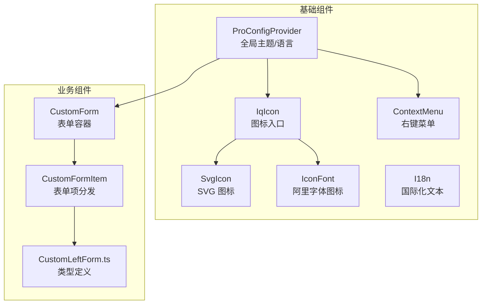
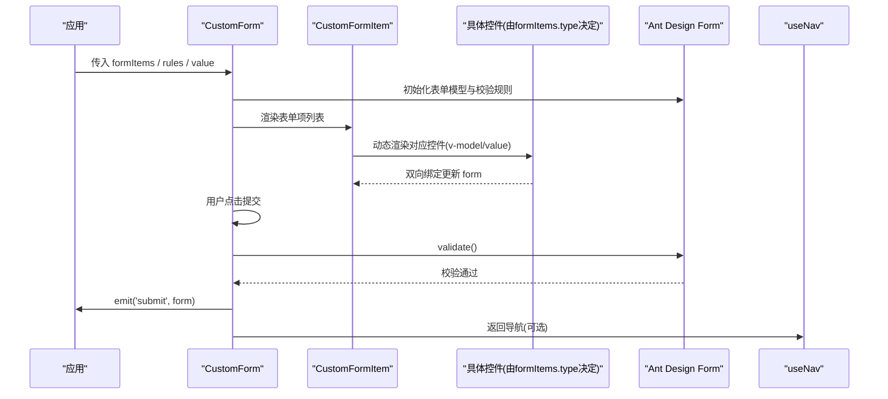
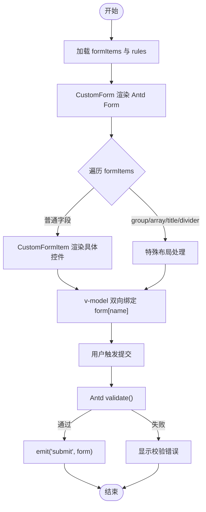
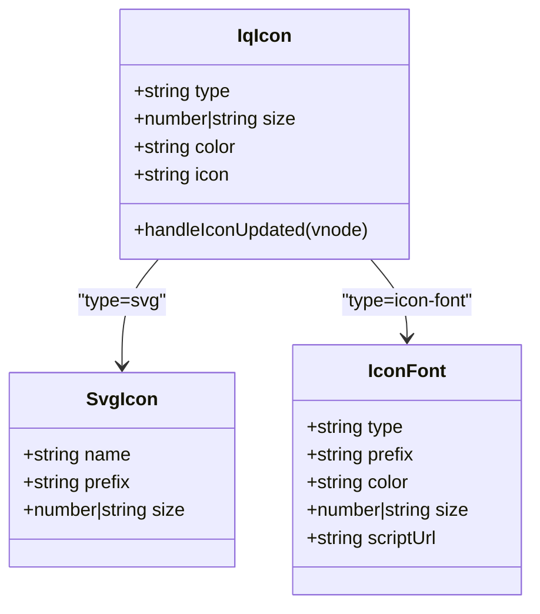
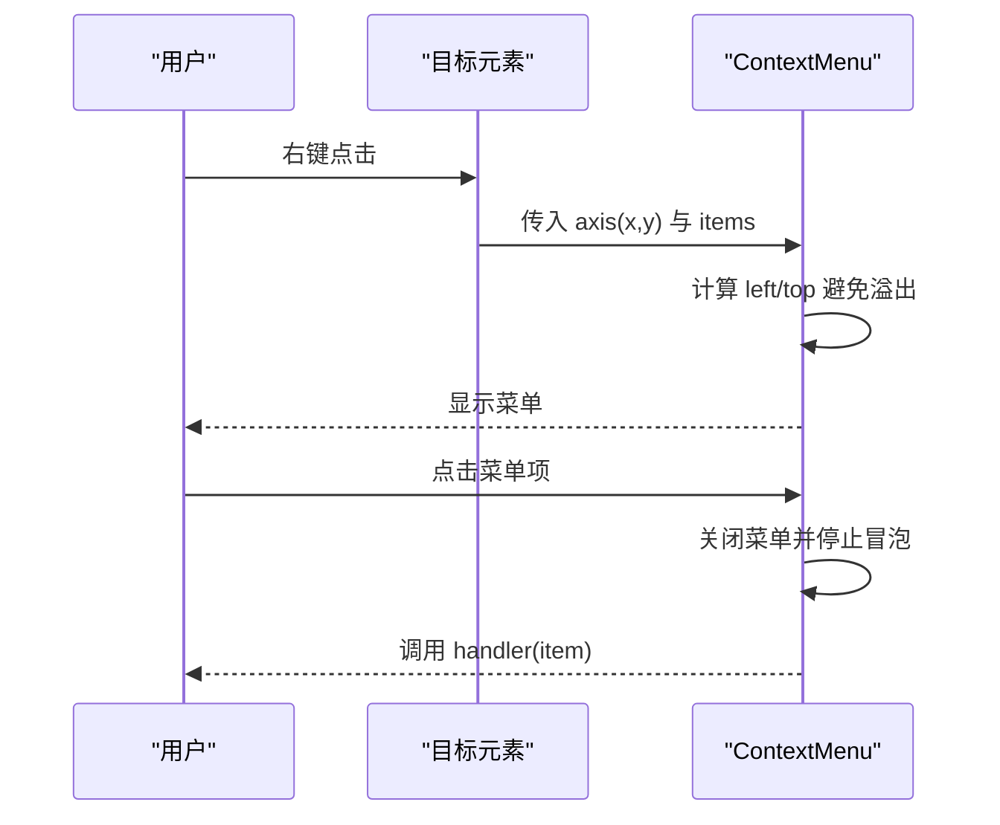
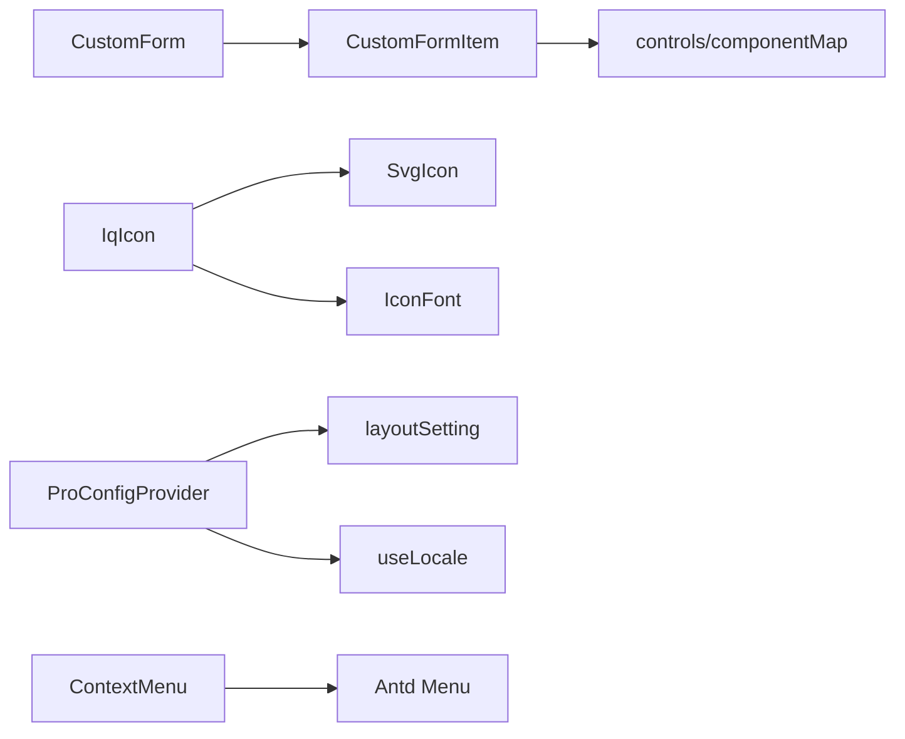

# 组件库

<cite>
**本文引用的文件**   
- [CustomForm.vue](file://src/components/basic/custom-form/CustomForm.vue)
- [CustomFormItem.vue](file://src/components/basic/custom-form/CustomFormItem.vue)
- [CustomLeftForm.ts](file://src/components/basic/custom-form/CustomLeftForm.ts)
- [IqIcon.vue](file://src/components/basic/icon/IqIcon.vue)
- [SvgIcon.vue](file://src/components/basic/icon/src/SvgIcon.vue)
- [icon-font.tsx](file://src/components/basic/icon/src/icon-font.tsx)
- [index.vue](file://src/components/basic/i18n/index.vue)
- [pro-config-provider.vue](file://src/components/basic/pro-config-provider.vue)
- [ContextMenu.vue](file://src/components/basic/context-menu/src/ContextMenu.vue)
</cite>

## 目录
1. [简介](#简介)
2. [项目结构](#项目结构)
3. [核心组件](#核心组件)
4. [架构总览](#架构总览)
5. [详细组件分析](#详细组件分析)
6. [依赖关系分析](#依赖关系分析)
7. [性能与可访问性](#性能与可访问性)
8. [故障排查指南](#故障排查指南)
9. [结论](#结论)
10. [附录：API 速查](#附录api-速查)

## 简介
本组件库基于 Vue 3 + TypeScript，围绕基础 UI、业务表单与框架级能力构建。重点覆盖：
- 基础组件：图标、国际化文本、配置提供者、右键菜单等
- 业务组件：声明式自定义表单（含动态控件、校验、布局）
- 框架组件：主题与语言全局注入、Ant Design Vue 集成

设计原则：
- 声明式优先：通过数据驱动渲染表单与菜单
- 可扩展：支持外部扩展控件、主题与国际化
- 可复用：统一布局与校验策略，减少重复代码
- 可定制：样式变量与主题配置贯穿全局

## 项目结构
组件按职责分层组织在 src/components/basic 下：
- custom-form：声明式表单容器与项分发器
- icon：统一图标入口，支持 Iconify、SVG、阿里字体图标
- i18n：国际化文案展示
- context-menu：右键上下文菜单
- pro-config-provider：全局主题与 Antd 配置

图表来源
- [IqIcon.vue:1-59](file://src/components/basic/icon/IqIcon.vue#L1-L59)
- [SvgIcon.vue:1-34](file://src/components/basic/icon/src/SvgIcon.vue#L1-L34)
- [icon-font.tsx:1-74](file://src/components/basic/icon/src/icon-font.tsx#L1-L74)
- [index.vue:1-32](file://src/components/basic/i18n/index.vue#L1-L32)
- [pro-config-provider.vue:1-40](file://src/components/basic/pro-config-provider.vue#L1-L40)
- [ContextMenu.vue:1-210](file://src/components/basic/context-menu/src/ContextMenu.vue#L1-L210)
- [CustomForm.vue:1-76](file://src/components/basic/custom-form/CustomForm.vue#L1-L76)
- [CustomFormItem.vue:1-112](file://src/components/basic/custom-form/CustomFormItem.vue#L1-L112)
- [CustomLeftForm.ts:1-129](file://src/components/basic/custom-form/CustomLeftForm.ts#L1-L129)

章节来源
- [CustomForm.vue:1-76](file://src/components/basic/custom-form/CustomForm.vue#L1-L76)
- [CustomFormItem.vue:1-112](file://src/components/basic/custom-form/CustomFormItem.vue#L1-L112)
- [CustomLeftForm.ts:1-129](file://src/components/basic/custom-form/CustomLeftForm.ts#L1-L129)
- [IqIcon.vue:1-59](file://src/components/basic/icon/IqIcon.vue#L1-L59)
- [SvgIcon.vue:1-34](file://src/components/basic/icon/src/SvgIcon.vue#L1-L34)
- [icon-font.tsx:1-74](file://src/components/basic/icon/src/icon-font.tsx#L1-L74)
- [index.vue:1-32](file://src/components/basic/i18n/index.vue#L1-L32)
- [pro-config-provider.vue:1-40](file://src/components/basic/pro-config-provider.vue#L1-L40)
- [ContextMenu.vue:1-210](file://src/components/basic/context-menu/src/ContextMenu.vue#L1-L210)

## 核心组件
- CustomForm：声明式表单容器，负责校验、提交、插槽按钮与返回导航
- CustomFormItem：根据 formItems 动态渲染具体控件，支持分组、数组、标题分隔等
- IqIcon：统一图标入口，支持 Iconify、SVG、阿里字体图标三种模式
- SvgIcon：基于 symbol 引用渲染 SVG 图标
- IconFont：基于 @ant-design/icons-vue 的字体图标封装
- I18n：多语言标题/文案展示
- ProConfigProvider：全局主题与 Antd 配置注入
- ContextMenu：右键菜单，支持层级、分割线、禁用、定位自适应

章节来源
- [CustomForm.vue:1-76](file://src/components/basic/custom-form/CustomForm.vue#L1-L76)
- [CustomFormItem.vue:1-112](file://src/components/basic/custom-form/CustomFormItem.vue#L1-L112)
- [IqIcon.vue:1-59](file://src/components/basic/icon/IqIcon.vue#L1-L59)
- [SvgIcon.vue:1-34](file://src/components/basic/icon/src/SvgIcon.vue#L1-L34)
- [icon-font.tsx:1-74](file://src/components/basic/icon/src/icon-font.tsx#L1-L74)
- [index.vue:1-32](file://src/components/basic/i18n/index.vue#L1-L32)
- [pro-config-provider.vue:1-40](file://src/components/basic/pro-config-provider.vue#L1-L40)
- [ContextMenu.vue:1-210](file://src/components/basic/context-menu/src/ContextMenu.vue#L1-L210)

## 架构总览
下图展示了组件间的调用关系与数据流向：

图表来源
- [CustomForm.vue:33-42](file://src/components/basic/custom-form/CustomForm.vue#L33-L42)
- [CustomForm.vue:45-72](file://src/components/basic/custom-form/CustomForm.vue#L45-L72)
- [CustomFormItem.vue:65-109](file://src/components/basic/custom-form/CustomFormItem.vue#L65-L109)

## 详细组件分析

### 自定义表单系统（CustomForm / CustomFormItem / CustomLeftForm.ts）
- 用途：以 JSON 配置驱动表单渲染，内置校验、布局与交互
- 关键特性：
  - 声明式 formItems 配置，支持多种控件类型与组合
  - 统一的 labelCol/wrapperCol 布局控制
  - 支持分组(group)、数组(arraySingle/arrayMultiple)、标题(title)、分隔(divider)
  - 校验规则集中管理，支持字段级覆盖
  - 提供默认提交与返回按钮，支持插槽自定义

#### API 与属性
- CustomForm
  - 属性：submitTitle、formItems、disabled、rules、customFormCol
  - 事件：submit(data)
  - 插槽：btn（用于自定义操作按钮）
  - 数据绑定：v-model:value 双向绑定表单值
- CustomFormItem
  - 属性：formItems、exComponents、customFormCol、rules、parentName
  - 行为：根据 item.type 动态选择控件；处理分组/数组/标题/分隔的特殊布局
- CustomLeftForm.ts
  - 类型定义：BaseProperties 与各 TypeXxx 接口，描述所有支持的控件类型与属性

#### 使用示例（步骤）
- 准备 formItems 配置数组，指定每个字段的 type/name/label 等
- 将 formItems 与 rules 传入 CustomForm
- 监听 submit 事件获取表单数据
- 如需自定义按钮，使用 btn 插槽替换默认提交/返回

#### 最佳实践
- 将复杂表单拆分为多个 formItems 区块，提升可读性
- 对敏感字段设置 disabled 或只读逻辑
- 使用 exComponents 注册业务专属控件，保持表单配置简洁
- 对长表单使用 column4 等布局配置，保证标签与输入对齐

#### 常见问题
- 校验不生效：检查 rules 是否按 name 正确映射，且字段名与 formItems.name 一致
- 布局错乱：确认 width 与 customFormCol.labelCol.span 配合合理
- 嵌套表单：注意 parentName 传递，确保 v-model 路径正确

图表来源
- [CustomForm.vue:33-42](file://src/components/basic/custom-form/CustomForm.vue#L33-L42)
- [CustomFormItem.vue:65-109](file://src/components/basic/custom-form/CustomFormItem.vue#L65-L109)

章节来源
- [CustomForm.vue:1-76](file://src/components/basic/custom-form/CustomForm.vue#L1-L76)
- [CustomFormItem.vue:1-112](file://src/components/basic/custom-form/CustomFormItem.vue#L1-L112)
- [CustomLeftForm.ts:1-129](file://src/components/basic/custom-form/CustomLeftForm.ts#L1-L129)

### 图标组件（IqIcon / SvgIcon / IconFont）
- 用途：统一图标入口，支持 Iconify、SVG、阿里字体图标三种渲染方式
- 关键特性：
  - IqIcon 作为门面，根据 type 分派到 SvgIcon 或 IconFont
  - SvgIcon 通过 symbol 引用渲染 SVG，支持尺寸与颜色
  - IconFont 基于 @ant-design/icons-vue，支持本地化脚本与动态 scriptUrl

#### API 与属性
- IqIcon
  - 属性：type(svg/icon-font/iconify)、size、color、icon
  - 行为：自动注入 title 以提升可访问性
- SvgIcon
  - 属性：name、prefix、size
  - 行为：计算 symbolId 并渲染 svg/use
- IconFont
  - 属性：type、prefix、color、size、scriptUrl
  - 行为：按需合并 scriptUrl，动态创建图标组件

#### 使用示例（步骤）
- 使用 IqIcon，type=iconify 时传入 icon 名称
- 使用 IqIcon，type=svg 时传入 name/prefix
- 使用 IqIcon，type=icon-font 时传入 type（阿里图标名）

#### 最佳实践
- 统一通过 IqIcon 引入，避免分散实现
- 为重要图标添加 title 属性，提升可访问性与工具提示
- 批量引入 SVG 资源时，使用 Symbol 方案减少请求

图表来源
- [IqIcon.vue:1-59](file://src/components/basic/icon/IqIcon.vue#L1-L59)
- [SvgIcon.vue:1-34](file://src/components/basic/icon/src/SvgIcon.vue#L1-L34)
- [icon-font.tsx:1-74](file://src/components/basic/icon/src/icon-font.tsx#L1-L74)

章节来源
- [IqIcon.vue:1-59](file://src/components/basic/icon/IqIcon.vue#L1-L59)
- [SvgIcon.vue:1-34](file://src/components/basic/icon/src/SvgIcon.vue#L1-L34)
- [icon-font.tsx:1-74](file://src/components/basic/icon/src/icon-font.tsx#L1-L74)

### 国际化文本（I18n）
- 用途：根据当前语言环境渲染标题或文案
- 关键特性：
  - 支持字符串或对象形式的 title，对象可按 locale 切换
  - 基于 useLocaleStore 获取当前语言

#### API 与属性
- 属性：title（string | object），必填

#### 使用示例（步骤）
- 传入字符串 title 直接渲染
- 传入对象 title，键名为语言代码，如 zh_CN/en

章节来源
- [index.vue:1-32](file://src/components/basic/i18n/index.vue#L1-L32)

### 全局配置（ProConfigProvider）
- 用途：注入 Ant Design Vue 的主题与语言，统一组件外观
- 关键特性：
  - 合并 layoutSetting.themeConfig 与 props.theme
  - 注入 getAntdLocale 语言包
  - 预设 Button 圆角等组件级样式

#### API 与属性
- 继承 Antd ConfigProvider 全部属性
- 内部 computed theme 合并顺序：layoutSetting.themeConfig -> props.theme -> components

#### 使用示例（步骤）
- 在应用根节点包裹 ProConfigProvider
- 通过 store 或 props 传入主题与语言

章节来源
- [pro-config-provider.vue:1-40](file://src/components/basic/pro-config-provider.vue#L1-L40)

### 右键菜单（ContextMenu）
- 用途：提供右键上下文菜单，支持层级、分割线、禁用、图标与自适应定位
- 关键特性：
  - 根据鼠标坐标计算菜单位置，避免溢出视口
  - 支持子菜单与分割线
  - 销毁时自动移除 DOM

#### API 与属性
- 属性：width、customEvent、styles、showIcon、axis、items
- items 结构：label、icon、handler、disabled、children、divider、hidden

#### 使用示例（步骤）
- 监听元素 oncontextmenu，阻止默认行为并传入 axis
- 传入 items 配置菜单项，handler 中执行业务逻辑

图表来源
- [ContextMenu.vue:47-88](file://src/components/basic/context-menu/src/ContextMenu.vue#L47-L88)
- [ContextMenu.vue:90-135](file://src/components/basic/context-menu/src/ContextMenu.vue#L90-L135)

章节来源
- [ContextMenu.vue:1-210](file://src/components/basic/context-menu/src/ContextMenu.vue#L1-L210)

## 依赖关系分析
- CustomForm 依赖 Ant Design Form 进行校验与渲染
- CustomFormItem 依赖 componentMap（由 controls 导出）动态渲染控件
- IqIcon 依赖 SvgIcon 与 IconFont 两种实现
- ProConfigProvider 依赖 layoutSetting 与 useLocale 注入主题与语言
- ContextMenu 依赖 Ant Design Menu 渲染菜单项

图表来源
- [CustomForm.vue:1-76](file://src/components/basic/custom-form/CustomForm.vue#L1-L76)
- [CustomFormItem.vue:1-112](file://src/components/basic/custom-form/CustomFormItem.vue#L1-L112)
- [IqIcon.vue:1-59](file://src/components/basic/icon/IqIcon.vue#L1-L59)
- [SvgIcon.vue:1-34](file://src/components/basic/icon/src/SvgIcon.vue#L1-L34)
- [icon-font.tsx:1-74](file://src/components/basic/icon/src/icon-font.tsx#L1-L74)
- [pro-config-provider.vue:1-40](file://src/components/basic/pro-config-provider.vue#L1-L40)
- [ContextMenu.vue:1-210](file://src/components/basic/context-menu/src/ContextMenu.vue#L1-L210)

章节来源
- [CustomForm.vue:1-76](file://src/components/basic/custom-form/CustomForm.vue#L1-L76)
- [CustomFormItem.vue:1-112](file://src/components/basic/custom-form/CustomFormItem.vue#L1-L112)
- [IqIcon.vue:1-59](file://src/components/basic/icon/IqIcon.vue#L1-L59)
- [SvgIcon.vue:1-34](file://src/components/basic/icon/src/SvgIcon.vue#L1-L34)
- [icon-font.tsx:1-74](file://src/components/basic/icon/src/icon-font.tsx#L1-L74)
- [pro-config-provider.vue:1-40](file://src/components/basic/pro-config-provider.vue#L1-L40)
- [ContextMenu.vue:1-210](file://src/components/basic/context-menu/src/ContextMenu.vue#L1-L210)

## 性能与可访问性
- 性能
  - 表单渲染采用动态组件，仅在需要时挂载具体控件，降低初始开销
  - 图标使用 Symbol 与 Iconify，减少网络请求与重绘
  - 右键菜单按需挂载至 body，避免频繁 DOM 操作
- 可访问性
  - IqIcon 在更新后插入 title 标签，提升屏幕阅读器支持
  - SvgIcon 使用 aria-hidden="true" 避免重复语义
  - 建议为交互元素添加 aria-label 与键盘事件支持（可在上层业务补充）

章节来源
- [IqIcon.vue:32-38](file://src/components/basic/icon/IqIcon.vue#L32-L38)
- [SvgIcon.vue:1-5](file://src/components/basic/icon/src/SvgIcon.vue#L1-L5)

## 故障排查指南
- 表单校验未触发
  - 检查 rules 是否与 formItems.name 对应
  - 确认 CustomForm 的 submit 方法被调用且 validate 成功
- 布局错位
  - 调整 customFormCol.labelCol/span 与 item.width 的关系
  - 对于 group/array 类型，宽度强制为 24，避免与其他字段混排
- 图标不显示
  - 确认 type 与 icon/name/type 参数匹配
  - 检查 SVG symbolId 是否正确拼接
- 右键菜单位置异常
  - 检查 axis 坐标是否准确传入
  - 确认菜单高度与宽度计算未溢出视口

章节来源
- [CustomForm.vue:33-42](file://src/components/basic/custom-form/CustomForm.vue#L33-L42)
- [CustomFormItem.vue:37-56](file://src/components/basic/custom-form/CustomFormItem.vue#L37-L56)
- [IqIcon.vue:18-30](file://src/components/basic/icon/IqIcon.vue#L18-L30)
- [SvgIcon.vue:15-24](file://src/components/basic/icon/src/SvgIcon.vue#L15-L24)
- [ContextMenu.vue:51-68](file://src/components/basic/context-menu/src/ContextMenu.vue#L51-L68)

## 结论
本组件库以声明式表单为核心，结合图标、国际化与全局配置，形成一套高内聚、低耦合的前端 UI 体系。通过类型化的 formItems 与统一的布局/校验策略，显著提升开发效率与一致性。同时，图标与右键菜单等基础能力为业务场景提供了稳定支撑。建议在业务层继续沉淀常用控件，并通过 exComponents 扩展机制融入表单生态。

## 附录：API 速查
- CustomForm
  - 属性：submitTitle、formItems、disabled、rules、customFormCol
  - 事件：submit(data)
  - 插槽：btn
- CustomFormItem
  - 属性：formItems、exComponents、customFormCol、rules、parentName
- IqIcon
  - 属性：type、size、color、icon
- SvgIcon
  - 属性：name、prefix、size
- IconFont
  - 属性：type、prefix、color、size、scriptUrl
- I18n
  - 属性：title
- ProConfigProvider
  - 属性：继承 Antd ConfigProvider
- ContextMenu
  - 属性：width、customEvent、styles、showIcon、axis、items

章节来源
- [CustomForm.vue:10-27](file://src/components/basic/custom-form/CustomForm.vue#L10-L27)
- [CustomFormItem.vue:10-16](file://src/components/basic/custom-form/CustomFormItem.vue#L10-L16)
- [IqIcon.vue:11-14](file://src/components/basic/icon/IqIcon.vue#L11-L14)
- [SvgIcon.vue:15-19](file://src/components/basic/icon/src/SvgIcon.vue#L15-L19)
- [icon-font.tsx:18-40](file://src/components/basic/icon/src/icon-font.tsx#L18-L40)
- [index.vue:10-16](file://src/components/basic/i18n/index.vue#L10-L16)
- [pro-config-provider.vue:14-17](file://src/components/basic/pro-config-provider.vue#L14-L17)
- [ContextMenu.vue:9-28](file://src/components/basic/context-menu/src/ContextMenu.vue#L9-L28)