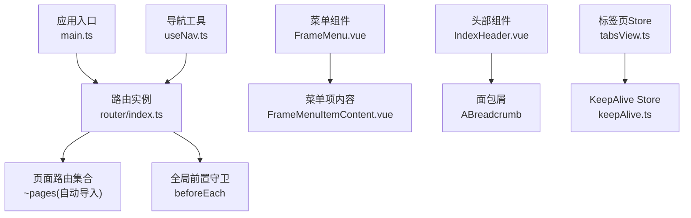
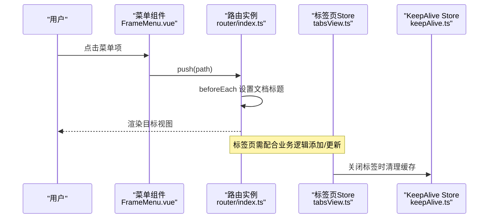
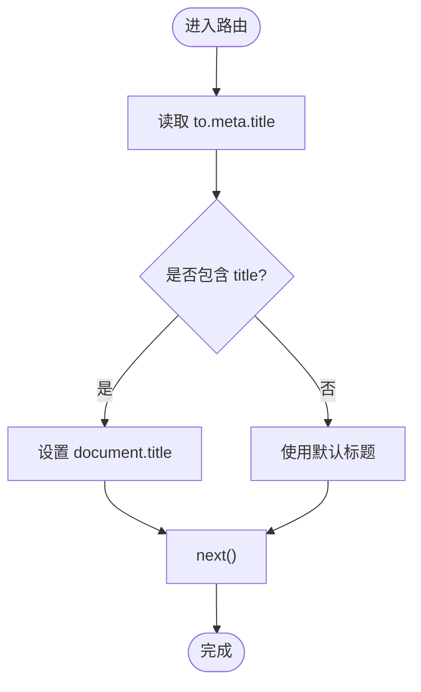
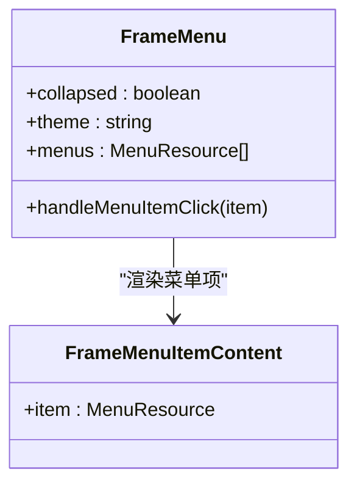
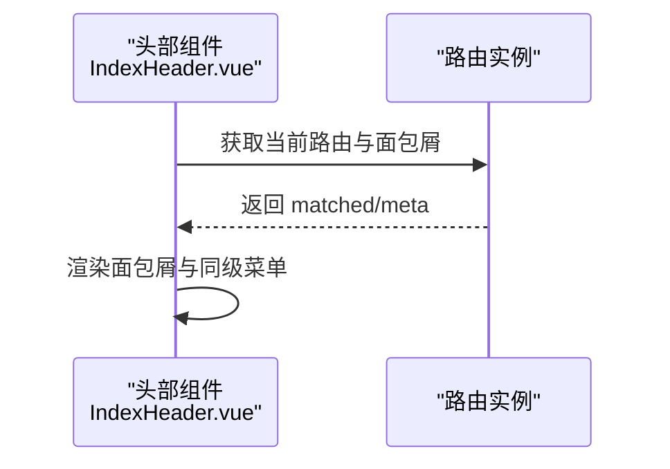
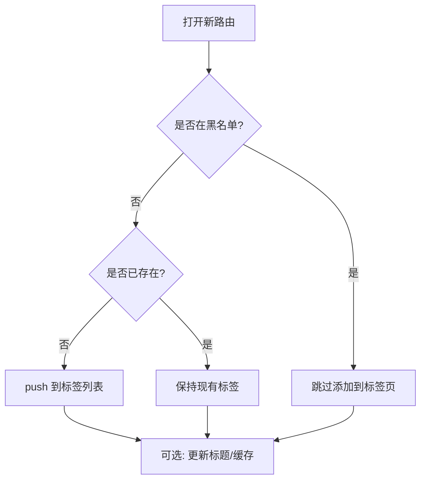
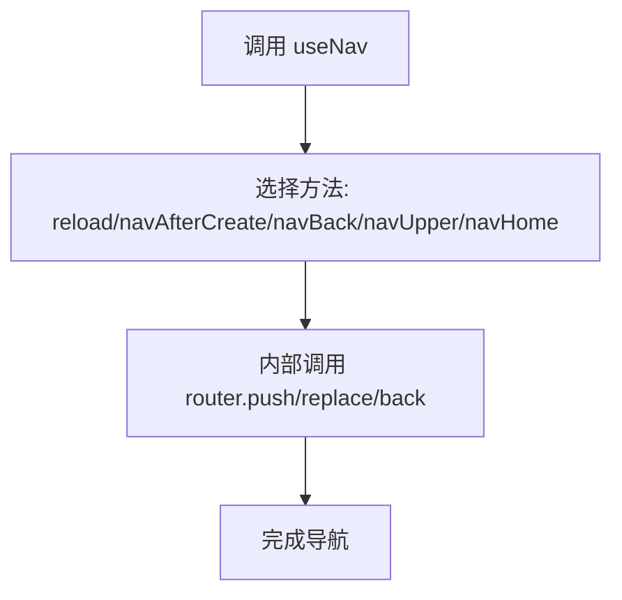
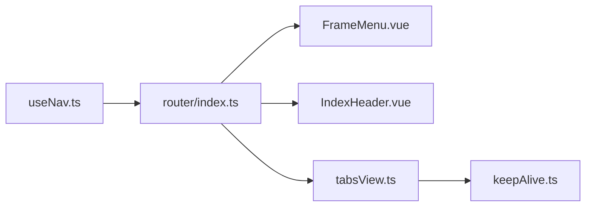

# 路由与导航

<cite>
**本文引用的文件**   
- [src/router/index.ts](file://src/router/index.ts)
- [src/services/common/useNav.ts](file://src/services/common/useNav.ts)
- [src/stores/modules/tabsView.ts](file://src/stores/modules/tabsView.ts)
- [src/components/frames/menu/FrameMenu.vue](file://src/components/frames/menu/FrameMenu.vue)
- [src/components/frames/menu/FrameMenuItemContent.vue](file://src/components/frames/menu/FrameMenuItemContent.vue)
- [src/components/frames/index/IndexHeader.vue](file://src/components/frames/index/IndexHeader.vue)
- [src/enums/cacheEnum.ts](file://src/enums/cacheEnum.ts)
- [src/stores/modules/keepAlive.ts](file://src/stores/modules/keepAlive.ts)
- [src/views/403.vue](file://src/views/403.vue)
</cite>

## 目录
1. [简介](#简介)
2. [项目结构](#项目结构)
3. [核心组件](#核心组件)
4. [架构总览](#架构总览)
5. [详细组件分析](#详细组件分析)
6. [依赖关系分析](#依赖关系分析)
7. [性能考虑](#性能考虑)
8. [故障排查指南](#故障排查指南)
9. [结论](#结论)

## 简介
本文件系统性梳理前端的路由与导航体系，覆盖以下主题：
- 路由配置结构与动态路由来源
- 导航守卫实现与页面标题控制
- 菜单系统与面包屑导航的实现原理
- 标签页导航的状态管理与生命周期
- 路由元信息、权限控制集成点与懒加载优化策略
- 导航状态管理、历史记录处理与用户体验优化方案

## 项目结构
本项目采用 Vue + Vue Router + Pinia 的组合。路由入口集中定义在 router 模块；导航相关能力通过组合式函数 useNav 暴露；菜单与面包屑位于 frames 子目录；标签页与缓存由 Pinia store 管理。

图表来源
- [src/router/index.ts:1-19](file://src/router/index.ts#L1-L19)
- [src/components/frames/menu/FrameMenu.vue:1-118](file://src/components/frames/menu/FrameMenu.vue#L1-L118)
- [src/components/frames/menu/FrameMenuItemContent.vue:1-29](file://src/components/frames/menu/FrameMenuItemContent.vue#L1-L29)
- [src/components/frames/index/IndexHeader.vue:45-118](file://src/components/frames/index/IndexHeader.vue#L45-L118)
- [src/stores/modules/tabsView.ts:1-145](file://src/stores/modules/tabsView.ts#L1-L145)
- [src/stores/modules/keepAlive.ts:1-44](file://src/stores/modules/keepAlive.ts#L1-L44)
- [src/services/common/useNav.ts:1-67](file://src/services/common/useNav.ts#L1-L67)

章节来源
- [src/router/index.ts:1-19](file://src/router/index.ts#L1-L19)
- [src/components/frames/menu/FrameMenu.vue:1-118](file://src/components/frames/menu/FrameMenu.vue#L1-L118)
- [src/components/frames/index/IndexHeader.vue:45-118](file://src/components/frames/index/IndexHeader.vue#L45-L118)
- [src/stores/modules/tabsView.ts:1-145](file://src/stores/modules/tabsView.ts#L1-L145)
- [src/stores/modules/keepAlive.ts:1-44](file://src/stores/modules/keepAlive.ts#L1-L44)
- [src/services/common/useNav.ts:1-67](file://src/services/common/useNav.ts#L1-L67)

## 核心组件
- 路由实例与全局守卫：负责历史模式、路由表注入、文档标题设置等。
- 导航工具 useNav：封装常用导航操作（重载、回退、上一级、首页）。
- 菜单 FrameMenu：侧边/顶部菜单渲染与选中态同步。
- 菜单项 FrameMenuItemContent：图标与文案展示。
- 头部 IndexHeader：面包屑与父级菜单快捷切换。
- 标签页 tabsView：标签列表、增删改查、关闭策略、持久化键。
- KeepAlive keepAlive：组件缓存白名单管理。
- 常量 cacheEnum：存储键（如标签页持久化键）集中管理。

章节来源
- [src/router/index.ts:1-19](file://src/router/index.ts#L1-L19)
- [src/services/common/useNav.ts:1-67](file://src/services/common/useNav.ts#L1-L67)
- [src/components/frames/menu/FrameMenu.vue:1-118](file://src/components/frames/menu/FrameMenu.vue#L1-L118)
- [src/components/frames/menu/FrameMenuItemContent.vue:1-29](file://src/components/frames/menu/FrameMenuItemContent.vue#L1-L29)
- [src/components/frames/index/IndexHeader.vue:45-118](file://src/components/frames/index/IndexHeader.vue#L45-L118)
- [src/stores/modules/tabsView.ts:1-145](file://src/stores/modules/tabsView.ts#L1-L145)
- [src/stores/modules/keepAlive.ts:1-44](file://src/stores/modules/keepAlive.ts#L1-L44)
- [src/enums/cacheEnum.ts:1-16](file://src/enums/cacheEnum.ts#L1-L16)

## 架构总览
下图展示了从用户交互到路由跳转、标签页更新、组件缓存的完整链路。

图表来源
- [src/components/frames/menu/FrameMenu.vue:75-82](file://src/components/frames/menu/FrameMenu.vue#L75-L82)
- [src/router/index.ts:10-18](file://src/router/index.ts#L10-L18)
- [src/stores/modules/tabsView.ts:30-41](file://src/stores/modules/tabsView.ts#L30-L41)

## 详细组件分析

### 路由配置与动态路由
- 路由实例使用 createWebHistory，并引入 ~pages 自动生成的路由表，支持按文件约定生成路由。
- 全局 beforeEach 根据 to.meta.title 设置文档标题，未设置则回退默认标题。
- 当前未实现鉴权拦截或动态路由注册，可在 beforeEach 中扩展权限校验与动态路由合并逻辑。

图表来源
- [src/router/index.ts:10-18](file://src/router/index.ts#L10-L18)

章节来源
- [src/router/index.ts:1-19](file://src/router/index.ts#L1-L19)

### 导航守卫与权限控制集成点
- 当前 beforeEach 仅处理标题，未做权限判断。建议在入口处增加：
  - 登录态校验
  - 角色/权限码校验
  - 动态路由合并（根据后端返回的菜单/资源树）
- 权限数据接口已存在（ApplicationApi.menu），可结合菜单系统实现“按需显示”和“按需访问”。

章节来源
- [src/router/index.ts:10-18](file://src/router/index.ts#L10-L18)
- [src/services/frame/application.ts:64-109](file://src/services/frame/application.ts#L64-L109)

### 菜单系统
- FrameMenu 提供侧边/水平两种模式，基于 layoutSetting 切换。
- 菜单数据目前为本地静态数组，预留了 ApplicationApi.menu 的接入位置。
- 选中态与展开态根据当前路由 path 计算，点击后调用 router.push 跳转。
- FrameMenuItemContent 统一渲染图标与描述文本。

图表来源
- [src/components/frames/menu/FrameMenu.vue:1-118](file://src/components/frames/menu/FrameMenu.vue#L1-L118)
- [src/components/frames/menu/FrameMenuItemContent.vue:1-29](file://src/components/frames/menu/FrameMenuItemContent.vue#L1-L29)

章节来源
- [src/components/frames/menu/FrameMenu.vue:1-118](file://src/components/frames/menu/FrameMenu.vue#L1-L118)
- [src/components/frames/menu/FrameMenuItemContent.vue:1-29](file://src/components/frames/menu/FrameMenuItemContent.vue#L1-L29)

### 面包屑导航
- IndexHeader 使用 ABreadcrumb 渲染面包屑，取 lastBreadcrumb.meta.title 作为显示文本。
- 当最后一个面包屑存在同级子菜单时，可通过下拉菜单快速切换同级页面。
- 面包屑路径与菜单路径联动，便于快速定位父级菜单。

图表来源
- [src/components/frames/index/IndexHeader.vue:45-118](file://src/components/frames/index/IndexHeader.vue#L45-L118)

章节来源
- [src/components/frames/index/IndexHeader.vue:45-118](file://src/components/frames/index/IndexHeader.vue#L45-L118)

### 标签页导航
- tabsView 维护标签列表，支持添加、关闭（左/右/其他/当前/全部）、更新标题等操作。
- 关闭标签时会清理对应组件的 KeepAlive 缓存，避免内存泄漏。
- 提供 blackList 过滤不需要出现在标签页中的路由。
- 提供 getTabsList 与 getCurrentTab 计算属性，用于 UI 渲染与高亮。

图表来源
- [src/stores/modules/tabsView.ts:16-55](file://src/stores/modules/tabsView.ts#L16-L55)

章节来源
- [src/stores/modules/tabsView.ts:1-145](file://src/stores/modules/tabsView.ts#L1-L145)
- [src/stores/modules/keepAlive.ts:1-44](file://src/stores/modules/keepAlive.ts#L1-L44)

### 导航工具 useNav
- 提供 reload（可替换 query 与 replace）、navAfterCreate（创建后跳转到编辑）、navBack、navUpper、navHome 等方法。
- 适用于表单提交后的导航、层级回退、回到首页等常见场景。

图表来源
- [src/services/common/useNav.ts:1-67](file://src/services/common/useNav.ts#L1-L67)

章节来源
- [src/services/common/useNav.ts:1-67](file://src/services/common/useNav.ts#L1-L67)

### 路由元信息与权限控制
- 路由元信息 meta.title 被用于设置文档标题。
- 标签页支持 meta.hideInTabs 控制是否隐藏于标签栏。
- 权限控制可扩展点：
  - 在 beforeEach 中校验用户权限，无权限跳转 403 页面。
  - 结合 ApplicationApi.menu 动态生成菜单与路由。
  - 对敏感按钮/功能进行权限码校验。

章节来源
- [src/router/index.ts:10-18](file://src/router/index.ts#L10-L18)
- [src/stores/modules/tabsView.ts:20-28](file://src/stores/modules/tabsView.ts#L20-L28)
- [src/views/403.vue:1-56](file://src/views/403.vue#L1-L56)

### 懒加载优化策略
- 路由表来自 ~pages 自动导入，通常意味着按文件分块与懒加载。
- 建议：
  - 将大组件拆分为独立文件，确保路由级懒加载生效。
  - 对非首屏模块使用异步组件或路由懒加载。
  - 合理使用 KeepAlive 缓存高频访问页面，减少重复渲染。

章节来源
- [src/router/index.ts:1-9](file://src/router/index.ts#L1-L9)
- [src/stores/modules/keepAlive.ts:1-44](file://src/stores/modules/keepAlive.ts#L1-L44)

## 依赖关系分析
- 路由层：router/index.ts 依赖 ~pages 路由表，并在 beforeEach 中读取 to.meta。
- 菜单层：FrameMenu.vue 依赖布局设置与路由，渲染菜单并触发导航。
- 头部层：IndexHeader.vue 依赖路由与菜单数据，渲染面包屑与同级菜单。
- 标签页层：tabsView.ts 依赖路由与 keepAlive store，管理标签与缓存。
- 工具层：useNav.ts 依赖 vue-router API，封装常用导航行为。

图表来源
- [src/router/index.ts:1-19](file://src/router/index.ts#L1-L19)
- [src/components/frames/menu/FrameMenu.vue:1-118](file://src/components/frames/menu/FrameMenu.vue#L1-L118)
- [src/components/frames/index/IndexHeader.vue:45-118](file://src/components/frames/index/IndexHeader.vue#L45-L118)
- [src/stores/modules/tabsView.ts:1-145](file://src/stores/modules/tabsView.ts#L1-L145)
- [src/stores/modules/keepAlive.ts:1-44](file://src/stores/modules/keepAlive.ts#L1-L44)
- [src/services/common/useNav.ts:1-67](file://src/services/common/useNav.ts#L1-L67)

章节来源
- [src/router/index.ts:1-19](file://src/router/index.ts#L1-L19)
- [src/components/frames/menu/FrameMenu.vue:1-118](file://src/components/frames/menu/FrameMenu.vue#L1-L118)
- [src/components/frames/index/IndexHeader.vue:45-118](file://src/components/frames/index/IndexHeader.vue#L45-L118)
- [src/stores/modules/tabsView.ts:1-145](file://src/stores/modules/tabsView.ts#L1-L145)
- [src/stores/modules/keepAlive.ts:1-44](file://src/stores/modules/keepAlive.ts#L1-L44)
- [src/services/common/useNav.ts:1-67](file://src/services/common/useNav.ts#L1-L67)

## 性能考虑
- 路由懒加载：利用 ~pages 自动导入的分包特性，减少首屏体积。
- 组件缓存：通过 keepAlive store 控制需要缓存的组件名称，避免频繁重建。
- 标签页清理：关闭标签时同步清理缓存，防止内存泄漏。
- 菜单渲染：菜单数据尽量扁平化与预排序，减少循环与比较开销。
- 导航节流：高频导航（如快速切换标签）可考虑防抖/节流，降低路由切换压力。

[本节为通用指导，不直接分析具体文件]

## 故障排查指南
- 文档标题未更新
  - 检查 to.meta.title 是否存在，确认 beforeEach 是否正确执行。
  - 参考：[src/router/index.ts:10-18](file://src/router/index.ts#L10-L18)
- 标签页不显示或无法关闭
  - 检查 blackList 是否误包含目标路由。
  - 检查 meta.hideInTabs 是否设置为 true。
  - 参考：[src/stores/modules/tabsView.ts:16-55](file://src/stores/modules/tabsView.ts#L16-L55)
- 关闭标签后页面仍闪烁或状态异常
  - 确认关闭标签时是否调用了 keepAlive.remove 清理缓存。
  - 参考：[src/stores/modules/tabsView.ts:30-41](file://src/stores/modules/tabsView.ts#L30-L41), [src/stores/modules/keepAlive.ts:23-33](file://src/stores/modules/keepAlive.ts#L23-L33)
- 权限不足但未被拦截
  - 在 beforeEach 中补充权限校验逻辑，无权限跳转 403。
  - 参考：[src/views/403.vue:1-56](file://src/views/403.vue#L1-L56)
- 面包屑与菜单不同步
  - 检查面包屑路径与菜单 path 的一致性，以及 lastBreadcrumb.meta.title 的取值。
  - 参考：[src/components/frames/index/IndexHeader.vue:45-118](file://src/components/frames/index/IndexHeader.vue#L45-L118)

章节来源
- [src/router/index.ts:10-18](file://src/router/index.ts#L10-L18)
- [src/stores/modules/tabsView.ts:16-55](file://src/stores/modules/tabsView.ts#L16-L55)
- [src/stores/modules/tabsView.ts:30-41](file://src/stores/modules/tabsView.ts#L30-L41)
- [src/stores/modules/keepAlive.ts:23-33](file://src/stores/modules/keepAlive.ts#L23-L33)
- [src/views/403.vue:1-56](file://src/views/403.vue#L1-L56)
- [src/components/frames/index/IndexHeader.vue:45-118](file://src/components/frames/index/IndexHeader.vue#L45-L118)

## 结论
本项目已具备基础的路由与导航能力：
- 路由实例与全局标题设置
- 菜单与面包屑的基础渲染与交互
- 标签页状态管理与缓存清理
- 导航工具封装常用操作

建议后续增强：
- 在 beforeEach 中完善鉴权与动态路由合并
- 接入 ApplicationApi.menu 实现后端驱动的菜单与权限
- 完善标签页持久化（使用 TABS_ROUTES 键）
- 持续优化懒加载与缓存策略，提升首屏与交互体验

[本节为总结性内容，不直接分析具体文件]