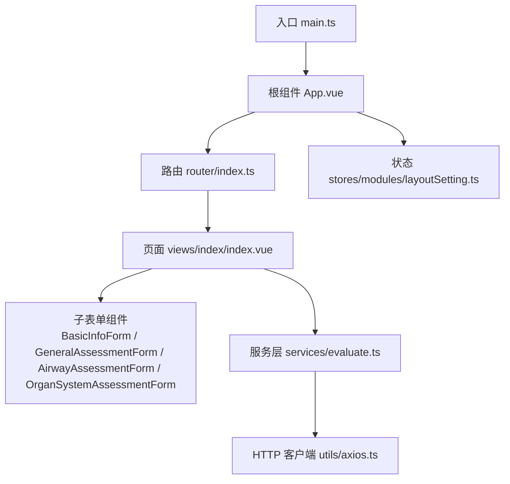
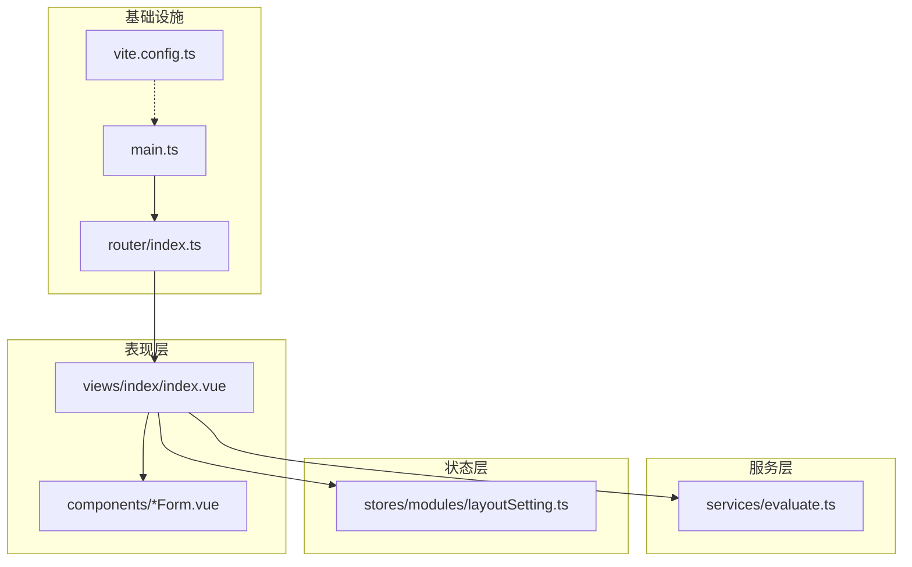
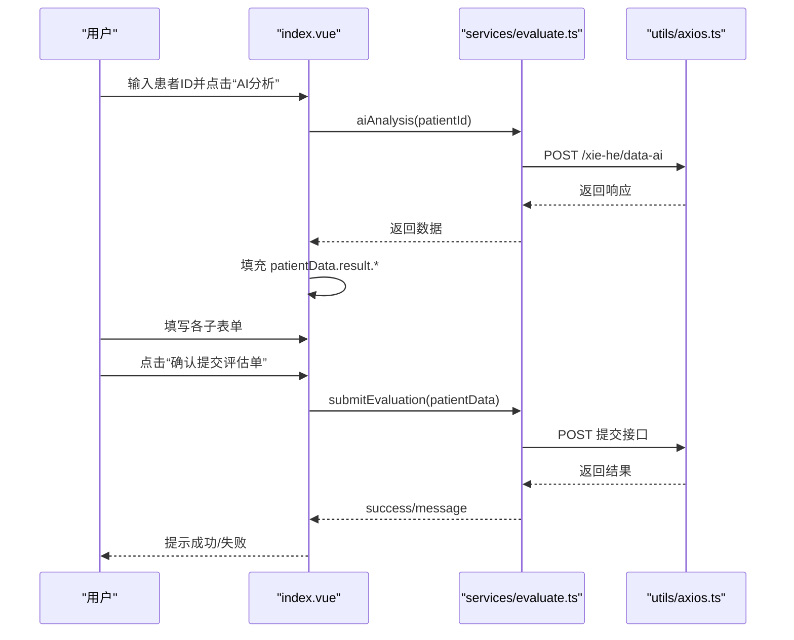
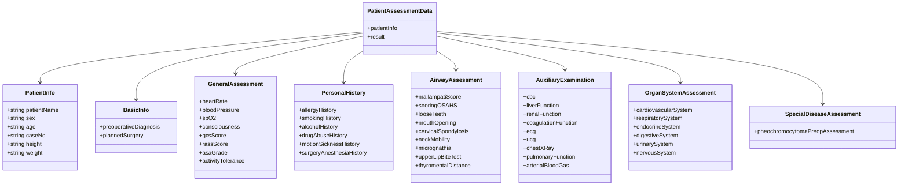
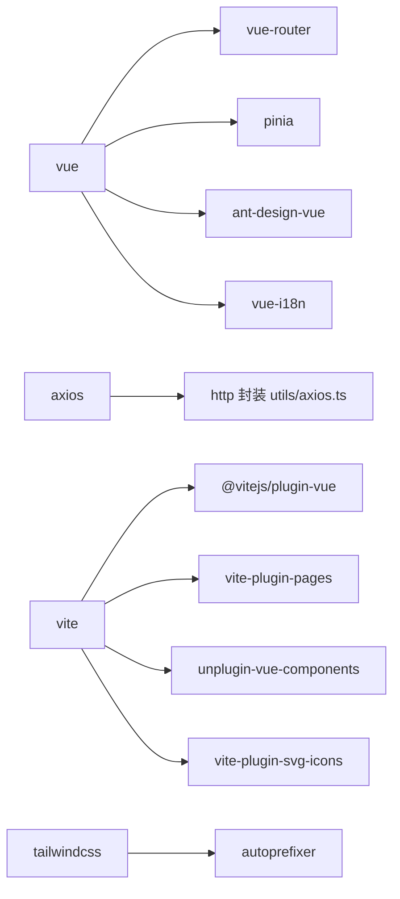

# 项目概述

<cite>
**本文引用的文件**   
- [README.md](file://README.md)
- [package.json](file://package.json)
- [vite.config.ts](file://vite.config.ts)
- [src/main.ts](file://src/main.ts)
- [src/App.vue](file://src/App.vue)
- [src/router/index.ts](file://src/router/index.ts)
- [src/views/index/index.vue](file://src/views/index/index.vue)
- [src/views/index/components/BasicInfoForm.vue](file://src/views/index/components/BasicInfoForm.vue)
- [src/views/index/components/GeneralAssessmentForm.vue](file://src/views/index/components/GeneralAssessmentForm.vue)
- [src/views/index/components/AirwayAssessmentForm.vue](file://src/views/index/components/AirwayAssessmentForm.vue)
- [src/views/index/components/OrganSystemAssessmentForm.vue](file://src/views/index/components/OrganSystemAssessmentForm.vue)
- [src/services/evaluate.ts](file://src/services/evaluate.ts)
- [src/stores/modules/layoutSetting.ts](file://src/stores/modules/layoutSetting.ts)
</cite>

## 目录
1. [引言](#引言)
2. [项目结构](#项目结构)
3. [核心组件](#核心组件)
4. [架构总览](#架构总览)
5. [详细组件分析](#详细组件分析)
6. [依赖分析](#依赖分析)
7. [性能与可维护性](#性能与可维护性)
8. [故障排查指南](#故障排查指南)
9. [结论](#结论)

## 引言
本项目为“协和麻醉科智能评估系统”的前端应用，面向麻醉科临床场景，围绕患者术前评估流程，提供结构化表单、AI辅助分析与评估单提交能力。系统以 Vue 3 + TypeScript + Vite 为核心技术栈，结合 Ant Design Vue 构建企业级界面，使用 Pinia 管理全局状态，通过路由实现页面导航，并通过服务层统一封装后端接口调用。

目标用户群体：
- 麻醉科医师与护士：完成患者基本信息采集、一般情况评估、个人史、气道评估、辅助检查、器官系统评估与专病评估等。
- 医疗信息化产品团队：基于本前端进行二次开发、集成医院信息系统（HIS/EMR）与数据中台。

核心价值：
- 标准化评估流程：将复杂医学评估拆解为多模块表单，降低遗漏风险。
- AI 辅助：根据患者ID拉取或生成评估数据，提升录入效率。
- 可配置主题与国际化：满足多科室、多环境部署需求。

## 项目结构
项目采用功能域与层次混合的组织方式：
- src/views：页面视图，按业务模块划分（如 index 下的评估主页面与各子表单）。
- src/components：基础组件与业务组件，包含通用 UI 控件、布局框架与业务复用组件。
- src/services：API 服务层，封装请求与类型定义。
- src/stores：Pinia 状态管理，包括布局设置、缓存、权限等。
- src/router：路由配置，支持自动路由与标题注入。
- src/configs、src/enums、src/locales、src/utils、src/styles：配置、枚举、国际化、工具函数与样式。

图表来源
- [src/main.ts:1-22](file://src/main.ts#L1-L22)
- [src/App.vue:1-43](file://src/App.vue#L1-L43)
- [src/router/index.ts:1-20](file://src/router/index.ts#L1-L20)
- [src/views/index/index.vue:1-800](file://src/views/index/index.vue#L1-L800)
- [src/services/evaluate.ts:459-506](file://src/services/evaluate.ts#L459-L506)
- [src/stores/modules/layoutSetting.ts:1-126](file://src/stores/modules/layoutSetting.ts#L1-L126)

章节来源
- [README.md:1-53](file://README.md#L1-L53)
- [package.json:1-76](file://package.json#L1-L76)

## 核心组件
- 应用入口与装配：main.ts 负责初始化样式、图标、i18n、Pinia、Router，并挂载到 DOM。
- 根组件：App.vue 通过 ProConfigProvider 包裹路由视图，动态注入主题 CSS 变量。
- 路由：router/index.ts 使用 vite-plugin-pages 自动生成路由，并在 beforeEach 中设置文档标题。
- 评估主页面：views/index/index.vue 聚合各子表单，处理查询参数、加载状态、AI 分析、提交逻辑与 GCS 总分计算。
- 子表单组件：BasicInfoForm、GeneralAssessmentForm、AirwayAssessmentForm、OrganSystemAssessmentForm 分别承载不同评估维度。
- 服务层：services/evaluate.ts 定义完整的数据模型、常量选项与 API 方法（提交评估、AI 分析），并提供工具函数。
- 状态管理：stores/modules/layoutSetting.ts 管理主题、布局与持久化。

章节来源
- [src/main.ts:1-22](file://src/main.ts#L1-L22)
- [src/App.vue:1-43](file://src/App.vue#L1-L43)
- [src/router/index.ts:1-20](file://src/router/index.ts#L1-L20)
- [src/views/index/index.vue:1-800](file://src/views/index/index.vue#L1-L800)
- [src/views/index/components/BasicInfoForm.vue:1-194](file://src/views/index/components/BasicInfoForm.vue#L1-L194)
- [src/views/index/components/GeneralAssessmentForm.vue:1-336](file://src/views/index/components/GeneralAssessmentForm.vue#L1-L336)
- [src/views/index/components/AirwayAssessmentForm.vue:1-349](file://src/views/index/components/AirwayAssessmentForm.vue#L1-L349)
- [src/views/index/components/OrganSystemAssessmentForm.vue:1-800](file://src/views/index/components/OrganSystemAssessmentForm.vue#L1-L800)
- [src/services/evaluate.ts:1-757](file://src/services/evaluate.ts#L1-L757)
- [src/stores/modules/layoutSetting.ts:1-126](file://src/stores/modules/layoutSetting.ts#L1-L126)

## 架构总览
系统采用典型的前端分层架构：
- 表现层（Views/Components）：Vue 单文件组件，承载交互与展示。
- 服务层（Services）：统一封装 HTTP 请求、类型定义与常量。
- 状态层（Stores）：Pinia 管理跨组件共享状态（如主题、布局）。
- 基础设施（Vite/Router/i18n/Utils）：构建、路由、国际化与工具库。

图表来源
- [src/main.ts:1-22](file://src/main.ts#L1-L22)
- [src/router/index.ts:1-20](file://src/router/index.ts#L1-L20)
- [src/views/index/index.vue:1-800](file://src/views/index/index.vue#L1-L800)
- [src/services/evaluate.ts:459-506](file://src/services/evaluate.ts#L459-L506)
- [src/stores/modules/layoutSetting.ts:1-126](file://src/stores/modules/layoutSetting.ts#L1-L126)
- [vite.config.ts:1-100](file://vite.config.ts#L1-L100)

## 详细组件分析

### 评估主页面（views/index/index.vue）
职责：
- 聚合各子表单，维护 patientData 大表单对象。
- 处理患者信息查询、AI 分析、提交评估单。
- 计算 GCS 总分并更新数据结构。

关键流程（序列图）：

图表来源
- [src/views/index/index.vue:408-521](file://src/views/index/index.vue#L408-L521)
- [src/services/evaluate.ts:471-506](file://src/services/evaluate.ts#L471-L506)

章节来源
- [src/views/index/index.vue:1-800](file://src/views/index/index.vue#L1-L800)

### 基本信息表单（BasicInfoForm.vue）
职责：
- 收集患者姓名、性别、年龄、病案号、身高、体重及术前诊断、拟行手术名称。
- 暴露 validateForm 供父组件校验。

要点：
- 使用 v-model 双向绑定至 patientData.patientInfo 与 result.basicInfo。
- 对必填字段进行本地校验，返回 { valid, message }。

章节来源
- [src/views/index/components/BasicInfoForm.vue:1-194](file://src/views/index/components/BasicInfoForm.vue#L1-L194)

### 一般情况评估（GeneralAssessmentForm.vue）
职责：
- 采集心率、血压、SpO2、意识状态、ASA分级、活动耐量。
- 支持 GCS 评分与 RASS 评分，实时计算 GCS 总分。

关键点：
- 使用 ASSESSMENT_CONSTANTS 提供下拉选项。
- 暴露 calculateGCSTotal 与 validateForm。

章节来源
- [src/views/index/components/GeneralAssessmentForm.vue:1-336](file://src/views/index/components/GeneralAssessmentForm.vue#L1-L336)
- [src/services/evaluate.ts:582-756](file://src/services/evaluate.ts#L582-L756)

### 气道评估（AirwayAssessmentForm.vue）
职责：
- 采集 Mallampati 分级、鼾症/OSAHS、松动牙齿、张口度、颈椎病、颈椎活动度、小下颌、咬上唇试验、甲颏距等。
- 暴露 validateForm 进行必填校验。

章节来源
- [src/views/index/components/AirwayAssessmentForm.vue:1-349](file://src/views/index/components/AirwayAssessmentForm.vue#L1-L349)

### 器官系统评估（OrganSystemAssessmentForm.vue）
职责：
- 覆盖心血管、呼吸、内分泌、消化、泌尿、神经系统疾病相关评估项。
- 每个子系统下细分疾病条目，提供时长、症状、用药等字段。

章节来源
- [src/views/index/components/OrganSystemAssessmentForm.vue:1-800](file://src/views/index/components/OrganSystemAssessmentForm.vue#L1-L800)

### 服务层（services/evaluate.ts）
职责：
- 定义完整的 PatientAssessmentData 数据模型及各子模块接口。
- 提供 evaluateApi.submitEvaluation 与 aiAnalysis 方法。
- 提供 ASSESSMENT_CONSTANTS 常量集与 evaluateUtils 工具函数。

数据结构类图（节选）：

图表来源
- [src/services/evaluate.ts:8-420](file://src/services/evaluate.ts#L8-L420)

章节来源
- [src/services/evaluate.ts:1-757](file://src/services/evaluate.ts#L1-L757)

## 依赖分析
- 运行时依赖：
  - vue、vue-router、pinia、ant-design-vue、axios、vue-i18n、@vueuse/core、rxjs、ramda、idb、tailwindcss 等。
- 开发依赖：
  - vite、@vitejs/plugin-vue、typescript、vue-tsc、vitest、eslint、prettier、husky、unplugin-vue-components、vite-plugin-pages、vite-plugin-svg-icons、tailwindcss、autoprefixer 等。

图表来源
- [package.json:17-68](file://package.json#L17-L68)
- [vite.config.ts:1-100](file://vite.config.ts#L1-L100)

章节来源
- [package.json:1-76](file://package.json#L1-L76)
- [vite.config.ts:1-100](file://vite.config.ts#L1-L100)

## 性能与可维护性
- 构建优化：
  - 使用 Vite 与 @vitejs/plugin-vue 获得快速热重载与按需编译。
  - unplugin-vue-components 自动解析 Ant Design Vue 组件，减少手动引入。
  - vite-plugin-pages 自动生成路由，降低维护成本。
  - vite-plugin-svg-icons 集中管理 SVG 图标，提升渲染性能。
  - PostCSS + TailwindCSS 自动化前缀与原子化样式，便于主题定制。
- 代码质量：
  - TypeScript + vue-tsc 严格类型检查，配合 ESLint + Prettier 统一风格。
  - Husky + lint-staged 在提交阶段执行格式化与校验。
- 可维护性：
  - 服务层集中管理接口与类型，视图层仅关注交互与展示。
  - 状态管理集中在 Pinia store，避免分散的状态耦合。

[本节为通用指导，不直接分析具体文件]

## 故障排查指南
常见问题与建议：
- 主题不生效或颜色异常：
  - 检查 layoutSetting store 的 themeConfig 与 colorPrimary 是否正确设置；清理 localStorage 后重试。
  - 参考 [src/stores/modules/layoutSetting.ts:72-115](file://src/stores/modules/layoutSetting.ts#L72-L115)。
- 路由标题未显示：
  - 确认路由 meta.title 已设置，且 router.beforeEach 正确注入 document.title。
  - 参考 [src/router/index.ts:10-18](file://src/router/index.ts#L10-L18)。
- AI 分析无数据或报错：
  - 检查网络代理配置（vite.config.ts server.proxy）与后端接口地址。
  - 查看 evaluateApi.aiAnalysis 的请求路径与参数。
  - 参考 [vite.config.ts:81-98](file://vite.config.ts#L81-L98)、[src/services/evaluate.ts:498-505](file://src/services/evaluate.ts#L498-L505)。
- 表单校验失败：
  - 确保各子表单 expose 了 validateForm，并在父组件中正确调用。
  - 参考各子表单的 validateForm 实现。

章节来源
- [src/stores/modules/layoutSetting.ts:72-115](file://src/stores/modules/layoutSetting.ts#L72-L115)
- [src/router/index.ts:10-18](file://src/router/index.ts#L10-L18)
- [vite.config.ts:81-98](file://vite.config.ts#L81-L98)
- [src/services/evaluate.ts:498-505](file://src/services/evaluate.ts#L498-L505)

## 结论
本项目以 Vue 3 + TypeScript + Vite 为核心，结合 Ant Design Vue 与 Pinia，构建了面向麻醉科术前评估的结构化、可配置、可扩展的前端系统。通过服务层抽象与类型驱动开发，提升了代码可读性与可维护性；借助 Vite 生态插件与 TailwindCSS，实现了高效的开发与构建体验。未来可在现有基础上扩展更多专科评估模板、对接更多外部系统与增强数据分析能力。

[本节为总结性内容，不直接分析具体文件]